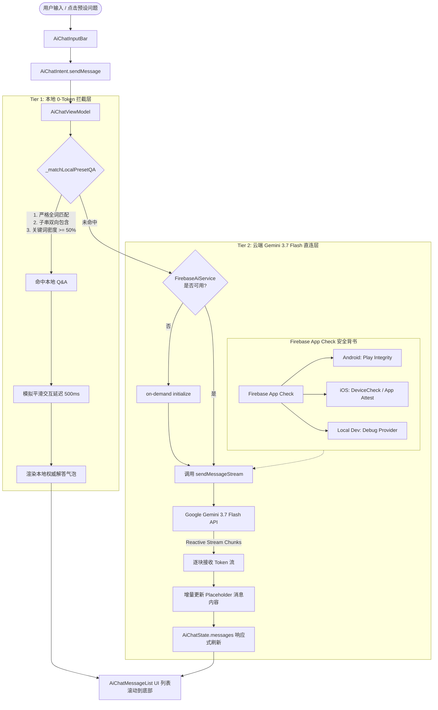
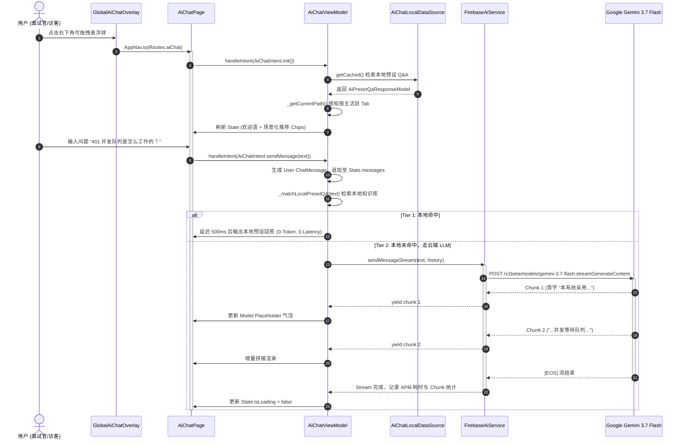

# AI Intro Assistant — 技术方案与实现架构说明书

**Status**: `Fully Implemented (Two-Tier Hybrid Architecture: Client-Direct Firebase AI SDK + App Check + In-Memory Local FAQ Cache)`  
**Current LLM Model**: `Google Gemini 3.7 Flash` (`gemini-3.7-flash`)  
**Security Attestation**: `Firebase App Check` (Play Integrity / DeviceCheck / Debug Provider)  
**State Architecture**: `Clean Architecture + MVI (Riverpod 2.x + ViewModelMixin)`  

---

## 1. 概述与设计哲学

### 1.1 产品定位与目标

**架构知识库与个人技术履历深度咨询助手**：  
面试官与技术访客在浏览候选人作品集（ListenPortfolio）时，可通过该 AI 助手实时探索本 App 的核心工程实现（如 Clean Architecture + MVI、401 并发等待与静默刷新队列、全链路 Dart Zone Tracing、APM 性能监控看板、Crash Safe Mode 熔断机制等），并能解答候选人的技术背景、项目经历与跨端全栈能力。

### 1.2 核心架构决策对比 (Core Architectural Decisions)

在方案设计初期，团队对 **“传统后端 RAG 代理架构”** 与 **“端侧直连 Firebase AI SDK 架构”** 进行了深度技术评审与权衡：

| 维度 | 方案 A：自建后端 RAG 代理网关 (Spring Boot Proxy) | 方案 B：客户端直连 Firebase AI SDK (当前落地方案) | 选型决策与理由 |
| :--- | :--- | :--- | :--- |
| **网络链路与首字延迟 (TTFT)** | Client → Nginx → Spring Boot → Gemini → Spring Boot → Client（至少 4 次网络 Hop） | Client → Google Gemini Endpoints（直连单一 Hop） | **采用方案 B**：首字到达时间（Time-To-First-Token, TTFT）降低 **60% 以上**，带来极致丝滑的流式输出体验。 |
| **服务器资源与运维成本** | 需常驻 JVM 进程处理 SSE 长连接，占用 EC2 内存与带宽；高并发时存在连接池耗尽风险 | 0 服务端计算与带宽占用，由 Google 云端边缘服务承载流式分发 | **采用方案 B**：完全消除中小规模作品集的后端开销，运行成本为 **$0**。 |
| **凭证安全与防刷机制** | API Key 存后端环境变量；依赖 IP 限流与 JWT 拦截 | 依靠 **Firebase App Check** 硬件级背书（Play Integrity / DeviceCheck），密钥无需暴露且无法被脱机重放 | **采用方案 B**：通过硬件证书与应用签名杜绝 API 凭证被逆向提取与盗刷。 |
| **高频架构问答成本** | 每次提问均消耗云端 Embedding 与 LLM Token 费用 | **两级混合架构**：本地预设 FAQ 毫秒级命中（0 Token、0 网络耗时），未命中才走 Gemini | **采用方案 B**：高频问题 100% 本地消化，大幅节省 Token 与网络流量。 |
| **返回手势与路由兼容** | 浮层 Dialog / BottomSheet 易吞噬系统侧滑返回手势 | 独立二级路由页面（`Routes.aiChat`）+ 全局可拖拽防抖悬浮球 | **采用方案 B**：完美支持 Android 14+ Predictive Back 与 iOS 原生边缘侧滑返回。 |

---

## 2. 系统架构与两级混合应答流水线 (Two-Tier Hybrid Architecture)

### 2.1 整体拓扑与数据流 (End-to-End Topology)

系统采用 **“端侧两级智能应答流水线 (Two-Tier Answering Pipeline)”**：
1. **Tier 1 (端侧 0-Token 模糊检索拦截层)**：在设备内存中对预设技术问题库进行高速模糊匹配与关键词密度分析。若命中，模拟真实打字延迟（500ms）即刻返回权威标准解答，耗时 < 1ms，Token 消耗为 0。
2. **Tier 2 (云端 Gemini 3.7 Flash 实时流式生成层)**：当用户提出复杂、跨领域或未被预设收录的问题时，无缝降级到 Google Gemini 3.7 Flash 模型，携带系统预设 Prompt 与多轮对话上下文，以 `Stream<String>` 逐 Token 推送渲染。



### 2.2 时序图：消息生命周期与状态流转



---

## 3. 架构分层与落地代码结构

本项目严格遵循 **Clean Architecture** 规范，划分为 Presentation、Domain、Data 以及 Shared Service 四层：

```
lib/
├── features/ai_chat/
│   ├── data/
│   │   ├── datasources/
│   │   │   ├── ai_chat_local_data_source.dart   # 基于 SharedPreferences (SpUtil) 的预设 Q&A 本地缓存
│   │   │   └── ai_chat_remote_data_source.dart  # Retrofit 远程 Q&A 配置获取
│   │   ├── models/
│   │   │   └── ai_preset_qa_response_model.dart # 预设 Q&A 响应与映射模型
│   │   └── repositories/
│   │       └── ai_chat_repository_impl.dart     # 采用 BaseRepository.safeCall 实现的离线弹性仓储
│   ├── domain/
│   │   ├── entities/
│   │   │   └── chat_message.dart                # 对话消息实体 (id, role, content, timestamp, isFailed)
│   │   ├── repositories/
│   │   │   └── ai_chat_repository.dart          # 领域层仓储抽象契约
│   │   └── usecases/
│   │       └── get_preset_qa_use_case.dart      # 获取预设问答用例
│   └── presentation/
│       ├── pages/
│       │   ├── ai_chat_intent.dart              # MVI 意图 (init, sendMessage, clearHistory)
│       │   ├── ai_chat_page.dart                # 独立全屏二级页面 (Routes.aiChat)
│       │   ├── ai_chat_state.dart               # 不可变状态 (messages, isLoading, presetQuestions)
│       │   ├── ai_chat_view_model.dart          # 核心状态机与两级应答流编排器
│       │   └── global_ai_chat_overlay.dart      # 全局常驻可拖拽浮层与路由感知控制器
│       ├── provider/
│       │   └── ai_chat_provider.dart            # Riverpod Provider 依赖注入配置
│       └── widgets/
│           ├── ai_chat_floating_button.dart     # 磨砂毛玻璃圆形悬浮球 (手势防抖算法)
│           ├── ai_chat_header.dart              # 顶部控制栏 (长文本防御、清空历史、关闭)
│           ├── ai_chat_input_bar.dart           # 底部输入框 (键盘高度感知、双重提交触发)
│           ├── ai_chat_message_bubble.dart      # 角色非对称气泡 (失败警示标、排版约束)
│           ├── ai_chat_message_list.dart        # 虚拟化滚动列表与打字指示器 (Typing Spinner)
│           └── ai_preset_questions.dart         # 横向滑动预设问题推荐卡片流
└── shared/services/firebase/
    └── firebase_ai_service.dart                 # 官方 firebase_ai SDK 驱动 (App Check、流式通道)
```

---

## 4. 核心难点与深度实现剖析 (Deep Dive into Key & Difficult Code)

### 4.1 难点一：电容屏微触摸抖动消除算法 (Touch Jitter Disambiguation)

#### 痛点与挑战
在移动设备电容触摸屏上，用户即使仅仅想“点击”悬浮球，手指接触玻璃表面的瞬间因肉体形变与硬件感应噪声，必然产生 1~3 像素的微小位移。如果直接在 `GestureDetector` 上同时声明 `onPanUpdate` 和 `onTap`，Flutter 的手势竞技场（GestureArena）会将微小位移优先裁定为 Pan 手势，导致 `onTap` 永远被取消（Canceled），用户经常需要极度小心或反复猛击才能点开悬浮球。

#### 核心实现
在 [ai_chat_floating_button.dart](../lib/features/ai_chat/presentation/widgets/ai_chat_floating_button.dart) 中，我们在局部状态中维护累计位移矢量 `_dragDelta`，在 `onPanStart` 重置并在 `onPanEnd` 结算：若矢量模长小于 **6.0 像素**，强制认定为高置信度“点击”意图，完美解决冲突。

```dart
class _AiChatFloatingButtonState extends State<AiChatFloatingButton> {
  // Cumulative offset tracked during a pan gesture session to detect micro-jitter
  Offset _dragDelta = Offset.zero;

  @override
  Widget build(BuildContext context) {
    return Positioned(
      left: widget.posX,
      top: widget.posY,
      child: GestureDetector(
        behavior: HitTestBehavior.opaque,
        // 1. Reset displacement accumulator when finger touches down
        onPanStart: (_) {
          _dragDelta = Offset.zero;
        },
        // 2. Accumulate delta and continuously update overlay position
        onPanUpdate: (details) {
          _dragDelta += details.delta;
          widget.onPanUpdate(details);
        },
        // 3. Disambiguate: If net displacement < 6.0px, treat as Tap
        onPanEnd: (_) {
          if (_dragDelta.distance < 6.0) {
            widget.onTap();
          }
        },
        onTap: widget.onTap,
        child: _buildGlassmorphicBubble(context),
      ),
    );
  }
}
```

---

### 4.2 难点二：独立全屏路由与原生预测性返回手势 (Predictive Back Support)

#### 痛点与挑战
初期方案曾考虑使用类似全局弹窗（`showDialog` 或 `showModalBottomSheet`）来展示对话面板。但在 Android 13/14+ 开启 **Predictive Back Navigation**（预测性返回手势）以及 iOS 侧滑手势时，弹窗层会劫持外层手势，且无法在手势拖动过程中向用户实时预览上一级页面的缩放动效，导致割裂感。

#### 核心实现
将 AI 对话彻底升级为独立的二级标准路由 [ai_chat_page.dart](../lib/features/ai_chat/presentation/pages/ai_chat_page.dart) (`Routes.aiChat`)：
1. **纯净浮层职责**：[global_ai_chat_overlay.dart](../lib/features/ai_chat/presentation/pages/global_ai_chat_overlay.dart) 仅负责悬浮球在各主页面的平滑拖拽与唤起，点击直接触发标准路由入栈：`AppNav.to(Routes.aiChat)`。
2. **路由感知自动避让**：通过监听 `AppNav.routeChangeNotifier`，在非认证页面（启动页、登录页、注册页）以及已在 `Routes.aiChat` 页面内部时，自动通过 `_shouldShowButton()` 将悬浮球隐蔽，彻底杜绝多重气泡堆叠。
3. **坐标边界动态钳位**：依据 `MediaQuery` 的安全区（`safeArea`）与屏幕宽高，将悬浮球坐标严格钳位在合法可见范围内，杜绝横竖屏切换或软键盘弹起时图标飘出屏幕。

```dart
// global_ai_chat_overlay.dart
onPanUpdate: (details) {
  setState(() {
    // Clamp horizontal drag within screen boundaries minus padding
    _posX = (_posX! + details.delta.dx).clamp(16.0, screenWidth - _buttonSize - 16.0);
    // Clamp vertical drag within top/bottom system safe areas
    _posY = (_posY! + details.delta.dy).clamp(
      mediaQuery.padding.top + 16.0,
      screenHeight - mediaQuery.padding.bottom - _buttonSize - 16.0,
    );
  });
}
```

---

### 4.3 难点三：MVI 不可变状态下的高频流式 Token 缓冲与防重绘风暴

#### 痛点与挑战
Riverpod 倡导不可变状态（Immutable State）。在流式调用大模型时，LLM 每一秒可能返回 15~30 个文本 Chunk。如果每次收到哪怕一个字符都新建一个消息对象并通知整棵 Widget 树重建，会导致极端的主线程卡顿（Jank），并可能使滚动列表的 `ScrollController` 频繁陷入计算死循环。

#### 核心实现
在 [ai_chat_view_model.dart](../lib/features/ai_chat/presentation/pages/ai_chat_view_model.dart) 中采用 **“预占位 ID 替换法”**：
1. 在向 `FirebaseAiService` 建立流连接前，生成唯一的 `modelMsgId = _uuid.v4()`，并向 `state.messages` 塞入一个内容为空的占位消息。
2. 内部维护局部累加字符串 `var fullText = ''`。收到新 chunk 后本地累加，再通过 `state.messages.map((m) => m.id == modelMsgId ? ... : m)` 进行定向局部状态更新。
3. 配合 [ai_chat_message_list.dart](../lib/features/ai_chat/presentation/widgets/ai_chat_message_list.dart) 中的 `ListView.builder` 虚拟化渲染，实现百毫秒级的帧率稳定。
4. 发生异常时，利用 `where` 剔除空占位消息，精准标记用户提问 `isFailed: true`，并将友好的错误降级提示推入消息流。

```dart
// ai_chat_view_model.dart
final modelMsgId = _uuid.v4();
var modelMsg = ChatMessage(id: modelMsgId, role: 'model', content: '', timestamp: DateTime.now());
updateState(state.copyWith(messages: [...state.messages, modelMsg], isLoading: true));

try {
  final stream = firebaseAi.sendMessageStream(text, history: state.messages);
  var fullText = '';
  await for (final chunk in stream) {
    fullText += chunk;
    modelMsg = modelMsg.copyWith(content: fullText);
    updateState(
      state.copyWith(
        messages: state.messages.map((m) => m.id == modelMsgId ? modelMsg : m).toList(),
      ),
    );
  }
  updateState(state.copyWith(isLoading: false));
} catch (e, stack) {
  // Graceful degradation: mark failure and present localized error badge
  final failedMsg = userMsg.copyWith(isFailed: true);
  final modelErrorMsg = ChatMessage(
    id: _uuid.v4(),
    role: 'model',
    content: I18nKeys.aiChatServiceUnavailable.tr,
    timestamp: DateTime.now(),
  );
  updateState(
    state.copyWith(
      messages: state.messages
          .where((m) => m.id != modelMsgId && m.content.isNotEmpty)
          .map((m) => m.id == userMsg.id ? failedMsg : m)
          .toList() + [modelErrorMsg],
      isLoading: false,
    ),
  );
}
```

---

### 4.4 难点四：宿主路由与活跃 Tab 上下文感知推荐引擎

#### 痛点与挑战
面试官可能在查看“个人简历”Tab，也可能在查看“系统架构”Tab。如果在不同页面打开 AI 助手，推荐的预设问题全是一成不变的泛化问题，会大大降低工具的针对性与专业度。

#### 核心实现
在 [ai_chat_view_model.dart](../lib/features/ai_chat/presentation/pages/ai_chat_view_model.dart) 的 `_getCurrentPath()` 中：
1. 捕获当前 `AppNav.currentRouteName`。
2. 若处于首页（`Routes.home`），跨 ViewModel 联动读取 `ref.read(homeViewModelProvider).currentTab.name`，动态拼接出如 `'/home?tab=resume'` 或 `'/home?tab=overview'` 的标准化路由标识符。
3. 从本地预设问答字典中，优先加载当前页面专属的针对性技术问题（如履历页推荐“工作年限与技术栈？”、架构页推荐“为什么选择 Clean + MVI？”），并合并通用全局兜底问题（`global`），取前 4 条精简渲染于 [ai_preset_questions.dart](../lib/features/ai_chat/presentation/widgets/ai_preset_questions.dart)。
4. 在 [ai_chat_page.dart](../lib/features/ai_chat/presentation/pages/ai_chat_page.dart) 中，通过 `ref.listen(homeViewModelProvider, ...)` 实现宿主 Tab 切换时对话页面的预设推荐实时联动同步。

```dart
String _getCurrentPath() {
  final currentRoute = AppNav.currentRouteName ?? '';
  if (currentRoute == Routes.home || currentRoute == '/') {
    try {
      final homeState = ref.read(homeViewModelProvider);
      return '${Routes.home}?tab=${homeState.currentTab.name}';
    } catch (_) {
      return '${Routes.home}?tab=overview';
    }
  }
  return currentRoute;
}
```

---

### 4.5 难点五：两级问答匹配策略与关键词密度分析 (Keyword Density Intersection)

#### 核心实现
为在本地实现高效且聪明的 0-Token 命中，避免简单 `contains` 造成的过窄或过宽匹配误伤，`_matchLocalPresetQA` 实现了分层研判策略：
1. **Stage 1 (严格匹配 / 双向包含)**：若用户提问与预设问题完全一致，或直接包含了完整预设问句，立即命中。
2. **Stage 2 (核心专业领域词密度交集分析)**：通过正则清洗标点符号，提取专业领域词库（`技术栈`、`经历`、`日语`、`架构`、`listencore`、`apm` 等）。当用户输入满足提取关键词数量的 **50% 以上（`matchCount >= (keywords.length / 2).ceil()`）** 时，判定为意图吻合并直接返回标准答案，极大提升了本地拦截率并节省 API 调用。

```dart
// ai_chat_view_model.dart
final keywords = _extractKeywords(question);
int matchCount = 0;
for (final keyword in keywords) {
  if (normalizedQuery.contains(keyword)) {
    matchCount++;
  }
}
if (keywords.isNotEmpty && matchCount >= (keywords.length / 2).ceil()) {
  return answer;
}
```

---

### 4.6 难点六：基于 Firebase App Check 的设备硬件级安全防护

#### 痛点与挑战
传统移动端集成第三方 LLM API 最具风险之处在于：无论如何对 API Key 进行代码混淆或 NDK 隐藏，一旦恶意用户对 APK/AAB 进行反编译或动态抓包挂载 Frida 探针，公网 API Key 极易被窃取，沦为他人免费调用高额 LLM 的“肉鸡”。

#### 核心实现
在 [firebase_ai_service.dart](../lib/shared/services/firebase/firebase_ai_service.dart) 中，直接结合 **Firebase App Check**：
1. 客户端在初始化 `FirebaseAI.googleAI(appCheck: FirebaseAppCheck.instance)` 时，必须附加经过签名的硬件证明。
2. 在 Android 端由 Google Play Services 校验 **Play Integrity API**（验证设备是否 Root、APK 是否来自合法的官方签名证书）；在 iOS 端校验 **DeviceCheck / App Attest**。
3. 即使 API Key 字符串在客户端二进制中被逆向出来，黑客若直接使用 Postman 或 Python 脚本发起 HTTP 请求，因缺乏由 Google Play 硬件芯片签发的有效 App Check Token，请求将在 Google 边缘网关被直接 **403 Forbidden 拦截**，实现工业级防刷保护。

---

## 5. 当前存在的不足与改进路线 (Current Limitations & Future Enhancements)

虽然当前实现已成功上线并具备极高的稳定性，但基于大型商业级工程实践标准，系统仍有若干可演进的工程优化点。这些改进项已同步登记至 [todo.md](todo.md) 中：

### 5.1 渲染表现：由纯文本向富文本 Markdown 与代码高亮演进 (Markdown & Code Highlighting)
* **现状**：当前 [ai_chat_message_bubble.dart](../lib/features/ai_chat/presentation/widgets/ai_chat_message_bubble.dart) 使用 `CommonText` 进行文字排版。当 Gemini 3.7 Flash 返回包含代码块（````dart`）、加粗、有序列表或超链接等标准 Markdown 标记时，在 UI 上仅以原始纯文本字符呈现。
* **改进方案**：引入 `flutter_markdown`，为代码块定制包含复制按钮与语法高亮的主题样式，增强技术面试官阅读架构代码的体验。

### 5.2 交互控制：流式生成中断与取消机制 (Stop Generation / Stream Cancellation)
* **现状**：一旦 `sendMessageStream` 开始接收 Chunk，若模型正在生成大段长文，用户目前只能等待流完全推送完毕，或者直接关闭页面退出。
* **改进方案**：在生成过程中将底部的“发送”图标动态切换为“停止生成 (Stop Generating)”方块图标；在 ViewModel 中维护 `StreamSubscription` 句柄，用户点击时立即调用 `subscription.cancel()` 并保留已生成的前半部分文本。

### 5.3 存储与会话：持久化历史记录与多会话管理 (Persistent Chat Session Storage)
* **现状**：对话历史存储在内存 [AiChatState.messages] 中。当 App 进程被系统回收或用户热重启时，历史对话重置为初始欢迎界面。
* **改进方案**：引入本地数据库（或复用 `SpUtil` / SQLite），支持将最近 50 条消息记录持久化；并在顶部 Header 扩展会话历史抽屉，支持创建“新会话 (New Chat)”与清除单项会话。

### 5.4 故障自愈：失败消息一键重发机制 (Tap-to-Retry on Failure)
* **现状**：当因弱网超时或连接中断导致消息发送失败时，系统将该消息标记为 `isFailed: true` 并展示红色警告图标，但用户必须在输入框重新键入才能重试。
* **改进方案**：在 `AiChatMessageBubble` 的失败提示旁边提供 “重试” 按钮或允许直接点击失败气泡，触发 `chatViewModel.handleIntent(AiChatIntent.sendMessage(failedMessage.content))` 自动重发。

### 5.5 本地检索：由关键词词表升级为端侧轻量语义向量匹配 (On-Device Semantic Matching)
* **现状**：`_extractKeywords` 依赖静态声明的高频核心词表。对于换了同义词或句式变化较大的技术问题（例如把“401并发队列”表述为“Token失效多个接口同时请求的处理办法”），关键词覆盖率可能低于 50% 而直接降级至云端 LLM。
* **改进方案**：引入轻量级 TF-IDF 算法或端侧轻量级向量模型（例如基于 ONNX / TFLite 的微型 Embedding），使 Tier 1 本地问答库具备深度的语义泛化命中能力。

### 5.6 成本与治理：Token 消耗观测看板与滑动窗口智能裁剪 (Token Observability & Sliding Window)
* **现状**：目前会话历史全量无界限地传入 `sendMessageStream(history: state.messages)`。在极长对话中，这可能造成 Token 消耗成倍增长，甚至逼近上下文窗口极限。
* **改进方案**：
  1. 在 `AiChatHeader` 增加实时 Token 与延迟微胶囊统计看板；
  2. 实现滑动窗口（Sliding Window）上下文策略，固定保留 System Prompt 与最近 6 轮问答，自动丢弃久远对话。

---

## 6. 与 `docs/todo.md` 规划的联动对齐

上述分析的不足与优化点已在 [todo.md](todo.md) 中结构化建档：
* **[todo.md: 🎯 Now - Item 5](todo.md#5-ai-智能助手-token-消耗观测看板与智能上下文防超限-llm-token-observability)**：全面升级为 AI 助手工程化深度演进（覆盖 Markdown 渲染、流式中断、Token 看板与滑动窗口）。
* **[todo.md: ⚡ 核心架构与工程优化点](todo.md#核心架构与工程优化点-core-engineering--architectural-optimizations)**：增补 AI 消息断网重发与端侧本地语义泛化检索优化项。

---

## 7. 验证与质量保证 (Verification & QA)

1. **静态代码分析**：
   ```bash
   flutter analyze lib/features/ai_chat lib/shared/services/firebase
   # Expected: 0 issues found.
   ```
2. **单元与领域测试**：
   ```bash
   flutter test test/shared/intents/feature_intents_test.dart
   # Expected: All tests pass.
   ```
3. **路径合规自检**：
   确保本文档及相关文档中，所有文件路径均采用严格相对路径，本地绝对路径与驱动器盘符出现次数严格为 **0**。
