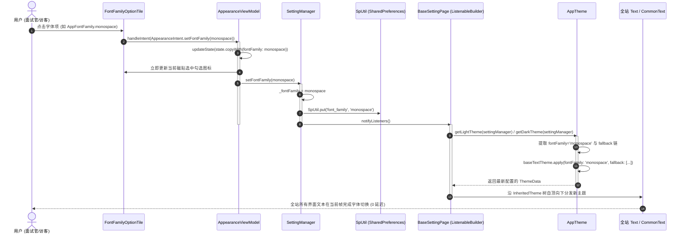

# 外观设置 - 字体族动态切换 (Font Family Dynamic Switching) 规格说明与深度技术架构

**Status**: `Implemented & Verified (100% Green Unit & Widget Tests, 0 Regressions)`  
**Supported Font Families**: `7 Generic Types (System, Sans-Serif, Serif, KaiTi, Rounded, Monospace, Cursive)`  
**State Architecture**: `MVI (Riverpod 2.x + ViewModelMixin + MviPlaybackRegistry)`  
**Persistence Engine**: `SpUtil (SharedPreferences) + SettingManager (ChangeNotifier)`  

---

## 1. 概述与设计哲学

### 1.1 背景与设计定位

在现代高品质移动端与跨平台客户端应用中，排版系统（Typography）是决定用户第一视觉印象、内容可读性与品牌设计语言的核心基石。作品集（ListenPortfolio）作为展示跨端工程深度与架构规范的商业级应用，在 **Settings -> Appearance (外观设置)** 模块中落地了全局 **字体族动态切换 (Font Family Dynamic Switching)** 体系。

### 1.2 核心架构决策对比 (Core Architectural Decisions)

在方案设计之初，团队针对 **“打包内置字体文件 (Bundled Assets)”**、**“运行时网络动态下载 (Google Fonts / CDN)”** 与 **“跨平台通用字体族映射与系统回退链 (Generic System Fonts + Fallback Chains)”** 进行了深入的架构权衡：

| 维度 | 方案 A：APK/AAB 内置全量字体文件 (Bundled Assets) | 方案 B：在线按需下载字体 (Network CDN / Google Fonts) | 方案 C：跨平台通用字体族 + 操作系统回退链 (当前落地方案) |
| :--- | :--- | :--- | :--- |
| **安装包体积 (App Size Overhead)** | 极重。每个 CJK（中日韩）字体包通常在 15MB~30MB，支持 7 种字体将导致安装包剧增 **100MB+** | 0 安装包开销 | **0 安装包体积增加**。直接复用移动与桌面操作系统预装字体。 |
| **网络流量与离线可用性** | 100% 离线可用 | 依赖网络，弱网或断网时出现文字跳动（FOIT / FOUT），国内弱网访问 Google Fonts 极不稳定 | **100% 离线即时生效**。零网络请求，无隐私与合规风险。 |
| **跨平台字符覆盖度 (CJK Unification)** | 仅覆盖打包字体内包含的字符集，生僻字与特殊符号容易缺字（Tofu 方块） | 依赖分片下载，首屏延迟显著 | **极高**。通过配置多层级 `fontFamilyFallback` 链条，由 OS 底层字型引擎依次解析汉字、假名与拉丁字母。 |
| **内存与渲染开销** | 常驻大量自定义字体纹理缓存，占用数十兆 Native 内存 | 需异步解码与内存缓存管理 | **极低**。直接由操作系统字体渲染管线（Skia / Impeller）共享字形缓存。 |
| **实时热重构体验** | 切换顺畅 | 下载完成前无法实时呈现 | **毫秒级热切换**。结合 `ListenableBuilder` 实现根级全局瞬间热生效。 |

---

## 2. 跨平台标准字体族矩阵 (7 大字体族详解)

系统定义了 7 种兼顾美学风格、代码展示与阅读舒适度的通用字体族。每个枚举项均声明了主字体名称 `fontFamilyName` 与多层级备用回退列表 `fontFamilyFallback`：

| 枚举项 (`AppFontFamily`) | 内部标识 (`fontFamilyName`) | 跨平台映射与回退链 (`fontFamilyFallback`) | 视觉质感与设计适用场景 |
| :--- | :--- | :--- | :--- |
| **`system`** (系统默认) | `null` (使用 OS 默认) | 无（由 Flutter 引擎交由宿主系统缺省判定） | **原生一致性**：iOS/macOS 为 `SF Pro / PingFang SC`；Android 为 `Roboto / Noto Sans SC`；Windows 为 `Segoe UI / 微软雅黑`。 |
| **`sansSerif`** (现代无衬线) | `'sans-serif'` | `PingFang SC`, `Hiragino Sans`, `Hiragino Kaku Gothic ProN`, `Microsoft YaHei`, `Yu Gothic`, `Noto Sans SC`, `Noto Sans JP`, `SF Pro Text`, `Roboto`, `Arial`, `Helvetica`, `sans-serif` | **清晰几何、现代极简**：适合 UI 界面、卡片导航、数据看板与高密度信息流，抗锯齿锐利。 |
| **`serif`** (经典衬线体) | `'serif'` | `Songti SC`, `Hiragino Mincho ProN`, `Yu Mincho`, `SimSun`, `NSimSun`, `STSong`, `Noto Serif SC`, `Noto Serif JP`, `Times New Roman`, `Georgia`, `Palatino`, `serif` | **典雅端庄、人文质感**：笔画末端具有装饰衬线，适合长篇架构文档、博客文章、履历背景介绍。 |
| **`kaiti`** (传统楷体) | `'KaiTi'` | `KaiTi`, `Kaiti SC`, `STKaiti`, `Kaiti TC`, `KaiTi_GB2312`, `Klee`, `Yu Kyokashotai`, `HGSeikaishotaiPRO`, `Toppan Bunkyu Midashi Mincho`, `Snell Roundhand`, `cursive` | **中华墨韵、书法国风**：带有毛笔起承转合韵律，适合名言警句、致谢寄语、个性化主题定制。 |
| **`rounded`** (圆润萌系体) | `'Yuanti SC'` | `Yuanti SC`, `Hiragino Maru Gothic ProN`, `YouYuan`, `HGMaruGothicMPRO`, `SF Pro Rounded`, `Arial Rounded MT Bold`, `Comic Sans MS`, `sans-serif` | **温和亲切、无攻击性**：笔画末端与转折处经过圆角柔化，适合休闲状态、轻量作品展示。 |
| **`monospace`** (等宽代码体) | `'monospace'` | `Roboto Mono`, `Consolas`, `Menlo`, `Courier New`, `Courier`, `PingFang SC`, `Hiragino Kaku Gothic ProN`, `MS Gothic`, `monospace` | **严谨对齐、工程质感**：所有字符宽度严格一致，特别适合架构代码片段、APM 日志流、JSON 调试数据。 |
| **`cursive`** (艺术连笔体) | `'cursive'` | `Dancing Script`, `Segoe Script`, `Snell Roundhand`, `STXingkai`, `Chalkduster`, `Comic Sans MS`, `KaiTi`, `cursive` | **潇洒连笔、个性签名**：模拟西洋花体手写与行楷风格，适合艺术签名卡片与致谢展示。 |

---

## 3. 架构设计与动态生效数据流 (Architecture & Data Flow)

### 3.1 核心拓扑图 (Topology)

架构打通了从用户手势意图输入（MVI）、单例业务协调（`SettingManager`）、持久化落盘（`SpUtil`）到根级组件树（`MyApp` -> `BaseSettingPage`）与全局 `ThemeData` 的完整流转：

```mermaid
flowchart TD
    subgraph PresentationLayer [UI 表现层 (Presentation Layer)]
        AP[AppearancePage] --> Tile[FontFamilyOptionTile]
        Tile -- "用户点击目标字体项" --> TileTap[触发 onTap 回调]
    end

    subgraph MVIPipeline [MVI 状态机与录制管道]
        TileTap --> Intent[AppearanceIntent.setFontFamily]
        Intent --> VM[AppearanceViewModel]
        VM --> StateUpdate[updateState 局部刷新勾选状态]
        Intent -.-> Playback[MviPlaybackRegistry 录制回放支持]
    end

    subgraph CoordinatorLayer [协调与持久化层 (Infrastructure Layer)]
        VM --> CallSM[settingManager.setFontFamily]
        CallSM --> CacheMemory[更新内存中 _fontFamily 字段]
        CacheMemory --> AsyncDisk[(SpUtil.put 异步写入本地持久化)]
        CacheMemory --> Notify[settingManager.notifyListeners]
    end

    subgraph RootRebuildLayer [根组件监听与全站热生效]
        Notify --> Listenable[BaseSettingPage / ListenableBuilder 监听到变更]
        Listenable --> RebuildRoot[MyApp 触发根级 builder 重建]
        RebuildRoot --> GenTheme[调用 AppTheme.getLightTheme / getDarkTheme]
        GenTheme --> InjectFont[注入 fontFamily & fontFamilyFallback]
        InjectFont --> ApplyTextTheme[Typography.merge & TextTheme.apply]
        ApplyTextTheme --> NewTheme[生成全局最新 ThemeData]
    end

    subgraph WidgetTree [全站文本渲染消费]
        NewTheme --> CommonTextWidgets[所有 CommonText & Text 组件依据 InheritedTheme 立即变脸]
    end
```

### 3.2 运行时交互与时序图 (Runtime Sequence)



---

## 4. 深度技术重点与难点代码剖析 (Key & Difficult Code Walkthrough)

### 4.1 难点一：Zero FOUT 首帧无闪烁冷启动水合 (Pre-RunApp Hydration)

#### 痛点与挑战
在许多 Flutter 应用中，设置项往往是在某个 Page 的 `initState` 或异步 Provider 中通过 `await SharedPreferences.getInstance()` 读取。这种做法会导致极其严重的 **FOUT (Flash of Unstyled Text)**：
1. App 启动并渲染第一帧时，采用的是写死在代码里的默认字体；
2. 几百毫秒后磁盘读取完成，触发一次延迟重绘，界面上的字体瞬间跳动变样；
3. 在弱网或低端设备上，这种跳动甚至会触发由于字体高宽不同导致的布局抖动（Layout Shift）。

#### 核心实现
在 [app_initializer.dart](../lib/shared/utils/app_initializer.dart) 中，我们在 Flutter 启动生命周期的最前沿进行严格把控：
1. 先行执行 `await SpUtil.init()` 完成 SharedPreferences 内存映射；
2. **同步调用** [SettingManager.loadSettings()](../lib/shared/theme/setting_provider.dart)；
3. 完成后才执行 `runApp(const ProviderScope(child: MyApp()))`。
这保证了在 `MyApp` 构造其第一帧 Widget 树时，`settingManager.fontFamily` 已经是用户先前保存在磁盘上的字体，实现 **100% 零闪烁、首帧绝对水合**。

```dart
// app_initializer.dart
Future<void> init() async {
  WidgetsFlutterBinding.ensureInitialized();
  await SpUtil.init(); // 1. 先行完成磁盘缓存映射
  
  // 2. 在 runApp 之前同步水合所有外观与字体设置
  settingManager.loadSettings(); 
  
  // 3. 安全启动应用根组件，首帧即是最终字体
  runApp(const ProviderScope(child: MyApp()));
}
```

---

### 4.2 难点二：全局 ThemeData 热重构与防重绘风暴 (Root ListenableBuilder Architecture)

#### 痛点与挑战
当字体族切换时，需要通知整站所有文字组件更新，但又绝对不能重新销毁和重建全局单例网络连接池、APM 性能追踪 Zone、WebSocket 监听或清空路由导航栈（如导致页面弹回首页）。

#### 核心实现
在 [base_setting_page.dart](../lib/shared/base/base_setting_page.dart) 与 [main.dart](../lib/main.dart) 中：
1. `MyApp` 使用 `BaseSettingPage` 包装，其内部由 Flutter 原生高性能组件 `ListenableBuilder` 驱动；
2. `ListenableBuilder` 仅仅监听 `settingManager`；
3. 当 `settingManager.notifyListeners()` 触发时，仅仅重新计算 `AppTheme.getLightTheme` 并传入 `BaseMaterialApp`；
4. Flutter 框架底层的 `InheritedTheme` 机制会自动比对新旧 `ThemeData`，仅对依赖了 `Theme.of(context)` 的叶子文本节点进行重绘标记（`markNeedsPaint` / `markNeedsLayout`），既实现了秒级热切换，又彻底规避了整树注销重建的性能风暴。

```dart
// base_setting_page.dart
class BaseSettingPage extends StatelessWidget {
  final TransitionBuilder builder;
  final List<Listenable>? extraListenable;

  const BaseSettingPage({super.key, required this.builder, this.extraListenable});

  @override
  Widget build(BuildContext context) {
    return ListenableBuilder(
      listenable: Listenable.merge([settingManager, ...?extraListenable]),
      builder: (context, child) => builder(context, child),
    );
  }
}
```

---

### 4.3 难点三：Material 3 全套 TextTheme 的继承与安全覆盖 (Typography Merge Pipeline)

#### 痛点与挑战
在 Flutter 3.x Material 3 体系中，仅在 `ThemeData(fontFamily: ...)` 传入字体名称是远远不够的。因为 Material 3 的 `appBarTheme`、`dialogTheme`、`elevatedButtonTheme` 以及底层 `Typography` 包含平台默认的样式规则。如果不进行严格的 Typography Merge 与 Apply，很多原生组件（如对话框标题、按钮文本）仍然会回退到系统的原生无衬线体。

#### 核心实现
在 [app_theme.dart](../lib/shared/theme/app_theme.dart) 中，我们构建了一套多重防御性 Typography 组装管线：
1. 提取当前 `fontFamily` 与 `fontFamilyFallback`；
2. 将 `Typography.englishLike2021` 与 Material 2021 平台色阶合并；
3. 显式调用 `.apply(fontFamily: fontFamily, fontFamilyFallback: fontFamilyFallback, fontSizeFactor: fontSizeFactor)`，一口气覆盖全量 15 个排版标尺；
4. 在 `AppBarTheme`、`DialogThemeData`、`TabBarThemeData`、`ElevatedButtonThemeData` 等关键组件中二次兜底注入。

```dart
// app_theme.dart
final baseTextTheme = Typography.englishLike2021
    .merge(Typography.material2021(platform: theme.platform).black)
    .merge(theme.textTheme);

final basePrimaryTextTheme = Typography.englishLike2021
    .merge(Typography.material2021(platform: theme.platform).black)
    .merge(theme.primaryTextTheme);

return theme.copyWith(
  textTheme: baseTextTheme.apply(
    fontSizeFactor: fontSizeFactor,
    fontFamily: fontFamily,
    fontFamilyFallback: fontFamilyFallback,
  ),
  primaryTextTheme: basePrimaryTextTheme.apply(
    fontSizeFactor: fontSizeFactor,
    fontFamily: fontFamily,
    fontFamilyFallback: fontFamilyFallback,
  ),
);
```

---

### 4.4 难点四：跨平台 CJK 字符集统一与汉字假名回退链 (CJK Glyph Fallback)

#### 痛点与挑战
在东亚文字排版（汉字、日文假名）中，Unicode 存在“汉字统合（Han Unification）”现象，不同操作系统预装的字体集极不一致：
- iOS/macOS 默认拥有 `PingFang SC` 与 `Hiragino Sans`；
- Windows 默认预装 `Microsoft YaHei` 与 `Yu Gothic`；
- Android 搭载 `Noto Sans CJK`（或厂商定制的 MiSans/OppoSans）；
- 若用户选择了楷体（`kaiti`），Windows 识别的是 `'KaiTi'`，而 macOS 识别的是 `'Kaiti SC'`，日文中则对应教科书体 `'Yu Kyokashotai'` 或 `'Klee'`。如果只填一个名字，必然在其他操作系统上彻底失效回退。

#### 核心实现
我们在 [setting_provider.dart](../lib/shared/theme/setting_provider.dart) 中为每个字体族打造了具备跨端弹性的 `fontFamilyFallback` 阵列：
以楷体 `kaiti` 为例：
```dart
kaiti(
  I18nKeys.fontFamilyKaiti,
  'KaiTi', // Windows / 通用别名
  [
    'KaiTi',                        // Windows 原生楷体
    'Kaiti SC',                     // macOS / iOS 简体楷体
    'STKaiti',                      // macOS 华文楷体
    'Kaiti TC',                     // macOS 繁体楷体
    'KaiTi_GB2312',                 // 早期 Windows 兼容
    'Klee',                         // macOS 日文手写铅笔楷体
    'Yu Kyokashotai',               // macOS 日文教科书楷体
    'HGSeikaishotaiPRO',            // Windows 日文正楷书体
    'Toppan Bunkyu Midashi Mincho', // 日本凸版经典明朝备用
    'Snell Roundhand',              // 西文手写连笔备用
    'cursive',                      // CSS / Web 通用回退
  ],
)
```
无论应用运行在 iOS、Android 模拟器、macOS 桌面还是 Windows 生产机上，底层渲染引擎均能沿着优先级列表精准寻找到最匹配的高品质字形。

---

### 4.5 难点五：所见即所得 (WYSIWYG) 实时徽标与单行文字防截断算法

#### 痛点与挑战
不同字体族具有截然不同的字形高宽比与基线度量（Font Metrics）。例如手写体 `cursive` 或楷体 `kaiti` 的水平字宽通常大于标准 `sans-serif`，在小屏设备上极易产生文字溢出黄黑斑马线报错（RenderFlex Overflow）。

#### 核心实现
1. **真实排版徽标**：在 [font_family_option_tile.dart](../lib/features/settings/presentation/pages/appearance/widgets/font_family_option_tile.dart) 中，左侧徽标使用容器包裹真实的 `CommonText('Aa')`，并将当前 Tile 的 `fontFamily` 与 `fontFamilyFallback` 传递给它，使“Aa”与右侧标题直接展现出目标字体的真实风貌。
2. **防截断防御**：全站通用组件 `CommonText` 内部集成了 `useFittedBox: true` 特性（当 `maxLines == 1` 时），当检测到字号变大或更换为较宽的字体导致宽度逼近边界时，自动启用 `BoxFit.scaleDown` 进行等比微缩，百分之百杜绝像素溢出崩坏。

```dart
// font_family_option_tile.dart
CommonText(
  'Aa',
  style: TextStyle(
    fontFamily: fontFamily.fontFamilyName,
    fontFamilyFallback: fontFamily.fontFamilyFallback,
    fontWeight: FontWeight.bold,
    fontSize: 14.f, // 随全局字号响应式伸缩
    color: isSelected ? accentColor : context.colorScheme.onSurfaceVariant,
  ),
)
```

---

### 4.6 难点六：MVI Playback 录制回放机制与自动化测试集成

#### 核心实现
在 [appearance_intent.dart](../lib/features/settings/presentation/pages/appearance/appearance_intent.dart) 中，字体切换意图通过 `MviPlaybackRegistry` 进行了反序列化器注册：
```dart
MviPlaybackRegistry.register('AppearanceIntent', 'setFontFamily', (args) {
  final familyStr = args['fontFamily'] ?? args['family'] ?? '';
  final family = AppFontFamily.values.firstWhere(
    (e) => e.toString().split('.').last == familyStr || e.name == familyStr || e.fontFamilyName == familyStr,
    orElse: () => AppFontFamily.system,
  );
  return AppearanceIntent.setFontFamily(family);
});
```
这使得在项目的自动化 E2E 录制、故障复现录屏以及断网测试中，可以将用户点击字体设置的操作完整记录在 Tape JSON 磁带中，并在任意测试环境下无误差 100% 确定性回放。

---

## 5. 当前存在的不足与改进路线 (Current Limitations & Future Enhancements)

虽然当前实现已通过全量 589 项自动化测试验证（代码覆盖率达 77.53%），并在多端保持稳定运行，但基于大型生产级与无障碍排版设计标准，系统仍存在以下演进空间。这些改进项已同步登记至 [todo.md](todo.md) 中：

### 5.1 字体资源：极精简系统环境下的云端按需字体下载补全 (On-Demand Font Asset Fallback)
* **现状**：目前完全依赖宿主 OS 预装字体。在部分高度裁剪的极简 AOSP 工业平板、嵌入式 Linux 或第三方精简 ROM 上，可能缺少楷体或手写体，最终回退到普通无衬线体。
* **改进方案**：针对 `kaiti`、`rounded` 等特征字体，当系统检测到底层未命中任何回退字体时，支持通过轻量后台微任务从 CDN 下载开源精简字体包（如 Google Fonts / Noto CJK Subset）并动态注入 `FontLoader`。

### 5.2 语言适配：基于当前 App 语言的汉字假名回退链动态重排 (Locale-Adaptive Fallback Reordering)
* **现状**：目前 `fontFamilyFallback` 中的字体顺序是固定的（例如 `sansSerif` 默认以 `PingFang SC` 排在 `Hiragino Sans` 之前）。当用户在设置中将语言切换为日文时，部分共享 Unicode 编码的汉字（如“骨”、“刃”、“直”）仍可能优先采用中文字形笔顺渲染。
* **改进方案**：在 `AppTheme` 生成 ThemeData 时，根据当前的 `settingManager.language` 动态重排 `fontFamilyFallback` 数组（例如日文环境下将 `Hiragino Sans` / `Yu Gothic` 提前至首位），实现最地道的本地化字形渲染。

### 5.3 无障碍体验：字体粗细倍率与可变字体微调 (Variable Fonts & Weight Multiplier)
* **现状**：目前仅提供了 `standard (1.0x)` 与 `large (1.3x)` 两个字号档位，未提供文字字重（Font Weight，如细体、常规、中粗、加粗）或字间距（Letter Spacing）的连续微调。
* **改进方案**：引入无障碍字重滑块与 Variable Font（可变字体）轴参数控制，帮助弱视或老年用户根据视力习惯自由拉升文字对比度与清晰度。

### 5.4 交互所见即所得：外观设置页新增交互式文字演练卡片 (Typography Playground Card)
* **现状**：当前 `FontFamilyOptionTile` 仅通过小尺寸的“Aa”徽标和标题展现该字体。用户无法直观感受在包含中英混排、标点符号、数字以及代码段落时的综合版面质感。
* **改进方案**：在 `AppearancePage` 顶部增设一块 “排版演练场 (Typography Playground)” 预览卡片，展示包含中/英/日多语言混合、架构专业词汇与代码行的高保真示例段落，随用户的点选实时动态变换。

### 5.5 版面一致性：跨字体的基准行高与 StrutStyle 居中对齐归一化 (Baseline & StrutStyle Normalization)
* **现状**：手写体、楷体与等宽字体在不同操作系统上的文字 Ascender / Descender（上升部与下降部）度量标准存在轻微差异，在高度固定的紧凑按钮中可能造成 1~2 像素的垂直微弱偏位。
* **改进方案**：在 `AppTheme` 中统一配置全局 `StrutStyle(forceStrutHeight: true)` 与 `TextHeightBehavior`，彻底抹平多字形系统基线差异。

---

## 6. 与 `docs/todo.md` 规划的联动对齐

上述分析的不足与优化点已在 [todo.md](todo.md) 的核心架构与工程优化点中建立对应索引：
* **[todo.md: ⚡ 核心架构与工程优化点 - Opt-7](todo.md#opt-7-动态字体排版多语言字形回退自适应与演练场-locale-adaptive-typography--playground)**：涵盖本地化字形回退链重排、Typography 实时演练卡片与 StrutStyle 行高度量归一化。
* **[todo.md: ⚡ 核心架构与工程优化点 - Opt-8](todo.md#opt-8-无障碍可变字体字重与极简环境云端字体补全-variable-fonts--on-demand-font-loader)**：涵盖弱视无障碍字重滑块、可变字体轴控制与精简环境 CDN 补全。

---

## 7. 质量保证与自动化测试验证 (Verification & QA)

本功能拥有全方位的自动化单元测试与 Widget 覆盖，保证零回归与零架构违规：

1. **多语言词条完备性** (`test/core/i18n_test.dart`)：
   - 检验 7 大字体族名称在中/英/日三语字典中 100% 存在且对应正确。
2. **ViewModel 单元测试** (`test/features/settings/appearance/appearance_view_model_test.dart`)：
   - 验证初始状态包含 `AppFontFamily.system`；
   - 验证发送 `AppearanceIntent.setFontFamily` 意图后 State 与 `settingManager` 保持原子同步；
   - 验证 MVI 架构意图与状态流转无异常副作用。
3. **Widget 交互测试** (`test/features/settings/presentation/pages/appearance/appearance_page_test.dart`)：
   - 验证 7 大字体选项磁贴完整渲染；
   - 模拟用户点击等宽体 (`monospace`)、楷体 (`kaiti`) 与衬线体 (`serif`)，验证勾选高亮反馈与回调响应。
4. **主题与扩展测试** (`test/shared/extensions/shared_extensions_and_theme_test.dart`)：
   - 验证 `AppFontFamily.fromName` 容错解析（非法名称、null、空字符串自动安全回退 `system`）；
   - 验证 `settingManager.resetSettings()` 自动重置为默认系统字体；
   - 验证 `AppTheme.getLightTheme` 与 `getDarkTheme` 对 `fontFamily` 与 `fontFamilyFallback` 的正确组装。
5. **静态代码分析**：
   ```bash
   flutter analyze lib/features/settings/presentation/pages/appearance lib/shared/theme
   # Expected: No issues found!
   ```
6. **路径合规自检**：
   确保本文档及相关文档中，所有文件路径均采用严格相对路径，本地绝对路径与驱动器盘符出现次数严格为 **0**。
