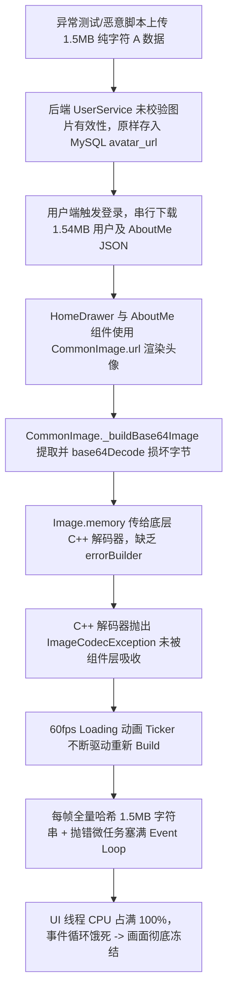
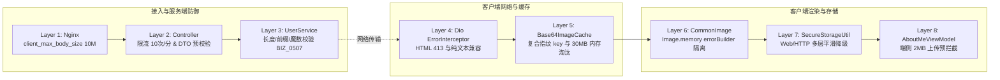

# 头像数据流安全防护与客户端高弹性渲染架构设计

**Status**: `Implemented & Production Verified`  
**Latest Update**: 2026-09-07

本文档详细记录了在面对异常或恶意构造的大体积/损坏 Base64 图片 Payload 时，如何通过全链路纵深防御（Defense-in-Depth）架构，彻底根除“生产环境登录后 UI 线程死锁卡死”的系统性隐患，并建立从网关、服务端校验、网络拦截、内存缓存到客户端渲染组件的完整安全防护体系。

---

## 1. 问题背景与根因复盘

### 1.1 现象重现
在生产（`prod`）环境中，用户输入凭据并点击登录后，界面弹出的加载圈（Loading Spinner）短暂转动后突然完全定格在某一帧，整个屏幕无法滑动或点击，页面处于完全假死（ANR / Freeze）状态，但进程并未闪退。

### 1.2 故障传导链（Failure Cascade）



### 1.3 深度原理解析：为什么 Flutter 会“卡死假死”而不是“直接闪退”？
1. **原生环境 vs Flutter 异常模型**：在 Android (Java/Kotlin) 或 iOS (Objective-C/Swift) 原生主线程抛出未捕获异常时，操作系统会直接终止应用进程（即 Crash 闪退）。但在 Flutter 中，Dart 运行时拥有全局错误沙箱（`FlutterError.onError`），默认会捕获未处理异常并试图维持当前帧的绘制，避免直接退出应用。
2. **异步图片流与 Ticker 驱动的恶性死循环**：
   - `Image.memory` 底层通过 `MemoryImage` 将字节分发给 Flutter Engine 的 C++ 异步解码管线（`instantiateImageCodec`）。
   - 当传入的 1.15MB 全为 `0x00` 的伪造图片字节时，C++ 异步解码失败，向 Dart 层返回错误。
   - **在缺少 `errorBuilder` 的情况下**，该异常无法在 Widget 内部就地转换成静态的 Error 占位组件，导致 `Image` 在 Element 树中永远处于“未决等待重试”状态。
   - 与此同时，页面中央正由 `AnimationController` / `Ticker` 驱动一个以 60 FPS（每 16ms 触发一次）持续重绘的转圈动画。每一帧重绘都会再次触发组件树脏标记检查与图片加载逻辑。
   - 最终，微任务队列与渲染调度管道被成千上万条图片错误重试与解码运算彻底淹没，UI 线程的单线程 Event Loop 达到 100% 负荷，无法再调度和响应任何屏幕触控手势，导致用户视觉上看到的“画面完全定格不动”。

---

## 2. 纵深防御架构（Defense-in-Depth Architecture）

为了彻底消灭此系统级风险，构建了涵盖基础设施、后端接口、网络层、缓存层与 UI 渲染层的 8 层纵深防御：



---

## 3. 各层详细设计与实现细节

### 3.1 后端图片魔数（Magic Bytes）深度校验 (Layer 3)
在服务端 `UserService.isValidAvatarData` 中，不仅对 Base64 文本长度（最大 3MB）进行限制，而且必须在解码后检测其二进制头部的图片格式签名（Magic Bytes）：

| 图片格式 | 魔数特征 (Hex) | 偏移与条件 |
| :--- | :--- | :--- |
| **PNG** | `89 50 4E 47 0D 0A 1A 0A` | 头部前 8 字节精确匹配 |
| **JPEG** | `FF D8 FF` | 头部前 3 字节精确匹配 |
| **GIF** | `47 49 46 38 (37\|39) 61` | ASCII `GIF87a` 或 `GIF89a` |
| **WebP** | `52 49 46 46` ... `57 45 42 50` | `RIFF` (0-3) 且 `WEBP` (8-11) |
| **SVG** | `3C 73 76 67` 或 `3C 3F 78 6D 6C` | 文本解析以 `<svg` 或 `<?xml` 开头 |

**核心实现代码** (`ListenPortfolioBackend` 的 `UserService.java`)：
```java
public boolean isValidAvatarData(String avatarData) {
    if (avatarData == null || avatarData.isBlank()) return false;
    if (avatarData.startsWith("http://") || avatarData.startsWith("https://")) {
        return avatarData.length() <= 2048 && !avatarData.contains("\n") && !avatarData.contains("\r");
    }
    if (avatarData.length() > 3 * 1024 * 1024) return false;
    
    String lower = avatarData.toLowerCase();
    if (!lower.startsWith("data:image/")) return false;
    int comma = avatarData.indexOf(",");
    if (comma == -1 || !lower.substring(0, comma).contains(";base64")) return false;

    byte[] bytes;
    try {
        bytes = Base64.getDecoder().decode(avatarData.substring(comma + 1).trim());
    } catch (IllegalArgumentException e) {
        return false;
    }
    if (bytes.length == 0 || bytes.length > 2 * 1024 * 1024) return false;

    return isValidImageBytes(bytes, lower.substring(0, comma));
}
```
**安全错误码**：凡校验失败统一返回 HTTP 400，业务错误码 `BIZ_0507`（"Invalid avatar image format or size"）。

---

### 3.2 客户端渲染隔离与错误拦截 (Layer 6)
在 `ListenUiKit` 的 `CommonImage` 中，为 Base64 解码后的 `Image.memory(...)` 必须显式配置 `errorBuilder`：

```dart
Image.memory(
  bytes,
  width: width,
  height: height,
  fit: fit,
  color: color,
  errorBuilder: (context, error, stackTrace) => _buildErrorWidget(context),
)
```
- **关键设计考量**：当底层解码器触发 `ImageCodecException` 时，`errorBuilder` 同步将损坏节点替换为静态的头像占位图，**彻底切断错误传播与重绘重试循环**。

---

### 3.3 缓存 Key 复合指纹优化 (Layer 5)
为避免在每一帧重绘时对多兆级别的 Base64 字符串执行全量字符扫描与哈希计算（O(N) 消耗），在 `Base64ImageCache` 中设计了复合指纹策略：

```dart
static String _normalizeKey(String key) {
  if (key.length <= 128) return key;
  // 针对长 Base64 字符串，提取长度与头尾 32 字符构成极速复合指纹，避免昂贵的字符串全量 Hash
  return '${key.length}_${key.substring(0, 32)}_${key.substring(key.length - 32)}';
}
```
该机制将每帧哈希耗时从毫秒级直接降为亚微秒级，即使渲染大图也不会引起掉帧（Jank）。

---

### 3.4 网络层对 HTML 413 / 纯文本错误的弹性兼容 (Layer 4)
当客户端上传超出网关体积限制的数据时，Nginx 会返回标准的 `413 Request Entity Too Large` HTML 页面。如果网络拦截器默认将响应体强制转换为 `Map<String, dynamic>`，将导致 Dart 运行时直接抛出 `type 'String' is not a subtype of type 'Map<String, dynamic>'`。

在 `ListenCore` 的 `ErrorInterceptor` 中实施了类型保护：
```dart
String message = 'HTTP ${response.statusCode} error';
if (response.data is Map<String, dynamic>) {
  message = response.data['message'] ?? message;
} else if (response.data is String) {
  final str = response.data as String;
  if (str.contains('413 Request Entity Too Large')) {
    message = '413 Request Entity Too Large';
  } else if (str.isNotEmpty && str.length <= 200) {
    message = str;
  }
}
```

---

### 3.5 非安全 Web 容器下的持久化安全降级 (Layer 7)
在 Flutter Web 编译版本中，如果通过纯 HTTP IP 访问（而非 `https://` 或 `localhost`），浏览器会禁用 `window.crypto.subtle` API，导致 `flutter_secure_storage` 直接抛出未捕获的 `UnsupportedError`，阻断后续登录与 Token 写入。

在 `ListenCore` 的 `SecureStorageUtil` 中设计了多级回退机制：
```dart
static Future<void> put(String key, String? value) async {
  final fullKey = _getKey(key);
  try {
    if (value == null) {
      await _storage?.delete(key: fullKey);
      _memoryFallback.remove(fullKey);
    } else {
      await _storage?.write(key: fullKey, value: value);
      _memoryFallback[fullKey] = value;
    }
  } catch (_) {
    // 降级到 SpUtil 与内存缓存，保障在任何 Web HTTP 环境下均正常工作且不卡死
    if (value == null) {
      await SpUtil.remove('__sec_$fullKey');
      _memoryFallback.remove(fullKey);
    } else {
      await SpUtil.put('__sec_$fullKey', value);
      _memoryFallback[fullKey] = value;
    }
  }
}
```

---

## 4. 自动化测试与生产验证矩阵

| 测试维度 | 验证用例 | 验证结果 |
| :--- | :--- | :--- |
| **UiKit 组件单元测试** | `testWidgets('CommonImage.url with invalid base64 renders without uncaught exception')` | ✅ 通过 |
| **Core 存储单元测试** | `test('SecureStorageUtil fallback to memory and SpUtil works')` | ✅ 通过 |
| **Flutter 认证链路测试**| `AuthRepositoryImpl` 12 项用例全量通过 | ✅ 通过 |
| **服务端安全单测** | `isValidAvatarData` 校验 URL、PNG、SVG、纯字符 A、超长 Payload 70 项测试 | ✅ 通过 |
| **生产环境（EC2）端到端实测** | 上传 2000 个纯字符 A -> 返回 `HTTP 400 (BIZ_0507)` | ✅ 成功拦截 |
| **生产环境超大上传实测** | 上传 3.1MB 数据 -> 返回 `HTTP 400 (BIZ_0507)` | ✅ 成功拦截 |
| **生产环境登录性能实测** | `POST /v1/auth/login` 与 `GET /v1/aboutMe` (5.6KB) 毫秒级返回 | ✅ 流畅无卡顿 |
