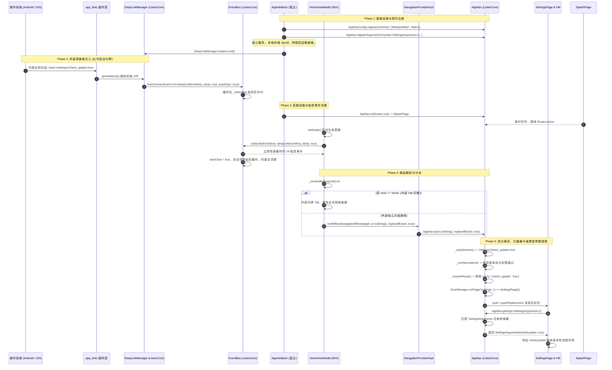

# 强类型路由与 Deep Link 架构设计及决策文档 (Deep Link & Strongly-Typed Routing Architecture Specification)

## 1. 业务背景与架构愿景 (Business Background & Architectural Vision)

在现代移动应用生态中，应用不仅需要响应内部用户的点击跳转，还必须支持跨应用、跨系统服务唤起的多维外部入口：
- **外部 Deep Link Scheme 唤起**：例如运营推广邮件、短信或外部浏览器通过 `listenportfolio://` / `myapp://` 自定义协议直达指定页面（如 `SettingsPage`，并按需执行特定动作，如 `check_update=true`）。
- **Google Play 延迟安装链接 (Deferred Deep Link)**：用户未安装应用时通过推广链接进入 Google Play，首次安装启动后还原跳转至特定落地页。
- **系统通知横幅 (Push Notification)**：用户点击推送通知携带的 Payload，需要安全解耦地解析并调度路由栈。
- **桌面快捷方式 (QuickActions)**：用户长按桌面图标触发特定业务二级功能。

在此背景下，移动端路由与深度链接面临数个极其严苛的技术挑战：
1. **底座业务无关性 (Business-Agnostic Core)**：通用底座 `ListenCore` 不应硬编码任何特定业务实体的 DTO 参数类或协议头，必须具备 100% 的业务中立性与跨项目可复用性。
2. **异步依赖就绪时序竞争 (Async Initialization Race Condition)**：原生平台自动分发深度链接时，若应用处于冷启动阶段，本地存储（`SpUtil`）、网络 Token、依赖注入容器（`Riverpod`）尚未加载就绪，强行 Push 目标页将导致运行时空指针或鉴权失效崩溃。
3. **参数类型擦除与安全转换 (Type Safety & Deserialization)**：外部 URI Query 参数均为字符串键值对，若在各个页面零散使用字符串解析与硬编码转换，极易诱发类型转换异常（`type 'String' is not a subtype of type 'bool'`）。
4. **路由重入与瞬态双重弹窗 (Route Re-entry & Single UI Binder)**：外部多次触发相同深链接时可能造成页面重复压栈；使用 `pushReplacement` 替换当前路由时，因新老页面存在约 300ms 过渡动画重叠，共享 ViewModel 容易触发两次相同的 Dialog 副作用（双重弹窗）。
5. **Android 13/14+ 预测性返回手势 (Predictive Back Gesture & PopScope)**：多标签页（`IndexedStack`）非活跃后台 Tab 容易劫持系统返回手势；页面加载中无法响应手势取消网络请求；WebView 内嵌页无法平滑联动原生系统退栈手势。

为系统性化解上述挑战，我们构建了一套基于 **转换器委托注册 (Converter Delegate)**、**`app_links` 延迟时钟分发**、**MVI Single UI Binder 排他订阅** 以及 **`BaseLifeCyclePage` 智能 PopScope 治理** 的商用级路由与深链接体系。

---

## 2. 核心架构哲学与设计原则 (Core Architecture Philosophy & Design Principles)

```
+-----------------------------------------------------------------------------------+
|                           ListenPortfolio (宿主业务层)                            |
|  - 路由实体表 (Routes.routes)                                                     |
|  - 业务参数 DTO (SettingsArguments / SignUpArguments / CrashLogListArguments)       |
|  - 业务 Tab 消费调度 (HomeViewModel 监听 deepLinkEventKey)                          |
+-----------------------------------------------------------------------------------+
                                         │ 依赖倒置 (Dependency Inversion)
                                         ▼ 注册转换器委托 / 自定义 Schemes
+-----------------------------------------------------------------------------------+
|                              ListenCore (通用路由底座)                            |
|  - DeepLinkManager (基于 app_links，冷启动/热启动统一流捕获)                        |
|  - EventBus (sticky: true 粘性缓存，时钟对齐，彻底消除时序竞争)                       |
|  - AppNav (协议头剥离 _stripScheme / Query 参数解析 / Zone APM 监控)                |
|  - RouteInterceptor 链 (LoginRouteInterceptor 鉴权拦截)                           |
|  - 路由去重治理 (replaceIfExists: true 幂等替换)                                   |
+-----------------------------------------------------------------------------------+
                                         │
                                         ▼
+-----------------------------------------------------------------------------------+
|                              Flutter Navigator & 系统通道                         |
|  - MaterialApp.onGenerateRoute / AppNavConfig.navigatorKey                       |
|  - BaseLifeCyclePage (PopScope: active 过滤 / 请求中断 cancelRequests)             |
|  - CommonWebView (动态 canPop: 区分 H5 内部历史与原生退栈 / Offstage 保活)          |
+-----------------------------------------------------------------------------------+
```

### 2.1 依赖倒置与解耦 (Business-Agnostic Core)
为了保证底座 `ListenCore` 的纯粹性，底座不直接引入宿主应用的任何类：
- **Scheme 动态注册**：宿主应用在 `CoreConfig` 中配置 `schemes: [AppConstants.deepLinkScheme]`，底座通过循环前缀匹配动态裁切协议头，支持无限扩展。
- **转换器委托注册 (Converter Delegate Registry)**：底座 `AppNav` 仅维护类型映射表 `Map<Type, ArgumentConverter<dynamic>>`。宿主在启动阶段向底座注入针对业务 DTO 的反序列化闭包：
  ```dart
  AppNav.registerArgumentConverter<SettingsArguments>((map) => SettingsArguments.fromMap(map));
  ```
- **消费端无感知**：业务 Page 或 ViewModel 仅需调用 `AppNav.getArgs<SettingsArguments>()`，底座自动在底层完成从 `Map<String, dynamic>` 到强类型对象的转化。

### 2.2 启动时钟对齐与防竞争 (Startup Clock Alignment & Race Condition Elimination)
Flutter 官方引擎默认会在 Android `MainActivity` 接收到带有 Deep Link 的 Intent 时立即触发 Flutter 路由生成。这在冷启动时存在致命缺陷：
- 异步初始化任务（`SpUtil.init()`、Dio 拦截器 Token 读取、Riverpod 状态装配）需要一定耗时（通常为 100~300ms）。
- 若原生引擎在此期间提前 Push 目标路由，目标 ViewModel 在执行 `initState` 或 `onReady` 时访问未初始化的持久化数据，必将崩溃。
- **解决方案**：禁用 Flutter 原生自动拦截，引入 `app_links` 插件。在 `AppInitializer.init()` 完成全部依赖注册后，才显式调用 `DeepLinkManager.instance.init()`。对于冷启动捕获的 URI，通过底座 `EventBus` 发射**粘性事件 (`sticky: true, autoClear: true`)**，直到首屏 `HomeViewModel` 完成初始化并注册订阅后才被平滑消费。

### 2.3 路由重入与幂等策略 (`replaceIfExists`)
在外部深链接频繁推送、自动化测试或快速点击时，目标页面可能已在当前路由栈顶：
- **默认策略 (`replaceIfExists = false`)**：若目标路由名称与 `AppNav.currentRouteName` 完全一致，框架自动忽略本次跳转，打印日志后直接返回，消除画面抖动与重复入栈。
- **替换策略 (`replaceIfExists = true`)**：用于深链接携带全新 Query 参数下钻的场景（如 `listen://settings?check_update=true`）。框架执行 `pushReplacement` 重建路由，使得新参数得以被正确加载并触发关联副作用。

### 2.4 MVI 单一 UI 绑定者模式 (Single UI Binder MVI Pattern)
当使用 `pushReplacement` 替换当前路由时，由于 Flutter 页面推入与推出存在约 300ms 的动画重叠（Hero 动画或滑动动画），新老页面短时间内在 Widget 树中同时存活。
- 若此时依赖同一个 Riverpod Provider，老页面和新页面若同时订阅 `viewModel.effectStream`，会导致一个业务 Effect（如更新检测完成弹出的 `ConfirmEffect`）被两个页面同时响应，引发**双重弹窗**。
- **排他性单绑定防护**：
  1. **ViewModel 端独占解绑 (Primary Guard)**：在 `BaseViewModel.onBindEffect` 中，新页面绑定时自动同步 `cancel()` 前一个 UI 绑定的 `StreamSubscription`，保障全局同一时刻仅存在一个活跃 UI 接收者。
  2. **View 级防御性 Pop 拦截 (Secondary Guard)**：老页面在 `_AppNavObserver.didPop` 瞬间即刻注销所有 Effect 监听与中止后台请求，不依赖动画彻底结束后的 `dispose()`。

### 2.5 预测性返回手势与 PopScope 统一治理 (Predictive Back Gesture Governance)
- **Scaffold 纯粹化**：`BaseScaffoldPage` 不保留任何返回手势逻辑，仅作为布局骨架。
- **生命周期接管**：`BaseLifeCyclePage` 统一包裹 `PopScope`。
  - **`active` 过滤**：针对 `IndexedStack` 多子页结构，处于非激活态的 Tab 强制设置 `canPop = true` 且在 `onPopInvokedWithResult` 中直接 `return`，杜绝后台 Tab 劫持全局侧滑返回。
  - **请求熔断优先级**：页面处于加载中（`_isInternalLoading.value == true`）时，拦截返回并优先调用 `_viewModel?.cancelRequests("onBackInvoked")` 中断后台网络请求并收起 Loading，实现“首击取消网络请求”。
  - **WebView 动态返回**：`CommonWebView` 根据 `controller.canGoBack()` 动态计算 `canPop`，区分“消费 H5 内部历史”与“触发原生退栈”，并结合 `Offstage` 保持 MethodChannel 存活，避免网络重试报 `MissingPluginException`。

---

## 3. 全链路端到端流程与时序图 (End-to-End Deep Link Flow & Sequence Diagram)

### 3.1 冷启动与热启动全流程时序图



---

## 4. 重点与难点代码实现深度剖析 (Deep Dive into Key Implementations)

### 4.1 动态协议头裁剪与 URI 解码 (`_stripScheme` & `_resolveRoute`)

#### 代码实现位置
- [`ListenCore/lib/route/app_nav.dart`](../../ListenCore/lib/route/app_nav.dart)

#### 源码剖析
```dart
  static String _stripScheme(String target) {
    var path = target;
    for (final scheme in AppNavConfig.schemes) {
      final prefix = '$scheme://';
      if (path.startsWith(prefix)) {
        path = path.substring(prefix.length);
        // 确保裁剪协议头后的路径具备标准的前导斜杠 '/'
        if (!path.startsWith('/')) {
          path = '/$path';
        }
        break;
      }
    }
    return path;
  }
```

在 `_resolveRoute` 中，框架不仅完成路径匹配，更对 QueryString 进行严格的 URL 编码解码与参数合并：
```dart
  static Route<T>? _resolveRoute<T>(dynamic target, Object? arguments) {
    if (target is Widget) {
      return MaterialPageRoute<T>(
        builder: (_) => ZoneManager.runPage(target.runtimeType.toString(), () => target),
        settings: RouteSettings(name: target.runtimeType.toString(), arguments: arguments),
      );
    } else if (target is String) {
      final cleanTarget = _stripScheme(target);
      String path;
      final Map<String, dynamic> combinedArgs = {};

      // 提取并解码 URI 中的 Query 参数
      if (cleanTarget.contains('?')) {
        final index = cleanTarget.indexOf('?');
        path = cleanTarget.substring(0, index);
        final queryStr = cleanTarget.substring(index + 1);
        final queryParts = queryStr.split('&');
        for (var part in queryParts) {
          final kv = part.split('=');
          if (kv.length == 2) {
            combinedArgs[kv[0]] = Uri.decodeComponent(kv[1]);
          }
        }
      } else {
        path = cleanTarget;
      }

      // 优先合并代码中显式传递的 arguments
      if (arguments is Map) {
        combinedArgs.addAll(Map<String, dynamic>.from(arguments));
      } else if (arguments != null && combinedArgs.isEmpty) {
        return _buildPageRoute(path, arguments);
      }

      return _buildPageRoute<T>(path, combinedArgs.isEmpty && arguments != null ? arguments : combinedArgs);
    }
    return null;
  }
```

> **技术难点与设计考量**：
> 1. **URL Component 解码**：如果外部深链接中包含路径或中文字符（如 `file_path=%2Fstorage%2Femulated%2F0%2Fcrash.txt`），若未经 `Uri.decodeComponent` 还原，业务侧读取时将是 URL 编码字符串，导致文件读取失败。
> 2. **Zone 性能监控环绕**：在构建路由时，统一经由 `ZoneManager.runPage(name, () => builder())` 包装，自动采集首帧渲染耗时并注入上下文 `traceId`，使得深链接下钻页面的性能表现直接纳入 APM 监控。

---

### 4.2 泛型转换器委托注册表与强类型解构 (`registerArgumentConverter` & `getArgs<T>`)

#### 代码实现位置
- [`ListenCore/lib/route/app_nav.dart`](../../ListenCore/lib/route/app_nav.dart)
- [`ListenPortfolioFlutter/lib/shared/utils/routing_arguments.dart`](../lib/shared/utils/routing_arguments.dart)
- [`ListenPortfolioFlutter/lib/shared/utils/app_initializer.dart`](../lib/shared/utils/app_initializer.dart)

#### 源码剖析
在 `AppNav` 内部：
```dart
  static final Map<Type, ArgumentConverter<dynamic>> _argumentConverters = {};

  static void registerArgumentConverter<T>(ArgumentConverter<T> converter) {
    _argumentConverters[T] = converter;
  }

  static T? getArgs<T>() {
    // 1. 如果当前路由参数已经为目标类型（代码内强类型传递），直接强转返回
    if (currentArgs is T) {
      return currentArgs as T;
    }
    // 2. 如果参数为 Map（深链接解析产物），匹配注册的泛型转换器委托
    if (currentArgs is Map) {
      final map = Map<String, dynamic>.from(currentArgs as Map);
      final converter = _argumentConverters[T];
      if (converter != null) {
        return converter(map) as T?;
      }
    }
    return null;
  }
```

在宿主实体 `SettingsArguments` 中：
```dart
class SettingsArguments {
  final bool checkUpdate;

  const SettingsArguments({this.checkUpdate = false});

  factory SettingsArguments.fromMap(Map<String, dynamic> map) {
    final val = map['check_update'] ?? map['checkUpdate'];
    return SettingsArguments(
      // 兼容 deep link 传入的 String 'true' 与代码直接传入的 bool true
      checkUpdate: val == 'true' || val == true,
    );
  }
}
```

> **设计优势**：
> 1. **零类型擦除**：通过 `_argumentConverters[T]` 以 Dart `Type` 作为字典键，无论在何时调用 `AppNav.getArgs<T>()`，泛型推导均能在编译期与运行时获得绝对保障。
> 2. **Context-Free 提取**：传统 Flutter 页面必须在 `build(BuildContext context)` 中调用 `ModalRoute.of(context)?.settings.arguments`，无法在 ViewModel 或非 UI 上下文中安全提取。`AppNav` 依托 `_AppNavObserver` 维护静态引用，使得业务在 `onInit` / `initState` 阶段即可无 Context 获取参数。

---

### 4.3 路由重入治理与热更新检测场景 (`replaceIfExists`)

#### 代码实现位置
- [`ListenCore/lib/route/app_nav.dart`](../../ListenCore/lib/route/app_nav.dart)
- [`ListenPortfolioFlutter/lib/features/home/presentation/pages/home_view_model.dart`](../lib/features/home/presentation/pages/home_view_model.dart)

#### 源码剖析
```dart
          final isAlreadyOnTarget = targetRouteName != null && currentRouteName == targetRouteName;

          if (isAlreadyOnTarget) {
            if (replaceIfExists) {
              // 目标路由已在栈顶，但指定了替换策略：通过 pushReplacement 刷新栈顶并重载 arguments
              AppNavConfig.navigatorKey.currentState?.pushReplacement(route).then((value) {
                completer.complete(value);
              });
            } else {
              // 目标路由已在栈顶且未声明替换：忽略无效的重复跳转，保障体验平滑
              appLogger.i('AppNav: Target route $targetRouteName is already current. Ignoring navigation.');
              completer.complete(null);
            }
          } else {
            // 常规压栈操作
            AppNavConfig.navigatorKey.currentState?.push(route).then((value) {
              completer.complete(value);
            });
          }
```

> **典型业务场景**：
> 用户当前已经停留在 `/settings` 页面。此时系统收到一条通知或运行外部 ADB 命令：
> `adb shell am start -a android.intent.action.VIEW -d "listen://settings?check_update=true"`
> - 若 `replaceIfExists = false`：深链接被忽略，页面不会有任何反应。
> - 若 `replaceIfExists = true`：当前 `/settings` 页面被即刻替换重载，`SettingsArguments.checkUpdate == true` 生效，页面进入并立即调起 OTA 更新检测弹窗，满足运营与测试的确定性预期。

---

### 4.4 MVI Single UI Binder 机制与过渡期双重弹窗免疫

#### 代码实现位置
- `ListenCore/lib/base/base_view_model.dart`
- [`ListenCore/lib/route/app_nav.dart`](../../ListenCore/lib/route/app_nav.dart)

#### 源码剖析
```dart
  StreamSubscription<BaseEffect>? _effectSubscription;

  /// 绑定 UI 层的副作用接收通道
  void onBindEffect(void Function(BaseEffect effect) onEffect) {
    // 💡 核心保护：一旦有新的 UI 订阅者接入，立即显式取消旧页面的订阅句柄
    _effectSubscription?.cancel();
    _effectSubscription = effectStream.listen(onEffect);
  }
```

```dart
  @override
  void didPop(Route<dynamic> route, Route<dynamic>? previousRoute) {
    AppNav.lastTransitionRoute = route;
    super.didPop(route, previousRoute);
    _updateRoute(previousRoute);
    AppNav.onRoutePopped?.call(route, previousRoute);
  }
```

> **技术难点与排障记录**：
> 在 `pushReplacement` 执行期间，新旧页面存在约 300ms 的动画重叠。如果 ViewModel 是共享单例（或尚未被 GC 销毁），老页面的 `State.dispose` 必须等待退出动画完全播完后才会由 Flutter 引擎调用。
> 如果在这 300ms 内 ViewModel 发射了一个 `ConfirmEffect`（例如检查更新弹窗），老页面和新页面都将收到该事件并调用 `CommonDialog.showConfirm()`，屏幕上就会叠加**两个完全相同的弹窗**。
> **Single UI Binder** 机制通过在 `onBindEffect` 中同步调用 `_effectSubscription?.cancel()`，让新页面的绑定动作瞬间剥夺老页面的接收权，彻底消除了由生命周期过渡重叠引发的并发副作用 Bug。

---

### 4.5 Android 13/14+ Predictive Back 与 PopScope 统一治理

#### 代码实现位置
- `ListenPortfolioFlutter/lib/shared/base/base_lifecycle_page.dart`
- `ListenPortfolioFlutter/lib/shared/widgets/common_web_view.dart`
- [`ListenPortfolioFlutter/lib/features/home/presentation/pages/home_page.dart`](../lib/features/home/presentation/pages/home_page.dart)

#### 源码剖析：`BaseLifeCyclePage`
```dart
return PopScope(
  // 1. 若当前页面为非激活 Tab（IndexedStack 后台），无条件放行 canPop
  canPop: !widget.active || ((widget.canPop ?? true) && !_isInternalLoading.value),
  onPopInvokedWithResult: (didPop, resultVal) {
    // 后台非激活 Tab 直接忽略系统手势回调
    if (!widget.active) return;
    
    if (didPop) {
      // 页面已成功退出：立即注销后台挂起的异步网络请求，释放资源
      _viewModel?.cancelRequests("onBackInvoked");
    } else if (_isInternalLoading.value) {
      // 页面处于内部 Loading 态：手势被拦截，首击取消网络请求并关闭加载遮罩
      _viewModel?.cancelRequests("onBackInvoked");
      _viewModel?.emitEffect(LoadingEffect(false));
    } else if (widget.onInterceptBack != null) {
      // 自定义拦截回调
      widget.onInterceptBack!();
    }
  },
  child: result,
);
```

#### 源码剖析：`CommonWebView` 动态返回与保活
```dart
PopScope(
  // 动态计算 canPop：当网页有可退历史时由 WebView 消费（canPop=false），否则放行系统原生退栈动画（canPop=true）
  canPop: !widget.enableBackHistory || !_canGoBack,
  onPopInvokedWithResult: (didPop, result) async {
    if (didPop) return;
    if (_canGoBack && _webViewController != null) {
      await _webViewController!.goBack();
      final canGo = await _webViewController!.canGoBack();
      setState(() => _canGoBack = canGo);
    }
  },
  child: Scaffold(
    body: Stack(
      children: [
        // 💡 采用 Offstage 而非条件 Widget 树移除，保障原生 MethodChannel 管道持续存活
        Offstage(
          offstage: _hasError,
          child: _buildWebView(context),
        ),
        if (_hasError) _buildErrorView(context),
      ],
    ),
  ),
)
```

> **设计亮点**：
> 1. **避免 `IndexedStack` 隐蔽劫持**：在 Flutter 3.x 的 `PopScope` 规范中，Widget 树中只要有一个叶子节点的 `canPop == false`，整个系统侧滑返回手势就会被阻断。通过 `!widget.active` 门禁，彻底解决了未处于前端的 Tab 误阻断全局返回的深层痛点。
> 2. **网络资源即刻回收**：用户在加载大列表或详情时点击返回，框架调用 `cancelRequests("onBackInvoked")` 触发 Dio 底层 `CancelToken.cancel()`，既避免了弱网下的带宽浪费，也杜绝了回调在已销毁上下文触发异常。
> 3. **WebView `Offstage` 防销毁**：网络错误时若直接将 `InAppWebView` 从 Widget 树中卸载，原生视图被销毁，再次点击“重试”调用 `controller.reload()` 必抛 `MissingPluginException`。采用 `Offstage` 完美维持了底层跨端通道。

---

## 5. 自动化测试与验证矩阵 (Verification & Testing Matrix)

项目针对强类型路由与深链接构建了立体的自动化测试矩阵（相关测试全量位于 `test/core/app_nav_test.dart` 与 `test/shared/utils/routes_test.dart`，100% 绿灯）：

| 测试用例文件 | 测试用例名称 | 验证核心逻辑 |
| :--- | :--- | :--- |
| [`test/core/app_nav_test.dart`](../test/core/app_nav_test.dart) | `should extract parameters correctly from standard URL query string` | 验证 `AppNav.getParam` 与 `AppNav.getArgs<SettingsArguments>` 的自动反序列化与类型映射 |
| [`test/core/app_nav_test.dart`](../test/core/app_nav_test.dart) | `should handle url decode in query parameters` | 验证特殊字符 URL 编码（如 `%2F`）在 Query 解析时的自动解码 |
| [`test/core/app_nav_test.dart`](../test/core/app_nav_test.dart) | `onGenerateRoute should parse deep links with custom schemes` | 验证多 Scheme（`listen://`、`myapp://`）协议头裁剪及路由提取 |
| [`test/core/app_nav_test.dart`](../test/core/app_nav_test.dart) | `DeepLinkManager should trigger AppNav.to and push route and arguments` | 验证 Widget 测试中从 URI 模拟输入到目标页面强类型参数解构的全链路渲染 |
| [`test/core/app_nav_test.dart`](../test/core/app_nav_test.dart) | `DeepLinkManager should bypass AppNav when onLinkReceived hook returns true` | 验证 `onLinkReceived` 面向切面 Hook 对特定链接的拦截与消费 |
| [`test/core/app_nav_test.dart`](../test/core/app_nav_test.dart) | `AppNav.to should replace if target route is already the current route` | 验证 `replaceIfExists = true` 时执行 `pushReplacement`，而默认策略下安全忽略 |
| [`test/shared/utils/routes_test.dart`](../test/shared/utils/routes_test.dart) | `makeHomeTabDeepLink builds correct URI with query parameters` | 验证首页 Tab 内部深链接 URI 构造器契约 |
| [`test/shared/utils/routes_test.dart`](../test/shared/utils/routes_test.dart) | `routes map contains all defined path constants` | 验证静态路由表中所有常量路径均有合法绑定的 Widget 构造器 |
| [`test/core/lifecycle_route_filtering_test.dart`](../test/core/lifecycle_route_filtering_test.dart) | `BaseLifeCyclePage should bypass back interception when not active` | 验证多 Tab 场景下非活跃页面对系统返回手势的直接放行 |

---

## 6. 架构决策记录 (ADR - Architecture Decision Records)

### ADR-1: 采用 `app_links` 延迟分发替代 Flutter 引擎原生 Deep Link
- **状态**：已采纳 (Accepted)
- **上下文**：Flutter 官方原生路由在 Android `MainActivity` 收到 Intent 时立即通知 `MaterialApp` 执行导航压栈。在冷启动时，异步初始化任务（`SpUtil`、网络 Token、Riverpod 容器）尚未完成，直接渲染目标页会引发崩溃。
- **决策**：禁用 Flutter 原生自动拦截。引入 `app_links`，将深链接收敛为 Dart 层 Stream，并在底座采用 `EventBus(sticky: true)` 机制暂存冷启动链接，待宿主主流程渲染并就绪后手动调起 `AppNav.to`。
- **后果**：彻底根除了冷启动初始化竞争崩溃，获得了 100% 可控的鉴权与跳转时序。

### ADR-2: 采用 Converter Delegate 机制实现底座与业务实体解耦
- **状态**：已采纳 (Accepted)
- **上下文**：若在 `ListenCore` 内部定义所有业务参数类，底座将受到宿主具体业务的强污染；若仅在页面层手工通过 Map 逐个提取字符串，则代码冗长且极易抛出类型转换异常。
- **决策**：在底座 `AppNav` 建立泛型委托注册表 `registerArgumentConverter<T>`，宿主业务实体实现 `fromMap` 并注册反序列化工厂。
- **后果**：底座维持了绝对的业务无关性，同时业务代码享受了编译期强类型推导与单一职责解析。

### ADR-3: 将 PopScope 手势拦截从 Scaffold 剥离至 BaseLifeCyclePage
- **状态**：已采纳 (Accepted)
- **上下文**：早期手势拦截混杂在 `BaseScaffoldPage` 中，导致布局组件承担过多逻辑；且在 `IndexedStack` 场景下后台未销毁的 Tab 会劫持返回手势，且缺乏在返回时立即注销网络请求的统一闭环。
- **决策**：彻底将 `PopScope` 迁移至 `BaseLifeCyclePage`，引入 `active` 状态判断，并将“取消网络请求”与“双击退出”机制标准化。
- **后果**：UI 布局组件职责纯粹化，系统返回手势全面支持 Android 13/14+ Predictive Back 规范，网络资源得到即刻回收。

---

## 7. 目前存在的不足与演进路线 (Limitations & Future Improvements)

我们在持续迭代中识别出以下两项具有极高工程价值的演进点，已作为架构优化项记录至 [`todo.md`](todo.md)：

### 7.1 Opt-13. Universal Links / App Links 自动化域校验与防伪造加固
- **现状**：当前深链接主要基于自定义 Scheme（如 `listenportfolio://`）。自定义 Scheme 容易被第三方应用在清单文件中注册相同的 Scheme 实施劫持；尚未配置标准的 Android App Links (`assetlinks.json`) 与 iOS Universal Links (`apple-app-site-association`)。
- **演进方案**：
  1. 引入标准 HTTPS 权威域名双向绑定，在 GitHub Pages / 生产服务器发布验证文件。
  2. 在 CI/CD 流水线中增加 Release Keystore SHA-256 签名指纹与线上配置文件的自动化比对门禁。
  3. 未安装客户端时平滑降级至 Web 版个人作品集或应用商店。
- **跟踪**：详见 [`todo.md`](todo.md) 中的 `Opt-13`。

### 7.2 Opt-14. 深链接查询参数 Schema 校验器与异常降级路由兜底门禁
- **现状**：当前参数解析若遇到外部传入严重畸变的 Query 参数或未注册的未知路由时，底层 `_buildPageRoute` 返回 null 并忽略跳转，在控制台打印日志，缺乏面向用户的优雅降级引导与监控上报。
- **演进方案**：
  1. 在 `ListenCore` 引入 `RouteSchemaValidator` 中间件，对必填字段与数据格式实施前置断言。
  2. 提供开箱即用的 `NotFoundPage` 404 兜底页，当深链接失效时展示引导与“返回首页”交互。
  3. 异常深链接事件统一接入 APM 与崩溃分析上报通道。
- **跟踪**：详见 [`todo.md`](todo.md) 中的 `Opt-14`。
