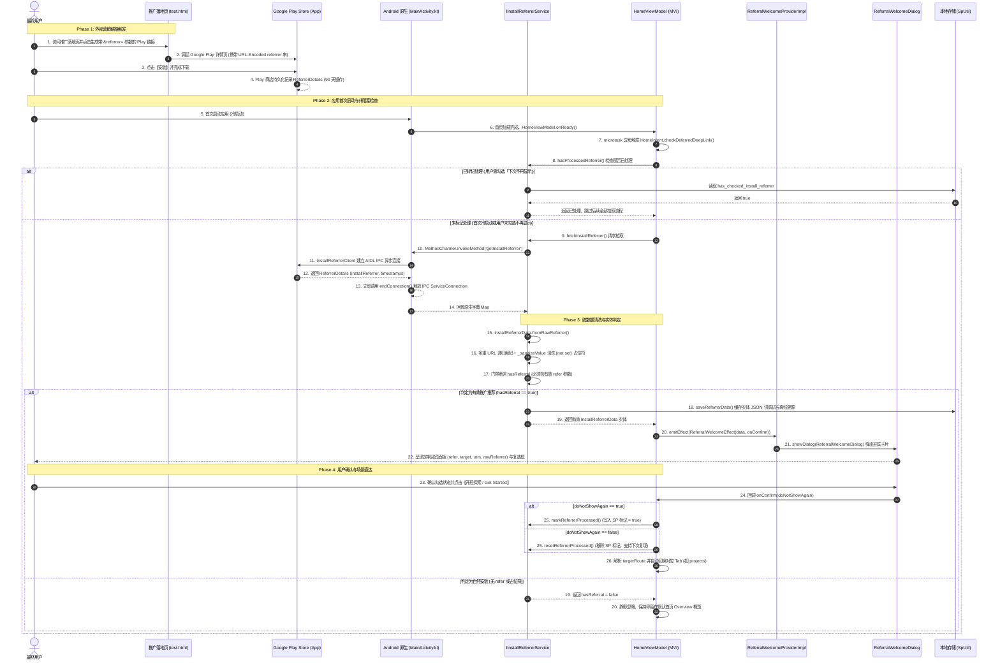

# Google Play 延迟深度链接 (Deferred Deep Link / Install Referrer) 技术规范与架构设计文档

## 1. 业务背景与全景愿景 (Business Background & Architectural Vision)

### 1.1 什么是 Deferred Deep Link（延迟深度链接）？
传统的深度链接（Deep Link / Universal Link）建立在一个关键前置条件之上：**用户设备上必须已经预装了目标 App**。
当尚未安装 App 的潜在用户在社交网络、推广短信、官网博客或营销邮件中点击推广链接时，传统的深度链接会遭遇阻断，系统通常只能将用户简单重定向至应用商店（如 Google Play Store）进行下载。然而在传统模式下，一旦用户进入下载安装环节，**最初点击时所携带的推广人标识、活动来源（UTM 参数）以及特定业务落地页面信息将彻底丢失**。当用户首次启动应用时，面对的只能是千篇一律的通用首页，不得不重新手动搜索查找此前感兴趣的内容，导致新客转化漏斗发生高达 30%~50% 的断崖式流失。

**Deferred Deep Linking（延迟深度链接）** 旨在彻底打破这一“安装即割裂”的体验断层：
- **安装前参数暂存**：允许用户在**尚未安装 App** 的状态下，点击携带自定义业务参数或营销标签的专属链接（如 `refer=ListenCommunity&target=projects`）；
- **应用商店中继传递**：Google Play 商店在用户下载安装时，将携带在 URL 中的 `referrer` 查询字符串安全持久化在 Play 商店服务底层（最长缓存 90 天）；
- **首装冷启动参数还原**：用户安装完成后首次打开应用，App 自动通过底层跨进程接口拉取安装前暂存的参数，并由业务状态机无缝恢复初始意图。

### 1.2 核心业务价值
在 ListenPortfolio 项目中，延迟深度链接落地了三大核心业务能力：
1. **个性化迎宾体验 (Personalized Onboarding)**：自动识别邀请人或推广渠道，呈现定制化的迎宾对话框（例如：*「来自 ListenCommunity 的特别推荐」*），显著提升品牌认同感。
2. **场景无缝承接与直达 (Instant Destination Navigation)**：根据 `target` 参数直接下钻至指定业务模块（如 `projects` 作品集 Tab、`aboutMe` 简历 Tab、或 `/settings` 系统设置），消除二次查找路径。
3. **精准渠道归因与营销漏斗沉淀 (Attribution & Funnel Analytics)**：无损解析 UTM 参数（`utm_source`, `utm_campaign`, `utm_medium` 等）与点击/安装时间戳，支撑精细化渠道投入产出比（ROI）分析。

---

## 2. 核心架构与端到端数据流 (Architecture & Data Flow)

### 2.1 Clean Architecture 模块分层模型
本方案严格遵循 Clean Architecture 与单一职责原则，实现原生层、服务层、领域层与表现层的解耦：

```
+-----------------------------------------------------------------------------------+
|                           UI & Presentation (表现层)                              |
|  - ReferralWelcomeDialog (基于 UIKit 的参数可视化迎宾弹窗)                         |
|  - ReferralWelcomeProviderImpl (基于 AppNavConfig.context 弹出，解耦 BuildContext)  |
|  - HomeViewModel (MVI Intent 调度、非阻塞微任务触发、Tab 切换直达)                 |
+-----------------------------------------------------------------------------------+
                                         │ 监听 / 派发 ReferralWelcomeEffect
                                         ▼
+-----------------------------------------------------------------------------------+
|                           Domain & Entities (领域实体层)                          |
|  - InstallReferrerData (不可变数据载体、多重 URL 解码、脏数据与占位符清洗)          |
|  - hasReferral 门禁 (严格校验 refer != null，杜绝自然安装误弹窗)                    |
+-----------------------------------------------------------------------------------+
                                         │ 数据抽象与持久化
                                         ▼
+-----------------------------------------------------------------------------------+
|                           Services & Storage (服务与存储层)                       |
|  - IInstallReferrerService (服务接口定义、mockInstance 单测注入)                  |
|  - InstallReferrerServiceImpl (平台检测、MethodChannel 桥接、SpUtil 幂等标记)     |
+-----------------------------------------------------------------------------------+
                                         │ MethodChannel ("com.listen.portfolio/install_referrer")
                                         ▼
+-----------------------------------------------------------------------------------+
|                           Platform Native (Android 原生层)                        |
|  - MainActivity.kt (Kotlin 实现，调用官方 com.android.installreferrer:2.2)         |
|  - InstallReferrerClient (AIDL IPC 绑定 Play 商店服务，严格 endConnection 释放)    |
+-----------------------------------------------------------------------------------+
```

### 2.2 端到端完整时序图



---

## 3. 技术难点与核心设计思路 (Technical Challenges & Deep Dives)

### 3.1 自研轻量实现 vs 商业化第三方 SDK 选型决策
在移动端工程实践中，通常有三类实现延迟深度链接的技术路线。我们对比如下：

| 评估维度 | 商业归因 SDK (Adjust / AppsFlyer / Branch) | 开源通用插件 (如 stack_deferred_link) | 本项目自研架构 (InstallReferrerClient + MVI) |
| :--- | :--- | :--- | :--- |
| **包体积影响** | 增加约 **2.5MB ~ 5MB** 原生动态库及依赖 | 增加约 200KB 依赖 | **仅增量约 35KB**（纯 Kotlin 原生直接调用，零多余三方库） |
| **隐私与合规** | 强制采集并上传设备硬件指纹、IP、IMEI，有 GDPR/隐私合规封禁风险 | 通常在 iOS 隐式强读剪贴板，易触发 iOS 14+ 隐私横幅警告 | **100% 离线自主可控**，不上传设备指纹，仅在内存与本地 SpUtil 流转 |
| **成本支出** | 昂贵的商业按月订阅费或按安装归因计费（MAU 计费） | 免费开源，但维护活跃度低，API 容易滞后 | **零额外资金成本**，基于 Google Play 官方公开免费 API 构建 |
| **架构契合度** | 黑盒闭包运行，难以无缝融入业务 MVI 状态机与测试矩阵 | 仅提供裸字符串读取，需业务层大量样板代码胶水拼接 | **原生融入 MVI 架构**：Intent 驱动、Effect 呈现、支持 `mockInstance` 单测覆盖率达 100% |

**架构决策**：本项目采用自研原生方案，以最小的代码增量和零合规隐患实现 Google Play 官方延迟深度链接体系。

---

### 3.2 难点 1：Google Play 90 天缓存机制与客户端幂等防重复弹窗

#### 问题现象
开发者初次接触 Google Play Install Referrer API 时，普遍存在一个思维误区，误以为 `InstallReferrerClient` 的数据在首次拉取后就会被 Google Play 自动消费并清空。但在真实环境中，用户即便多次打开应用，只要未卸载，Google Play 每次均会如实返回该数据。

#### Google 官方规范定义
> *"The install referrer information will be available for **90 days** and will not change unless the application is reinstalled."*
> —— Google Play Install Referrer API 官方文档规范

#### 架构应对与幂等保护
若无严密的客户端状态机设计，用户每次打开应用都会重复弹出“欢迎来自 ListenCommunity 的推荐”弹窗，造成灾难性的用户体验破坏。
为此，我们设计了双重幂等防护机制：
1. **状态机前置门禁 (`hasProcessedReferrer`)**：
   在 `HomeViewModel` 发起拉取前，优先调用 `IInstallReferrerService.hasProcessedReferrer()`。该方法直接读取 `SpUtil` 中存储的 `has_checked_install_referrer` 布尔键。一旦标记为 `true`，后续所有 IPC 连接与弹窗逻辑被立即短路，耗时为 0ms。
2. **用户知情权与测试平衡（「下次不再显示」复选框）**：
   在 `ReferralWelcomeDialog` 底部设计了复选框（默认未勾选，方便开发测试反复验证）。用户点击【开启探索】时，将复选框状态回调至 ViewModel：
   ```dart
   onConfirm: (bool doNotShowAgain) async {
     if (doNotShowAgain) {
       await service.markReferrerProcessed(); // 永久标记已处理
     } else {
       await service.resetReferrerProcessed(); // 移除标记，下次启动仍可触发
     }
     // 执行页面直达跳转
   }
   ```
   这一设计既保障了普通用户的免打扰体验，又极大提升了开发、测试与演示阶段的调试便利性。

---

### 3.3 难点 2：系统占位符与脏数据过滤体系

#### 脏数据痛点
在 Google Play 生态中，不仅携带参数的推广链接会返回字符串，在以下场景下 Google Play 也会下发系统默认占位字符串：
1. **自然搜索安装 (Organic Search)**：Google Play 返回 `utm_source=google-play&utm_medium=organic`；
2. **未带参内测页面 (Internal Testing Opt-in)**：Google Play 默认下发占位符 `utm_source=(not%20set)&utm_medium=(not%20set)`；
3. **空参数或异常跳转**：返回诸如 `null`、`(null)`、`undefined` 等字符串文本。

如果开发人员仅简单校验 `utmSource.isNotEmpty` 或 `rawReferrer.isNotEmpty`，会导致全量自然安装的真实用户在首次打开 App 时，被错误弹出空迎宾卡片。

#### 清洗与过滤双重引擎
为彻底杜绝误判，我们在 [`InstallReferrerData`](../lib/shared/services/referrer/install_referrer_data.dart) 中实现了高鲁棒性的清洗过滤器：
1. **`_sanitizeValue` 占位符擦除器**：
   ```dart
   static String? _sanitizeValue(String? val) {
     if (val == null) return null;
     final trimmed = val.trim();
     if (trimmed.isEmpty) return null;

     final lower = trimmed.toLowerCase();
     if (lower == '(not set)' ||
         lower == 'not set' ||
         lower == '(not%20set)' ||
         lower == 'not%20set' ||
         lower == 'null' ||
         lower == '(null)' ||
         lower == 'undefined') {
       return null;
     }
     return trimmed;
   }
   ```
2. **`hasReferral` 刚性判定门禁**：
   ```dart
   /// 严格要求必须包含非空的自定义 refer 推荐参数
   bool get hasReferral => refer != null && refer!.trim().isNotEmpty;
   ```
   只要 Query 中没有明确传递具备业务意义的 `refer` 字段（例如来自 `test.html` 的专属推广），无论 Google Play 下发何种复杂的默认 UTM 占位串，一律被判定为无效来源，直接静默放行，确保自然安装用户的纯净体验。

---

### 3.4 难点 3：多重 URL 编码递归还原算法

#### 编码转义痛点
Google Play 要求推广链接中拼装在 `referrer=` 后的整个字符串必须经过标准的 URL 编码（RFC 3986）。
例如原始参数为：
```text
refer=ListenCommunity&target=projects&utm_source=twitter
```
组装为 Google Play 链接后为：
```text
https://play.google.com/store/apps/details?id=com.listen.portfolio.listen_portfolio_flutter&referrer=refer%3DListenCommunity%26target%3Dprojects%26utm_source%3Dtwitter
```
在某些第三方落地页跳转或邮件客户端重定向时，URL 可能会被浏览器二次转义（双重编码，例如 `%26` 被再次转义为 `%2526`）。

#### 健壮的解码流水线
在 [`InstallReferrerData.fromRawReferrer`](../lib/shared/services/referrer/install_referrer_data.dart) 中：
1. **自动侦测并递归解码**：通过 `Uri.decodeFull` 检测并还原多层 `%` 转义字符；
2. **双重分隔符兼容**：通过 `RegExp(r'[;&]')` 同时兼容标准 `&` 与极少数平台生成的 `;` 参数分隔符；
3. **键值容错提取**：对键名提供容错降级（如 `params['target'] ?? params['route'] ?? params['tab']`，`params['refer'] ?? params['referrer'] ?? params['ref']`）；
4. **纯字符串退化保护**：若外部传入的是非键值对格式的纯激活码（如 `referrer=ListenVIP2026`），自动将其整体降级赋值给 `refer`，保障最大容错度。

---

### 3.5 难点 4：Android 原生 IPC 资源防泄漏管理

#### 连接模型与潜在风险
Google Play 的 `InstallReferrerClient` 基于 Android AIDL（Android 接口定义语言）跨进程绑定远程应用商店服务（`com.android.vending`）。
若调用端未显式调用 `referrerClient.endConnection()`，会导致该 Activity 持有远程 ServiceConnection 的 Binder 引用，引发内存泄漏，在系统资源紧张时甚至会导致应用主线程卡顿（ANR）。

#### 严格的生命周期终结守卫
在 [`MainActivity.kt`](../android/app/src/main/kotlin/com/listen/portfolio/listen_portfolio_flutter/MainActivity.kt) 中，我们在所有可能的分支中严密执行了清理：
```kotlin
private fun fetchInstallReferrer(result: MethodChannel.Result) {
    try {
        val referrerClient = InstallReferrerClient.newBuilder(this).build()
        referrerClient.startConnection(object : InstallReferrerStateListener {
            override fun onInstallReferrerSetupFinished(responseCode: Int) {
                when (responseCode) {
                    InstallReferrerClient.InstallReferrerResponse.OK -> {
                        try {
                            val response: ReferrerDetails = referrerClient.installReferrer
                            val referrerUrl = response.installReferrer ?: ""
                            // 💡 成功读取后立即释放 IPC 连接
                            referrerClient.endConnection()
                            result.success(mapOf(
                                "installReferrer" to referrerUrl,
                                "referrerClickTimestampSeconds" to response.referrerClickTimestampSeconds,
                                "installBeginTimestampSeconds" to response.installBeginTimestampSeconds,
                                "googlePlayInstant" to response.googlePlayInstantParam
                            ))
                        } catch (e: Exception) {
                            try { referrerClient.endConnection() } catch (_: Exception) {}
                            result.success(mapOf("installReferrer" to ""))
                        }
                    }
                    else -> {
                        // 💡 遇到错误响应码（如 FEATURE_NOT_SUPPORTED、SERVICE_UNAVAILABLE）时同样必须释放
                        try { referrerClient.endConnection() } catch (_: Exception) {}
                        result.success(mapOf("installReferrer" to ""))
                    }
                }
            }
            override fun onInstallReferrerServiceDisconnected() {
                // IPC 连接断开回调
            }
        })
    } catch (e: Exception) {
        result.success(mapOf("installReferrer" to ""))
    }
}
```

---

### 3.6 难点 5：Google Play 内测渠道归因陷阱与落地页设计

#### 内测渠道归因陷阱
在 Google Play Console 的 **Internal Testing（内部测试）** 渠道中，如果受邀测试人员直接在邀请邮件中点击「在 Google Play 下载」，Google Play 官方并不会自动带上任何自定义参数，返回的永远是 `(not set)`。

#### 解决方案：专属 Web 落地页 `test.html`
我们专门在 GitHub Pages 构建并部署了开箱即用的落地页：
👉 **[`https://listen2code.github.io/ListenPortfolioFlutter/pages/test.html`](https://listen2code.github.io/ListenPortfolioFlutter/pages/test.html)**

落地页特性：
1. **表单参数所见即所得**：支持输入 `refer`、`target`、`utm_source` 等字段；
2. **自动化 URL 编码**：利用 JavaScript `encodeURIComponent` 构建符合 Google Play 规范的严谨 URL；
3. **一键唤起 Google Play**：点击按钮直接调用 `market://` 或 `https://play.google.com/store/apps/details?id=...`，确保参数完整灌入 Google Play 客户端。

---

## 4. 关键源码结构与职责边界 (Key Source Code Structure)

### 4.1 源码文件全景清单

| 文件路径 | 架构层级 | 核心职责说明 |
| :--- | :--- | :--- |
| [`android/.../MainActivity.kt`](../android/app/src/main/kotlin/com/listen/portfolio/listen_portfolio_flutter/MainActivity.kt) | Native Layer | 响应 MethodChannel，调用官方 `InstallReferrerClient` 进行 AIDL 跨进程通信，并保障连接终结释放 |
| [`lib/shared/services/referrer/install_referrer_data.dart`](../lib/shared/services/referrer/install_referrer_data.dart) | Domain Entity | 纯不可变数据实体，负责多重 URL 递归解码、占位符清洗、`hasReferral` 判定及 JSON 序列化 |
| [`lib/shared/services/referrer/install_referrer_service.dart`](../lib/shared/services/referrer/install_referrer_service.dart) | Service Layer | 抽象服务接口与默认实现，执行平台过滤（非 Android 直接忽略）、MethodChannel 调用及 `SpUtil` 幂等管理 |
| [`lib/shared/base/referral_welcome_provider_impl.dart`](../lib/shared/base/referral_welcome_provider_impl.dart) | Provider Layer | 桥接 MVI 状态机与 UI 呈现，监听 `ReferralWelcomeEffect` 并在当前全局 Context 弹出迎宾对话框 |
| [`lib/shared/widgets/dialogs/referral_welcome_dialog.dart`](../lib/shared/widgets/dialogs/referral_welcome_dialog.dart) | UI Widget | 基于自研 UIKit（`CommonButton`, `CommonCard`, `CommonText`）构建的迎宾对话框，包含参数高亮与不再提示复选框 |
| [`lib/features/home/presentation/pages/home_view_model.dart`](../lib/features/home/presentation/pages/home_view_model.dart) | Presentation | MVI 状态机，在 `onReady` 阶段以非阻塞微任务发起检查，处理用户确认回调并执行 Tab 场景直达 |

---

### 4.2 核心代码实现切片

#### 1. `InstallReferrerData.fromRawReferrer` 核心解析
```dart
// 递归 URL 解码与键值容错提取
factory InstallReferrerData.fromRawReferrer(
  String raw, {
  int? clickTimestampSeconds,
  int? installTimestampSeconds,
  bool googlePlayInstant = false,
}) {
  if (raw.trim().isEmpty) return InstallReferrerData.empty;

  String decoded = raw;
  try {
    if (decoded.contains('%')) decoded = Uri.decodeFull(decoded);
  } catch (_) {}

  final params = _parseQueryString(decoded);
  String? rawRefer = params['refer'] ?? params['referrer'] ?? params['ref'] ?? params['source'];
  if (rawRefer == null && !raw.contains('=') && raw.trim().isNotEmpty) {
    rawRefer = raw.trim();
  }

  return InstallReferrerData(
    rawReferrer: raw,
    refer: _sanitizeValue(rawRefer),
    utmSource: _sanitizeValue(params['utm_source']),
    targetRoute: _sanitizeValue(params['target'] ?? params['route'] ?? params['tab']),
    clickTimestampSeconds: clickTimestampSeconds,
    installTimestampSeconds: installTimestampSeconds,
    googlePlayInstant: googlePlayInstant,
  );
}
```

#### 2. `HomeViewModel` MVI 驱动与直达跳转
```dart
Future<void> _onCheckDeferredDeepLink() async {
  final service = ref.read(installReferrerServiceProvider);
  final hasProcessed = await service.hasProcessedReferrer();
  if (hasProcessed) return;

  final data = await service.fetchInstallReferrer();
  if (data.hasReferral) {
    await service.saveReferrerData(data);
    _onHandleDeferredDeepLink(data);
  }
}

void _onHandleDeferredDeepLink(InstallReferrerData data) {
  final service = ref.read(installReferrerServiceProvider);
  emitEffect(
    ReferralWelcomeEffect(
      data: data,
      onConfirm: (bool doNotShowAgain) async {
        if (doNotShowAgain) {
          await service.markReferrerProcessed();
        } else {
          await service.resetReferrerProcessed();
        }

        // 目标路由直达分发
        if (data.targetRoute != null && data.targetRoute!.isNotEmpty) {
          final target = data.targetRoute!.trim();
          final targetTab = HomeTab.values.firstWhereOrNull((t) => t.name == target);
          if (targetTab != null) {
            _onTabChanged(targetTab, null, false);
          } else {
            emitEffect(NavigationEffect<void>(target: target));
          }
        }
      },
    ),
  );
}
```

---

## 5. 推广链接生成规范 (Referral Link Specifications)

### 5.1 标准 URL 格式
```text
https://play.google.com/store/apps/details?id=com.listen.portfolio.listen_portfolio_flutter&referrer=<URL_ENCODED_QUERY>
```

### 5.2 核心参数契约表
| 键名 (Key) | 必填 | 业务含义说明 | 规范取值示例 |
| :--- | :---: | :--- | :--- |
| **`refer`** | **是** | 推荐来源核心标识（触发迎宾流程的唯一必要门禁） | `ListenCommunity`, `GitHubVisitor`, `Campus2026` |
| **`target`** | 否 | 首次启动直达的页面或 Tab 标识 | `projects`, `aboutMe`, `resume`, `/settings` |
| **`utm_source`** | 否 | 推广营销渠道 | `twitter`, `github`, `reddit`, `email` |
| **`utm_campaign`** | 否 | 营销活动名称 | `v1_launch`, `developer_beta` |
| **`utm_medium`** | 否 | 媒介类型 | `social`, `readme`, `cpc` |
| **`utm_content`** | 否 | 广告内容/位置标识 | `header_btn`, `sidebar_link` |
| **`utm_term`** | 否 | 搜索关键词 | `flutter_developer`, `portfolio` |

---

## 6. 全链路日志与可观测性规范 (Observability & Logging)

所有涉及 Deferred Deep Link / Install Referrer 的日志均统一使用前缀：
```text
[Deferred Deep Link]
```

### 日志过滤指南
- **终端 ADB Logcat (双端全量监控)**：
  ```bash
  adb logcat | grep "Deferred Deep Link"
  ```
- **应用内 APM 调试浮窗 (`LogOverlay`)**：
  在控制台搜索 `Deferred Deep Link`，可直接下钻查看完整的提取耗时、原始参数串及 JSON 缓存。

---

## 7. 自动化测试与开发者验证指南 (Verification & Testing Guide)

### 7.1 自动化单元与 Widget 测试套件 (16/16 绿灯)
在项目根目录下执行专项测试：
```bash
flutter test test/shared/services/install_referrer_service_test.dart \
             test/shared/widgets/referral_welcome_dialog_test.dart \
             test/features/home/home_view_model_deferred_deeplink_test.dart
```

测试覆盖矩阵：
- `InstallReferrerData Parsing Tests`：标准解析、多重 URL 编码解码、UTM 提取、`(not set)` 与自然安装占位符清洗、JSON 互转；
- `ReferralWelcomeDialog Widget Tests`：自研 UIKit 组件层级、参数渲染、Checkbox 状态切换及 `onConfirm` 回调；
- `HomeViewModel Deferred Deep Link Tests`：MVI 流程驱动、SP 幂等标记读写、`doNotShowAgain` 行为分支及目标 Tab 直达切换。

### 7.2 开发者本地模拟（免安装方案）
1. **开发者模式模拟**：在应用内进入「设置」页面，连续轻触版本号 7 次激活开发者模式，点击「模拟 Deferred Deep Link」即可触发全套流程。
2. **ADB 命令行广播模拟**：
   ```bash
   adb shell am broadcast -a com.android.vending.INSTALL_REFERRER \
     -n com.listen.portfolio.listen_portfolio_flutter/com.listen.portfolio.listen_portfolio_flutter.MainActivity \
     --es "referrer" "refer=ListenCommunity&target=projects&utm_source=twitter"
   ```

---

## 8. 目前存在的不足与演进路线 (Limitations & Future Improvements)

我们在持续演进中规划了以下两项商业级能力，已同步记录至 [`todo.md`](todo.md)：

### 8.1 Opt-15. iOS 剪贴板归因合规感知与 App Clip 延迟深度链接体系
- **现状**：当前 `IInstallReferrerService` 仅依托 Android 原生 `InstallReferrerClient` 实现渠道归因，在 iOS 平台直接返回空数据 (`kIsWeb || !Platform.isAndroid`)。iOS 系统缺乏原生的 Install Referrer 机制，若隐式读取剪贴板（UIPasteboard）会触发系统隐私弹窗。
- **演进方案**：
  1. 在 Web 落地页 `test.html` 提供「一键复制专属推荐码并跳转 App Store」，App 首次冷启动时基于用户显式意图或 `UIPasteControl` 原生合规控件进行感知；
  2. 探索轻量 App Clip（轻 App，包体积 $< 15$MB），用户点击 Universal Link 直接秒开 App Clip，通过 App Group 共享容器向完整版 App 无缝传递渠道参数与目标路由。
- **跟踪**：详见 [`todo.md`](todo.md) 中的 `Opt-15`。

### 8.2 Opt-16. Google Play 服务端时间戳防篡改与 CTIT 反作弊点击注入校验
- **现状**：当前应用提取到的时间戳仅在端侧解析，未上传至云端进行二次鉴权校验；在开放网络或 ADB 环境下，可能遭受模拟广播（`INSTALL_REFERRER`）伪造来源作弊。
- **演进方案**：
  1. 将 Google Play 返回的服务端校准时间戳（`referrerClickTimestampServerSeconds` / `installBeginTimestampServerSeconds`）随首次激活请求上传至 Spring Boot 后端，对接 Google Play Developer API 验证安装真实性；
  2. 建立反作弊漏斗：若 Click-to-Install Time ($\text{CTIT} < 5$ 秒)，自动标记为“点击注入 (Click Injection)”作弊并降级；若 $\text{CTIT} > 90$ 天，标记为长尾过期点击并过滤；
  3. 服务端建立 `install_referrals` 归因表，在管理控制台输出多渠道次留、七留与转化漏斗图谱。
- **跟踪**：详见 [`todo.md`](todo.md) 中的 `Opt-16`。
