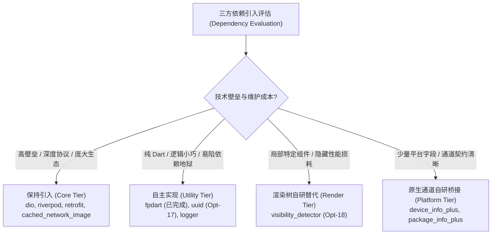
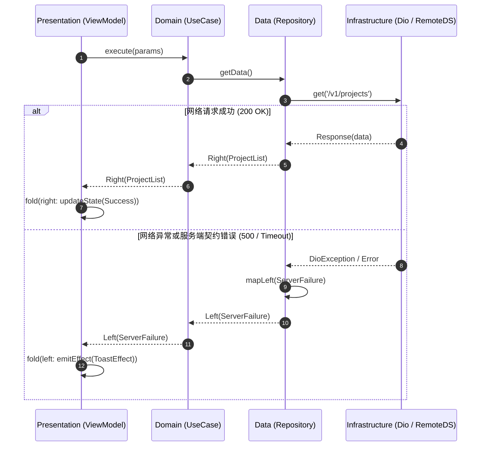
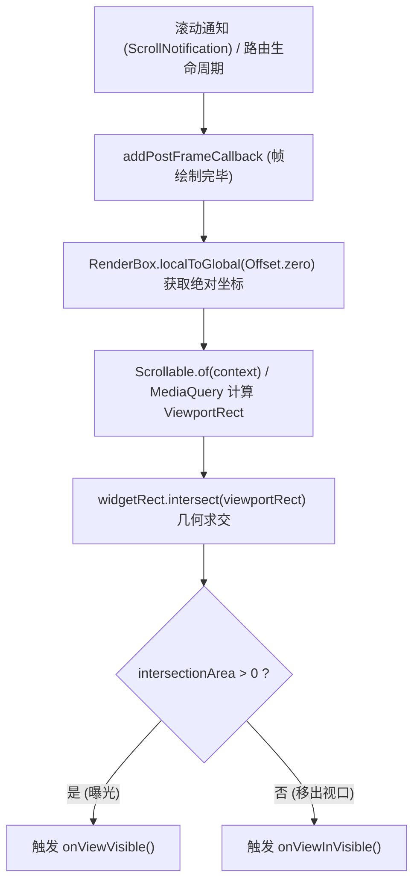
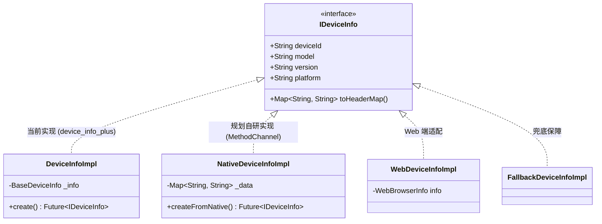

# 剔除部分三方 Pub 依赖并自主实现的架构演进与深度技术方案

> [!NOTE]
> **Implementation & Refactoring Status (重构实施进展)**:
> - **阶段一已落地 (Completed)**：`fpdart` 已被自定义轻量 `Either<L, R>` 与 `Option<T>` 密封类 100% 替换，并已从 `ListenCore/pubspec.yaml` 中彻底移除；
> - **阶段一计划中 (Planned - Opt-17)**：`uuid` 已完成纯 Dart RFC 4122 v4 算法预研，准备落地自研 `UuidUtil` 并从全工程 `pubspec.yaml` 中移除；`logger` 已完成 `_TracePrinter` 与 `_LogManagerOutput` APM 装饰层集成，后续规划纯 Dart ANSI 彩色日志器；
> - **阶段二计划中 (Planned - Opt-18)**：`visibility_detector` 仅在 `BaseLifeCyclePage` 中用于曝光探测，规划基于 `RenderBox` 几何求交与 `Scrollable` 视口计算替代；
> - **阶段三计划中 (Planned)**：`device_info_plus` 已通过 `IDeviceInfo` 抽象接口完成业务隔离，准备通过极简原生 `MethodChannel` 替代；`package_info_plus` 与 `connectivity_plus` 规划同理落地。

---

## 1. 设计思路与重构哲学 (Design Rationale & Philosophy)

在现代移动跨平台架构设计中，第三方开源依赖（Pub Packages）是一把双刃剑：在初期它们能够显著提高开发敏捷度，但随着工程规模扩大与长期维护周期的拉长，过度引入边缘功能依赖会带来沉重的工程包袱。

本项目提出并践行**“核心基建严谨引入，周边工具审慎自研”**的架构演进哲学。



### 1.1 为什么要剔除部分三方 Pub 依赖？

1. **规避“依赖地狱”与 Flutter SDK 升级阻断 (Dependency Hell & Upgrade Blockers)**：
   Flutter 框架平均每季度发布一次大版本更新。许多社区小包长期缺乏维护，一旦其 `environment: sdk` 约束未及时放宽，或者使用了已废弃的 Flutter 内部 API，就会直接阻断全工程的升级。自主实现能够让关键基建与官方 SDK 保持 100% 同步演进。
2. **包体积与冷启动性能极致优化 (Binary Size & Launch Time)**：
   每一个引入的第三方包都会向 Dart AOT Snapshot 或 Android DEX 注入额外的类、方法和符号表。像 `fpdart` 或 `uuid` 这种功能完备的通用库，通常包含了数十倍于业务所需特性的冗余代码（如 `fpdart` 中的 Reader/State/Lens 单子，`uuid` 中的 v1/v3/v5 散列算法）。自研小巧工具能让包体积与内存常驻实现“克制之美”。
3. **消除隐式性能与测试侵入开销 (Eliminate Hidden Overhead & Test Pollution)**：
   以 `visibility_detector` 为例，其内部启动了一个 500ms 轮询的全局定时器。这不仅在运行时消耗 CPU 唤醒，更严重侵入了单元测试：为了防止测试执行超时或定时器未释放，必须在每个测试文件的 `setUpAll` 中硬编码 `VisibilityDetectorController.instance.updateInterval = Duration.zero;`。自研基于渲染树的按需事件驱动方案能彻底根除该问题。
4. **技术沉淀与硬核技能穿透 (Deep Mastery of Core Principles)**：
   通过自研，开发者将从单纯的“API 调用者”进阶为“机制掌控者”：
   - 掌握 Dart 3 的代数数据类型（Algebraic Data Types）与模式匹配；
   - 掌握 RFC 4122 规范、加密级随机数安全与二进制位运算；
   - 掌握 Flutter 渲染树 `RenderObject`、`RenderBox.localToGlobal` 几何相交算法；
   - 掌握跨平台 `MethodChannel` 的双端（Kotlin / Swift）极致封装。

---

## 2. 🙋 核心疑问解答：只会 Android 不会 iOS，适合做这件事吗？

> [!IMPORTANT]
> **完全适合，甚至是非常难得的跨端进阶契机！** 原因如下：
>
> 1. **很多库是纯 Dart / Flutter 实现的，不需要编写任何原生代码**：
>    像 `uuid`、`fpdart`（已完成自主替换）以及自定义日志输出等，它们 100% 运行在 Dart VM 虚拟机层。只要用纯 Dart 编写一次，就能在 Android、iOS、Web 及 Desktop 上完美运行，零原生门槛。
> 2. **对于需要原生代码的库，这是掌握跨端通道的最佳实践**：
>    - 像 `device_info_plus` 或 `package_info_plus` 这种库，其核心原生代码其实只有 20~30 行（读取 Android 的 `Build.MODEL` 或 iOS 的 `UIDevice.current.model`）。
>    - iOS 端对应的 Swift 代码极其精简规范，你可以借助成熟范例或 AI 辅助补齐 Swift 类，同时运用你深厚的 Android (Kotlin) 经验完成高质量的 Android 侧管道对接与性能保障。
>    - 真正将 `MethodChannel` 与 Clean Architecture 接口解耦落地，是迈向高级跨平台架构师的必由之路。

---

## 3. 已落地实现深度剖析：代数数据类型与轻量 `Either` (替代 `fpdart`)

在 Clean Architecture 中，数据层 Repository 与领域层 UseCase 的操作结果天然具备**二元性**（要么成功返回领域实体，要么失败返回领域异常）。

传统 Java/Dart 习惯使用 `try-catch` 抛出受检或非受检异常，但这破坏了函数的引用透明性（Referential Transparency），导致调用方极易遗漏 `catch` 分支，且捕获异常（Capturing StackTrace）在 Dart VM 中存在不可忽略的性能开销。

此前项目引入了第三方库 `fpdart`，但其带来了数百个无关的函数式编程类型。为此，我们在 `ListenCore` 中自主实现了轻量纯 Dart 的 `Either<L, R>` 与 `Option<T>`。

### 3.1 密封类体系与编译期穷尽性 (Compile-Time Exhaustiveness)

利用 Dart 3 的 `sealed class` 特性，定义了二元联合类型的闭环继承层次：

```dart
@immutable
sealed class Either<L, R> {
  const Either();

  T fold<T>(T Function(L left) left, T Function(R right) right);

  Either<L, NewR> map<NewR>(NewR Function(R right) fn) {
    return fold((l) => Left<L, NewR>(l), (r) => Right<L, NewR>(fn(r)));
  }

  Either<NewL, R> mapLeft<NewL>(NewL Function(L left) fn) {
    return fold((l) => Left<NewL, R>(fn(l)), (r) => Right<NewL, R>(r));
  }

  bool isLeft() => this is Left<L, R>;
  bool isRight() => this is Right<L, R>;

  R getOrElse(R Function(L left) onError) {
    return fold(onError, (r) => r);
  }

  Option<R> getRight() => fold((_) => const None(), (r) => Some(r));
  Option<L> getLeft() => fold((l) => Some(l), (_) => const None());
}

class Left<L, R> extends Either<L, R> {
  final L value;
  const Left(this.value);
  @override
  T fold<T>(T Function(L left) left, T Function(R right) right) => left(value);
}

class Right<L, R> extends Either<L, R> {
  final R value;
  const Right(this.value);
  @override
  T fold<T>(T Function(L left) left, T Function(R right) right) => right(value);
}
```

### 3.2 双轨错误处理模型 (Railway-Oriented Programming)

`Either<L, R>` 在工程中贯彻了“双轨错误模型”：
- **绿色轨道 (Right Track)**：承载业务成功数据；
- **红色轨道 (Left Track)**：承载领域错误对象（如 `Failure`）。



### 3.3 对比收益

| 维度 | 原三方依赖 (`fpdart: ^1.1.0`) | 自主实现 (`Either` + `Option`) | 收益说明 |
| :--- | :--- | :--- | :--- |
| **代码量** | 5,000+ 行 Dart 代码 | 120 行聚焦核心代码 | 剔除 97% 无用抽象类型 |
| **Transitive 依赖** | 引入多个元数据注解辅助包 | **0 额外依赖**，纯原生 Dart | 零版本冲突风险 |
| **编译速度与体积** | 参与 AOT 符号分析与静态编译 | 毫秒级编译，完全受编译器内联优化 | 减小 Release 产物体积 |
| **可维护性** | 外部黑盒，文档随版本变迁 | 源码完全透明，内嵌详尽教学注释 | 100% 掌控度 |

---

## 4. 待落地重点模块设计与难点代码实现

根据规划，我们将推进三个层级的依赖自主实现，并在 [todo.md](todo.md) 中建立对应的跟踪项。

### 4.1 阶段一：纯 Dart RFC 4122 v4 UUID 生成器 (替代 `uuid`, 对应 Opt-17)

#### 4.1.1 痛点剖析与业务审计
全工程（`ListenCore` 与 `ListenPortfolioFlutter`）经严格检索，仅有 **4 处** 调用了 `const Uuid().v4()`：
1. `ListenCore/lib/network/interceptors/network_inspector_interceptor.dart`：生成 HTTP 请求审计 `requestId`；
2. `ListenCore/lib/utils/zone_manager.dart`：生成全链路分布式 Trace ID；
3. `ListenPortfolioFlutter/lib/features/fault_injection/presentation/pages/fault_injection_view_model.dart`：故障模拟时生成事件跟踪 ID；
4. `ListenPortfolioFlutter/lib/features/ai_chat/presentation/pages/ai_chat_view_model.dart`：生成本地未发送完成的消息唯一键。

业务**完全未用到** `package:uuid` 附带的 v1（基于 MAC 地址和时间戳）、v3/v5（MD5/SHA-1 命名空间哈希）、以及复杂的校验解析器。为此，实现一个标准、零依赖、高性能的纯 Dart RFC 4122 v4 生成器具有极高的 ROI。

#### 4.1.2 RFC 4122 规范与二进制位运算核心实现
UUID v4 是基于随机数生成的 128 位（16 字节）数字，其规范要求：
- **版本位 (Version)**：在第 7 个字节（索引 6）的高 4 位必须固定为 `0100`（二进制表示 4）；
- **变体位 (Variant)**：在第 9 个字节（索引 8）的高 2 位必须固定为 `10`（二进制表示 DCE 1.1 / RFC 4122 规范）。

二进制位运算公式：
$$\text{byte}_6 = (\text{byte}_6 \ \& \ \text{0x0F}) \ | \ \text{0x40}$$
$$\text{byte}_8 = (\text{byte}_8 \ \& \ \text{0x3F}) \ | \ \text{0x80}$$

#### 4.1.3 高性能无对象分配组装算法
为避免使用 `List.generate` 和频繁字符串拼接产生的 GC 压力，我们使用固定长度的字符码缓冲区与 16 进制常量查表法：

```dart
import 'dart:math';
import 'dart:typed_data';

/// Pure-Dart zero-dependency RFC 4122 compliant UUID v4 generator.
class UuidUtil {
  UuidUtil._();

  static final Random _secureRandom = Random.secure();

  // Pre-computed lowercase hex lookup table for 0..255
  static final List<String> _byteToHex = List<String>.generate(256, (i) {
    return i.toRadixString(16).padLeft(2, '0');
  });

  /// Generates a cryptographically secure RFC 4122 Version 4 UUID string.
  /// Format: 8-4-4-4-12 (e.g. "f47ac10b-58cc-4372-a567-0e02b2c3d479")
  static String v4() {
    final Uint8List bytes = Uint8List(16);
    for (int i = 0; i < 16; i++) {
      bytes[i] = _secureRandom.nextInt(256);
    }

    // Set Version 4: bits 12-15 of time_hi_and_version to 0100
    bytes[6] = (bytes[6] & 0x0F) | 0x40;

    // Set Variant: bits 6-7 of clock_seq_hi_and_reserved to 10
    bytes[8] = (bytes[8] & 0x3F) | 0x80;

    final StringBuffer buffer = StringBuffer();
    for (int i = 0; i < 16; i++) {
      if (i == 4 || i == 6 || i == 8 || i == 10) {
        buffer.write('-');
      }
      buffer.write(_byteToHex[bytes[i]]);
    }
    return buffer.toString();
  }
}
```

---

### 4.2 阶段二：基于 RenderBox 与 Scrollable 的视口相交曝光检测器 (替代 `visibility_detector`, 对应 Opt-18)

#### 4.2.1 痛点剖析
目前全工程仅在 `ListenCore/lib/base/base_lifecycle_page.dart` 中使用 `visibility_detector` 插件，且受 `widget.useVisibilityDetector` 控制：
- 该插件在后台常驻 `Timer.periodic(const Duration(milliseconds: 500))` 全局轮询任务；
- 在自动化测试中，由于定时器未暂停，会导致测试框架无法判定 UI 稳定（Pending Timers），被迫在大量测试的 `setUpAll` 中注入 `VisibilityDetectorController.instance.updateInterval = Duration.zero;`；
- 实际上业务只需要知道当前页面在屏幕中是否曝光（`visibleFraction > 0` 触发 `onViewVisible` / `onViewInVisible`）。

#### 4.2.2 渲染树几何相交数学原理
利用 Flutter 渲染引擎的核心 API：
1. **获取组件绝对屏幕坐标**：
   通过 `context.findRenderObject() as RenderBox`，调用 `renderBox.localToGlobal(Offset.zero)` 获得当前组件左上角相对于屏幕坐标系的绝对原点 $(x_0, y_0)$，从而构造出组件外接矩形：
   $$\text{WidgetRect} = \text{Rect.fromLTWH}(x_0, y_0, \text{width}_{\text{widget}}, \text{height}_{\text{widget}})$$
2. **获取可视视口边界 (Viewport Rect)**：
   通过 `Scrollable.of(context)` 向上查找最近的滚动容器，获取滚动视口的 `RenderBox`；若当前页面为静态页面，则直接取屏幕可用尺寸 `MediaQuery.of(context).size`：
   $$\text{ViewportRect} = \text{Rect.fromLTWH}(0, 0, \text{width}_{\text{screen}}, \text{height}_{\text{screen}})$$
3. **矩形相交判定与曝光比例计算**：
   调用 Flutter 基础几何库的 `widgetRect.intersect(viewportRect)` 计算两矩形的交集区域 `intersection`。
   若交集为空，则 $\text{visibleFraction} = 0.0$；否则：
   $$\text{visibleFraction} = \frac{\text{intersection.width} \times \text{intersection.height}}{\text{widgetRect.width} \times \text{widgetRect.height}}$$



#### 4.2.3 自研组件蓝图设计 (`ViewportVisibilityDetector`)

```dart
import 'package:flutter/material.dart';

typedef VisibilityChangedCallback = void Function(double fraction);

/// Lightweight, zero-timer visibility detector based on RenderBox geometry.
class ViewportVisibilityDetector extends StatefulWidget {
  final Widget child;
  final VisibilityChangedCallback onVisibilityChanged;

  const ViewportVisibilityDetector({
    super.key,
    required this.child,
    required this.onVisibilityChanged,
  });

  @override
  State<ViewportVisibilityDetector> createState() => _ViewportVisibilityDetectorState();
}

class _ViewportVisibilityDetectorState extends State<ViewportVisibilityDetector> {
  double _lastFraction = -1.0;

  void _calculateVisibility() {
    if (!mounted) return;
    final renderObject = context.findRenderObject();
    if (renderObject is! RenderBox || !renderObject.hasSize) return;

    final widgetOffset = renderObject.localToGlobal(Offset.zero);
    final widgetRect = widgetOffset & renderObject.size;

    final screenSize = MediaQuery.of(context).size;
    final viewportRect = Offset.zero & screenSize;

    final intersection = widgetRect.intersect(viewportRect);
    double fraction = 0.0;
    if (intersection.width > 0 && intersection.height > 0) {
      fraction = (intersection.width * intersection.height) / (widgetRect.width * widgetRect.height);
    }

    fraction = fraction.clamp(0.0, 1.0);
    if ((fraction - _lastFraction).abs() > 0.01) {
      _lastFraction = fraction;
      widget.onVisibilityChanged(fraction);
    }
  }

  @override
  Widget build(BuildContext context) {
    WidgetsBinding.instance.addPostFrameCallback((_) => _calculateVisibility());

    return NotificationListener<ScrollNotification>(
      onNotification: (notification) {
        _calculateVisibility();
        return false;
      },
      child: widget.child,
    );
  }
}
```

---

### 4.3 阶段三：接口隔离与原生平台通道分发 (`IDeviceInfo`, 解耦 `device_info_plus`)

#### 4.3.1 接口隔离原则 (Interface Segregation Principle)
在 `ListenCore/lib/utils/device_info.dart` 中，已经抽象了 `IDeviceInfo` 接口：

```dart
abstract class IDeviceInfo {
  String get deviceId;
  String get model;
  String get version;
  String get platform;
  Map<String, String> toHeaderMap();
}
```

上层业务（如 `NetworkInspectorInterceptor` 用于注入 `X-Device-ID`、`X-Device-Model` 等请求头）以及 ViewModel 只面向 `IDeviceInfo` 抽象编程，**完全不知道底层是 `device_info_plus` 还是自研 MethodChannel**。



#### 4.3.2 替换为自研原生通道的具体实现

- **Android 侧 (Kotlin - 仅需 ~25 行)**：
  ```kotlin
  // In MainActivity.kt or DeviceInfoPlugin.kt
  MethodChannel(flutterEngine.dartExecutor.binaryMessenger, "com.listen.portfolio/device_info").setMethodCallHandler { call, result ->
      if (call.method == "getDeviceInfo") {
          val data = mapOf(
              "deviceId" to (Settings.Secure.getString(contentResolver, Settings.Secure.ANDROID_ID) ?: "unknown"),
              "model" to Build.MODEL,
              "version" to Build.VERSION.RELEASE,
              "platform" to "android"
          )
          result.success(data)
      } else {
          result.notImplemented()
      }
  }
  ```

- **iOS 侧 (Swift - 仅需 ~20 行)**：
  ```swift
  // In AppDelegate.swift
  let channel = FlutterMethodChannel(name: "com.listen.portfolio/device_info", binaryMessenger: controller.binaryMessenger)
  channel.setMethodCallHandler { (call: FlutterMethodCall, result: @escaping FlutterResult) in
      if call.method == "getDeviceInfo" {
          let data: [String: String] = [
              "deviceId": UIDevice.current.identifierForVendor?.uuidString ?? "unknown",
              "model": UIDevice.current.model,
              "version": UIDevice.current.systemVersion,
              "platform": "ios"
          ]
          result(data)
      } else {
          result(FlutterMethodNotImplemented)
      }
  }
  ```

替换过程完全由 `IDeviceInfo.create()` 工厂封装，**调用方零行代码改动**。

---

## 5. 依赖自主实现技术决策与 ROI 评估矩阵

| 目标依赖 | 核心功能 | 自研技术方案 | 预估研发工时 | 技术收益与 ROI | 风险与对策 | 实施状态 |
| :--- | :--- | :--- | :--- | :--- | :--- | :--- |
| **`fpdart`** | `Either`, `Option` 错误流 | Dart 3 `sealed class` 模式匹配 | 1 天 | **极高**：包体积缩减，0 外部依赖，编译提速 | 语法兼容已全面对齐单测覆盖 | ✅ **已落地完成** |
| **`uuid`** | v4 随机 UUID 字符串 | 纯 Dart RFC 4122 + `Random.secure()` | 0.5 天 | **极高**：全代码库仅 4 处调用，彻底干掉 1 个依赖包 | 严格遵循位运算规范，编写 100% 单测 | 📋 **待排期 (Opt-17)** |
| **`visibility_detector`** | Widget 视口曝光监测 | `RenderBox.localToGlobal` 几何求交 | 1.5 天 | **高**：彻底消除 500ms 定时器轮询与单元测试侵入 | 滚动监听需配合防抖，避免高频计算 | 📋 **待排期 (Opt-18)** |
| **`logger`** | 控制台彩格式化输出 | ANSI 颜色转义符 + `ZoneManager` 串联 | 1 天 | **中**：代码解耦，与 APM `LogOverlay` 深度整合 | 仅在 Debug 下开启控制台，性能无忧 | 🔄 **已封装装饰层** |
| **`device_info_plus`** | 获取硬件型号、系统版本 | 极简原生 `MethodChannel` | 1 天 | **高**：掌握原生平台通道，摆脱大版本升级连带风险 | 已有 `IDeviceInfo` 接口防腐隔离，无缝迁移 | 🔄 **已完成接口隔离** |
| **`package_info_plus`** | 读取 App 版本与构建号 | 原生 `PackageInfo` / `Bundle` 通道 | 0.5 天 | **高**：原生代码仅需 10 行 | 统一封装至 `IPackageInfo` 接口后替换 | 📋 **待排期** |
| **`connectivity_plus`** | 网络通断监听 | 原生广播监听通道或 DNS 探测 | 2 天 | **中**：不同平台网络状态广播规范较复杂 | 可结合现有网络重试拦截器做心跳降级 | ⏳ **中远期规划** |

---

## 6. 演进路线图与下一步行动 (Roadmap & Action Items)

1. **执行 Opt-17 (`uuid` 纯 Dart 替换)**：
   - 在 `ListenCore/lib/utils/` 下创建 `uuid_util.dart`；
   - 编写单元测试验证生成格式符合 RFC 4122 正则表达式（`^[0-9a-f]{8}-[0-9a-f]{4}-4[0-9a-f]{3}-[89ab][0-9a-f]{3}-[0-9a-f]{12}$`）；
   - 替换 4 处调用，从 `ListenCore` 与 `ListenPortfolioFlutter` 的 `pubspec.yaml` 中移除 `uuid`。
2. **执行 Opt-18 (`visibility_detector` 渲染几何替代)**：
   - 在 `ListenCore` 下实现 `ViewportVisibilityDetector`；
   - 重构 `BaseLifeCyclePage` 接入自研组件；
   - 移除测试代码中的 `VisibilityDetectorController.instance.updateInterval` 配置；
   - 从 `pubspec.yaml` 中移除 `visibility_detector`。
3. **落地阶段三原生通道**：
   - 在主工程 `MainActivity.kt` 与 `AppDelegate.swift` 中接入极简 `device_info` 通道；
   - 替换 `DeviceInfoImpl` 并在真机上验证，剔除 `device_info_plus`。
