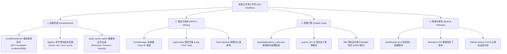
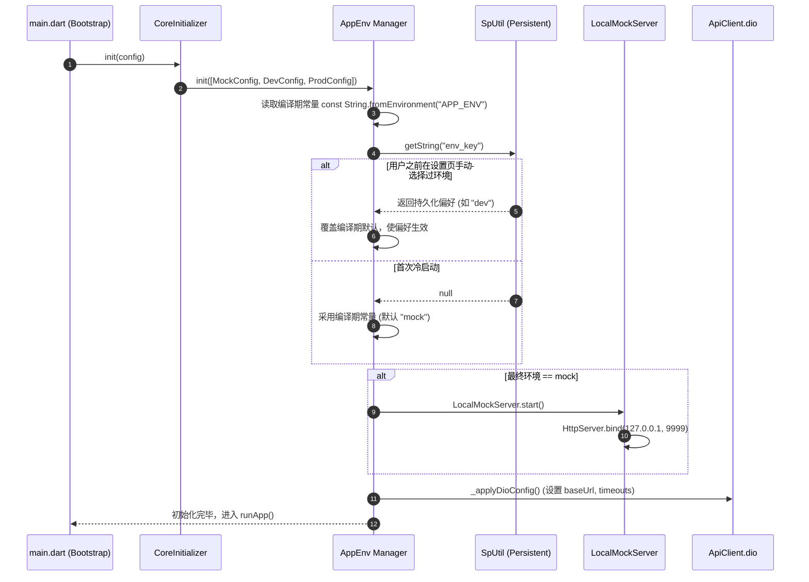
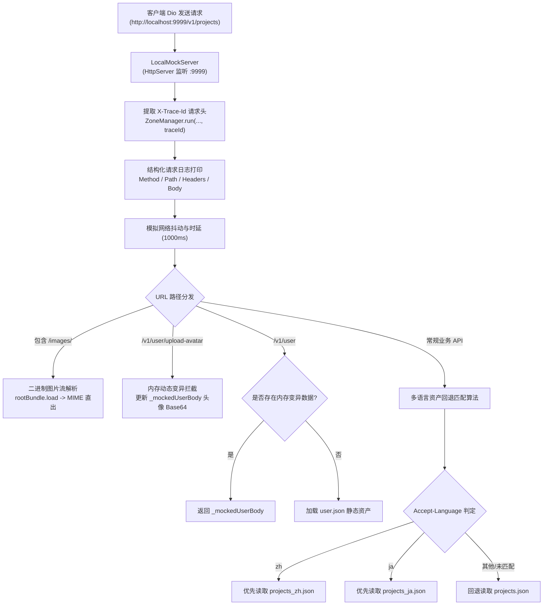
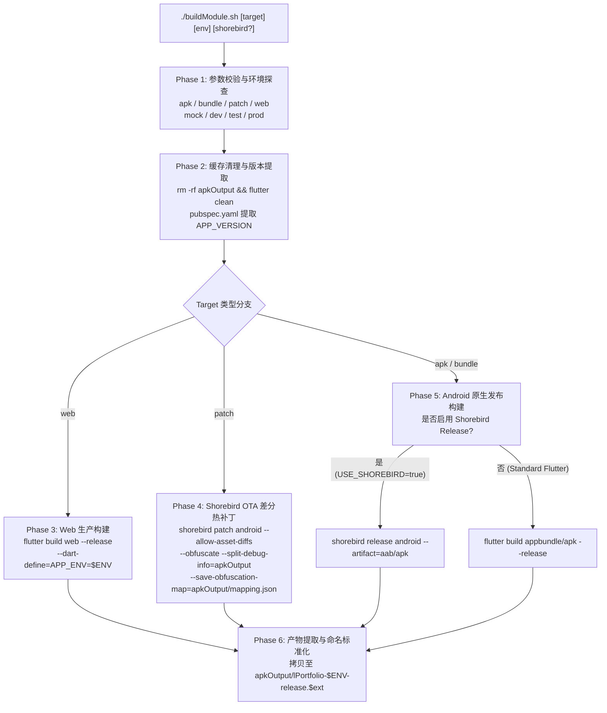
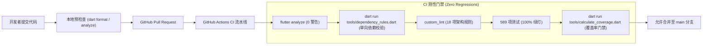

# 标准化开发工作流与工程效能架构规范

> [!NOTE]
> **Workflow Overview & Implementation Status**:
> 本文档定义了 Listen Portfolio Flutter 项目的工业级标准化开发工作流程与工程效能体系。涵盖：
> - **单机闭环研发哲学 (The Local-First Paradigm)**：内置基于 `dart:io` 的 `LocalMockServer`（`localhost:9999`），支持多语言资产回退、图片流式分发与内存动态状态变异，实现 100% 离线脱机全功能开发；
> - **环境生命周期与动态热切换 (`AppEnv`)**：支持 `mock`、`dev`、`test`、`prod` 四档环境，结合 `--dart-define=APP_ENV` 编译期常量与 `SpUtil` 运行期偏好仲裁，实现零重启热重构；
> - **响应式代码与资产生成**：`build_runner watch`（Riverpod / Freezed / Retrofit）常驻增量生成与 `r.dart` 资产强类型映射；
> - **应用内全链路可观测性 (APM & LogOverlay)**：结合 `ZoneManager` 分布式 Trace ID 穿透、FPS/Jank 监控、网络流量拦截器（Net Inspector）与 SafeMode 熔断演练；
> - **企业级统一发布管线 (`buildModule.sh`)**：覆盖 AAB、APK、Shorebird OTA 差分热补丁（Patch）与 Flutter Web 生产构建，集成代码混淆与符号表剥离（Symbol Stripping）；
> - **架构防御刚性门禁**：`tools/dependency_rules.dart` 架构单向依赖扫描、18 项自定义 Lint 规则 (`custom_lint`) 与 589 项单元/Widget 自动化测试（覆盖率达 77.53%）。

---

## 1. 核心设计思路与研发哲学 (Design Rationale & Philosophy)

在现代移动跨平台工程实践中，开发工作流不仅关乎团队日常的编码效率，更直接决定了系统的交付质量与架构一致性。本项目贯彻**“单机高保真闭环、环境按需分级、质量前置防御、发布高度自动化”**的研发哲学。



### 1.1 为什么采用单机 Local-First 研发范式？
在传统移动端前后端协同开发中，前端开发常常面临三大痛点：
1. **后端进度阻塞 (Backend Velocity Blocker)**：前端业务逻辑和 UI 早已就绪，但后端 API 尚未开发完毕或处于调试不稳定状态；
2. **外部网络波动与离线断连 (Network Flakiness)**：移动出差、弱网或公共 Wi-Fi 环境下，远程联调服务器难以访问；
3. **接口契约漂移与数据不确定性 (Contract Drift)**：沙箱数据被其他开发者随意修改，导致边界测试难以复现。

本项目通过在 `ListenCore` 中内置 `LocalMockServer`（基于原生 `dart:io` 的 `HttpServer`），完全跑通真实网络协议栈：
- **真实网络协议栈走查**：流量真实流经 `Dio`、请求头注入拦截器、401 重试队列、JSON 反序列化，与真实生产网络行为 100% 对齐；
- **全格式与多语言支持**：支持 JSON 接口契约、JPEG/PNG/SVG 二进制图片流直出，以及基于 `Accept-Language` 的中/英/日自动路由与回退；
- **内存动态变异模拟**：在脱机状态下支持头像上传等 `POST` 状态持久化模拟，打造毫秒级无感响应的单机高保真沙盒。

### 1.2 多维环境分级与仲裁模型 (Multi-Tier Environment Model)

项目定义了清晰的四档运行环境：

| 环境标识 (`APP_ENV`) | 基准地址 (`baseUrl`) | 核心数据源 | 定位与适用场景 |
| :--- | :--- | :--- | :--- |
| **`mock`** (默认) | `http://localhost:9999` | 本地资产 `assets/mock/` | 日常本地开发、UI 像素对齐、离线脱机调试、边界异常复现 |
| **`dev`** | `http://localhost:8080` / 内网 IP | 本地 Docker 或内网后端微服务 | 联调接口契约、多服务协同测试、Spring Boot 增量特性对接 |
| **`test`** | `http://test-api.listen.dev` | QA 灰度测试服务器 | 测试团队集成验证、用户验收测试 (UAT)、自动化巡检 |
| **`prod`** | `http://13.218.192.181/api` | AWS EC2 生产集群与 MySQL | 生产环境打包、Google Play 正式发布、真实用户使用 |

---

## 2. 🚀 快速上手与本地研发闭环

### 2.1 依赖安装与代码生成常驻
进入工程目录，执行初始化与代码生成：

```bash
# 1. 克隆并安装依赖
git clone https://github.com/listen2code/ListenPortfolioFlutter.git
cd ListenPortfolioFlutter
flutter pub get

# 2. 启动增量代码生成常驻进程 (推荐在新终端常驻运行)
flutter packages pub run build_runner watch --delete-conflicting-outputs
```

> [!TIP]
> **为什么必须常驻 `build_runner watch`？**
> 本项目高度依托自动化代码生成（Freezed 状态模型、Riverpod 依赖注入与 Retrofit 网络层）。保持 `--watch` 能够在保存 `.dart` 文件时毫秒级更新 `.freezed.dart` 与 `.g.dart`，避免反复手动运行 `build`，极大提升编码流畅度。

### 2.2 启动应用与环境指定

```bash
# 以默认 Mock 环境启动 (在本地启动 LocalMockServer，无需后端)
flutter run --dart-define=APP_ENV=mock

# 以开发联调环境启动 (对接真实后端)
flutter run --dart-define=APP_ENV=dev

# 以生产配置启动
flutter run --dart-define=APP_ENV=prod
```

---

## 3. 环境生命周期与核心架构实现细节

### 3.1 `AppEnv` 编译期常量 vs 运行期偏好仲裁机制

在 `ListenCore/lib/env/app_env.dart` 中，环境初始化遵循严格的双层仲裁逻辑：



#### 零重启运行时动态环境热切换实现
当用户在“设置 -> 环境切换”修改环境时，调用 `AppEnv.setEnvironment(newEnv)`：
```dart
static Future<void> setEnvironment(AppEnvironment newEnv) async {
  // 1. 若离开 mock 环境，平滑注销本地 HttpServer 套接字
  if (_env == AppEnvironment.mock && newEnv != AppEnvironment.mock) {
    await LocalMockServer.stop();
  }

  // 2. 若进入 mock 环境，动态唤醒 LocalMockServer
  if (newEnv == AppEnvironment.mock) {
    await LocalMockServer.start();
  }

  // 3. 原子更新内部环境变量并重配 Dio 单例的选项
  _env = newEnv;
  _applyDioConfig();

  // 4. 持久化偏好至本地，供下一次冷启动恢复
  await SpUtil.put(envKey, newEnv.name);
}
```
此设计确保了无需重启 Flutter 引擎即可即刻生效，底层所有后续发出的网络请求均无缝重定向至新环境。

---

### 3.2 `LocalMockServer` 架构设计与难点代码精读

`LocalMockServer`（位于 `ListenCore/lib/network/local_mock_server.dart`）是项目单机闭环的核心驱动者。



#### 难点 1: 多语言资产树候选路径匹配算法
`LocalMockServer` 解析客户端请求头中的 `Accept-Language`，并结合 HTTP Method 动态组装资产查找路径：
```dart
// 1. 提取语言标识
final acceptLang = request.headers.value('accept-language')?.split(',').first.trim().toLowerCase() ?? '';
String langSuffix = '';
if (acceptLang.startsWith('zh')) langSuffix = 'zh';
else if (acceptLang.startsWith('ja')) langSuffix = 'ja';

// 2. 构建候选路径优先级列表
List<String> candidatePaths = [];
if (pathParts.length > 1) {
  final baseSingle = _buildPath(versionDir, method, [pathParts[0]]);
  // 优先级 1: 对应语言的定制文件 (如 assets/mock/v1/get/projects_zh.json)
  if (langSuffix.isNotEmpty) {
    candidatePaths.add(baseSingle.replaceFirst('.json', '_$langSuffix.json'));
  }
  // 优先级 2: 通用默认文件 (如 assets/mock/v1/get/projects.json)
  candidatePaths.add(baseSingle);
}

// 3. 逐级尝试加载资产，首个命中即返回
for (final path in candidatePaths) {
  try {
    final jsonStr = await rootBundle.loadString(path);
    // 命中并响应 200 OK
    request.response
      ..statusCode = HttpStatus.ok
      ..headers.contentType = ContentType.json
      ..write(jsonStr);
    await request.response.close();
    return;
  } catch (_) {
    // 未找到则平滑尝试下一候选
    continue;
  }
}
```

#### 难点 2: 全链路 Trace ID 穿透与 Zone 绑定
客户端 `NetworkInspectorInterceptor` 会为每个请求生成唯一 `X-Trace-Id` 并附带在请求头中。`LocalMockServer` 在收到请求后，**不会直接处理**，而是提取该头部并在独立的 Dart `Zone` 中执行处理逻辑：
```dart
final String? traceId = request.headers.value('X-Trace-Id');
// 将当前请求挂载入带有 traceId 的 Zone 上下文中执行
ZoneManager.run(() => _handleRequest(request), traceId: traceId, silent: true);
```
**技术价值**：当 MockServer 打印日志（`appLogger.w`）时，日志打印器内部的 `_TracePrinter` 和 `_LogManagerOutput` 能够自动提取该 `traceId`，从而让在应用内 APM 浮窗中按 Trace ID 检索时，能够将客户端发包日志、Mock 服务端接包日志以及 UI 响应日志**精准串联在同一时间线下**！

---

## 4. 应用内调试与全链路 APM 可观测性 (LogOverlay)

在开发阶段，项目提供了高度集成的应用内可观测性浮窗工具——`LogOverlay`。

### 4.1 三大核心调试面板
1. **Logs (实时日志流面板)**：
   - 包含 `All`、`Server`、`App`、`Perf` 四档过滤；
   - 点击任何一条日志中的绿色 `Trace ID`，自动填入搜索框并毫秒级下钻过滤出整条交互链路。
2. **Perf Dashboard (性能看板面板)**：
   - **Vsync 帧时延动态曲线**：借助 `SchedulerBinding.instance.addTimingsCallback` 实时捕获 GPU 与 Build 阶段耗时；
   - **FPS 滑动窗口滤波**：消除微小帧抖动误差，精准识别 60Hz / 120Hz 刷新率状态；
   - **Jank 卡顿统计**：分类统计 轻度卡顿 (Jank) 与 严重卡顿 (Frozen Frame)；
   - **冷启动指标 (Launch Monitor)**：展示从应用入口到首帧渲染的分段耗时与历史 50 条回归趋势。
3. **Net Inspector (网络流量审计面板)**：
   - 实时拦截所有通过 Dio 发起的 HTTP 请求；
   - 审计 URL、Method、Status Code、时延（ms）、Payload 体积以及请求/响应 JSON 格式化树；
   - 支持一键跳转至对应 Trace ID 的日志视图。

### 4.2 浮窗启动与状态持久化
- **自动初始化**：在 `SplashPage` 的 `PageLifecycle.onReady()` 中通过 `LogOverlayManager.init(context)` 自动读取 `SpUtil.getBool('log_overlay_key')` 恢复上一会话的显示/隐藏状态；
- **用户控制**：在“设置 -> 开发者选项”中可通过开关即时呼出或销毁浮窗。

---

## 5. 企业级统一构建与发布流水线 (`buildModule.sh`)

为了抹平跨环境（本地构建 vs CI 云端构建）与多产物类型（APK / AAB / Patch / Web）的执行割裂，项目设计并落地了标准化的 Shell 自动化管线：[`buildModule.sh`](../buildModule.sh)。



### 5.1 6 阶段构建管线剖析

1. **Phase 1: 输入校验与工具链探测**：
   - 严格校验目标产物（`apk|bundle|patch|web`）与目标环境（`mock|dev|test|prod`）；
   - 自动扫描全平台 Shorebird CLI 安装路径（`~/.shorebird/bin`、`$XDG_CONFIG_HOME`），未配置 PATH 也能自愈恢复；
   - 智能判定 Shorebird 凭据模式（通过 `$SHOREBIRD_TOKEN` 或传参动态激活）。
2. **Phase 2: 缓存清理与版本号解析**：
   - 清理旧输出目录 `apkOutput` 并触发 `flutter clean`；
   - 通过 `grep '^version: ' pubspec.yaml` 自动化解析当前应用版本号（`APP_VERSION`），供后续编译参数注入。
3. **Phase 3: Web 生产构建**：
   - 执行 `flutter build web --release`，向 Web 产物注入环境变量和版本信息，输出位于 `build/web`。
4. **Phase 4: Shorebird OTA 增量热更新补丁部署 (Android Patch)**：
   - 执行 `shorebird patch android --allow-asset-diffs`；
   - 配合 Flutter 混淆与符号剥离：`--obfuscate --split-debug-info=apkOutput`；
   - 导出混淆映射表：`--extra-gen-snapshot-options=--save-obfuscation-map=apkOutput/mapping.json,--strip`。
5. **Phase 5: Android App Bundle (AAB) / APK 生产发布编译**：
   - 区分标准 Flutter 编译与 Shorebird Release 双轨流程；
   - 强制剥离本地符号表，在大幅缩小 AAB / APK 体积（通常缩减 20%~30%）的同时，将 debug symbols 安全保留在本地 `apkOutput`，防止敏感源码反编译逆向。
6. **Phase 6: 产物规范化归档**：
   - 自动从 Gradle 嵌套输出目录中提取编译产物，重命名为标准格式：
     `apkOutput/lPortfolio-$ENV-release.[aab|apk]`。

### 5.2 常用构建命令示例
```bash
# 1. 构建日常测试 APK (针对 Dev 环境)
./buildModule.sh apk dev

# 2. 构建生产环境正式发布 AAB (接入 Shorebird Release，用于提交 Google Play)
./buildModule.sh bundle prod true

# 3. 线上突发 Bug 紧急修复，发布增量 OTA 热补丁 (用户免重新下载 APK)
./buildModule.sh patch prod

# 4. 构建生产环境 Flutter Web 静态资产 (用于部署 AWS S3 / Nginx)
./buildModule.sh web prod
```

---

## 6. 质量门禁与防御性工程保障

项目实施严密的“本地 + CI”双层质量防御体系，确保无缺陷代码流入生产。



### 6.1 架构单向依赖校验 (`tools/dependency_rules.dart`)
在 Clean Architecture 体系下，严禁违反分层单向原则（如 Core 模块反向引用 Feature、Feature 之间发生强横向耦合）。
在提交代码前或 CI 中执行：
```bash
dart run tools/dependency_rules.dart
```
一旦发现非法引用（例如 `features/settings` 直接 import 了 `features/auth`），脚本立即以非 0 状态码退出，红牌阻断 CI 流水线。

### 6.2 自动化测试矩阵与覆盖率审计
全工程拥有 **589 项** 单元测试与 Widget 测试，全面覆盖 MVI 状态机、Dio 拦截器、深链接路由、延迟归因及 APM 探针。
```bash
# 执行全量测试并收集覆盖率数据
flutter test --coverage

# 计算并输出格式化覆盖率报告
dart run tools/calculate_coverage.dart
```
当前测试通过率为 **100%**，全工程纯净代码覆盖率稳定在 **77.53%**（6,196 / 7,992 行）。

---

## 7. 常见问题排查与避坑指南 (Troubleshooting)

### 7.1 `build_runner` 生成文件冲突或锁死
- **现象**：提示 `Conflicting outputs were detected and the build is aborted`。
- **排查与修复**：
  ```bash
  # 清理 build_runner 缓存
  flutter packages pub run build_runner clean
  # 强制删除冲突文件重新全量生成
  flutter packages pub run build_runner build --delete-conflicting-outputs
  ```

### 7.2 环境变量不生效或基准 URL 错误
- **现象**：指定了 `--dart-define=APP_ENV=prod`，但在手机上运行时依然请求 `localhost:9999`。
- **根因**：本地 `SpUtil` 中持久化了上一次用户在 UI 设置页选择的 `mock` 环境，运行时偏好覆盖了编译期常量。
- **修复**：在应用内“Settings -> Environment”手动切换回目标环境，或在应用信息中清除应用缓存数据。

### 7.3 `LocalMockServer` 端口占用 (Port 9999 Conflict)
- **现象**：在极少数情况下（如热重启过程异常）提示 `Failed to start Local Mock Server: SocketException: OS Error: Address already in use`。
- **修复**：在 `LocalMockServer.start()` 中已内建安全防重入机制；若遇系统级端口锁定，重新启动调试进程或杀掉对应端口占用的进程即可。

---

## 8. 不足之处与后续演进路线 (Roadmap - 对应 `todo.md`)

结合当前研发工作流的实际运行情况，在 [todo.md](todo.md) 中规划并追踪以下两项核心效能演进：

1. **`Opt-19. Flutter Web 平台 LocalMockServer 纯内存 Dio 拦截器适配`**：
   - **现状**：当前 `LocalMockServer` 强依赖 `dart:io` 底层套接字，在 Flutter Web 编译下不可用；
   - **方案**：针对 Web 平台抽象 `IMockServerAdapter`，实现无套接字纯内存的 `WebInMemoryMockInterceptor`，打通 Web 端完全独立的单机 Mock 体验。
2. **`Opt-20. 跨平台开发工作流 CLI 与 Git Pre-Commit / Pre-Push 质量门禁自动挂载`**：
   - **现状**：`buildModule.sh` 依赖 Bash，在 Windows 纯 CMD / PowerShell 下不够友好；且本地缺少自动化的 Git Hooks 门禁；
   - **方案**：基于纯 Dart 实现跨平台工作流工具 `tools/workflow.dart`，并提供 `tools/setup_hooks.dart` 一键安装 `pre-commit`（代码格式化与 analyze）与 `pre-push`（依赖边界与单测门禁）钩子，将错误拦截在推送到远端之前。
