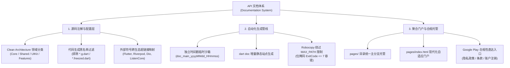
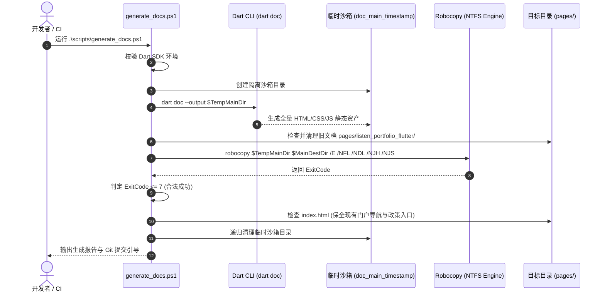

# API 文档自动化生成与 GitHub Pages 托管架构指南

> [!NOTE]
> **Documentation System Overview & Implementation Status**:
> 本文档详细定义了 Listen Portfolio Flutter 项目的 API 文档自动化生成、静态门户架构、Windows 文件路径限制规避策略与 GitHub Pages 部署发布管线。涵盖：
> - **单分支静态托管架构 (`/pages`)**：将 API 文档与 Google Play 数据注销/隐私条款统一聚合于主分支 `/pages` 目录，规避多分支维护的历史分叉；
> - **`dartdoc_options.yaml` 深度定制**：四维 Clean Architecture 架构分类（Core / Shared / UIKit / Features）、外部三方库符号超链接与代码生成文件（`.freezed.dart` / `.g.dart`）黑名单过滤；
> - **Windows MAX_PATH (260 字符) 防御与 Robocopy 宽容镜像**：基于 `scripts/generate_docs.ps1` 采用临时隔离沙箱与位掩码（Bitmask $\le 7$）退出码机制，杜绝 `PathTooLongException`；
> - **现代化自适应门户站点 (`pages/index.html`)**：支持暗黑/浅色主题自适应、状态监测徽章与 Google Play 政策合规入口；
> - **后续演进规划**：CI/CD 自动化部署流水线 (Opt-21) 与跨平台 Shell/本地预览服务 (Opt-22)。

---

## 1. 核心设计思路与架构哲学 (Design Rationale & Philosophy)

在规范化企业级软件工程中，API 文档不仅是团队内部协同的字典，更是展示工程架构严谨性、领域分层纯净度与代码自说明能力（Self-Documenting Code）的重要载体。



### 1.1 为什么需要企业级 API 文档体系？
1. **架构契约自说明与防腐治理**：
   在 Clean Architecture 中，Presentation、Domain、Data 三层的职责边界必须十分清晰。通过 `dartdoc` 提取类与接口的 Docstrings，可以让开发者直观审视公开 API（Public APIs）是否暴露了实现细节，强制推动面向抽象接口编程。
2. **多包协同的统一入口 (Multi-Package Documentation Portal)**：
   项目由主应用、底座 `listen_core` 与通用设计组件 `listen_uikit` 构成。通过构建统一的门户导航站点，将多个独立包的文档集中索引，打破“文档孤岛”。
3. **面试展示与代码透明度**：
   在线托管的高保真 API 文档能够让猎头、面试官和技术同行直接在网页端浏览全工程的类关系图、方法说明和设计模式应用，形成强有力的工程实力佐证。

### 1.2 单分支托管架构设计 (`/pages` on `main`)
在 GitHub Pages 部署策略中，业界通常有两种做法：
- **方案 A：独立 `gh-pages` 分支**；
- **方案 B：主分支 `/pages` 目录直接托管**（本项目采用）。

| 对比维度 | 独立 `gh-pages` 分支 | 主分支 `/pages` 目录托管 (本项目) | 选型权衡 |
| :--- | :--- | :--- | :--- |
| **分支管理复杂度** | 高（两个互不相关的孤立分支） | **极简（仅保留 main/develop）** | 消除多分支切换与代码合并时的混乱 |
| **版本对齐感知** | 弱（文档分支往往与主干代码脱节） | **强（文档更新作为 Commit 随代码同行）** | 保证在线文档与线上 App 版本 100% 同步 |
| **法务合规集成** | 需额外同步隐私协议文件 | **天然共存**（`privacy_policy.html` 在同一目录下） | Google Play 合规性链接永久稳定可用 |
| **CI/CD 权限要求** | 需配置跨分支 Force-Push 令牌 | **标准分支权限** | 降低持续集成流水线配置成本 |

### 1.3 Windows NTFS MAX_PATH 260 字符防御哲学
在 Windows 平台上开发 Flutter 项目时，深度嵌套的目录结构容易触碰 Win32 API 历史遗留的 `MAX_PATH`（260 字符）限制。
- `dartdoc` 生成的 HTML 页面会依据 Dart 命名空间和操作符嵌套创建子目录（例如 `listen_portfolio_flutter/features_settings_presentation_pages_widgets/.../operator_equals.html`）；
- 若使用标准 PowerShell 命令 `Copy-Item -Recurse`，将直接抛出 `System.IO.PathTooLongException` 导致构建崩溃；
- **解决策略**：本项目通过引入 Windows 原生支持长路径（最大 32,767 字符）的 `robocopy` 命令，配合时间戳沙箱隔离目录，彻底攻克长路径拷贝痛点。

---

## 2. `dartdoc_options.yaml` 深度定制与工程实现

项目在根目录下维护了定制化的 [`dartdoc_options.yaml`](../dartdoc_options.yaml)，作为 `dartdoc` 静态生成引擎的顶层策略配置文件。

### 2.1 页面头部与底部品牌化定制
通过 `header` 与 `footer` 注入统一的 CSS 与语义化 HTML，提供全局导航与版权声明：
```yaml
header: |
  <div class="header">
    <h1>Listen Portfolio Flutter API Documentation</h1>
    <p>Comprehensive API documentation for the Listen Portfolio Flutter application and its core libraries.</p>
    <div class="header-links">
      <a href="https://github.com/listen2code/ListenPortfolioFlutter">GitHub Repository</a>
      <a href="https://pub.dev/packages/listen_core">listen_core on pub.dev</a>
      <a href="https://pub.dev/packages/listen_uikit">listen_uikit on pub.dev</a>
    </div>
  </div>

footer: |
  <div class="footer">
    <p>Generated by <a href="https://dart.dev/tools/dart-doc">dartdoc</a></p>
    <p>&copy; 2026 Listen Portfolio Flutter. All rights reserved.</p>
    <div class="footer-links">
      <a href="https://listen2code.github.io">Author Website</a>
      <a href="mailto:listen2code@gmail.com">Contact</a>
    </div>
  </div>
```

### 2.2 Clean Architecture 四维领域分类 (`categories`)
为了防止成百上千个类平铺在侧边栏导致检索灾难，我们在配置文件中建立了层次清晰的架构分类树：

```yaml
categories:
  # 1. 核心底座与架构基石
  core:
    title: "Core Architecture"
    description: "Fundamental architecture components and base classes"
    subcategories:
      base:
        title: "Base Classes"
        description: "Base classes for ViewModels, Repositories, and Use Cases"
      network:
        title: "Network Layer"
        description: "HTTP client, API interfaces, and network utilities"
      utils:
        title: "Core Utilities"
        description: "Utility classes and helpers"
  
  # 2. 跨模块共享逻辑
  shared:
    title: "Shared Components"
    description: "Business logic and shared utilities"
    subcategories:
      constants:
        title: "Constants"
      extensions:
        title: "Extensions"
      utils:
        title: "Utilities"
  
  # 3. 设计系统与 UI 控件
  uikit:
    title: "UI Components"
    description: "Reusable UI components and design system"
    subcategories:
      widgets:
        title: "Widgets"
      themes:
        title: "Themes"
  
  # 4. 业务特性模块
  features:
    title: "Feature Modules"
    description: "Application feature modules"
    subcategories:
      auth:
        title: "Authentication"
      home:
        title: "Home"
      settings:
        title: "Settings"
```

### 2.3 黑名单精细化过滤与外部依赖映射

#### 排除编译副产物 (`exclude`)
代码生成（Freezed / Retrofit / JsonSerializable）会产生大量伴生文件，这些属于机器生成的机械样板代码，若纳入文档会导致索引膨胀与搜索污染。配置文件中明确剔除：
```yaml
exclude:
  # 排除自动化代码生成文件
  - '**/*.g.dart'
  - '**/*.freezed.dart'
  - '**/*.mock.dart'
  
  # 排除测试用例与测试工具
  - '**/test/**'
  - '**/*_test.dart'
  
  # 排除私有内部实现细节
  - '**/impl/**'
  - '**/*_impl.dart'
  - '**/_private/**'
```

#### 外部符号超链接映射 (`linkResolution.external`)
当方法返回值或参数引用了外部依赖类型（如 `MaterialApp`、`WidgetRef`、`Dio` 等），通过映射确保点击即可直达官方 pub.dev 页面：
```yaml
linkResolution:
  external:
    'package:flutter/material.dart': 'https://api.flutter.dev/flutter/material/material-library.html'
    'package:flutter_riverpod/flutter_riverpod.dart': 'https://pub.dev/documentation/flutter_riverpod/latest/flutter_riverpod/flutter_riverpod-library.html'
    'package:dio/dio.dart': 'https://pub.dev/documentation/dio/latest/dio/dio-library.html'
    'package:freezed_annotation/freezed_annotation.dart': 'https://pub.dev/documentation/freezed_annotation/latest/freezed_annotation/freezed_annotation-library.html'
    'package:listen_core/core.dart': 'https://pub.dev/documentation/listen_core/latest/'
    'package:listen_uikit/listen_uikit.dart': 'https://pub.dev/documentation/listen_uikit/latest/'
```

---

## 3. 自动化生成脚本深度解析 (`scripts/generate_docs.ps1`)

为了让文档生成一键化、高可靠，工程编写了专用的 PowerShell 调度脚本：[`scripts/generate_docs.ps1`](../scripts/generate_docs.ps1)。



### 3.1 核心步骤与容错设计

1. **环境与依赖自检**：
   - 检查 `dart --version` 是否就绪；
   - 自动在项目根目录下执行 `dart pub get` 保证依赖解析完整。
2. **基于时间戳的独立沙箱目录**：
   - 使用 `$TempMainDir = Join-Path $ProjectRoot "doc_main_$((Get-Date).ToString('yyyyMMdd_HHmmss'))"`；
   - 隔离并发或历史生成的缓存冲突，避免旧文件占用引发写入失败。
3. **Robocopy 绕过 MAX_PATH 与宽容退出码机制**：
   - 使用 `robocopy $TempMainDir $MainDestDir /E /NFL /NDL /NJH /NJS`；
   - 抑制控制台冗余的文件扫描信息（`/NFL /NDL /NJH /NJS`），保持输出整洁。

---

## 4. 重点、难点代码实现与数学/逻辑原理解析

### 难点 1: Windows MAX_PATH 溢出拦截与 Robocopy 位掩码状态码机制
标准命令行工具在执行成功时通常返回 `0`，非 `0` 即判定为失败。然而 Windows 的 `robocopy` 采用了**位掩码（Bitmask）返回码**设计：

| 掩码位 (Bit) | 对应十进制值 | 含义说明 | 严重级别 |
| :---: | :---: | :--- | :--- |
| **0** | `0` | 源目录与目标目录完全一致，未发生文件拷贝 | 正常 |
| **1** | `1` | 成功拷贝了至少一个文件 | 正常 (成功) |
| **2** | `2` | 目标目录中存在源目录没有的额外文件（Extra files） | 提示 |
| **3** | `4` | 检测到存在不匹配的文件（Mismatched files） | 提示 |
| **4** | `8` | 发生拷贝失败（至少一个文件无法复制，如权限拒绝） | **严重错误** |
| **5** | `16` | 严重错误（致命语法错误、磁盘未就绪、路径不存在） | **致命错误** |

#### 容错数学公式
由于位状态是叠加的（例如既有成功拷贝又有额外文件时，返回码为 $1 + 2 = 3$），因此合法的成功状态集合为：
$$\text{ExitCode} \in [0, 7] \iff (\text{ExitCode} \ \& \ \text{0x18}) == 0$$
脚本通过：
```powershell
if ($LASTEXITCODE -le 7) {
    $MainSuccess = $true
    Write-Success "Main application documentation copied successfully (Robocopy ExitCode: $LASTEXITCODE)"
} else {
    Write-Warning "Robocopy failed with fatal exit code: $LASTEXITCODE"
    $MainSuccess = $false
}
```
精准拦截了真正的系统级致命故障（$\ge 8$），同时避免了因增量文件状态提示引发的虚假报错中断。

---

### 难点 2: 门户导航与 Google Play 政策合规文件的防御性保全
在 `pages/` 目录下，除了生成的 API 文档子目录之外，还托管了重要的**法务与应用门户文件**：
- `pages/index.html`：包含暗黑/浅色自适应主题的统一展示门户；
- `pages/privacy_policy.html`：Google Play 审核强制要求的隐私政策；
- `pages/terms_of_service.html`：服务条款；
- `pages/delete_account.html`：Google Play 合规性在线账户与数据注销申请表单。

如果在清理旧文档时粗暴执行 `Remove-Item pages/*`，会导致上述关键合规页面被误删，进而引发 Google Play 线上审核被拒或警告。
**防御性保全逻辑**：
```powershell
# 1. 仅精准定位并清理 API 文档子目录，绝对不破坏根级 index.html 和法务页面
$MainDestDir = Join-Path $GhPagesDir "listen_portfolio_flutter"
if (Test-Path $MainDestDir) {
    Remove-Item -Path $MainDestDir -Recurse -Force -ErrorAction SilentlyContinue
}

# 2. 防御性检查 index.html，若缺失则提供保底模板，存在则严格保全
$TargetIndexHtml = Join-Path $GhPagesDir "index.html"
if (-not (Test-Path $TargetIndexHtml)) {
    Write-Info "Creating default navigation index..."
    $IndexContent | Out-File -FilePath $TargetIndexHtml -Encoding UTF8
} else {
    Write-Info "Preserving existing portal index.html with legal and documentation links."
}
```

---

## 5. 聚合门户站点架构规范 (`pages/`)

生成的站点部署于 GitHub Pages，目录拓扑结构如下：

```
pages/
├── index.html                    # 现代化展示门户（支持系统深色模式自适应）
├── privacy_policy.html           # Google Play 隐私政策
├── terms_of_service.html         # 服务条款
├── delete_account.html           # 数据与账户在线注销合规页
├── .nojekyll                    # 绕过 GitHub Pages Jekyll 渲染器
└── listen_portfolio_flutter/     # 由 dartdoc 生成的主应用 API 文档
    ├── index.html               # API 索引主页
    ├── __404error.html          # 404 页面
    ├── search.json              # 静态搜索数据索引
    ├── categories.json          # 架构分类元数据
    └── topics/                  # 各大架构领域专题
```

### 门户核心特性
- **现代化响应式布局**：基于 CSS Flexbox 与 Grid，移动端与宽屏自适应；
- **系统级深色模式切换**：通过媒体查询 `@media (prefers-color-scheme: dark)` 实现无闪烁主题跟随；
- **免 Jekyll 编译 (`.nojekyll`)**：GitHub Pages 默认使用 Jekyll 引擎处理静态网页，以下划线开头（如 `_common/`）的文件会被忽略。通过创建 `.nojekyll` 空文件，强制 GitHub 原样直出 dartdoc 的全部静态脚本与样式。

---

## 6. 🚀 快速开始与部署流程

### 本地文档生成与发布步骤

```powershell
# 1. 进入工程根目录并执行自动化生成脚本
cd ListenPortfolioFlutter
.\scripts\generate_docs.ps1

# 2. 检查生成的文档输出与导航主页
start pages/index.html

# 3. 将更新推送至 GitHub 触发 GitHub Pages 重新部署
cd pages
git add .
git commit -m "docs: regenerate API documentation and update portal"
git push origin main
```

部署完成后，文档可在以下公开网址访问：  
🌐 **文档门户主页**：`https://listen2code.github.io/ListenPortfolioFlutter/pages`  
📚 **API 文档直达**：`https://listen2code.github.io/ListenPortfolioFlutter/pages/listen_portfolio_flutter/`

---

## 7. 不足之处与后续演进路线 (Roadmap - 对应 `todo.md`)

在持续运营过程中，当前文档体系存在以下改进空间，已在 [todo.md](todo.md) 中建立专项跟踪：

1. **`Opt-21. GitHub Actions CI/CD 自动化 API 文档生成与 GitHub Pages 持续交付`**：
   - **现状**：依赖开发者本地执行 PowerShell 脚本并手动 Push `pages/`，容易出现忘记同步导致线上文档滞后于代码的情况；
   - **方案**：在 `.github/workflows/ci.yml` 中接入自动化 `dart doc` 构建 Job，在合并至 `main` 且测试通过后，通过 `actions/deploy-pages@v4` 自动化部署，彻底消除人工介入。
2. **`Opt-22. 跨平台文档生成 Shell 脚本与多包离线预览本地服务`**：
   - **现状**：当前脚本仅有 PowerShell 实现，macOS / Linux 开发者缺乏原生支持；且通过本地 `file:///` 协议打开时，浏览器同源策略（CORS）会阻断 `search.json` 搜索索引的加载；
   - **方案**：补充 POSIX 兼容的 `scripts/generate_docs.sh`，并在脚本中提供 `--serve` 本地轻量 Web 服务选项，实现完全脱机的高保真搜索预览体验。
