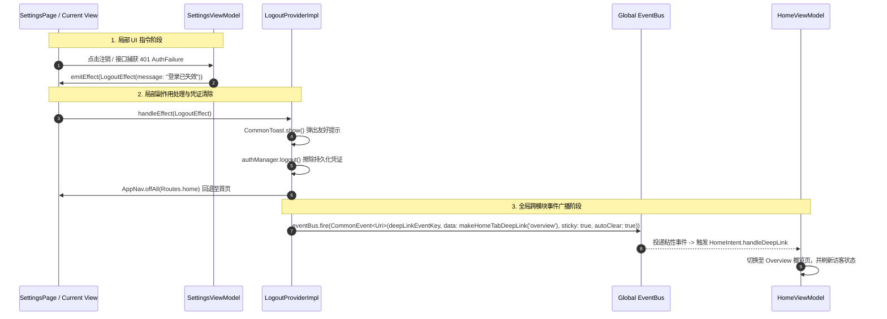
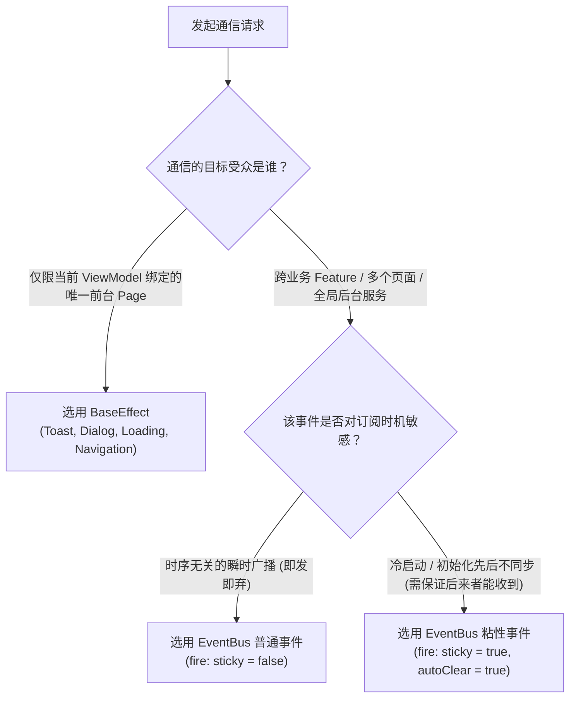

# EventBus 与 BaseEffect 职责评估与通信架构规范 (Communication Architecture: EventBus vs. BaseEffect)

**Status**: `Active & Implemented (Core Communication Architectural Standard)`  
**Latest Update**: 2026-09-12  
**Maintainer**: Architecture & Core Infrastructure Team

---

## 1. 架构愿景与双通道通信哲学 (Architectural Philosophy & Dual-Channel Model)

在 `ListenCore` / `ListenPortfolio` Clean Architecture + MVI (Model-View-Intent) 架构体系中，界面呈现与状态机流转严格遵循**单向数据流 (Unidirectional Data Flow)**：`Intent` 驱动 `ViewModel` 计算，产出不可变状态 `BaseState`，最终由响应式控件渲染。

然而，在移动端真实交互场景中，存在两类不可被持久化状态完全表征的通信需求：
1. **局部瞬时 UI 指令 (Intra-Page Ephemeral Side Effects)**：如展示一次性 Toast、弹出模态确认对话框、局部 Loading 遮罩开关、触觉震动反馈等。这类指令**与当前页面生命周期强绑定、依赖 `BuildContext`、且消费后即焚**。
2. **全局跨模块解耦广播 (Inter-Page / Cross-Module Asynchronous Events)**：如系统网络状态连通性变更、Token 失效触发全域注销、冷/热启动 Deep Link 路由唤起、FCM 远程推送点击直达等。这类事件**跨越不同业务 Feature、不依赖任何单个 Widget 树、且需要支持 1-to-N 广播甚至晚挂载订阅（Sticky 粘性回放）**。

为了杜绝“用全局总线控制局部 UI”或“局部副作用越权穿透页面边界”导致的架构腐化，底层基础设施明确划定了**双通道隔离设计 (Segregation of Channels)**：

```
┌──────────────────────────────────────────────────────────────────────────────────┐
│                      双通道通信隔离与 Clean MVI 架构全景图                        │
└──────────────────────────────────────────────────────────────────────────────────┘

                  ┌──────────────────────────────────────────────┐
                  │          Global EventBus (全局事件总线)       │
                  │   - 1-to-Many 跨模块广播 (Pub-Sub)            │
                  │   - 内存 Sticky 缓存 + autoClear 一次性消费   │
                  │   - 无 Context 依赖, 全局单例解耦              │
                  └──────────────▲───────────────────────────────┘
                                 │
                ┌────────────────┼────────────────┐
                │ fire(event)    │ subscribeEvent │
                │                ▼                │
┌────────────────────────┐  ┌────────────────────────┐  ┌────────────────────────┐
│  Infrastructure Layer  │  │  ViewModel A (MVI)     │  │  ViewModel B (MVI)     │
│  - DeepLinkManager     │  │  - Business Logic      │  │  - Business Logic      │
│  - NetworkInfo         │  │  - State Machine       │  │  - State Machine       │
│  - FirebasePushService │  └────────────┬───────────┘  └────────────┬───────────┘
└────────────────────────┘               │ emitEffect                │ emitEffect
                                         ▼                           ▼
                            ┌────────────────────────┐  ┌────────────────────────┐
                            │ BaseEffect (局部指令)  │  │ BaseEffect (局部指令)  │
                            │ - 1-to-1 局部单向通道  │  │ - 1-to-1 局部单向通道  │
                            │ - Single UI Binder 防重│  │ - Single UI Binder 防重│
                            │ - 随 onPop 自动注销    │  │ - 随 onPop 自动注销    │
                            └────────────┬───────────┘  └────────────┬───────────┘
                                         │                           │
                                         ▼                           ▼
                            ┌────────────────────────┐  ┌────────────────────────┐
                            │ View A (Page / Widget) │  │ View B (Page / Widget) │
                            │ Context: Toast/Dialog  │  │ Context: Toast/Dialog  │
                            └────────────────────────┘  └────────────────────────┘
```

---

## 2. 架构对比矩阵 (Architectural Comparison Matrix)

| 评估维度 | `BaseEffect` (局部 UI 指令) | `EventBus` (全局事件总线) |
| :--- | :--- | :--- |
| **核心定位** | **局部单向 UI 副作用** (ViewModel ➔ 绑定的唯一 View) | **全局解耦事件广播** (1 个 Publisher ➔ N 个 Subscribers) |
| **通信基数 (Cardinality)**| **1-to-1 严格单对单** (由 Single UI Binder 强制约束) | **1-to-N 一对多广播** (零或任意多个监听者) |
| **生命周期绑定** | **自动绑定与释放** (随 `BaseLifecyclePage.onPop` 与 `dispose` 自动销毁) | **需生命周期托管** (推荐通过 `BaseViewModel.subscribeEvent` 自动注销) |
| **上下文依赖** | **强依赖 `BuildContext`** (用于弹窗 `showDialog`、`ScaffoldMessenger`) | **完全上下文无关 (Context-Free)** (底层基于纯 Dart Stream) |
| **状态滞留 (Retention)**| **零滞留即发即焚 (Fire-and-Forget)** (入队消费即焚，无历史状态) | **支持 Sticky 粘性滞留** (最新事件保存在内存，支持晚挂载回放) |
| **重复消费保护** | **Single UI Binder 物理互斥** (路由切换时自动取消老页面订阅) | **`autoClear: true`** (首个订阅者读取后自动销毁，防重复导航) |
| **流控制器类型** | 内部专用 `StreamController<BaseEffect>.broadcast()` | 全局单例 `StreamController<BaseEvent>.broadcast()` |
| **典型应用场景** | 页面加载转圈 (Loading)、错误/成功提示 (Toast/Alert)、页面强退出 | 登录态失效全域登出、网络状态恢复、深链接/推送点击直达 |

---

## 3. BaseEffect 核心架构与设计实现 (Deep Dive: BaseEffect Architecture)

### 3.1 MVI 模式中的瞬时单向副作用定义
在响应式 UI 开发中，最常见的反模式是将“一次性弹窗”或“页面跳转”保存在 State 中（例如 `state.showToast` 或 `state.navigateTo`）。这会导致在屏幕旋转、组件重构（Rebuild）或热重载（Hot Reload）时，旧状态被重复触发导致弹窗连续弹出。

`BaseEffect` 彻底剥离了这一职责：
- **`BaseState`**: 负责持久化 UI 结构（列表数据、表单字段、加载中指示器）。
- **`BaseEffect`**: 负责瞬时消费指令。代码通过 `emitEffect()` 发射后，仅通过独立的 `effectStream` 单次投递给视图层。

### 3.2 Single UI Binder 契约与 300ms 路由过渡幽灵弹窗防护
在真实 App 开发中，存在一个极其棘手的技术陷阱：**幽灵弹窗 (Ghost Dialogs)**。
- 当用户从 Page A 跳转至 Page B 时，Flutter 执行约 300ms 的页面推入/推出路由动画。
- 在此 300ms 期间，Page A 虽然不可见，但其 State 与 Widget **并未立刻被 `dispose`**。
- 若 Page A 绑定的 ViewModel 此时由于后台异步任务完成发射了 `MessageEffect.dialog`，会导致 Page A 与 Page B **同时弹出两层完全相同的对话框**。

为了从底层根治此问题，`ListenCore` 设计了 **Single UI Binder (单界面绑定器)** 机制：
1. 在 [base_view_model.dart](../../ListenCore/lib/base/base_view_model.dart) 中：
   ```dart
   @override
   StreamSubscription<BaseEffect> onBindEffect(void Function(BaseEffect effect) handler) {
     // 核心突破：同步取消前一个页面的订阅句柄，确保同一 ViewModel 仅与当前处于前台的最顶层 Page 绑定
     _activeEffectSubscription?.cancel();
     final sub = effectStream.listen(handler);
     _activeEffectSubscription = sub;
     return sub;
   }
   ```
2. 在 [base_lifecycle_page.dart](../../ListenCore/lib/base/base_lifecycle_page.dart) 的路由代理中：
   ```dart
   _routeObserver = _RouteAwareProxy(
     onPop: () {
       // 离开页面时立即同步切断监听，避免等待 300ms 动画结束期间接收残余 Effect
       _effectSubscription?.cancel();
       _effectSubscription = null;
       // 自动关闭可能悬挂的全局 Loading 遮罩，杜绝界面永久锁死
       ProviderRegistry.handle(LoadingEffect(false));
     },
   );
   ```

### 3.3 基础 Effect 类型家族
框架在 [base_effect.dart](../../ListenCore/lib/base/base_effect.dart) 中预置了标准化的副作用体系：
- **`MessageEffect`**：支持 `info`（Toast）、`error`（错误横幅）与 `dialog`（阻塞模态框）。
- **`LoadingEffect`**：支持 `dialog`（居中加载框）、`page`（骨架/局部指示器）与 `both`。
- **`EmptyEffect`**：控制列表/页面空状态占位图呈现。
- **`LogoutEffect`**：指示全域注销与凭证清除，由 `LogoutProviderImpl` 执行注销跳转。

---

## 4. EventBus 核心架构与设计实现 (Deep Dive: EventBus Architecture)

### 4.1 全局发布-订阅模式与广播流架构
`EventBus` 在 [event_bus.dart](../../ListenCore/lib/utils/event_bus.dart) 中基于单例与 Dart `StreamController<BaseEvent>.broadcast()` 实现。它提供了一个全局、松耦合的高性能异步分发总线，解耦了事件的生产者与消费者。

事件基类与强类型包装：
- **`BaseEvent`**：封装 `key` 唯一语义标识、`sticky` 粘性标志与 `autoClear` 一次性消费标志。
- **`CommonEvent<T>`**：泛型数据载荷包装类，在不膨胀类结构的前提下，为任意强类型数据（如 `Uri`、自定义 DTO、枚举）提供类型安全的发布与订阅。

### 4.2 粘性事件 (Sticky) 与 `async*` 历史回放机制
在跨进程或初始化时序中，最常见的痛点是**时序竞争 (Timing Gap)**：
> 例如：应用被外部浏览器唤起（Cold Start Deep Link）或系统推送唤醒时，Android/iOS 原生层在 `main()` 执行伊始就派发了目标 URI。而此时，Flutter 的 `MaterialApp`、`HomePage` 以及对应的 `HomeViewModel` 尚在异步初始化中，没有任何活跃的事件监听者。普通广播流会直接把该事件静默丢弃！

`EventBus` 采用 **`async*` 异步流生成器 + 内存平坦字典 (`_stickyMap`)** 解决了这一难题：

```dart
// EventBus.on<T>() 内部实现
Stream<T> createStickyStream() async* {
  T? stickyEvent;
  if (key != null) {
    final e = _stickyMap[key];
    if (e is T) stickyEvent = e;
  } else {
    // 降级策略：反向提取最近一次匹配类型 T 的缓存事件
    try {
      stickyEvent = _stickyMap.values.lastWhere((e) => e is T) as T?;
    } catch (_) {
      stickyEvent = null;
    }
  }

  // 1. 优先将历史缓存的粘性事件即刻回放给新订阅者
  if (stickyEvent != null && (where == null || where(stickyEvent))) {
    yield stickyEvent;
    // 2. 优化：若标记了 autoClear，消费一次后立即从缓存中抹除 (Exactly-Once 交付)
    if (stickyEvent.autoClear) {
      _stickyMap.remove(stickyEvent.key);
    }
  }

  // 3. 将后续所有实时到达的广播事件委托给全局主广播流
  yield* stream;
}
```

#### `autoClear: true` 的核心价值
若没有 `autoClear`，粘性事件将永久保留在 `_stickyMap` 中。当用户跳转到其他页面后再次返回，或者触发热重载导致 ViewModel 重新挂载时，该深链接会被再次回放，引发**无限重复跳转死循环**。通过 `autoClear: true`，首个订阅者读取后即刻清空，既解决了冷启动时间差，又杜绝了重复消费。

### 4.3 核心生产应用场景
1. **统一深链接中枢 ([deep_link_manager.dart](../../ListenCore/lib/route/deep_link_manager.dart))**：
   ```dart
   void _fireEvent(Uri uri) {
     EventBus().fire(CommonEvent<Uri>(deepLinkEventKey, data: uri, sticky: true, autoClear: true));
   }
   ```
2. **FCM 远程推送点击直达 ([firebase_notification_service_impl.dart](../../ListenPortfolioFlutter/lib/shared/services/firebase/firebase_notification_service_impl.dart))**：
   后台唤醒或冷启动点击通知横幅时，提取携带的 `deepLink`，同样通过 `EventBus(sticky: true, autoClear: true)` 广播给顶层路由器。
3. **安全生命周期自动注销 ([base_view_model.dart](../../ListenCore/lib/base/base_view_model.dart))**：
   ```dart
   @protected
   void subscribeEvent<T extends BaseEvent>(
     void Function(T event) onData, {
     String? key,
     bool sticky = false,
     bool Function(T event)? where,
   }) {
     final sub = eventBus.on<T>(onData, key: key, sticky: sticky, where: where);
     _eventSubscriptions.add(sub); // 收集句柄并在 _performRealDispose 中全量 cancel()，杜绝内存泄漏
   }
   ```

---

## 5. 协同工作流实战：跨通道组合范式 (Dual-Channel Synergy in Practice)

在处理复杂的业务流转时，`BaseEffect` 与 `EventBus` 往往形成高效的分工协作。以系统的**401 登录态失效 / 安全注销流程**为例：



- **第一阶段（局部）**：由当前 ViewModel 通过 `BaseEffect` 触发局部注销流程。
- **第二阶段（全局）**：由底层 Provider 执行凭证清除并跳转后，通过 `EventBus` 广播重置首页 Tab，通知全局各模块刷新自身登录态。

---

## 6. 架构反模式与代码异味诊断 (Anti-Patterns & Architectural Smells)

### 🚨 反模式 1：通过 EventBus 发送局部 UI 动作 (Ghost Dialogs & Race Conditions)
- **错误代码**：
  ```dart
  // 错误：在异步请求完成后通过 EventBus 触发弹窗
  EventBus().fire(CommonEvent('show_user_dialog', data: "Saved"));
  ```
- **架构危害**：如果用户快速打开了两个同构页面或在路由切换中，两个页面都会收到该 Event，造成界面**多次重叠弹窗且无法关闭**。
- **正确做法**：一律在 ViewModel 内部调用 `emitEffect(MessageEffect.dialog("Saved"))`。

### 🚨 反模式 2：未受控的 EventBus 订阅导致永久内存泄漏 (GC Blocking)
- **错误代码**：
  ```dart
  class UserRepository {
    UserRepository() {
      // 致命错误：直接在无生命周期的服务层单例上创建未取消的 StreamSubscription
      eventBus.on<UserUpdatedEvent>((e) { ... });
    }
  }
  ```
- **架构危害**：全局单例 `EventBus` 的 `_controller` 会永久持有该闭包及其外部作用域对象，导致宿主类永远无法被 GC 回收，引爆堆内存泄漏。
- **正确做法**：在 ViewModel 中使用 `subscribeEvent<T>()`，或显式保存 `StreamSubscription` 并在 `dispose()` 时显式 `cancel()`。

### 🚨 反模式 3：在 Widget 视图层直接订阅 EventBus 并调用 `setState` (Bypassing MVI)
- **错误代码**：
  ```dart
  // 错误：在 State.initState 中监听 EventBus 并直接触发 setState
  @override
  void initState() {
    super.initState();
    eventBus.on<NetworkChangedEvent>((e) => setState(() => isOnline = e.data));
  }
  ```
- **架构危害**：打破了 MVI 单向数据流，使 UI 拥有无法被 ViewModel 管理的私有状态，阻断了状态时间旅行（State Playback）与单元测试能力。
- **正确做法**：在 ViewModel 的 `onInit` 中通过 `subscribeEvent` 监听，将事件转换为 `Intent` 或直接更新 `State`。

---

## 7. 黄金决策树与选型准则 (Decision Tree & Rule of Thumb)

当您无法确定应该选择哪一种通信方式时，请依据以下决策树进行判定：



---

## 8. 单元测试策略与验证范式 (Unit Testing Strategies)

### 8.1 单元测试 `BaseEffect` (验证单向副作用流)
利用 `expectLater` 与 `emitsInOrder` 验证 ViewModel 在执行 Intent 时发出的副作用序列：

```dart
test('should emit LoadingEffect and MessageEffect on login failure', () async {
  when(mockAuthUseCase.login(any))
      .thenAnswer((_) async => const Left(AuthFailure('Invalid password')));

  expectLater(
    viewModel.effectStream,
    emitsInOrder([
      predicate<LoadingEffect>((e) => e.show == true),
      predicate<LoadingEffect>((e) => e.show == false),
      predicate<MessageEffect>((e) => e.type == MessageType.error && e.message.contains('Invalid password')),
    ]),
  );

  viewModel.sendIntent(const LoginIntent('user', 'wrong_pwd'));
});
```

### 8.2 单元测试 `EventBus` (验证粘性回放与自动清理)
```dart
test('should receive sticky deep link and auto-clear from cache', () async {
  final testUri = Uri.parse('listenportfolio://settings');
  eventBus.fire(CommonEvent<Uri>('test_key', data: testUri, sticky: true, autoClear: true));

  expect(eventBus.hasSticky('test_key'), true);

  // 晚挂载订阅者验证
  Uri? received;
  final sub = eventBus.on<CommonEvent<Uri>>(
    (e) => received = e.data,
    key: 'test_key',
    sticky: true,
  );

  await pumpEventQueue();
  expect(received, testUri);
  expect(eventBus.hasSticky('test_key'), false); // autoClear 验证生效

  sub.cancel();
});
```

---

## 9. 存在不足与演进方向 (Limitations & Future Roadmap)

针对当前通信体系在实际工程运行中的边界情况，已在项目待办清单 [todo.md](todo.md) 中建立专项演进课题：

### 9.1 Opt-25: EventBus 全局弱引用监听与生命周期安全自动注销
- **现状瓶颈**：当前若开发者脱离 `BaseViewModel.subscribeEvent`，在普通类或服务中直接调用 `eventBus.on<T>()`，一旦遗漏 `cancel()` 会导致永久强引用内存泄漏。
- **演进规划**：引入 `WeakReference` 或 `Expando` 机制，在总线内部实现死引用自动剪除；提供 `EventBusLifecycleMixin` 实现绑定宿主生命周期的自动注销。（详见 [todo.md](todo.md#opt-25-eventbus-全局弱引用监听与生命周期安全自动注销-weakreference--auto-lifecycle-eventbus-subscriptions)）。

### 9.2 Opt-26: BaseEffect 消费确认闭环与一次性副作用投递保障契约
- **现状瓶颈**：`BaseEffect` 依托广播流分发。若 ViewModel 在极早期异步返回或路由切换空窗期发射了 Effect，此时若无活跃监听者，事件会被静默丢弃。
- **演进规划**：在 `BaseViewModel` 引入副作用暂存队列（Pending Effect Queue）与消费确认 ACK 机制，保证新页面挂载完成后按序补发，达成“至少一次且至多一次 (Exactly-Once)”的可靠交付保障。（详见 [todo.md](todo.md#opt-26-baseeffect-消费确认闭环与一次性副作用投递保障契约-baseeffect-acknowledgment--exactly-once-delivery-contract)）。

---

## 10. 相关文档与源码参考 (References)

- **待办任务清单**: [todo.md](todo.md)
- **深链接路由设计**: [deep_link_routing_design.md](deep_link_routing_design.md)
- **推送通知集成规范**: [push_notification_specification.md](push_notification_specification.md)
- **错误码与异常处理**: [error_codes_reference.md](error_codes_reference.md)
- **核心源码参考**:
  - [event_bus.dart](../../ListenCore/lib/utils/event_bus.dart) - 全局发布-订阅总线与 async* 粘性流
  - [base_effect.dart](../../ListenCore/lib/base/base_effect.dart) - 局部单向 UI 副作用模型
  - [base_view_model.dart](../../ListenCore/lib/base/base_view_model.dart) - Single UI Binder 与 subscribeEvent 自动注销
  - [base_lifecycle_page.dart](../../ListenCore/lib/base/base_lifecycle_page.dart) - 路由退出监听切断与 Loading 清理
  - [deep_link_manager.dart](../../ListenCore/lib/route/deep_link_manager.dart) - 冷/热启动深链接事件派发
  - [logout_provider_impl.dart](../../ListenPortfolioFlutter/lib/shared/base/logout_provider_impl.dart) - 双通道协同实战范式

