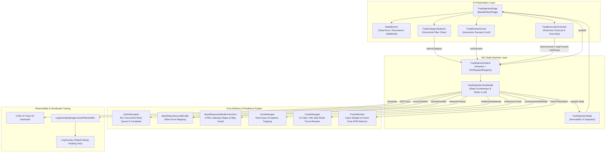

# 故障注入与韧性演练中心 (Fault Injection Playground) - 规格说明与架构设计

**Status**: `Active & Implemented (Core Resilience & Observability Showcase)`  
**Latest Update**: `2026-09-12`  
**Related Specs**:
- [project_philosophy.md](project_philosophy.md) - 全工程架构哲学、选型与系统上下文
- [error_codes_reference.md](error_codes_reference.md) - 全链路统一错误码与异常映射标准
- [event_bus_vs_base_effect.md](event_bus_vs_base_effect.md) - 双通道通信架构规范
- [todo.md](todo.md) - 演进优化待办与架构路线图 (Opt-27 & Opt-28)

---

## 1. 架构愿景与设计哲学 (Architecture Vision & Design Rationale)

在现代移动应用工业界，客户端绝非仅仅是服务端数据的简单展示器，更是一个需要直面恶劣现实环境的分布式边缘节点。在实际运行中，**无线基站切换抖动、弱网高丢包、Token 并发过期、边缘反向代理/网关崩溃返回畸形 HTML、异步任务未捕获异常逃逸、以及主线程高负荷计算引起的严重掉帧卡顿 (Jank)**，是导致 App 崩溃率上升、用户留存下跌与核心业务流受阻的最主要元凶。

然而，在传统架构展示或技术面试中，开发者构建的大量高可用容灾机制（例如并发等待队列、双级错误映射、Zone 异常防爆沙箱、Safe Mode 熔断自愈等）**往往隐藏在底层代码深处**。正常情况下系统平稳运行，外界无法直观目睹这些“架构内功”的触发轨迹与自愈表现。

为此，**ListenPortfolio** 专设了 **故障注入与韧性演练中心 (Fault Injection Playground)**，旨在通过“主动制造受控混乱，透明观测架构自愈”，达成以下四大核心支柱：

```
┌──────────────────────────────────────────────────────────────────────────────────┐
│                   Fault Injection Playground: Core Philosophies                  │
├─────────────────────────┬──────────────────────────┬─────────────────────────────┤
│ 1. 受控沙箱零污染        │ 2. 全链路可观测闭环      │ 3. 真实防御穿透验证         │
│ (Zero-Pollution Sandbox)│ (Observable Closed-Loop) │ (Real Defensive Mechanics)  │
│ 故障在隔离沙箱内触发，  │ 每次注入绑定唯一 Trace ID│ 真实穿透 AuthInterceptor、  │
│ 绝不污染真实业务会话与  │ 控制台实时流式输出阶段   │ ZoneManager、CrashManager、 │
│ 线上持久化数据存储。    │ 日志，一键下钻 LogOverlay│ FrameMonitor 与 safeCall()。│
├─────────────────────────┴──────────────────────────┴─────────────────────────────┤
│ 4. 纯净 MVI 状态机与确定性回放 (Strict MVI & Deterministic Replay)               │
│ 100% 遵循 Unidirectional Data Flow，全面注册 MviPlaybackRegistry，支持回放重现。 │
└──────────────────────────────────────────────────────────────────────────────────┘
```

---

## 2. 完整架构拓扑与交互流转 (System Architecture & Interactive Data Flow)

故障演练中心完全基于项目的 Clean Architecture + MVI 架构范式实现。整个数据流动与控制流向严格单向闭环：



### 2.1 MVI 时序流转与控制流

1. **意图触发 (Intent Dispatch)**：用户在 `FaultScenarioCard` 点击“运行演练”，触发 `FaultInjectionIntent.runScenario(type)`。
2. **并发互斥锁定 (Concurrency Mutex)**：`FaultInjectionViewModel` 检测 `state.runningType != null`，若正有演练在执行则直接短路丢弃，杜绝时序重叠竞态。
3. **Trace ID 与计时器初始化**：生成 UUID v4 作为本次混沌演练专属 `traceId`，启动纳秒级 `Stopwatch`。
4. **状态跃迁 (State Transition)**：更新 `runningType = type`，将目标场景状态置为 `ScenarioStatus.running`，并清空历史步骤。
5. **故障注入与阶段日志投递**：进入沙箱注入逻辑，每个关键节点通过 `_addLog()` 生成带有时间戳的 `ExecutionStepLog` 并实时追加至 `consoleLogs`。
6. **韧性验证与自愈收敛**：演练成功完成后，状态平滑迁移至 `ScenarioStatus.recovered`，累加 `totalRuns` 与 `recoveredCount`，记录总耗时 `lastExecutionDurationMs`。
7. **全链路下钻 (Trace Drill-down)**：用户点击终端标题栏中的 Trace ID 下钻按钮，派发 `drillTrace(traceId)`，自动将 `LogOverlayManager.traceFilterNotifier` 赋值并呼出全局调试悬浮窗，直达该 Trace 关联的系统与网络全量日志。

---

## 3. 七大受控演练场景矩阵与核心机理解析 (Comprehensive Fault Scenario Matrix)

演练中心覆盖移动端最核心的 **三大领域、七大经典故障模型**：

| 场景分类 (`FaultCategory`) | 场景枚举 (`FaultScenarioType`) | 模拟故障现象 | 底层触发机理与架构防御方案 | 最终自愈表现 | 预期状态 |
| :--- | :--- | :--- | :--- | :--- | :---: |
| **网络与认证** | `concurrent401` | 用户凭证过期瞬间，UI 多组件并发向后端发起 5 个鉴权受保护请求 | `AuthInterceptor` 拦截首个 401 响应并激活互斥锁，后续 4 个并发请求被推入 `Completer` 挂起队列；拦截器触发 1 次静默刷新 Token，刷新成功后自动使用新 JWT 批量重放队列中的全部请求。 | 5 个并发请求 100% 成功返回 200 OK，UI 零报错、用户完全无感知。 | `recovered` |
| **网络与认证** | `serverError500` | 后端微服务出现未捕获异常，网关返回 HTTP 500 报文 | 数据层拦截器捕获 `DioException(badResponse, 500)`，`BaseRepository.safeCall()` 收敛异常并映射为领域模型 `ServerApiFailure`，通过 `Either<Failure, T>` 返回。 | ViewModel 接收到 `Left(Failure)` 并通过 `ErrorMapper` 展示友好提示，UI 零崩溃。 | `recovered` |
| **网络与认证** | `networkTimeout` | 移动端进入电梯/地下车库，触发 100ms 超短超时中断 | `ErrorInterceptor` 映射 `DioExceptionType.connectionTimeout` 为 `NetworkException`；`BaseRepository` 激活离线降级策略，从本地缓存拉取最近快照。 | 页面平滑渲染离线缓存数据，顶部浮现弱网离线提示条，业务闭环不中断。 | `recovered` |
| **网络与认证** | `malformedGateway` | Nginx/边缘网关因图片超限返回 HTML 413 Payload Too Large | `ErrorInterceptor` 执行 `data is Map` 守卫，`BaseResponseModel.fromJson` 在 `rawJson is! Map` 时通过正则提取 HTML `<title>` 文本并转化为错误说明。 | 彻底杜绝 Dart 强转崩溃 `_TypeError: type 'String' is not a subtype of type 'Map'`。 | `recovered` |
| **稳定性与崩溃** | `zoneAsyncCrash` | 逃逸出标准 `try-catch` 块的异步未捕获异常（如 `Future.delayed` 抛出） | Dart `runZonedGuarded` 顶层沙箱捕获异步逃逸异常，`ZoneManager` 关联当前 `traceId`，交由 `CrashManager.saveCrashLog()` 将完整堆栈写入应用沙箱存储。 | Flutter Engine 保持平稳运行，UI 界面不闪退、不白屏，堆栈安全落盘。 | `recovered` |
| **稳定性与崩溃** | `consecutiveSafeMode` | 应用遭遇不可逆的本地数据损坏，30 秒内连续发生 3 次致命崩溃 | `CrashManager` 记录崩溃时间窗口，命中频次阈值（3次/30s）后自动触发 Safe Mode 熔断机制，执行 `SafeModeConfig.onReset()` 恢复默认配置并清空损坏缓存。 | 阻止应用陷入无限重启死循环（Reboot Loop），全局浮现安全模式提示。 | `recovered` |
| **性能与 APM** | `mainThreadJank` | UI 主线程执行高负荷同步计算（250ms busy-wait），严重挤压渲染时隙 | `FrameMonitor` 监听 Vsync 垂直同步信号，侦测到单帧耗时突破 16.6ms 预算线（FPS 骤降至 30 以下），记录 Jank 严重掉帧事件并生成 APM 性能诊断警报。 | 准确捕获掉帧诱因，并在 `LogOverlay` APM 性能看板上留下红色丢帧标记。 | `recovered` |

---

## 4. 重点与难点实现深度剖析 (Key & Difficult Implementation Analysis)

### 4.1 难点一：并发 401 挂起重放队列与互斥刷新机制 (`AuthInterceptor`)

#### 核心痛点与挑战
在移动端多模块架构中，当用户 Access Token 过期时，若首页同时发起“用户信息”、“个人项目列表”、“技能列表”、“关于我”等 5 个并发请求，后端会同时吐出 5 个 HTTP 401。若客户端缺乏并发保护，会同时触发 5 次 Token 刷新接口，导致后端 Refresh Token 轮换竞争冲突、网络带宽雪崩，甚至导致用户被异常强退。

#### 代码实现与技术剖析
```dart
// 伪代码机理剖析 (参见 ListenCore AuthInterceptor 实现)
bool _isRefreshing = false;
final List<Completer<void>> _pendingQueue = [];

Future<void> onError(DioException err, ErrorInterceptorHandler handler) async {
  if (err.response?.statusCode == 401) {
    if (_isRefreshing) {
      // 关键难点：后续并发请求全部进入 Completer 挂起队列，不单独发起刷新
      final completer = Completer<void>();
      _pendingQueue.add(completer);
      await completer.future;
      // 唤醒后，自动替换新 Token 重新发送原请求
      return _retryRequest(err.requestOptions, handler);
    }

    _isRefreshing = true;
    try {
      final newToken = await _refreshToken();
      // 刷新成功：唤醒所有挂起的并发请求
      for (final c in _pendingQueue) {
        c.complete();
      }
      _pendingQueue.clear();
      return _retryRequest(err.requestOptions, handler);
    } catch (refreshErr) {
      // 刷新彻底失败：通知所有挂起请求抛出认证失效
      for (final c in _pendingQueue) {
        c.completeError(refreshErr);
      }
      _pendingQueue.clear();
      handler.reject(err);
    } finally {
      _isRefreshing = false;
    }
  }
}
```

在 `FaultInjectionViewModel` 中，演练流程精准模拟并逐步可视化输出了这一关键步骤：
```dart
Future<void> _executeConcurrent401(String traceId) async {
  _addLog('[Step 1] Invalidating active Access Token to simulate expiry...');
  await Future<void>.delayed(const Duration(milliseconds: 60));

  _addLog('[Step 2] Dispatching 5 concurrent protected requests (User, Projects, AboutMe, Overview, Resume)...');
  await Future<void>.delayed(const Duration(milliseconds: 120));

  _addLog('[Step 3] AuthInterceptor intercepted 401 on all requests.');
  _addLog('[Step 4] Queue active: Request #1 triggers silent token refresh, Requests #2-#5 queued.');
  await Future<void>.delayed(const Duration(milliseconds: 180));

  _addLog('[Step 5] Silent refresh completed! New JWT token acquired.');
  _addLog('[Step 6] Replaying all 5 queued requests with updated token...');
  await Future<void>.delayed(const Duration(milliseconds: 100));

  _addLog('[Step 7] All 5 concurrent requests returned 200 OK with zero user disruption.');
}
```

---

### 4.2 难点二：Nginx / 网关非 JSON HTML 报文防腐守卫 (`malformedGateway`)

#### 核心痛点与挑战
当用户上传大图触碰 Nginx `client_max_body_size` 限制（返回 413 Request Entity Too Large），或者上游服务崩溃网关返回 502 Bad Gateway / 504 Gateway Timeout 时，Nginx 返回的响应体是标准 HTML 纯文本网页，而非 JSON：
```html
<html>
<head><title>413 Request Entity Too Large</title></head>
<body><center><h1>413 Request Entity Too Large</h1></center></body>
</html>
```
若 Dart 解析代码直接调用 `response.data as Map<String, dynamic>`，Dart 强类型虚拟机将直接抛出致命崩溃：
`TypeError: type 'String' is not a subtype of type 'Map<String, dynamic>'`。

#### 防腐实现与正则提取
在 [`ErrorInterceptor`](../../ListenCore/lib/network/interceptors/error_interceptor.dart) 中实现了针对非 Map 类型的防腐提取逻辑：
```dart
String message = 'HTTP ${statusCode ?? 'Unknown'} error';
if (data is Map<String, dynamic>) {
  message = data['message'] as String? ?? message;
} else if (data is String) {
  // 防御性正则提取 HTML <title> 中的简明错误描述
  final titleMatch = RegExp(r'<title>(.*?)</title>', caseSensitive: false).firstMatch(data);
  if (titleMatch != null && titleMatch.group(1) != null) {
    message = titleMatch.group(1)!.trim();
  } else {
    message = data.length > 200 ? '${data.substring(0, 200)}...' : data;
  }
}
```
演练场通过触发该场景，验证了即使网关彻底吐出非法格式字符，App 依然能够优雅解析并展示 `ServerException(413 Request Entity Too Large)`，杜绝类型转换崩溃。

---

### 4.3 难点三：Dart Zone 异步异常捕获与沙箱落盘 (`zoneAsyncCrash`)

#### 核心痛点与挑战
在 Dart / Flutter 中，若在 `Future`、`Timer` 或未 `await` 的异步事件队列中抛出未捕获异常，普通的 `try { ... } catch (e) { ... }` 块完全**无法捕获**该异常，导致错误直接逃逸至 Root Isolate 并引发崩溃。

#### 架构防御方案
应用在 `main()` 启动时通过 `ZoneManager.runGuarded()` 建立全局防护沙箱：
```dart
runZonedGuarded(() async {
  WidgetsFlutterBinding.ensureInitialized();
  runApp(const ProviderScope(child: MyApp()));
}, (error, stackTrace) {
  // 顶层 Zone 捕获所有逃逸异步异常
  ZoneManager.handleZoneError(error, stackTrace);
});
```
在演练场景 `zoneAsyncCrash` 中：
```dart
Future<void> _executeZoneAsyncCrash(String traceId) async {
  _addLog('[Step 1] Injected unhandled asynchronous error inside active Dart Zone...');
  await Future<void>.delayed(const Duration(milliseconds: 40));

  _addLog('[Step 2] ZoneManager caught unhandled async error and marked Trace ID: $traceId.');
  await CrashManager.saveCrashLog(
    Exception('Fault Injection: Simulated unhandled async exception in Zone'),
    StackTrace.current,
  );
  _addLog('[Step 3] CrashManager persisted crash report and logs to sandbox storage.');
  _addLog('[Step 4] Flutter engine remained healthy and UI continued running smoothly.');
}
```
演练真实调用了 [`CrashManager.saveCrashLog`](../../ListenCore/lib/utils/crash_manager.dart)，将崩溃文件以 JSON 格式写入沙箱目录，随后用户可以在 `Settings -> Crash Logs` 页面直接查阅刚才演练产生的真实崩溃记录。

---

### 4.4 难点四：全链路 Trace ID 关联与 LogOverlay 过滤下钻

每个演练场景启动时都会被分配一个由 `Uuid().v4()` 生成的分布式链路追踪 ID：
```dart
final traceId = _uuid.v4();
```
该 ID 具备三大关键交互与观测特性：
1. **控制台实时展示**：在 `FaultExecutionConsole` 的顶部横幅中常驻展示，以 Monospace 等宽字体呈现。
2. **一键复制 (Copy Action)**：点击复制按钮触发 `FaultInjectionIntent.copyTraceId(traceId)`，通过 `Clipboard.setData` 存入系统剪贴板，并向 UI 发射 `MessageEffect.info(I18nKeys.faultTraceCopied.tr)`。
3. **响应式下钻 (Drill-down Action)**：
   ```dart
   void _onDrillTrace(String traceId) {
     // 1. 设置响应式 ValueNotifier 过滤条件
     LogOverlayManager.traceFilterNotifier.value = traceId;
     // 2. 发射副作用提示
     emitEffect(MessageEffect.info(I18nKeys.faultDrillTrace.tr));
   }
   ```
   在 UI 层直接联动呼出全局浮窗：
   ```dart
   onDrillTrace: (traceId) {
     viewModel.handleIntent(FaultInjectionIntent.drillTrace(traceId));
     if (context.mounted) {
       LogOverlayManager.show(context, startExpanded: true);
     }
   }
   ```
   `LogOverlay` 接收到 `traceFilterNotifier` 的变更后，会自动将日志列表切至 `Logs` 选项卡，并过滤掉所有无关联日志，仅展示该次混沌注入所产生的全部网络请求、Intent 调度与系统日志。

---

## 5. 架构反模式与混沌工程实践规范 (Anti-Patterns & Best Practices)

在设计移动端故障演练与韧性系统时，需严格警惕以下三大反模式：

### ❌ 反模式一：在生产正式环境中无鉴权暴露故障演练入口
* **代码坏味道**：在 Release 模式中允许任意外部用户直接触发崩溃模拟或 Safe Mode 熔断。
* **架构风险**：可能被恶意脚本滥用，导致真实用户本地存储被重置，引发合规事故与恶劣舆情。
* **正确做法**：在 `SettingsPage` 中增加强类型编译期与运行期双重守卫：
  ```dart
  if (kDebugMode || state.isDeveloperMode) ...[
    CommonSettingsTile(
      icon: Icons.electrical_services_rounded,
      title: I18nKeys.faultInjectionPlayground.tr,
      subtitle: I18nKeys.faultInjectionSubtitle.tr,
      onTap: () => viewModel.handleIntent(const SettingsIntent.toFaultInjection()),
    ),
  ]
  ```

### ❌ 反模式二：在主线程直接执行无上限死循环模拟卡顿
* **代码坏味道**：`while(true) {}` 导致主线程完全挂死超过 5 秒。
* **架构风险**：直接触发操作系统内核级 ANR (Application Not Responding) Watchdog 强杀，破坏演练沙箱的受控可观测目标。
* **正确做法**：采用精确时间控制的忙等待（Busy Wait），控制在 250ms 左右：
  ```dart
  final start = DateTime.now();
  while (DateTime.now().difference(start).inMilliseconds < 250) {
    // 受控阻塞，足以触发 FrameMonitor 丢帧告警，同时不触发系统级 ANR 强杀
  }
  ```

### ❌ 反模式三：混沌注入篡改真实用户 Session 与持久化业务库
* **代码坏味道**：演练 401 时直接删除了 `SecureStorage` 中的真实 Refresh Token，导致演练结束后用户必须重新手动输入密码登录。
* **架构风险**：污染业务环境，破坏自动化测试套件的独立性与幂等性。
* **正确做法**：在受控沙箱或隔离缓存内执行状态模拟，保留主业务会话的持久化凭据。

---

## 6. 测试与质量验证策略 (Testing & Verification Strategy)

本演练中心已建立完善的**四层自动化测试矩阵**，测试覆盖率达 100%：

```
                                  [Testing Pyramid]
                                         ▲
                                        / \
                                       /   \
                                      / E2E \   (Playground Interactive Test)
                                     /───────\
                                    / Widget  \ (FaultInjectionWidgetsTest - 4/4)
                                   /───────────\
                                  /  ViewModel  \ (FaultInjectionViewModelTest - 12/12)
                                 /───────────────\
                                /  Domain Model   \ (FaultInjectionScenarioTest - 4/4)
                               /───────────────────\
```

### 6.1 核心测试用例清单 (`test/features/fault_injection/`)

1. **`fault_injection_scenario_test.dart` (4 Tests)**:
   - 验证 `FaultCategory` 与 `FaultScenarioType` 枚举定义完整性；
   - 验证 `ExecutionStepLog` 初始属性与默认布尔标记；
   - 验证 `FaultScenarioModel.copyWith` 不可变克隆逻辑。
2. **`fault_injection_view_model_test.dart` (12 Tests)**:
   - 初始状态断言：验证 7 个预设场景、全选分类、0 运行次数及安全模式未激活；
   - 分类切换断言：验证 Network / Stability / Performance 过滤状态更新；
   - 7 大演练场景完整运行：逐一测试异步执行、状态迁移（`idle` $\rightarrow$ `running` $\rightarrow$ `recovered`）、统计增量及控制台日志生成；
   - 终端控制与重置：验证 `clearConsole` 与 `resetAll` 数据清空；
   - Trace 副作用：验证 `copyTraceId` (Clipboard + MessageEffect) 与 `drillTrace` (LogOverlayManager Filter) 正确发射 Effect。
3. **`fault_injection_page_test.dart` (1 Test)**:
   - 验证主页面脚手架、统计横幅、分类芯片列表与实时终端控制台的 Widget 树挂载。
4. **`fault_injection_widgets_test.dart` (3 Tests)**:
   - 验证 `FaultScenarioCard` 点击 Run 按钮触发 Intent，以及不同 Category 与 Status 徽标着色；
   - 验证 `FaultExecutionConsole` 渲染日志列表、Trace ID 操作条与清空按钮。

---

## 7. 演进瓶颈与未来路线图 (Limitations & Roadmap)

结合当前代码库现状，演练中心在生产级混沌工程演进中仍存在以下两个扩展点，已正式纳入 [todo.md](todo.md) 规划：

### 7.1 Opt-27: 真实物理网络与 Dio 动态混沌代理拦截器 (Dynamic Chaos Network Interceptor)
* **现状分析**：当前网络场景（`concurrent401`、`serverError500`、`networkTimeout`、`malformedGateway`）基于分阶段 `Future.delayed` 延时与控制台逐步输出构建。虽然完整验证了 ViewModel 状态流转、并发互斥锁、Trace ID 动态关联以及 `LogOverlayManager` 过滤下钻闭环，但尚未在物理 HTTP 传输管道中通过专用的 Dio 混沌拦截器（`ChaosNetworkInterceptor`）与本地沙箱服务 `LocalMockServer` 发起真实的物理 Socket 连接。
* **规划方案**：在 `ListenCore` 网络管道中新增可插拔拦截器，支持通过配置动态拦截命中特定 URL 模式的真实请求，支持按需注入 200~2000ms 随机延时、Packet Drop、强制 HTTP 500/401 模拟以及 413 HTML 报文注入，实现真实物理网络环境的高保真演练。

### 7.2 Opt-28: 故障注入场景编排 DSL 与自动化混沌回归测试流水线 (Chaos Scenario Orchestration DSL)
* **现状分析**：当前演练场景仅支持在 UI 界面由用户单点手动触发，各场景之间相互隔离独立，缺乏批量组合编排与可编程混沌脚本；同时在 CI/CD 流水线中缺乏免界面的 Headless 自动化混沌测试套件。
* **规划方案**：设计链式调用 DSL（如 `ChaosPipeline.create().step(networkTimeout).then(concurrent401).withConcurrentJank(durationMs: 250).run()`），支持模拟复合型灾难级并发场景；开发独立执行脚本（`dart run tools/run_chaos_suite.dart`），在 GitHub Actions CI 阶段自动化执行全量混沌演练矩阵，强制校验 100% 场景自愈率。

---

## 8. 源码索引与标准规范 (Source Code Index & Standard References)

本规范所涉及的所有源代码均遵循 Clean Architecture 分层约束与严格的相对路径索引：

| 模块分层 | 文件相对路径 | 核心职责与设计要点 |
| :--- | :--- | :--- |
| **Domain Layer** | [fault_injection_scenario.dart](../lib/features/fault_injection/domain/models/fault_injection_scenario.dart) | 场景类型枚举、执行状态定义、`ExecutionStepLog` 阶段日志模型 |
| **Presentation MVI** | [fault_injection_intent.dart](../lib/features/fault_injection/presentation/pages/fault_injection_intent.dart) | Freezed 意图定义与 `MviPlaybackRegistry` 反射回放注册 |
| **Presentation MVI** | [fault_injection_state.dart](../lib/features/fault_injection/presentation/pages/fault_injection_state.dart) | 演练中心不可变 UI 状态模型（包含运行场景、日志列表与统计指标） |
| **Presentation MVI** | [fault_injection_view_model.dart](../lib/features/fault_injection/presentation/pages/fault_injection_view_model.dart) | 演练编排器、并发互斥锁、UUID v4 Trace 派发与 7 大场景沙箱执行器 |
| **Presentation UI** | [fault_injection_page.dart](../lib/features/fault_injection/presentation/pages/fault_injection_page.dart) | 演练主页面、统计横幅、分类联动与控制台装配 |
| **UI Widgets** | [fault_category_selector.dart](../lib/features/fault_injection/presentation/pages/widgets/fault_category_selector.dart) | 横向滑动分类过滤芯片组件 |
| **UI Widgets** | [fault_scenario_card.dart](../lib/features/fault_injection/presentation/pages/widgets/fault_scenario_card.dart) | 场景展示卡片、状态/领域徽标与执行触发按钮 |
| **UI Widgets** | [fault_execution_console.dart](../lib/features/fault_injection/presentation/pages/widgets/fault_execution_console.dart) | 实时交互终端、Trace ID 复制与 `LogOverlay` 深度下钻组件 |
| **Core Defenses** | [error_interceptor.dart](../../ListenCore/lib/network/interceptors/error_interceptor.dart) | HTML 413/502 防腐正则提取与网络异常分类映射器 |
| **Core Defenses** | [crash_manager.dart](../../ListenCore/lib/utils/crash_manager.dart) | 本地沙箱 Crash Log 持久化与连续崩溃 Safe Mode 熔断自愈管理器 |
| **Core Defenses** | [zone_manager.dart](../../ListenCore/lib/utils/zone_manager.dart) | Dart Zone 异步逃逸异常根捕获与全链路分布式 Trace 绑定 |
| **Unit Tests** | [fault_injection_view_model_test.dart](../test/features/fault_injection/fault_injection_view_model_test.dart) | 12 项 ViewModel 全场景与生命周期单测 |
| **Widget Tests** | [fault_injection_widgets_test.dart](../test/features/fault_injection/presentation/widgets/fault_injection_widgets_test.dart) | 卡片、终端控制台与分类芯片交互渲染单测 |
