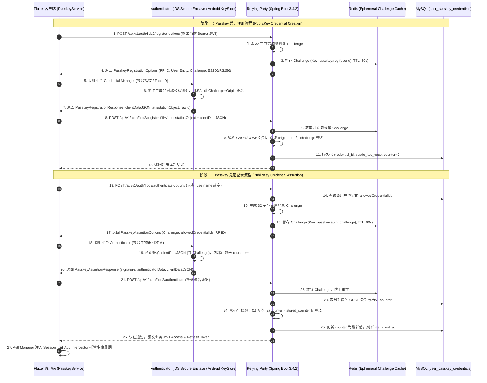
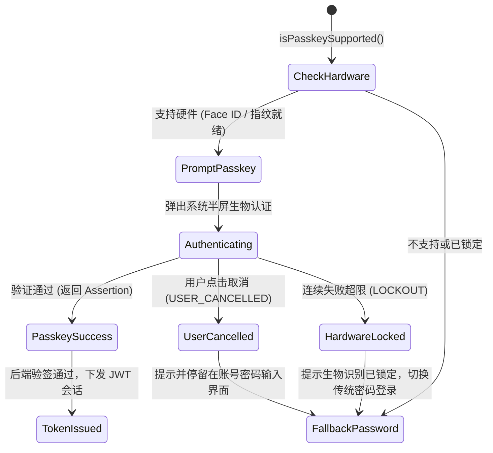

# FIDO2 / Passkey 免密认证系统 - 架构设计与实现方案 (Full-Stack Architecture)

> [!NOTE]
> **Status: 设计规范与客户端领域架构已实现 (Design Specification & Client Domain Architecture Implemented)**
> - 客户端已建立符合 W3C WebAuthn Level 3 规范的领域模型与服务抽象契约：[passkey_service.dart](../lib/features/auth/domain/services/passkey_service.dart)
> - 客户端已实现本地开发与沙箱测试的内存模拟器：[mock_passkey_service_impl.dart](../lib/features/auth/data/services/mock_passkey_service_impl.dart)
> - 客户端已完成全覆盖单元测试套件：[passkey_service_test.dart](../test/features/auth/domain/services/passkey_service_test.dart)（6/6 项测试 100% 绿灯通过）
> - 待排期实施项（双端原生桥接与 Spring Boot 服务端引擎）已收录至 [todo.md](todo.md)（`Opt-29`、`Opt-30`）

本文档系统性地阐述了在 **ListenPortfolio** 生态系统（Flutter 客户端 + Spring Boot 后端）中构建基于 **FIDO2 / WebAuthn (Passkey 通行密钥)** 的金融级安全无密码（Passwordless）身份认证架构。涵盖非对称密码学公私钥体系、双端原生桥接、防钓鱼物理域名绑定、单调计数器防重放攻击、后端 Gradle 依赖与 WebAuthn4J 验签流水线，以及异常降级兜底策略。

---

## 1. 系统总体架构与时序图

FIDO2 认证系统依托非对称加密算法（Asymmetric Cryptography），将传统的“共享秘密（用户名+密码）”转换为“硬件级私钥物理隔离 + 服务端仅存公钥验签”的零信任安全模型。系统由三大实体构成：
1. **FIDO2 客户端 (Flutter Client)**：运行于宿主操作系统，通过统一领域契约 [PasskeyService](../lib/features/auth/domain/services/passkey_service.dart) 调度系统级通行密钥接口，管理公私钥注册与挑战签名流程。
2. **Authenticator (平台物理认证器)**：设备内置安全芯片（iOS Secure Enclave / Android KeyStore / StrongBox），私钥物理固化于硬件熔丝或加密隔离区，不可导出；唯有通过系统生物识别（Face ID / Touch ID / 屏幕锁凭据）授权后方可执行数字签名。
3. **Relying Party (RP, Spring Boot 服务端)**：作为 WebAuthn 依赖方，负责下发强伪随机数挑战（Challenge）、校验客户端上报的客户端数据与签名有效性、维护单调自增签名计数器，并在认证成功后签发标准 JWT 双 Token。



---

## 2. 客户端架构设计与实现细节 (Flutter)

### 2.1 领域契约与模型分层 (`lib/features/auth/domain/services/passkey_service.dart`)

遵循 Clean Architecture 原则，Passkey 认证能力在领域层抽象为强类型不可变模型与抽象接口契约，不直接依赖第三方插件，实现上层业务逻辑与平台特异性实现的彻底解耦：

- **`PasskeyRpEntity`**：依赖方元数据（`id`: 对应物理域名如 `listen-portfolio.com`，`name`: 应用展示名）。
- **`PasskeyUserEntity`**：用户信息（`id`: Base64URL 编码的主键，`name`: 登录账号，`displayName`: 弹窗展示名）。
- **`PasskeyPubKeyCredParam`**：声明客户端支持的非对称加密算法（COSE 标识符）：
  - `ES256` (`alg: -7`)：基于 NIST P-256 椭圆曲线的 ECDSA 算法，全平台通用且硬件原生支持最优。
  - `RS256` (`alg: -257`)：RSASSA-PKCS1-v1_5 配合 SHA-256，用于特定兼容性场景。
- **`PasskeyRegistrationOptions` & `PasskeyRegistrationResponse`**：注册请求与响应契约（包含 `clientDataJSON` 与 CBOR 编码的 `attestationObject`）。
- **`PasskeyAssertionOptions` & `PasskeyAssertionResponse`**：断言请求与响应契约（包含 `signature` 与包含计数器的 `authenticatorData`）。
- **`PasskeyResult<T>`**：统一函数式结果包装器，暴露 `isSuccess` 与 `isFailure`，提供标准错误码体系（`USER_CANCELLED`、`HARDWARE_UNAVAILABLE`、`CREDENTIAL_NOT_FOUND` 等）。

### 2.2 核心服务抽象契约

```dart
abstract class PasskeyService {
  /// 探测当前设备物理硬件与系统版本是否具备 Passkey / 生物识别能力
  Future<bool> isPasskeySupported();

  /// 发起 Passkey 凭证注册，拉起 Face ID / 指纹完成硬件公私钥对生成与签名
  Future<PasskeyResult<PasskeyRegistrationResponse>> register(PasskeyRegistrationOptions options);

  /// 发起 Passkey 身份断言，完成免密挑战签名
  Future<PasskeyResult<PasskeyAssertionResponse>> authenticate(PasskeyAssertionOptions options);

  /// 获取设备或沙箱内已注册的凭据元数据列表
  Future<List<PasskeyCredential>> getRegisteredCredentials();

  /// 移除指定凭据
  Future<bool> deleteCredential(String credentialId);
}
```

### 2.3 内存与沙箱测试实现 (`lib/features/auth/data/services/mock_passkey_service_impl.dart`)

为了在本地 CI/CD 流水线、无物理生物识别传感器的模拟器及开发调试中跑通完整流程，项目内置了工业级沙箱模拟实现：
1. **Base64URL 标准编码**：所有 ID、`clientDataJSON`、`authenticatorData` 均符合 RFC 4648 无填充规范。
2. **重放防范计数器维护**：在内存中模拟单调递增的 `counter`，每次签名后递增并在 `authenticatorData` 中回传。
3. **故障注入模拟能力**：提供 `setSimulateHardwareFailure(bool)` 与 `setSimulateUserCancellation(bool)`，直接赋能单元测试与故障演练场。

### 2.4 ViewModel 与网络拦截器串联

- **`LoginViewModel` 协同**：
  在 [login_view_model.dart](../lib/features/auth/presentation/pages/login/login_view_model.dart) 中预留了 `loginWithPasskey` 接入点。用户点击免密登录按钮后，从后端获取 Challenge，调用 `PasskeyService.authenticate()` 获取生物签名后提交给后端置换 `UserModel`。
- **`AuthInterceptor` 协同**：
  在 [auth_interceptor.dart](../../ListenCore/lib/network/interceptors/auth_interceptor.dart) 中，FIDO2 认证成功下发的 JWT Access/Refresh Token 会自动进入拦截器生命周期管辖范围，实现 401 自动排队重试与刷新。若刷新令牌最终失效，触发会话登出并回退至生物识别重签。

---

## 3. 后端技术选型与服务端引擎设计 (Spring Boot)

> [!IMPORTANT]
> **构建系统说明**：`ListenPortfolioBackend` 采用 **Gradle** (`build.gradle`) 构建，基于 **Spring Boot 3.4.2** 与 **Java 17**。原设计方案中提及的 `pom.xml` 已废弃纠正。

### 3.1 Gradle 依赖配置 (`build.gradle`)

在 `ListenPortfolioBackend/build.gradle` 的 `dependencies` 闭包中集成经行业审计的 W3C 认证库：

```groovy
dependencies {
    // Spring Boot 核心组件
    implementation 'org.springframework.boot:spring-boot-starter-web'
    implementation 'org.springframework.boot:spring-boot-starter-security'
    implementation 'org.springframework.boot:spring-boot-starter-data-redis'

    // W3C WebAuthn / FIDO2 服务端验证核心引擎 (WebAuthn4J)
    implementation 'com.webauthn4j:webauthn4j-core:0.28.6.RELEASE'

    // CBOR 与 COSE 密码学解析辅助库
    implementation 'com.fasterxml.jackson.dataformat:jackson-dataformat-cbor:2.18.2'
    implementation 'org.bouncycastle:bcprov-jdk18on:1.79'
}
```

### 3.2 凭据持久化数据表设计 (MySQL DDL)

创建 `user_passkey_credentials` 表，存储用户绑定的公钥与安全计数器：

```sql
CREATE TABLE `user_passkey_credentials` (
    `id` VARCHAR(64) NOT NULL COMMENT '凭证记录主键 UUID',
    `user_id` VARCHAR(64) NOT NULL COMMENT '关联系统用户表 users.id',
    `credential_id` VARCHAR(255) NOT NULL COMMENT 'Base64URL 编码的 WebAuthn 凭证全局唯一 ID',
    `public_key_cose` BLOB NOT NULL COMMENT 'COSE (CBOR) 格式序列化的公钥字节流',
    `counter` BIGINT NOT NULL DEFAULT 0 COMMENT '单调自增签名计数器，用于严格防御重放攻击',
    `aaguid` VARCHAR(64) NULL COMMENT '认证器厂商在全球的唯一标识符 AAGUID',
    `device_label` VARCHAR(128) NULL COMMENT '设备类型备注 (如 iPhone 15 Pro, Pixel 8)',
    `attestation_type` VARCHAR(32) NOT NULL DEFAULT 'none' COMMENT '证明类型 (none, direct)',
    `created_at` DATETIME NOT NULL DEFAULT CURRENT_TIMESTAMP COMMENT '凭证创建时间',
    `last_used_at` DATETIME NULL COMMENT '最后一次成功免密登录时间',
    PRIMARY KEY (`id`),
    UNIQUE KEY `uk_credential_id` (`credential_id`),
    INDEX `idx_user_id` (`user_id`)
) ENGINE=InnoDB DEFAULT CHARSET=utf8mb4 COMMENT='FIDO2 / Passkey 用户硬件凭据存储表';
```

### 3.3 Redis 临时挑战缓存设计

挑战码（Challenge）具备极高的时效性与一次性属性，切忌直接入库或存入持久化 Session：
- **Key 格式**：`passkey:challenge:{contextId}`
- **TTL 设定**：`60 秒`（超时自动过期）
- **核销机制**：在验证接口进入后，执行原子操作 `GETDEL passkey:challenge:{contextId}`，确保每个 Challenge 只能被验证一次，从源头上阻断并发重放。

---

## 4. 核心技术重点与难点深度解析 (Key Technical Challenges)

### 4.1 难点一：COSE (CBOR Object Signing and Encryption) 公钥解析与校验

#### 机制剖析
WebAuthn 规范（RFC 8152）抛弃了传统的 PEM/X.509 繁重格式，强制采用二进制 **COSE** 格式表达公钥。在 ES256 (-7) 算法下，公钥被序列化为一个 CBOR Map：
- Key `1` (`kty`): Key Type（`2` 表示 EC2 椭圆曲线）
- Key `3` (`alg`): 算法标识符（`-7` 表示 ES256）
- Key `-1` (`crv`): 曲线类型（`1` 表示 NIST P-256）
- Key `-2` (`x`): 32 字节的大端坐标点 X
- Key `-3` (`y`): 32 字节的大端坐标点 Y

#### 服务端解析核心代码示例 (Java + WebAuthn4J)
```java
import com.webauthn4j.data.attestation.statement.COSEAlgorithmIdentifier;
import com.webauthn4j.data.attestation.authenticator.COSEKey;
import com.webauthn4j.converter.util.CborConverter;
import java.security.PublicKey;

public class CosePublicKeyResolver {
    private final CborConverter cborConverter = new CborConverter();

    public PublicKey extractPublicKey(byte[] coseKeyBytes) throws Exception {
        // 1. 将二进制 CBOR 反序列化为 WebAuthn4J COSEKey 对象
        COSEKey coseKey = cborConverter.read(coseKeyBytes, COSEKey.class);

        // 2. 校验算法一致性
        if (!coseKey.getAlgorithm().equals(COSEAlgorithmIdentifier.ES256)) {
            throw new IllegalArgumentException("Unsupported algorithm: " + coseKey.getAlgorithm());
        }

        // 3. 将 COSEKey 转换为 Java JCA 标准 java.security.PublicKey
        return coseKey.getPublicKey();
    }
}
```

---

### 4.2 难点二：单调自增签名计数器 (Monotonic Counter) 与重放攻击防御

#### 防御原理
攻击者如果能够通过中间人攻击截获客户端发出的有效断言包（Assertion），即使它具有有效的数字签名，也可能尝试重发该数据包（Replay Attack）。
WebAuthn 在物理硬件认证器中引入了 **32 位单调递增计数器 (`signCount`)**：
1. 每次 Authenticator 对断言进行签名时，芯片内部时钟硬件将 `signCount` 自增，并打包进 `authenticatorData` 的第 33~36 字节中（大端无符号整数）。
2. 服务端在校验签名成功后，比对当前上报的 `signCount` 与数据库中该凭证上次记录的 `counter`：
   - 若 `signCount > storedCounter`：合法请求，数据库更新 `counter = signCount`。
   - 若 `signCount <= storedCounter` 且 `storedCounter > 0`：**判定发生重放攻击或物理硬件被非法克隆！**

#### 拦截与风控响应逻辑
```java
@Transactional
public void verifyCounterAndSave(UserPasskeyCredential credential, long incomingSignCount) {
    long currentCounter = credential.getCounter();

    // 当且仅当认证器支持计数器时执行严格校验
    if (incomingSignCount > 0 || currentCounter > 0) {
        if (incomingSignCount <= currentCounter) {
            // 记录最高级别安全审计日志
            log.error("SECURITY ALERT: Monotonic counter roll-back detected! CredentialId={}, Stored={}, Incoming={}",
                    credential.getCredentialId(), currentCounter, incomingSignCount);
            
            // 标记凭据异常锁定，阻断认证
            credential.setIsSuspicious(true);
            passkeyRepository.save(credential);
            throw new SecurityReplayException("Credential cloned or assertion replayed. Authentication rejected.");
        }
    }

    // 更新最新计数器
    credential.setCounter(incomingSignCount);
    credential.setLastUsedAt(LocalDateTime.now());
    passkeyRepository.save(credential);
}
```

---

### 4.3 难点三：RP ID 与 Digital Asset Links / AASA 双向物理域名绑定 (防钓鱼)

传统短信验证码或 TOTP 口令极易遭受钓鱼网站（Reverse Proxy 钓鱼）劫持，而 FIDO2/Passkey 具备天生的**防钓鱼（Phishing-Resistance）**特性：

1. **Origin 物理校验**：
   在 Flutter 客户端唤起操作系统认证器时，Android/iOS 系统内核会直接提取当前宿主应用的官方签名证书指纹（SHA-256 Fingerprint）与包名，强制校验其是否属于目标 Relying Party 域名绑定的合法资产。
2. **Android Digital Asset Links 配置** (`https://portfolio.listen.io/.well-known/assetlinks.json`)：
   ```json
   [
     {
       "relation": ["delegate_permission/common.handle_all_urls", "delegate_permission/common.get_login_creds"],
       "target": {
         "namespace": "android_app",
         "package_name": "com.listen.portfolio",
         "sha256_cert_fingerprints": [
           "14:6D:E9:01:..." // 官方签名证书指纹
         ]
       }
     }
   ]
   ```
3. **iOS Apple App Site Association (AASA)** (`https://portfolio.listen.io/.well-known/apple-app-site-association`)：
   ```json
   {
     "webcredentials": {
       "apps": [
         "TEAMID12345.com.listen.portfolio"
       ]
     }
   }
   ```
4. **钓鱼防护效果**：黑客即使伪造一个像素级相同的仿冒 App 或搭设钓鱼域名，由于无法在真正的官方服务器部署合法的 `assetlinks.json`，操作系统安全模块会直接拒绝签发合法凭证，使得钓鱼攻击在物理层失效。

---

### 4.4 难点四：生物识别生命周期、硬件故障与优雅降级回退 (Graceful Fallback)

在移动端物理环境中，生物识别存在多种硬件边界异常：
1. **生物特征注册变更 (Biometric Enrollment Invalidation)**：用户在系统设置中录入了新的手指或面容。根据金融合规要求，原有绑定在密钥库中的加密凭证必须失效，防止手机借给他人录入指纹后盗用账户。
2. **硬件不可用与传感器锁定 (Lockout)**：连续多次识别人脸失败，系统锁定生物传感器。
3. **用户主动取消 (User Cancellation)**：用户主动关闭系统弹出 Sheet。

#### 降级状态机设计


在客户端中，`PasskeyResult` 通过结构化错误码（`USER_CANCELLED`、`HARDWARE_UNAVAILABLE`、`CREDENTIAL_NOT_FOUND`）驱动 UI，若识别被取消则平滑停留在原表单，不产生阻断性 Crash。

---

## 5. 架构反模式与避坑指南 (Anti-Patterns & Pitfalls)

### ❌ 反模式 1：将 Challenge 长期持久化在数据库或粘性 Session 中
* **隐患**：挑战码是单次高熵随机数，若直接写入磁盘数据库不仅造成垃圾数据膨胀，且可能因为分布式多节点 Session 同步延迟导致并发验证时 Challenge 错配。
* **正解**：采用 Redis 配合原子性操作 `SET key value EX 60` 与 `GETDEL key`，确保验证完毕后立即在内存中物理销毁。

### ❌ 反模式 2：绕过客户端 `clientDataJSON.origin` 与 `rpIdHash` 校验
* **隐患**：部分后端开发者仅校验签名本身是否正确，忽略了比对 `clientDataJSON` 中的 `origin` 与 `rpId` 是否与服务端配置完全吻合，使得黑客可以通过重放其他域名下签发的凭证实施跨站伪造。
* **正解**：严格执行 W3C 标准流程，对 `rpId` 进行 SHA-256 哈希后与 `authenticatorData` 中的前 32 字节比对，必须全等方可通过。

### ❌ 反模式 3：允许计数器逆流或静默放行 Counter=0
* **隐患**：在生产环境中发现计数器没有增加时，简单记录日志后依然签发 Token，导致防重放机制形同虚设。
* **正解**：计数器非严格单调递增必须视为严重入侵行为，不仅拒绝本次请求，还应立即封禁该 `credential_id` 并通知用户。

---

## 6. 测试与验证策略 (Testing Strategy)

为确保 FIDO2 架构在全生命周期中的绝对稳健，建立三层测试矩阵：

| 测试层级 | 测试范围 | 验证手段 | 覆盖目标 |
| :--- | :--- | :--- | :--- |
| **客户端单元测试** | [passkey_service_test.dart](../test/features/auth/domain/services/passkey_service_test.dart) | Flutter Test + MockPasskeyServiceImpl | 覆盖凭据注册、Base64URL 解码、单调计数器自增、硬件故障模拟、取消拦截等全场景 |
| **客户端契约测试** | [login_view_model_test.dart](../test/features/auth/login/login_view_model_test.dart) | MVI 状态机与 Intent 驱动测试 | 验证 Passkey 成功后登录状态流转、取消与异常时的优雅降级 |
| **后端验签集成测试** | `Fido2VerificationIntegrationTest.java` | Spring Boot Test + WebAuthn4J | 测试真实 COSE 公钥解析、ES256 验签、Redis Challenge 原子核销与重放攻击拦截 |

---

## 7. 后续落地演进路线 (Roadmap)

根据项目整体技术规划，FIDO2 核心模块的后续工程化落地已明确分解为两个核心实施任务（详见 [todo.md](todo.md)）：

1. **`Opt-29: Android Credential Manager 与 iOS ASAuthorizationController 原生双端 Passkey 桥接`**
   - 封装原生平台 MethodChannel / Pigeon 插件。
   - Android 端接入 `androidx.credentials:credentials:1.3.0`。
   - iOS 端接入 `AuthenticationServices` 框架。
2. **`Opt-30: Spring Boot WebAuthn4J / Yubico 服务端公钥认证引擎与凭证生命周期管理`**
   - 在 `ListenPortfolioBackend/build.gradle` 引入 `com.webauthn4j:webauthn4j-core`。
   - 实现 RESTful 端点（`/options` 与 `/verify`）与 Redis 缓存联动。
   - 部署生产环境 `.well-known/assetlinks.json` 与 AASA 文件。
