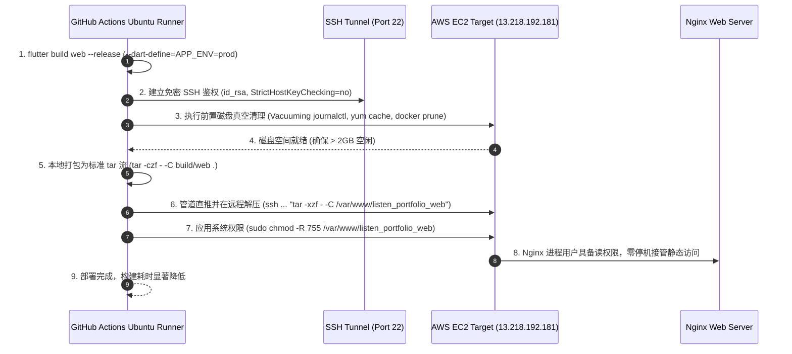

# 🌐 Flutter Web 生产级构建、AWS EC2 部署发布与全链路架构深度解析

> [!NOTE]
> **Status: 生产环境已上线运行 (Production Running & Architecture Verified)**
> - 生产环境在线访问入口：`http://13.218.192.181/`（或绑定域名 `http://listen2code.is-a.dev/`）
> - 自动化构建与部署脚本：[buildModule.sh](../buildModule.sh) 与 [.github/workflows/ci.yml](../.github/workflows/ci.yml)
> - 核心环境网络映射契约：[env_config.dart](../lib/shared/constants/env_config.dart)
> - 跨平台多环境安全防腐初始化：[app_initializer.dart](../lib/shared/utils/app_initializer.dart)
> - 演进优化项（Gzip/Brotli 预压缩、蓝绿无停机发布）已收录至 [todo.md](todo.md)（`Opt-31`、`Opt-32`）

本文档系统性地复盘与阐述 ListenPortfolio Flutter Web 客户端从源码编译、CI/CD 自动化流水线、零停机流式部署至 AWS EC2 服务器的完整工业级架构。深入剖析**同源零跨域反向代理**、**移动端平台代码的渐进式防腐降级**、**Nginx 路由优先级与前缀剥离**、**低配服务器磁盘防爆雪崩治理**等核心技术难点与避坑实录。

---

## 🏗️ 1. 系统总体架构与设计哲学

在现代全栈移动与 Web 混合架构中，前端与后端若采用不同域名或端口（如前端托管在 CDN/80 端口，后端运行在 8080 端口），浏览器在处理 `POST`、`PUT` 及携带自定义 Header（如 `Authorization: Bearer <token>`、`X-Trace-ID`）的请求时，会强制触发 CORS `OPTIONS` 预检请求（Preflight Request），不仅增加了 100ms~300ms 的网络往返延时，且极易因网关或 Spring Security 拦截导致跨域白屏。

为此，ListenPortfolio 采用了 **AWS EC2 单一网关统一端口的同源代理拓扑架构**：

```mermaid
graph TD
    Client[Web 浏览器 / iOS & Android 客户端] -->|HTTP 80 端口 / 同源访问| Nginx[AWS EC2 Nginx 80 端口网关]

    subgraph AWS EC2 实例 (13.218.192.181)
        subgraph Nginx 路由调度与安全沙箱
            Nginx -->|/ 静态资源路由 (SPA try_files)| WebDir["前端根目录: /var/www/listen_portfolio_web<br/>(index.html, main.dart.js, WASM, assets)"]
            Nginx -->|^~ /api/ 反向代理与前缀剥离| DockerApp["Spring Boot 3.4.2 容器<br/>(127.0.0.1:8080 / Java 17 + MySQL + Redis)"]
            Nginx -->|~* 静态资源长效缓存 (7d)| CacheRule["Browser Cache-Control: public, no-transform<br/>(WASM, Fonts, Icons, JS, CSS)"]
        end
    end
```

### 💡 核心设计哲学
1. **同源零跨域 (Same-Origin Zero-CORS)**：
   前端 Web 静态页面挂载于根路径 `/`，后端接口与后端动态图片统一反代至 `/api/`。对于浏览器而言，所有的资源请求均处于相同的 `协议 (HTTP)`、`域名 (13.218.192.181)` 与 `端口 (80)` 下，从根本上消除了 CORS 机制与 `OPTIONS` 预检请求的性能损耗。
2. **渐进式平台防腐降级 (Graceful Degradation)**：
   借助 Flutter 的编译期常量 `kIsWeb` 与底层接口隔离（ISP），将极度依赖移动端物理硬件的原生服务（推送通知、应用内购买、热更新、物理传感器、移动深链）与 Web 运行时彻底隔离，达成“同一套 Clean 架构业务代码，无缝交付全端”。
3. **原子管道流式部署 (Tar-Streaming Pipeline)**：
   放弃传统的逐文件 SCP 传输与笨重的远程中间压缩包落盘，采用标准 Unix 管道流式传输（`tar -czf - | ssh ... tar -xzf -`），实现秒级网络传输与零额外磁盘磨损。

---

## 🛠️ 2. 本地与 CI 打包构建流水线

### 2.1 构建命令与自动化脚本 ([buildModule.sh](../buildModule.sh))

在工程根目录下执行标准构建脚本：

```bash
./buildModule.sh web prod
```

脚本内部的核心编译逻辑如下：

```bash
# --- Phase 3: Web Release Compilation ---
if [ "$TARGET_TYPE" == "web" ]; then
    echo ">>> Building Flutter Web Release for [$ENV] environment (Version: $APP_VERSION)..."
    flutter build web --release \
        --dart-define=APP_ENV=$ENV \
        --dart-define=APP_VERSION=$APP_VERSION
    if [ $? -eq 0 ]; then
        echo ">>> Web build completed successfully. Output directory: build/web"
        echo ">>> Note: Deploy output to Nginx root (e.g., /var/www/listen_portfolio_web)."
        exit 0
    else
        echo ">>> Error: Web build failed!"
        exit 1
    fi
fi
```

### 2.2 关键编译参数深度解密

| 编译参数 | 底层运作机制与架构必要性 |
| :--- | :--- |
| `--release` | **开启生产编译优化**。触发 Dart 编译器的顶级 Tree-Shaking 算法、符号压缩与代码混淆（Obfuscation）；裁剪所有未被引用的 Material/Cupertino 图标与字体资产；生成高度紧凑的 `main.dart.js` 与 CanvasKit / Skwasm 渲染指令集。 |
| `--dart-define=APP_ENV=prod` | **环境绑定守卫**。在编译期向 Dart 虚拟机常量池注入环境变量。`ListenCore` 的 `AppEnv` 据此读取环境配置，精准匹配 [env_config.dart](../lib/shared/constants/env_config.dart) 中的 `EnvConfigs.prod`（绑定 `http://13.218.192.181/api`），杜绝因环境变量遗漏而降级连向 `localhost:9999` 本地沙箱。 |
| `--dart-define=APP_VERSION=...` | **语义化版本注入**。自动提取 `pubspec.yaml` 中的语义化版本号并注入全局常量 `AppConstants.appVersion`，使 Web 页面底栏与“关于我”模块能够精准展示当前构建版本。 |

---

## 🚀 3. GitHub Actions CI/CD 自动化部署流水线

在自动化工作流 [`.github/workflows/ci.yml`](../.github/workflows/ci.yml) 中，构建与部署步骤被组织为流水线作业。其核心架构与执行步骤如下：



### 3.1 生产级 CI/CD 配置实录 (`.github/workflows/ci.yml`)

```yaml
      # Step 1: 编译生产级 Web 产物
      - name: Build Flutter Web
        run: |
          echo "Building Flutter Web for environment: ${{ env.ENVIRONMENT }}"
          flutter build web --release \
            --dart-define=APP_ENV=${{ env.ENVIRONMENT }} \
            --dart-define=ENVIRONMENT=${{ env.ENVIRONMENT }}

      # Step 2: 注入 AWS SSH 凭据
      - name: Configure SSH Private Key for AWS
        env:
          SSH_KEY: ${{ secrets.AWS_SSH_KEY }}
        run: |
          if [ -n "$SSH_KEY" ] && [ -n "${{ secrets.AWS_HOST }}" ]; then
            mkdir -p ~/.ssh
            echo "$SSH_KEY" > ~/.ssh/id_rsa
            chmod 600 ~/.ssh/id_rsa
            printf "Host *\n  StrictHostKeyChecking no\n  UserKnownHostsFile /dev/null\n" >> ~/.ssh/config
          fi

      # Step 3: 磁盘安全维护与无中间文件管道直推部署
      - name: Deploy Flutter Web to AWS EC2
        env:
          AWS_HOST: ${{ secrets.AWS_HOST }}
        run: |
          if [ -f ~/.ssh/id_rsa ] && [ -n "$AWS_HOST" ]; then
            echo "Preparing and cleaning Remote Web Directory on EC2..."
            ssh -i ~/.ssh/id_rsa ec2-user@$AWS_HOST "
              echo '=== Disk Space Before ==='
              df -h /
              # 释放系统日志、包缓存与 Docker 孤儿层，防止 EBS 8GB 磁盘满载故障
              sudo journalctl --vacuum-size=50M 2>/dev/null || true
              sudo yum clean all 2>/dev/null || true
              sudo docker system prune -af 2>/dev/null || true
              sudo mkdir -p /var/www/listen_portfolio_web
              sudo chown -R ec2-user:ec2-user /var/www/listen_portfolio_web
              sudo rm -rf /var/www/listen_portfolio_web/*
              echo '=== Disk Space After Cleanup ==='
              df -h /
            "
            echo "Uploading Flutter Web Build Artifacts to EC2 (tar streaming pipeline)..."
            tar -czf - -C build/web . | ssh -i ~/.ssh/id_rsa ec2-user@$AWS_HOST "tar -xzf - -C /var/www/listen_portfolio_web"
            echo "Setting read & execute permissions for Nginx..."
            ssh -i ~/.ssh/id_rsa ec2-user@$AWS_HOST "sudo chmod -R 755 /var/www/listen_portfolio_web"
            echo "Successfully deployed Flutter Web to AWS EC2!"
          fi
```

---

## 📜 4. Nginx 生产环境配置清单 (`/etc/nginx/conf.d/listen_portfolio.conf`)

EC2 服务器上的全功能反向代理与静态托管配置如下：

```nginx
server {
    listen 80;
    server_name 13.218.192.181 listen2code.is-a.dev;

    # 允许最大 10MB 请求体（支撑用户头像与大尺寸图片 Base64 异步上传）
    client_max_body_size 10m;

    # 1. Flutter Web 单页应用根路径托管
    location / {
        root /var/www/listen_portfolio_web;
        index index.html;
        # SPA 路由兜底：若物理文件不存在，回退至 index.html 交由 Flutter 路由接管
        try_files $uri $uri/ /index.html;
    }

    # 2. 后端 API 反向代理与动态图片代理 (核心修饰符 ^~ 优先匹配)
    location ^~ /api/ {
        # 针对浏览器 CORS OPTIONS 预检请求直接返回 204 No Content
        if ($request_method = 'OPTIONS') {
            add_header 'Access-Control-Allow-Origin' '*' always;
            add_header 'Access-Control-Allow-Methods' 'GET, POST, PUT, DELETE, PATCH, OPTIONS' always;
            add_header 'Access-Control-Allow-Headers' '*' always;
            add_header 'Access-Control-Max-Age' 1728000 always;
            add_header 'Content-Type' 'text/plain; charset=utf-8' always;
            add_header 'Content-Length' 0 always;
            return 204;
        }

        # 透明代理转发至本地 Spring Boot 容器 (末尾的 / 自动剥离 /api/ 前缀)
        proxy_pass http://127.0.0.1:8080/;
        proxy_set_header Host $host;
        proxy_set_header X-Real-IP $remote_addr;
        proxy_set_header X-Forwarded-For $proxy_add_x_forwarded_for;
        proxy_set_header X-Forwarded-Proto $scheme;

        # 调优长连接与超时缓冲
        proxy_connect_timeout 60s;
        proxy_read_timeout 60s;
        proxy_send_timeout 60s;
    }

    # 3. 前端静态资产长效客户端缓存 (JS, CSS, 图片, 字体, WebAssembly)
    location ~* \.(js|css|png|jpg|jpeg|gif|ico|svg|wasm|otf|ttf|woff|woff2)$ {
        root /var/www/listen_portfolio_web;
        expires 7d;
        add_header Cache-Control "public, no-transform";
    }
}
```

---

## 🔍 5. 核心技术重点与难点深度解析 (Key Technical Challenges)

### 5.1 难点一：跨平台运行时边界与 `dart:io` 崩溃防腐

#### 核心痛点
在 Flutter 中，移动端常用的 `dart:io`（包含 `Platform.isAndroid`、`Platform.isIOS`、`Platform.environment` 以及 `File` 类）在编译为 Web（JavaScript / WASM）时**完全不可用**。若代码中未加防护直接调用 `Platform.isAndroid`，在浏览器控制台中将直接抛出致命未捕获异常：
```
UnsupportedError: Platform._operatingSystem is not supported on this platform
```
这会导致 Flutter Engine 的生命周期在 `runApp()` 前直接熔断崩溃，呈现永久白屏。

#### 生产级解决方案
1. **设备信息适配器多态分离 ([`device_info.dart`](../../ListenCore/lib/utils/device_info.dart))**：
   在底层依赖库 `ListenCore` 中，将设备信息查询抽象为 `IDeviceInfo` 接口，通过 `kIsWeb` 进行安全分支分发：
   ```dart
   static Future<IDeviceInfo> create() async {
     final plugin = DeviceInfoPlugin();
     if (kIsWeb) {
       // Web 端专用适配器：从 window.navigator 提取浏览器信息，零调用 dart:io
       final webInfo = await plugin.webBrowserInfo;
       return WebDeviceInfoImpl(webInfo);
     }
     // 移动端安全调用 dart:io
     if (Platform.isAndroid) {
       return DeviceInfoImpl(await plugin.androidInfo);
     } else if (Platform.isIOS) {
       return DeviceInfoImpl(await plugin.iosInfo);
     }
     return FallbackDeviceInfoImpl();
   }
   ```
2. **应用引导层渐进式初始化 ([`app_initializer.dart`](../lib/shared/utils/app_initializer.dart))**：
   在应用入口初始化生命周期中，使用 `if (!kIsWeb)` 将所有强依赖原生渠道的模块（`DeepLinkManager`、`QuickActionsManager`、`ReviewService`、`notificationService`、`iapService`、`shorebirdService`）严密包裹并加以异步 Try-Catch 隔离，确保 Web 环境下仅加载纯 Dart/Web 兼容组件。

---

### 5.2 难点二：Nginx 路由优先级与反向代理前缀剥离 (`^~ /api/` vs 正则)

#### 陷阱重现
在早期配置中，后端提供的静态工程图片通过 `/api/images/project1.jpg` 对外提供服务。然而在 Nginx 的默认匹配规则中，**正则表达式匹配（Regex Match `~*`）的优先级高于常规前缀匹配（Standard Prefix Match）**：
- 请求 `/api/images/project1.jpg` 发来时；
- 规则 `location ~* \.(jpg|png)$` 优先命中了该 URL；
- Nginx 误以为这是前端工程的静态资源，转而在本地目录 `/var/www/listen_portfolio_web/api/images/project1.jpg` 寻找该文件；
- 磁盘上并不存在该路径，导致前端页面上所有项目卡片图片集体暴雷 HTTP 404！

#### 修复与原理解析
在 `/api/` 匹配段前加入特殊修饰符 **`^~`**：
```nginx
location ^~ /api/ {
    proxy_pass http://127.0.0.1:8080/;
}
```
* **修饰符 `^~` 的魔法**：表示“若此前缀匹配命中，则**立即停止后续的所有正则表达式搜索**”。
* **末尾斜杠 `/` 的前缀剥离机制**：
  在 `proxy_pass http://127.0.0.1:8080/;` 中，由于 URI 包含了末尾的 `/`，Nginx 会自动将 location 中声明的前缀 `/api/` 替换为 `/`。
  因此，前端请求 `http://13.218.192.181/api/v1/projects` 会被精准重写透传给后端容器的 `http://127.0.0.1:8080/v1/projects`，实现平滑无缝反代。

---

### 5.3 难点三：单页应用 (SPA) 刷新 404 与 Base Href 虚拟路径寻址

#### 核心机制
Flutter Web 采用基于浏览器 HTML5 History API 的无哈希（Path URL Strategy）路由。用户在访问 `http://13.218.192.181/projects` 时：
1. 若用户在当前页面点击前进，由 Flutter 客户端内部的 Router 拦截并重绘，无网络请求发出。
2. 若用户按下浏览器刷新键（F5），浏览器会直接向 Nginx 服务器请求物理文件 `/projects`。
3. 如果 Nginx 没有特别处理，检测到服务器 `/var/www/listen_portfolio_web/projects` 既非文件也非目录，会直接给浏览器返回 `HTTP 404 Not Found`。

#### 解决方案
1. **Nginx SPA 兜底指令**：
   ```nginx
   try_files $uri $uri/ /index.html;
   ```
   该指令使 Nginx 按照如下顺序探测：
   - 探测 `$uri`（是否存在该静态文件，如 `main.dart.js`）；
   - 探测 `$uri/`（是否存在该静态子目录）；
   - 若皆不存在，则**无条件将请求内部重定向至 `/index.html`**。
2. **HTML Base Href 协同**：
   在 [web/index.html](../web/index.html) 中声明 `<base href="$FLUTTER_BASE_HREF">`，在 `flutter build web` 构建时自动填充为 `/`。当页面被重定向至 `/index.html` 时，浏览器能正确基于根路径拉取静态 JS/CSS 资产，随后 Flutter 引擎引导完毕读取当前浏览器的 `window.location.pathname`，正确还原出 `/projects` 页面。

---

### 5.4 难点四：低配云主机磁盘雪崩与管道流式传输 (Disk Exhaustion & Tar Streaming)

#### 背景与挑战
生产环境采用 AWS EC2 基础型实例（如 t2.micro / t3.micro），系统默认分配的根磁盘仅为 **8GB EBS**：
- Docker 构建生成的未打标中间层（Dangling Images / Build Layers）；
- Linux `systemd-journald` 累积的数十万条系统内核与登录日志；
- `yum`/`dnf` 遗留的数百兆 RPM 包元数据缓存。
在自动化流水线高频构建时，这三者会迅速将磁盘占用推高至 **100%（0 字节空闲）**，导致 SSH 连接直接拒绝、Nginx 写入临时文件失败崩溃。此外，传统 SCP 逐个上传几百个分散小文件时，网络极易发生 `Connection reset by peer` 失败。

#### 生产级治理策略
1. **CI 自动化前置真空清理 (Vacuuming)**：
   在解压之前，通过远程 SSH 一键执行三连清理：
   ```bash
   sudo journalctl --vacuum-size=50M 2>/dev/null || true
   sudo yum clean all 2>/dev/null || true
   sudo docker system prune -af 2>/dev/null || true
   ```
   瞬间回收 2GB~4GB 宝贵磁盘空间，消除部署中断隐患。
2. **SSH Tar-Streaming 管道直推**：
   ```bash
   tar -czf - -C build/web . | ssh -i ~/.ssh/id_rsa ec2-user@$AWS_HOST "tar -xzf - -C /var/www/listen_portfolio_web"
   ```
   - 本地 `tar -czf -` 将构建目录压缩并输出到标准输出（stdout `-`）；
   - 通过 Unix 管道 `|` 经由 SSH 加密信道实时流式推送；
   - 远程端 `tar -xzf -` 直接从标准输入（stdin `-`）解压写入目标目录；
   - **双端全程不产生任何 `.tar.gz` 临时文件落盘**，磁盘 I/O 损耗降至物理最低，规避传输中断。

---

## 💥 6. 部署踩坑实战全景记录 (7 大关键隐患速查表)

| 隐患分类 | 典型报错 / 异常现象 | 深度根因分析 | 最终标准解决方案 |
| :--- | :--- | :--- | :--- |
| **1. 原生插件未隔离** | 浏览器打开全白屏，控制台报 `UnimplementedError` | `runApp` 前无条件触发了原生渠道插件（`iap`、`shorebird` 等） | 在 [app_initializer.dart](../lib/shared/utils/app_initializer.dart) 中增加 `if (!kIsWeb)` 保护 |
| **2. 底层库 Platform 报错** | 控制台抛出 `UnsupportedError: Platform._operatingSystem` | `ListenCore` 中直接调用 `Platform.isAndroid`，Web 运行时不支持 `dart:io` | 在 [`device_info.dart`](../../ListenCore/lib/utils/device_info.dart) 引入 `kIsWeb` 分流，通过 `webBrowserInfo` 解析 |
| **3. 跨域与预检拦截** | 报 `XMLHttpRequest onError ... not a CORS "simple request"` | 前端 80 端口跨端口直连后端 8080，触发复杂跨域与 `OPTIONS` 拦截 | Nginx 统一 80 端口同源代理；配置 `prod` 环境 `baseUrl` 为 `/api` 相对地址 |
| **4. 环境降级连本地** | 线上请求莫名连向 `http://localhost:9999` | 构建时未带 `--dart-define=APP_ENV=prod`，`AppEnv` 兜底为 `mock` | 在 `buildModule.sh` 和 CI 流水线中强制注入 `--dart-define=APP_ENV=prod` |
| **5. Nginx 403 Forbidden** | 网页 CSS/JS 加载失败，提示 HTTP 403 Forbidden | Nginx 工作进程用户为 `nginx`，对新建的 `/var/www/` 目录缺乏读权限 | 部署完成后统一执行 `sudo chmod -R 755 /var/www/listen_portfolio_web` |
| **6. 头像上传报 413** | 头像更新失败，服务端返回 `413 Request Entity Too Large` | Nginx 默认 `client_max_body_size` 仅为 1MB，Base64 头像数据体积溢出 | 在 Nginx 配置文件中设置 `client_max_body_size 10m;` |
| **7. 图片代理被劫持 404** | 项目图片 `/api/images/*.jpg` 全部破损 404 | Nginx 正则规则 `~* \.(jpg)$` 优先级过高，抢先拦截并在本地静态目录寻址 | 在 `/api/` 代理块前加入 `^~` 修饰符：`location ^~ /api/`，阻断正则向下执行 |

---

## 📋 7. 生产部署上线验证 Checklist

每次构建部署完成后，按顺序执行以下指令进行全链路健康验收：

```bash
# 1. 验证 Web 首页静态加载状态 (应返回 HTTP 200 OK)
curl -I http://13.218.192.181/

# 2. 验证 SPA 单页应用二级路由刷新兜底 (应返回 HTTP 200 OK 并指向 index.html)
curl -I http://13.218.192.181/projects

# 3. 验证 API 代理透传与前缀剥离 (80/api -> 8080/)
curl -I http://13.218.192.181/api/v1/projects

# 4. 验证后端静态工程图片代理 (应返回 HTTP 200 OK，而非被本地目录拦截报 404)
curl -I http://13.218.192.181/api/images/project1.jpg

# 5. 验证 CORS OPTIONS 预检请求能否秒级响应 204
curl -I -X OPTIONS http://13.218.192.181/api/v1/projects \
  -H "Origin: http://13.218.192.181" \
  -H "Access-Control-Request-Method: POST"

# 6. 浏览器强刷验证 (Ctrl + Shift + R / Cmd + Shift + R)
# 访问 http://13.218.192.181，打开 F12 DevTools Console，确保无任何 Uncaught JavaScript Error。
```

---

## 🚀 8. 演进优化项与后续路线 (Roadmap)

针对当前生产部署中存在的潜在性能提升与发布可用性空间，已将以下两大进阶优化方案规划并登记至 [todo.md](todo.md)：

1. **`Opt-31: Flutter Web Gzip / Brotli 预压缩与 Nginx 静态加速流水线`**
   - **目标**：在 CI 构建期对 `main.dart.js` 与 CanvasKit 静态资源预先生成 `.gz` 与 `.br` 压缩包。
   - **收益**：开启 Nginx `gzip_static on;` 后免除服务器动态压缩 CPU 开销，静态传输体积削减 65%~75%，首屏加载耗时大幅缩减。
2. **`Opt-32: Flutter Web 自动化蓝绿发布与静态版本哈希回滚守卫`**
   - **目标**：建立基于 Git Commit SHA 的独立版本目录与原子软链接切换机制（`/var/www/listen_portfolio_web -> releases/<sha>`）。
   - **收益**：彻底杜绝发布窗口期用户异步加载旧 JS Chunk 导致的偶发白屏，支持一秒级无缝回滚与最近 3 个历史版本自愈回退。
