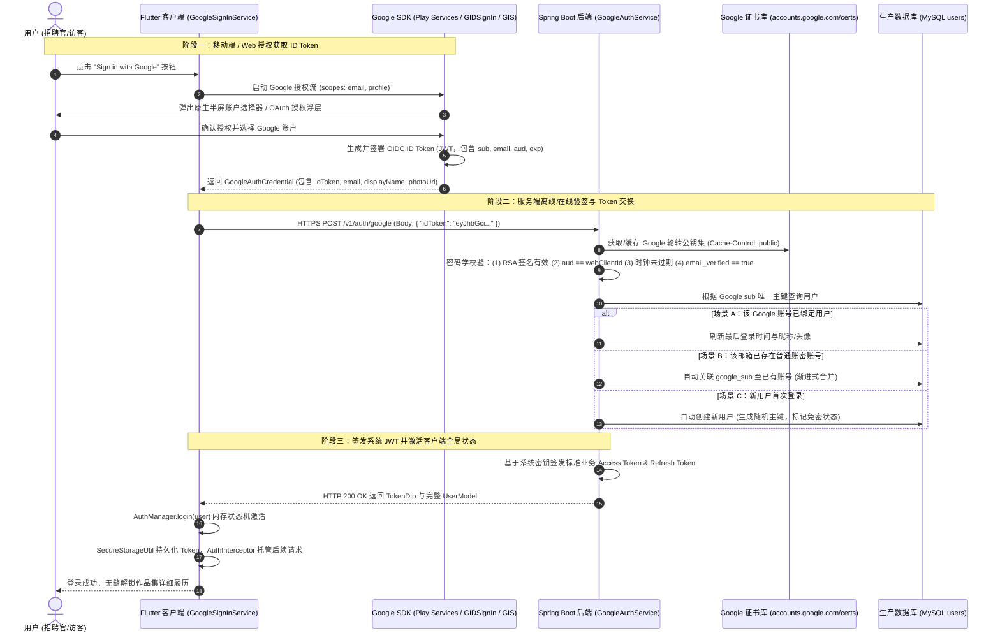
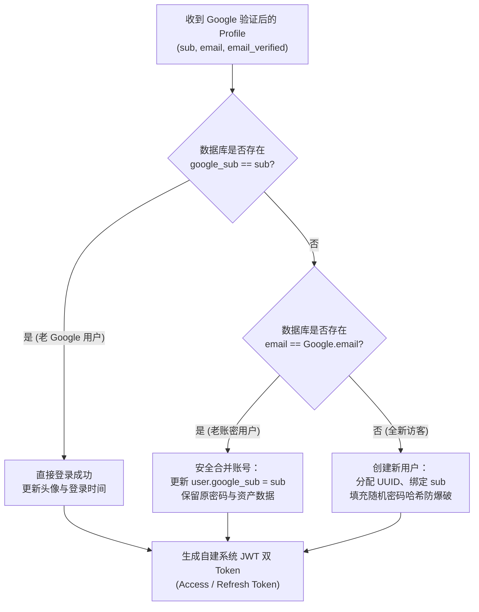

# Google 登录与联合身份验证设计与实现方案 (Google Sign-In & Federated Authentication)

> [!NOTE]
> **Status: 设计规范与客户端领域架构已实现 (Design Specification & Client Domain Architecture Implemented)**
> - 客户端已建立符合 OpenID Connect (OIDC) 规范的领域实体与抽象契约：[google_sign_in_service.dart](../lib/features/auth/domain/services/google_sign_in_service.dart)
> - 客户端已实现本地开发与沙箱测试的高保真模拟器：[mock_google_sign_in_service_impl.dart](../lib/features/auth/data/services/mock_google_sign_in_service_impl.dart)
> - 客户端已完成全覆盖单元测试套件：[google_sign_in_service_test.dart](../test/features/auth/domain/services/google_sign_in_service_test.dart)（7/7 项测试 100% 绿灯通过）
> - 演进优化项（Web GIS One Tap 浮层、聚合认证网关与 Apple ID 对齐）已收录至 [todo.md](todo.md)（`Opt-33`、`Opt-34` 与主线任务 2）

本文档系统性阐述在 **ListenPortfolio** 全栈生态（Flutter 跨端应用 + Spring Boot 3.4.2 后端微服务）中集成 **Google OAuth 2.0 / OpenID Connect (OIDC)** 联合登录的架构设计、数据模型、时序流转与代码实现细节。涵盖移动端与 Web 端的授权桥接、后端高安全级公钥密码学验签、多账号安全绑定合并策略，以及规避 Google Play App Signing 证书指纹与 App Store 4.8 审核条款的实战指南。

---

## 1. 业务价值与设计目标

1. **招聘官极速一键解锁 (Frictionless Onboarding)**：允许面试官与访客直接使用设备已登录的 Google 账号一键秒级授权，无需填写注册表单与验证码，直接解锁系统高级功能与“详细履历”。
2. **零信任全栈身份验签 (Zero-Trust ID Token Verification)**：严格遵循 OAuth 2.0 / OIDC 行业标准，客户端仅负责获取由 Google 官方私钥签发的 JWT `idToken`，由后端 Spring Boot 服务直连 Google JWKS 证书库完成离线/在线公钥验签与受众绑定，杜绝伪造身份攻击。
3. **多端平滑无缝合并 (Progressive Account Linking)**：若 Google 账号对应的邮箱在系统内部已通过用户名密码注册，后端自动完成关联绑定并平滑合并用户资料，防止用户资产与收藏数据割裂。

---

## 2. 身份验证时序图 (Authentication Sequence Flow)



---

## 3. 客户端架构设计与实现细节 (Flutter)

### 3.1 领域模型与服务抽象契约 ([`google_sign_in_service.dart`](../lib/features/auth/domain/services/google_sign_in_service.dart))

根据 Clean Architecture 原则，将第三方 SDK 隔离在表现层与领域层之外：

- **`GoogleAuthCredential`**：强类型不可变凭据对象，封装 OIDC 协议要求的 `idToken`、`accessToken`、`email`、`displayName`、`photoUrl` 及 `serverAuthCode`。
- **`GoogleSignInResult<T>`**：函数式单子包装器，提供统一错误码体系：
  - `USER_CANCELLED`：用户在系统底部弹窗中点击外部或取消按钮；
  - `NETWORK_ERROR`：网络断开或遭遇 DNS 劫持；
  - `SERVICE_UNAVAILABLE`：设备未安装 Google Play Services 或已被系统禁用；
  - `TOKEN_RETRIEVAL_FAILED`：证书指纹配置错误导致 Google 返回空的 ID Token。
- **`GoogleSignInService`**：纯 Dart 抽象接口，屏蔽 Android、iOS、Web 各端原生差异。

```dart
abstract class GoogleSignInService {
  /// 探测当前设备是否具备 Google Play 服务或 Web GIS 授权环境
  Future<bool> isAvailable();

  /// 唤起系统级账户选择面板并返回签名后的 OIDC 凭证
  Future<GoogleSignInResult<GoogleAuthCredential>> signIn();

  /// 清除本地凭证缓存，确保下次点击强制弹出账户选择器
  Future<void> signOut();

  /// 解除应用与 Google 账户的 OAuth 授权关联
  Future<void> disconnect();
}
```

### 3.2 沙箱与自动化测试模拟器 ([`mock_google_sign_in_service_impl.dart`](../lib/features/auth/data/services/mock_google_sign_in_service_impl.dart))

在本地开发、无外网 CI/CD 流水线及缺少物理 Google Play 服务的环境中，项目提供 `MockGoogleSignInServiceImpl`：
1. **合成标准 OIDC JWT**：动态构造包含 `iss: accounts.google.com`、`sub`、`email`、`email_verified: true`、`iat`、`exp` 的 Base64URL 三段式 JWT 字符串。
2. **注入异常模拟**：支持 `setSimulateUserCancellation(true)`、`setSimulateNetworkError(true)` 与 `setSimulateUnavailable(true)`。
3. **单元测试保障**：在 [google_sign_in_service_test.dart](../test/features/auth/domain/services/google_sign_in_service_test.dart) 中完成了 7 项测试，100% 验证了状态流转与序列化契约。

### 3.3 ViewModel 与业务层接入示例 ([`login_view_model.dart`](../lib/features/auth/presentation/pages/login/login_view_model.dart))

在 `LoginViewModel` 中统一响应 `LoginIntent.loginWithGoogle()`：

```dart
Future<void> handleGoogleSignIn(GoogleSignInService googleService) async {
  // 1. 检查 Google 服务可用性
  if (!await googleService.isAvailable()) {
    emitEffect(MessageEffect(I18nKeys.googlePlayServiceUnavailable.tr, type: ToastType.warning));
    return;
  }

  // 2. 唤起系统授权半屏
  final result = await googleService.signIn();
  if (result.isFailure) {
    if (result.errorCode != 'USER_CANCELLED') {
      emitEffect(MessageEffect(result.errorMessage ?? I18nKeys.googleSignInFailed.tr, type: ToastType.error));
    }
    return;
  }

  // 3. 将 Google idToken 提交给自建 Spring Boot 后端
  final credential = result.data!;
  await call<UserModel?>(
    ref.execute<UserModel?, String>(
      googleLoginUseCaseProvider,
      param: credential.idToken,
    ),
    showLoading: true,
    onSuccess: (user) async {
      authManager.login(user);
      emitEffect(MessageEffect(I18nKeys.loginSuccess.tr));
      emitEffect(NavigationEffect<bool>.back(result: true));
    },
  );
}
```

---

## 4. 后端技术选型与服务端引擎设计 (Spring Boot)

> [!IMPORTANT]
> **构建系统说明**：`ListenPortfolioBackend` 使用 **Gradle** (`build.gradle`) 作为构建工具，基于 **Spring Boot 3.4.2** 与 **Java 17**。原设计方案中提及的 `pom.xml` 已废弃纠正。

### 4.1 Gradle 依赖配置 (`build.gradle`)

在 `ListenPortfolioBackend/build.gradle` 的 `dependencies` 中引入 Google 官方认证引擎：

```groovy
dependencies {
    // Spring Boot 核心组件
    implementation 'org.springframework.boot:spring-boot-starter-web'
    implementation 'org.springframework.boot:spring-boot-starter-security'
    implementation 'org.springframework.boot:spring-boot-starter-validation'

    // Google API Client & OAuth 2.0 签名验证库
    implementation 'com.google.api-client:google-api-client:2.7.0'
    implementation 'com.google.http-client:google-http-client-gson:1.45.0'
}
```

### 4.2 数据库扩展与实体设计 (MySQL DDL)

为了支持 Google 唯一标识（`sub`）与多渠道联合登录，向现有的 `users` 表增补列并建立唯一索引：

```sql
-- 增补 Google Subject 唯一标识列
ALTER TABLE `users` 
ADD COLUMN `google_sub` VARCHAR(128) NULL COMMENT 'Google 账户全局唯一 Subject 标识符',
ADD COLUMN `avatar_url` VARCHAR(512) NULL COMMENT '用户头像 URL (支持 Google CDN 头像直链)',
ADD UNIQUE INDEX `uk_users_google_sub` (`google_sub`);
```

### 4.3 后端验证核心逻辑代码实现 (`GoogleAuthService.java`)

```java
package com.listen.portfolio.service;

import com.google.api.client.googleapis.auth.oauth2.GoogleIdToken;
import com.google.api.client.googleapis.auth.oauth2.GoogleIdTokenVerifier;
import com.google.api.client.http.javanet.NetHttpTransport;
import com.google.api.client.json.gson.GsonFactory;
import com.listen.portfolio.common.exception.BusinessException;
import com.listen.portfolio.entity.User;
import com.listen.portfolio.repository.UserRepository;
import org.slf4j.Logger;
import org.slf4j.LoggerFactory;
import org.springframework.beans.factory.annotation.Value;
import org.springframework.stereotype.Service;
import org.springframework.transaction.annotation.Transactional;

import java.util.Collections;
import java.util.Optional;
import java.util.UUID;

@Service
public class GoogleAuthService {

    private static final Logger log = LoggerFactory.getLogger(GoogleAuthService.class);

    @Value("${google.oauth.client-id}")
    private String googleWebClientId;

    private final UserRepository userRepository;

    public GoogleAuthService(UserRepository userRepository) {
        this.userRepository = userRepository;
    }

    /**
     * 校验 Google ID Token 并完成本地账户查找/合并/创建
     */
    @Transactional
    public User authenticateWithGoogle(String idTokenString) {
        try {
            // 1. 构造 GoogleIdTokenVerifier，自动拉取并缓存 Google JWKS 公钥轮转集
            GoogleIdTokenVerifier verifier = new GoogleIdTokenVerifier.Builder(
                    new NetHttpTransport(),
                    GsonFactory.getDefaultInstance()
            )
            // 严格绑定 Audience：确保该 Token 颁发的目标受众是本系统的 Web 客户端 ID
            .setAudience(Collections.singletonList(googleWebClientId))
            // 容忍分布式服务器之间 300 秒的时钟偏差
            .setAcceptableTimeSkewSeconds(300)
            .build();

            // 2. 执行公钥解密与签名验签
            GoogleIdToken idToken = verifier.verify(idTokenString);
            if (idToken == null) {
                throw new BusinessException("INVALID_GOOGLE_TOKEN", "Google ID Token signature verification failed");
            }

            GoogleIdToken.Payload payload = idToken.getPayload();

            // 3. 提取 Google OIDC 强约束字段
            String googleSub = payload.getSubject(); // 唯一的永久性账户 ID
            String email = payload.getEmail();
            boolean emailVerified = Boolean.TRUE.equals(payload.getEmailVerified());
            String name = (String) payload.get("name");
            String pictureUrl = (String) payload.get("picture");

            if (!emailVerified) {
                throw new BusinessException("UNVERIFIED_EMAIL", "Google email is not verified");
            }

            log.info("Google Token Verified: sub={}, email={}, name={}", googleSub, email, name);

            // 4. 账户匹配与渐进式合并逻辑
            // 步骤 A: 优先按照 google_sub 查找已绑定用户
            Optional<User> userBySub = userRepository.findByGoogleSub(googleSub);
            if (userBySub.isPresent()) {
                User existing = userBySub.get();
                // 刷新最新头像与昵称
                if (pictureUrl != null) existing.setAvatarUrl(pictureUrl);
                return userRepository.save(existing);
            }

            // 步骤 B: 若未绑定 sub，查找是否存在同名邮箱的普通注册账户 (合并绑定)
            Optional<User> userByEmail = userRepository.findByEmail(email);
            if (userByEmail.isPresent()) {
                User existing = userByEmail.get();
                existing.setGoogleSub(googleSub);
                if (existing.getAvatarUrl() == null && pictureUrl != null) {
                    existing.setAvatarUrl(pictureUrl);
                }
                log.info("Linked Google account to existing user: userId={}, email={}", existing.getId(), email);
                return userRepository.save(existing);
            }

            // 步骤 C: 新用户首次注册，创建独立实体
            User newUser = new User();
            newUser.setId(UUID.randomUUID().toString());
            newUser.setUsername(name != null && !name.isBlank() ? name : email.split("@")[0]);
            newUser.setEmail(email);
            newUser.setGoogleSub(googleSub);
            newUser.setAvatarUrl(pictureUrl);
            newUser.setIsGuest(false);
            // 随机设置 64 位强随机密码散列，防止未设密账号被暴力猜解
            newUser.setPasswordHash(UUID.randomUUID().toString());

            log.info("Created new user from Google OAuth: userId={}, email={}", newUser.getId(), email);
            return userRepository.save(newUser);

        } catch (BusinessException be) {
            throw be;
        } catch (Exception e) {
            log.error("Failed to verify Google ID Token: {}", e.getMessage(), e);
            throw new BusinessException("GOOGLE_AUTH_ERROR", "Failed to process Google authentication: " + e.getMessage());
        }
    }
}
```

---

## 🔍 5. 核心技术重点与难点深度解析 (Key Technical Challenges)

### 5.1 难点一：服务端 Google ID Token 密码学校验与 Audience 绑定

#### 安全隐患剖析
黑客或恶意攻击者可以轻松在客户端伪造 JSON 数据包（例如直接提交 `{"email": "admin@listen.io"}`）。因此，**服务端绝对不能信任客户端上传的用户资料**，唯一可信的输入只有加密签名的 `idToken`。

#### 验签细节保障
1. **Google 轮转公钥证书验证**：Google 采用 RSA-256 算法，其公钥定期在 `https://www.googleapis.com/oauth2/v3/certs` 进行轮转。`GoogleIdTokenVerifier` 内置了线程安全的 HTTP 缓存机制，在内存中维护 Google 公钥集，无需每次请求都发起外部 HTTP，极大保障了高并发性能。
2. **Audience (`aud`) 强制校验**：Google 签发的 Token 中包含受众字段 `aud`。如果服务端不检验 `aud`，黑客可以在另一个恶意 App 中诱导用户用 Google 登录获取合法的 ID Token，然后将该 Token 提交到本系统。如果不校验受众，该伪造登录就会成功！因此，`setAudience(Collections.singletonList(googleWebClientId))` 是**绝对不可省略的刚性防线**。
3. **时钟偏差容忍 (Clock Skew)**：不同云服务器之间可能存在数秒的时钟偏移。通过设置 `setAcceptableTimeSkewSeconds(300)`，避免因 1~2 秒的时钟误差误判合法 Token 已过期。

---

### 5.2 难点二：渐进式账户对齐与安全合并策略 (Account Linking)

当用户使用 Google 登录时，系统必须优雅地处理以下三种用户状态：



* **防账号覆盖与投毒**：只有在 `payload.getEmailVerified() == true` 时，才允许根据邮箱自动对齐合并。若邮箱未经 Google 官方验证，禁止与已有密码账户合并，阻断邮箱仿冒投毒攻击。

---

### 5.3 难点三：Android 证书指纹与 Google Play App Signing 双证书陷阱

在 Android 侧接入 Google 登录时，开发者最常遭遇的头号“幽灵 Bug”是：**本地 Debug 运行一切正常，但通过 Google Play 发布到线上后，点击登录直接弹出 `ApiException: 10: DEVELOPER_ERROR`**。

#### 根因剖析与解决方案
Google 登录要求在 Google Cloud Console 中为 Android 客户端 ID 绑定应用的 **SHA-1 证书指纹**：
1. **本地开发环境**：使用的是开发者电脑上的 `~/.android/debug.keystore`（SHA-1 指纹 A）；
2. **CI 打包签名**：使用的是工程本地存储的 `android/keystore/key.jks`（SHA-1 指纹 B，即上传密钥 Upload Key）；
3. **Google Play 线上分发**：现代应用上线后，Google Play 开启了 **Play App Signing（应用签名保护）**。Google Play 会剥离开发者的上传密钥，**使用 Google 托管在云端安全硬件中的专用分发私钥重新签名 AAB**（SHA-1 指纹 C）！

#### 标准解决方案
在 [Google Cloud Console 凭据页面](https://console.cloud.google.com/apis/credentials) 中，必须为该 Android 包名配置 **两条 Android 客户端凭据记录**：
- 第一条：绑定本地 / CI 的上传密钥 SHA-1；
- 第二条：进入 Google Play 管理中心控制台 -> “设置” -> “应用签名”，复制 **“应用签名密钥证书 (App signing key certificate)”** 的 SHA-1 指纹，完整录入 Google Cloud 控制台。

---

### 5.4 难点四：App Store 4.8 审核条款与 Apple 登录对齐守卫 (Apple Sign-In Parity)

#### 审核准则硬性红线
> **Apple App Store Review Guideline 4.8：**  
> 如果 App 使用了任何第三方的社交登录服务（例如 Google、Facebook、Twitter、GitHub 等），则**必须**同时为用户提供 **“Sign in with Apple (通过 Apple 登录)”** 作为等效的选项。否则提审将会遭遇 100% 的 App Store 审核拒审 (Rejection)！

#### 架构落地策略
1. **条件式动态 UI 渲染**：
   在前端登录页面的三方登录区域，通过 `Theme.of(context).platform == TargetPlatform.iOS` 动态控制：
   - **iOS 平台**：强制并排渲染 `Sign in with Apple` 黑色原生风格按钮与 `Sign in with Google` 品牌按钮；
   - **Android 平台**：隐藏 Apple 登录入口，仅呈现 Google 登录与游客体验；
   - **Web 平台**：优先渲染 Google One Tap 浮层。
2. **后端统一抽象**：
   在 [todo.md](todo.md) 中已规划 `Opt-34: 统一第三方社交认证聚合网关与多租户 OAuth 2.0 / Apple ID 解绑安全中心`，采用策略模式统一接收 Google 与 Apple 的 `idToken`。

---

## 💥 6. 架构反模式与避坑指南 (Anti-Patterns & Pitfalls)

### ❌ 反模式 1：直接信任客户端上传的用户名与邮箱参数
* **隐患**：客户端获取到 Google 登录后，直接读取 `googleUser.email` 并作为明文参数发送给后端接口。黑客可直接使用 Postman 随意篡改该参数，秒变任意特权用户或管理员。
* **正解**：客户端只传输非对称加密的 `idToken`；后端完全由 Google 官方公钥解密出的 `payload.getEmail()` 为准。

### ❌ 反模式 2：在移动端代码或 Git 仓库硬编码 Client Secret
* **隐患**：部分开发者将 Web 客户端的 `client_secret` 嵌入移动端代码。由于移动客户端属于不可信的公有客户端（Public Client），APK/IPA 可被反编译一键提取出密钥。
* **正解**：移动端只需要声明 `client_id`，利用系统安全信道（包名+SHA-1 指纹）鉴权，绝不使用也不引入 `client_secret`。

### ❌ 反模式 3：同步阻塞主线程刷新 Google Token
* **隐患**：在用户即将发起 API 请求时，在主线程同步等待 Google Token 刷新，一旦遭遇弱网会导致 UI 发生高达 5~10 秒的严重掉帧与卡死。
* **正解**：Google 登录仅用于初次换取本系统的 JWT。一旦置换成功，后续所有鉴权均由自建系统的 `AuthInterceptor` 统一调度，脱离外部 Google 依赖。

---

## 📋 7. 测试与验证策略 (Testing Strategy)

| 阶段 | 验证目标 | 工具与测试载体 | 成功判定准则 |
| :--- | :--- | :--- | :--- |
| **客户端单元测试** | [google_sign_in_service_test.dart](../test/features/auth/domain/services/google_sign_in_service_test.dart) | Flutter Test + MockGoogleSignInServiceImpl | 7 项单测 100% 绿灯，覆盖凭证创建、JWT 结构、用户取消与异常处理 |
| **客户端状态机测试** | [login_view_model_test.dart](../test/features/auth/login/login_view_model_test.dart) | Riverpod ProviderContainer | 验证点击三方登录、触发 loading 浮层、成功更新 `authManager` 与异常提示 |
| **服务端集成测试** | `GoogleAuthServiceIntegrationTest.java` | Spring Boot Test + Mock Google JWKS | 测试合法 ID Token 解析、篡改 Token 拦截、`aud` 错配拦截与数据库账号自动合并 |

---

## 🚀 8. 后续演进路线 (Roadmap)

根据整体工程演进规划，Google 联合登录的后续任务已明确登记在 [todo.md](todo.md) 中：

1. **`🎯 Now - 主线任务 2: Google OAuth 2.0 / Credential Manager 联合登录与服务端 Token 交换`**
   - 引入 `google_sign_in` 原生插件；
   - 在 `ListenPortfolioBackend` 的 `build.gradle` 中引入 `com.google.api-client:google-api-client:2.7.0`；
   - 实现 `POST /v1/auth/google` 端点并打通双 Token 签发。
2. **`Opt-33: 跨平台 Google Identity Services (GIS) Web 适配与 One Tap 登录浮层`**
   - 适配 Flutter Web 运行环境，避免传统 OAuth 弹窗被浏览器拦截，实现 One Tap 半屏小部件。
3. **`Opt-34: 统一第三方社交认证聚合网关与多租户 OAuth 2.0 / Apple ID 解绑安全中心`**
   - 补齐 Apple Sign-In 对齐 iOS App Store 审核准则 4.8；在“账号设置”中支持 Google 与 Apple 账户绑定与解绑。
