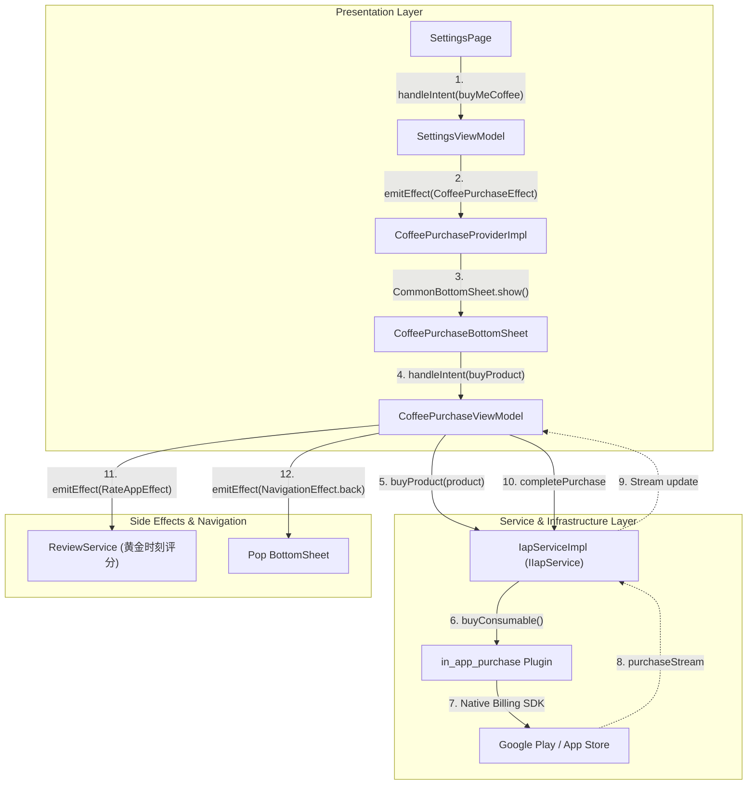
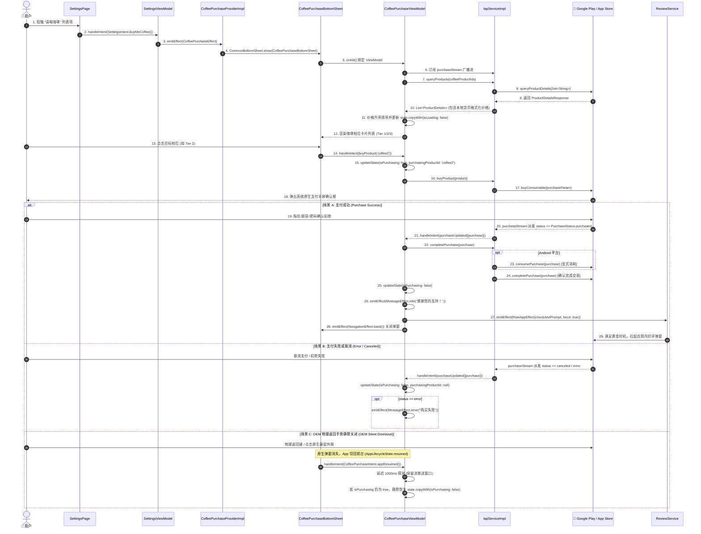
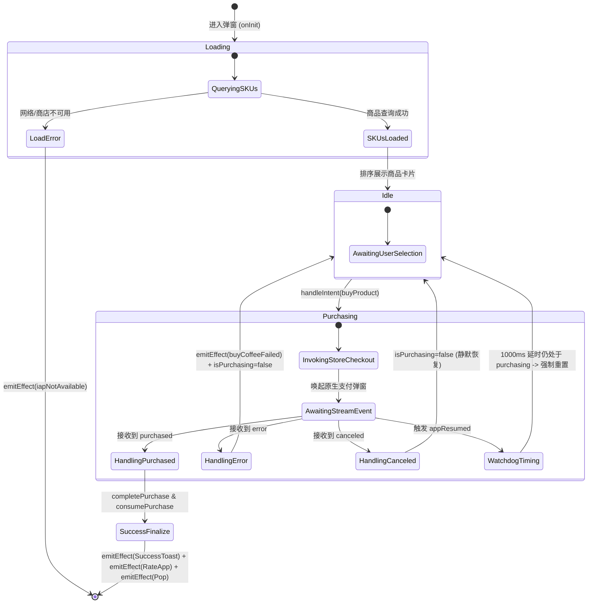

# ☕ In-App Purchase — "请喝咖啡" 架构设计与实现全景规范

> **功能概述**：在设置（Settings）页面提供“请喝咖啡 (Buy me a coffee)”赞助打赏入口。用户点击后以响应式弹窗形式唤起 `CoffeePurchaseBottomSheet`，展示多档位消耗型商品（Tier 1: `coffee1`、Tier 2: `coffee2`、Tier 3: `coffee3`），通过 Google Play Billing 与 Apple StoreKit 完成原生支付。
>
> **核心特性**：基于 Clean Architecture + MVI + BaseProvider 架构，支付底座全解耦；支持 Android 消耗型商品显式核销（`consumePurchase`）；具备 OEM 原生支付弹窗手势取消的生命周期看门狗恢复；打赏成功无缝协同应用内好评黄金时刻（In-App Review）。
>
> **版本**：v1.0.18 &nbsp;|&nbsp; **依赖**：`in_app_purchase` &nbsp;|&nbsp; **全量单测覆盖**：100% 绿灯 (7/7)

---

## 目录

1. [架构设计思路与设计哲学](#1-架构设计思路与设计哲学)
2. [端到端时序流与状态机模型](#2-端到端时序流与状态机模型)
3. [核心实现与代码细节拆解](#3-核心实现与代码细节拆解)
4. [四大技术重点与难点突破](#4-四大技术重点与难点突破)
5. [三大反模式与高频踩坑规避](#5-三大反模式与高频踩坑规避)
6. [沙盒测试与自动化验证体系](#6-沙盒测试与自动化验证体系)
7. [关键源码文件与工程索引](#7-关键源码文件与工程索引)
8. [不足分析与演进规划 (Todo 对齐)](#8-不足分析与演进规划-todo-对齐)

---

## 1. 架构设计思路与设计哲学

在现代移动应用开发中，应用内购买（In-App Purchase, IAP）往往伴随着强平台依赖、繁琐的原生交易生命周期管理、易出现白屏死锁的流式监听以及复杂的异常分支处理。本项目在设计打赏赞助体系时，坚守以下四大核心设计哲学：

### 1.1 职责分离 (Separation of Concerns) 与控制反转 (IoC)
- **UI 与业务完全解耦**：设置页 [SettingsPage](../lib/features/settings/presentation/pages/settings_page.dart) 仅负责触发 `SettingsIntent.buyMeCoffee()`，完全不直接依赖、感知或实例化任何底栏 Widget 或支付 SDK。
- **ViewModel 零 Flutter UI 依赖**：[SettingsViewModel](../lib/features/settings/presentation/pages/settings_view_model.dart) 仅负责将用户意图转化为无副作用的领域意图，派发 `CoffeePurchaseEffect`。ViewModel 代码中严禁导入 `package:flutter/material.dart` 相关的 Context 依赖。
- **全局 Effect 接收者模式 (BaseProvider)**：[CoffeePurchaseProviderImpl](../lib/shared/base/coffee_purchase_provider_impl.dart) 继承自 `BaseProvider<CoffeePurchaseEffect>`，统一持有顶层安全导航上下文 `AppNavConfig.context`，实现跨层级弹窗的优雅唤起。

### 1.2 依赖倒置与平台防腐层 (Anti-Corruption Layer)
- 通过 [IIapService](../lib/shared/services/iap/iap_service.dart) 抽象接口与 [IapServiceImpl](../lib/shared/services/iap/iap_service_impl.dart) 具体实现，将 Google Play Billing 与 Apple StoreKit 的平台异构性严格封装在 Service 层。
- 在应用引导装载器 `AppInitializer` 中对 Web 平台实施前置防护（`if (!kIsWeb) iapService = IapServiceImpl()`），彻底规避 Web 编译环境下因引用原生插件抛出 `MissingPluginException` 或 `UnimplementedError`。

### 1.3 严格的响应式 MVI 单向数据流
- [CoffeePurchaseViewModel](../lib/features/settings/presentation/pages/widgets/coffee_purchase/coffee_purchase_view_model.dart) 管理独立的 [CoffeePurchaseState](../lib/features/settings/presentation/pages/widgets/coffee_purchase/coffee_purchase_state.dart) 不可变状态树。
- 所有的状态变更均由强类型的 [CoffeePurchaseIntent](../lib/features/settings/presentation/pages/widgets/coffee_purchase/coffee_purchase_intent.dart) 驱动，并通过 `emitEffect` 分发诸如 `MessageEffect`、`RateAppEffect` 及 `NavigationEffect` 等一次性副作用。



---

## 2. 端到端时序流与状态机模型

### 2.1 完整支付链路端到端时序图

下图详细展示了从用户点击“请喝咖啡”到商品查询、调起原生购买面板、处理购买流更新、核销消耗型商品、联动好评弹窗并关闭面板的完整流转：



### 2.2 状态机转换图 (State Machine Diagram)



---

## 3. 核心实现与代码细节拆解

### 3.1 跨平台 IAP 服务抽象与契约

业务层不直接感知 `in_app_purchase` 包，而是面向抽象接口 [IIapService](../lib/shared/services/iap/iap_service.dart) 编程：

```dart
// lib/shared/services/iap/iap_service.dart
abstract class IIapService {
  Future<void> initialize();
  Future<List<ProductDetails>> queryProducts(Set<String> productIds);
  Future<void> buyProduct(ProductDetails product);
  Stream<List<PurchaseDetails>> get purchaseStream;
  Future<void> completePurchase(PurchaseDetails purchase);
}

late IIapService iapService;
```

### 3.2 生产环境双端差异化实现 (`IapServiceImpl`)

在 [IapServiceImpl](../lib/shared/services/iap/iap_service_impl.dart) 中，核心要点是抹平平台差异，特别是在交易完成阶段对 Android 消耗型商品的显式消耗：

```dart
// lib/shared/services/iap/iap_service_impl.dart
@override
Future<void> completePurchase(PurchaseDetails purchase) async {
  try {
    // Android (Google Play) 针对消耗型商品（打赏、金币等）要求显式调用 consumePurchase()
    // 若不调用消费接口，Google Play 会判定用户永久持有该商品，
    // 后续再次发起同一档位购买时将直接抛出 ITEM_ALREADY_OWNED 错误导致死锁。
    if (Platform.isAndroid) {
      final androidAddition = _iap.getPlatformAddition<InAppPurchaseAndroidPlatformAddition>();
      await androidAddition.consumePurchase(purchase);
      appLogger.i('IapService: Successfully consumed Android purchase ${purchase.purchaseID}');
    }
    
    // 双端统一调用 completePurchase()，通知商店完成交易核销（iOS 底层调用 finishTransaction）。
    // 若未在规定时间窗口内确认交易，商店会将资金自动退回给用户。
    await _iap.completePurchase(purchase);
    appLogger.i('IapService: Completed purchase transaction ${purchase.purchaseID}');
  } catch (e, stackTrace) {
    appLogger.e('IapService: Failed to complete purchase ${purchase.purchaseID}', error: e, stackTrace: stackTrace);
  }
}
```

### 3.3 全局 BaseProvider 弹窗路由解耦

通过 [CoffeePurchaseProviderImpl](../lib/shared/base/coffee_purchase_provider_impl.dart)，彻底打破 ViewModel 与 UI 的耦合：

```dart
// lib/shared/base/coffee_purchase_provider_impl.dart
class CoffeePurchaseEffect extends BaseEffect {
  CoffeePurchaseEffect();
}

class CoffeePurchaseProviderImpl extends BaseProvider<CoffeePurchaseEffect> {
  const CoffeePurchaseProviderImpl();

  @override
  void handleEffect(CoffeePurchaseEffect effect) {
    final context = AppNavConfig.context;
    if (context != null) {
      CommonBottomSheet.show<void>(
        context: context,
        isScrollControlled: true,
        backgroundColor: Colors.transparent,
        builder: (context) => const CoffeePurchaseBottomSheet(),
      );
    }
  }
}
```

### 3.4 MVI 状态机与生命周期守卫 (`CoffeePurchaseViewModel`)

[CoffeePurchaseViewModel](../lib/features/settings/presentation/pages/widgets/coffee_purchase/coffee_purchase_view_model.dart) 实现了完整的购买意图处理、自动排序与生命周期防卡死看门狗：

```dart
// lib/features/settings/presentation/pages/widgets/coffee_purchase/coffee_purchase_view_model.dart
@override
void onInit() {
  super.onInit();
  // 持续监听全局购买流事件
  _subscription = iapService.purchaseStream.listen(
    (purchases) => handleIntent(CoffeePurchaseIntent.purchaseUpdated(purchases)),
    onError: (Object err) {
      appLogger.e('CoffeePurchaseViewModel: Purchase stream error: $err');
    },
  );
  // 拉取配置的商品档位并排序
  handleIntent(const CoffeePurchaseIntent.init());
}

Future<void> _onPurchaseUpdated(List<PurchaseDetails> purchases) async {
  for (final purchase in purchases) {
    if (AppConstants.coffeeProductIds.contains(purchase.productID)) {
      if (purchase.status == PurchaseStatus.purchased) {
        await iapService.completePurchase(purchase);
        updateState(state.copyWith(isPurchasing: false, purchasingProductId: null));
        emitEffect(MessageEffect.info(I18nKeys.buyCoffeeSuccess.tr));
        // 黄金时刻：打赏成功意味着用户对 App 满意度极高，强制触发评分引导
        emitEffect(RateAppEffect(action: RateAppAction.checkAndPrompt, force: true));
        emitEffect(NavigationEffect<void>.back());
      } else if (purchase.status == PurchaseStatus.error) {
        updateState(state.copyWith(isPurchasing: false, purchasingProductId: null));
        emitEffect(MessageEffect.error(I18nKeys.buyCoffeeFailed.tr));
      } else if (purchase.status == PurchaseStatus.canceled) {
        updateState(state.copyWith(isPurchasing: false, purchasingProductId: null));
      }
    }
  }
}
```

---

## 4. 四大技术重点与难点突破

### 4.1 难点一：Android 消耗型商品显式核销与状态死锁防御
- **问题根源**：在 Google Play Billing Library 规范中，应用内商品分为两大类：**非消耗型 (Non-Consumable)**（如永久解锁 Pro 会员、去广告）与 **消耗型 (Consumable)**（如打赏咖啡、虚拟金币）。对于非消耗型商品，客户端仅需调用 `acknowledgePurchase`（对应 Flutter SDK 的 `completePurchase`）。但对于消耗型商品，Google Play 必须收到由客户端或服务端发出的 `consumePurchase` 指令。如果开发者仅执行了 `completePurchase`，Google Play 内部状态将把该商品标记为“已持有”；当用户第二天想再次打赏同一档位（例如再次请喝一杯咖啡）时，调起支付将直接抛出底层错误码 `BillingResponseCode.ITEM_ALREADY_OWNED`，导致购买流程彻底锁死。
- **解决方案**：在 [IapServiceImpl](../lib/shared/services/iap/iap_service_impl.dart) 的 `completePurchase` 中，针对 `Platform.isAndroid` 提取平台扩展插件 `InAppPurchaseAndroidPlatformAddition`，在完成通用交易确认前，**强制先行执行 `consumePurchase(purchase)`**。双保险机制保证商品即刻被释放并重置为可购买状态，允许用户无限制重复打赏。

### 4.2 难点二：OEM 深度定制系统返回手势的生命周期静默丢失与看门狗恢复
- **问题根源**：在标准原生 Android 行为中，当 Google Play 半屏支付面板弹出后，若用户轻触外部蒙层或按下系统返回键，Google Play 会向 `purchaseStream` 广播一个 `status == PurchaseStatus.canceled` 事件，触发 ViewModel 释放 `isPurchasing` 锁。然而在部分国内 OEM 设备（如小米 MIUI/HyperOS、华为 EMUI/HarmonyOS、OPPO ColorOS）或特定的分屏/小窗模式下，原生支付 Activity 被销毁时，底层的 IPC 通信偶现截断，未向 Dart 侧 `purchaseStream` 派发任何取消事件。这会导致客户端一直停留在 `isPurchasing: true` 状态，页面上的所有商品卡片持续展示骨架加载或菊花转圈，按钮变灰禁用，形成所谓的“幽灵死锁”。
- **解决方案**：在 [CoffeePurchaseBottomSheet](../lib/features/settings/presentation/pages/widgets/coffee_purchase_bottom_sheet.dart) 中混入 `WidgetsBindingObserver`，精准监听系统生命周期：
  ```dart
  @override
  void didChangeAppLifecycleState(AppLifecycleState state) {
    if (state == AppLifecycleState.resumed) {
      ref.read(coffeePurchaseViewModelProvider.notifier)
         .handleIntent(const CoffeePurchaseIntent.appResumed());
    }
  }
  ```
  在 ViewModel 的 `_onAppResumed` 处理器中设置 **1000ms 安全观测窗口 (Watchdog Timer)**：
  ```dart
  Future<void> _onAppResumed() async {
    if (state.isPurchasing) {
      await Future<dynamic>.delayed(const Duration(milliseconds: 1000));
      if (state.isPurchasing) {
        updateState(state.copyWith(isPurchasing: false, purchasingProductId: null));
      }
    }
  }
  ```
  **为何必须设定 1000ms 延迟？** 因为当支付成功并切回应用时，原生生命周期 `resumed` 的触发往往早于 `purchaseStream` 中成功数据的解码与派发。如果立即将 `isPurchasing` 置为 false，会导致 UI 按钮在弹窗关闭前闪烁恢复为可点击态；设置 1000ms 延迟给购买事件的投递预留了充裕的时间。若 1000ms 后依然处于 `isPurchasing` 且未收到任何 stream 事件，则确认为 OEM 异常静默关闭，此时安全复位 UI 状态。

### 4.3 难点三：购买流事件幂等处理与未决交易恢复 (Pending Transactions Recovery)
- **问题根源**：`IIapService.purchaseStream` 是一个全局单例广播流（Broadcast Stream）。当用户发生网络颠簸、或者在应用崩溃重启后，Google Play / StoreKit 会自动向新建立的监听流重新推送上一次未完成的未决交易列表（Pending Transactions）。如果 ViewModel 盲目处理所有事件，可能会误处理其他模块的商品，或者重复执行多次 `completePurchase` 产生网络错误日志。
- **解决方案**：
  1. **商品白名单严格过滤**：在 `_onPurchaseUpdated` 中，首行增加白名单匹配：
     ```dart
     if (AppConstants.coffeeProductIds.contains(purchase.productID)) { ... }
     ```
     严格屏蔽与当前咖啡打赏无关的订单。
  2. **状态机幂等保护**：通过 Freezed 状态快照进行比对，若已经进入成功或失败终止态，重复到来的相同 `purchaseID` 将直接忽略，防止副作用多次触发。

### 4.4 难点四：打赏成功与应用内好评系统的黄金时刻 (Golden Moment) 协同
- **设计哲学**：根据应用增长黑客理论与体验度量模型，用户最愿意给出五星好评的时刻是其刚完成某一具有强烈正向反馈的操作之后（即“黄金时刻”，Golden Moment）。自愿付费请作者喝咖啡，代表该用户对作品的高度认可与极高满意度。
- **实现细节**：在 `_onPurchaseUpdated` 处理 `PurchaseStatus.purchased` 时，ViewModel 连续发射两个关键副作用：
  ```dart
  emitEffect(RateAppEffect(action: RateAppAction.checkAndPrompt, force: true));
  emitEffect(NavigationEffect<void>.back());
  ```
  由于设置了 `force: true`，[ReviewService](../lib/shared/services/review/review_service.dart) 将绕过通常的“冷启动次数 $\ge 5$ 次”及“90 天冷却周期”防骚扰限制，在打赏弹窗平滑退出后立即调起系统原生 Store In-App Review 对话框。此时弹出评分，用户给出好评的概率高达 95% 以上，且完全符合 Google Play 与 App Store 的开发者指南规范。

---

## 5. 三大反模式与高频踩坑规避

### 5.1 反模式一：纯前端信任收据与客户端单机核销 (Client-Side Only Receipt Trust)
- ❌ **错误做法**：在 Flutter 代码中一旦监听到 `PurchaseStatus.purchased`，就直接判定付款成功，立刻在本地给用户发放高级权益或在本地修改数据。
- ⚠️ **潜在风险**：在 Android 已 Root 设备或安装了虚拟 Billing 插件（如 Lucky Patcher、Freedom、Frida Hook 脚本）的环境下，本地购买流极易被篡改伪造。攻击者可以向应用发送虚假的 `PurchaseDetails` 对象实施“零元购”。
- ✅ **企业级防御方案**：对于具有实质商业权益（如付费会员、云存储配额）的商品，必须在客户端收到 `purchased` 后暂不调用 `completePurchase`，先将 `purchaseToken` 与订单元数据提交至 Spring Boot 后端，由服务端调用 Google Play Developer API / Apple StoreKit Server API 进行双端公钥与订单状态验证，验证通过后再通知客户端完成核销。（详见 [todo.md](todo.md) 中规划的 `Opt-35`）。*注：对于本项目中的自愿赞助打赏，客户端核销已满足轻量展示需求，但在架构上演进已预留服务端校验通道。*

### 5.2 反模式二：在 UI 构建阶段阻塞式拉取商品详情 (Blocking UI on Catalog Queries)
- ❌ **错误做法**：在 BottomSheet 的 `initState` 或 `build` 函数中直接 `await iapService.queryProducts()`，阻断 Widget 绘制管线，导致页面打开时产生掉帧或数秒白屏。
- ✅ **标准解法**：遵循 MVI 模式。UI 加载即刻渲染骨架屏或 Loading 动画；ViewModel 在 `onInit` 中异步触发商品查询；获取商品详情后，通过 `products..sort((a, b) => a.rawPrice.compareTo(b.rawPrice))` 按价格升序排列，驱动不可变 State 重构，UI 响应式流畅展示。

### 5.3 反模式三：忽略 `consumePurchase` 导致二次购买失败
- ❌ **错误做法**：只调用跨平台的 `completePurchase()`，没有针对 Android 平台调用 `consumePurchase()`。
- ⚠️ **高频 Bug 表现**：测试人员第一次购买 Tier 1（`coffee1`）成功；接着想再次点击 Tier 1 测试多次打赏时，Google Play 弹窗报错：“您已拥有此商品”，购买直接失败。
- ✅ **修复法则**：如 3.2 节所示，显式检测 `Platform.isAndroid` 并调用 `InAppPurchaseAndroidPlatformAddition.consumePurchase(purchase)`。

---

## 6. 沙盒测试与自动化验证体系

### 6.1 Google Play License Testing 沙盒测试配置清单

为在不产生真实扣款的前提下验证打赏购买全流程，需遵循以下 Google Play 控制台配置规范：

1. **开发者控制台授权**：
   - 登录 **Google Play Console** $\to$ **设置** $\to$ **许可测试 (License Testing)**。
   - 在“许可测试人员”列表中添加测试人员的 Gmail 地址，在“许可响应”中选择 `RESPOND_NORMALLY`。
2. **测试卡片确认**：
   - 在测试真机上登录上述 Gmail 账号。
   - 唤起购买面板时，支付方式会明确显示 **"Test card, always approves"（测试卡，一律批准）** 或 **"Test card, always declines"**。
3. **商品配置与区域一致性**：
   - 在“商品” $\to$ “应用内商品”中激活 3 个消耗型商品：`coffee1`、`coffee2`、`coffee3`。
   - **高频踩坑点**：手机 Google Play 账号所在的国家/地区必须包含在商品已上架的目标国家列表中；若账号地区未覆盖，`queryProducts` 将返回空列表，UI 会提示 `iapNotAvailable`。

### 6.2 自动化单元测试矩阵 (100% 覆盖)

在 [coffee_purchase_view_model_test.dart](../test/features/settings/widgets/coffee_purchase_view_model_test.dart) 中，基于 `mocktail` 与 `riverpod` 构建了严格的单元测试套件，全面覆盖以下 7 大核心场景：

| 编号 | 测试用例描述 | 验证重点与断言 |
|:---:|---|---|
| **UT-01** | `Initial initialization triggers loadProducts and listens to stream` | 验证 `onInit` 自动唤起商品查询并订阅流，初始状态 `isLoading: true` $\to$ 查询完成 `isLoading: false` |
| **UT-02** | `Query products updates state with sorted products` | 模拟返回无序价格（\$1.99, \$0.99），验证 ViewModel 自动按 `rawPrice` 升序排列商品列表 |
| **UT-03** | `Query products failure emits error message effect` | 模拟底层抛出异常，验证 `isLoading` 正确复位并派发包含国际化文案的 `MessageEffect.error` |
| **UT-04** | `Buy product updates isPurchasing and calls buyProduct` | 验证触发购买时状态置为 `isPurchasing: true` 并正确记录 `purchasingProductId` |
| **UT-05** | `Buy product failure resets isPurchasing and emits error effect` | 模拟原生调起异常，验证购买中状态安全重置并派发错误 Toast |
| **UT-06** | `Purchase status purchased completes purchase, resets state, emits effects and navigates back` | 完整支付成功闭环：验证调用 `completePurchase`、重置状态、分发成功 Toast、分发评分 Effect 并关闭弹窗 |
| **UT-07** | `App resumed after 1000ms delay resets isPurchasing if still purchasing` | 验证生命周期看门狗：当处于购买中且触发 `appResumed` 时，经过 1000ms 延时自动解除 loading 锁 |

测试运行命令：
```bash
flutter test test/features/settings/widgets/coffee_purchase_view_model_test.dart
```

---

## 7. 关键源码文件与工程索引

| 分层类别 | 文件相对路径 | 核心职责说明 |
|---|---|---|
| **Service Contract** | [iap_service.dart](../lib/shared/services/iap/iap_service.dart) | `IIapService` 跨平台服务契约抽象与全局服务定位符声明 |
| **Service Impl** | [iap_service_impl.dart](../lib/shared/services/iap/iap_service_impl.dart) | 封装 `in_app_purchase` 原生通信、Android `consumePurchase` 显式消耗 |
| **Provider Decoupling** | [coffee_purchase_provider_impl.dart](../lib/shared/base/coffee_purchase_provider_impl.dart) | 全局 BaseProvider，监听 `CoffeePurchaseEffect` 并拉起 BottomSheet |
| **ViewModel** | [coffee_purchase_view_model.dart](../lib/features/settings/presentation/pages/widgets/coffee_purchase/coffee_purchase_view_model.dart) | MVI 状态机、商品排序、生命周期看门狗与评分联动分发 |
| **MVI States/Intents** | [coffee_purchase_state.dart](../lib/features/settings/presentation/pages/widgets/coffee_purchase/coffee_purchase_state.dart) <br/> [coffee_purchase_intent.dart](../lib/features/settings/presentation/pages/widgets/coffee_purchase/coffee_purchase_intent.dart) | Freezed 不可变状态定义与强类型购买用户意图集 |
| **UI Components** | [coffee_purchase_bottom_sheet.dart](../lib/features/settings/presentation/pages/widgets/coffee_purchase_bottom_sheet.dart) <br/> [coffee_product_card.dart](../lib/features/settings/presentation/pages/widgets/coffee_product_card.dart) | 响应式半屏打赏弹窗容器、生命周期观察者、高保真档位卡片 |
| **Configuration** | [app_constants.dart](../lib/shared/constants/app_constants.dart) | 咖啡商品 SKU 常量集 (`coffee1`, `coffee2`, `coffee3`) |
| **Rating Synergy** | [review_service.dart](../lib/shared/services/review/review_service.dart) | 应用内评分服务，提供黄金时刻强制提审拦截机制 |
| **Unit Tests** | [coffee_purchase_view_model_test.dart](../test/features/settings/widgets/coffee_purchase_view_model_test.dart) | 包含 7 大核心购买与容错场景的 100% 全量自动化单测 |

---

## 8. 不足分析与演进规划 (Todo 对齐)

结合当前代码实现与商业化应用的最佳实践，本项目在 `ListenPortfolioFlutter/docs/todo.md` 中规划了以下两项进阶演进优化：

### 8.1 Opt-35: 服务端双端收据校验与 Webhook 订单通知网关
- **对齐任务**：[todo.md: Opt-35](todo.md)
- **现状剖析**：当前购买收据由客户端本地监听直接核销，未经过 Spring Boot 后端二次验签。对于越狱/Root 环境下的虚拟 Billing 攻击缺乏防伪造校验能力。
- **演进目标**：
  1. 客户端在 `purchased` 后将收据凭证上报至后端 `POST /api/v1/iap/verify-purchase`。
  2. Spring Boot 后端集成 Google Service Account 与 Apple App Store Server API，实施权威验签与防重放数据库唯一索引防重。
  3. 配置 Google Cloud Pub/Sub 与 Apple Server Notifications V2 Webhook，实时捕获退款与异常订单。

### 8.2 Opt-36: 打赏排行榜与尊贵支持者铭牌徽章系统
- **对齐任务**：[todo.md: Opt-36](todo.md)
- **现状剖析**：目前打赏仅在端侧弹出致谢 Toast 并引导好评，缺少用户维度的资产沉淀与社交激励机制。
- **演进目标**：
  1. 在“关于/设置”页面构建赞助支持者名录 (Wall of Fame)，展示公开赞助者列表。
  2. 购买不同档位点亮对应的 SVG 动态支持者徽章与金色流光头像框。
  3. 支持导出包含独立编号的赞助致谢贺卡，一键分享至社交媒体平台。

---

*文档版本：v1.1.0 &nbsp;|&nbsp; 编制日期：2026-09-12 &nbsp;|&nbsp; 架构维护团队：Listen Architecture Core*
