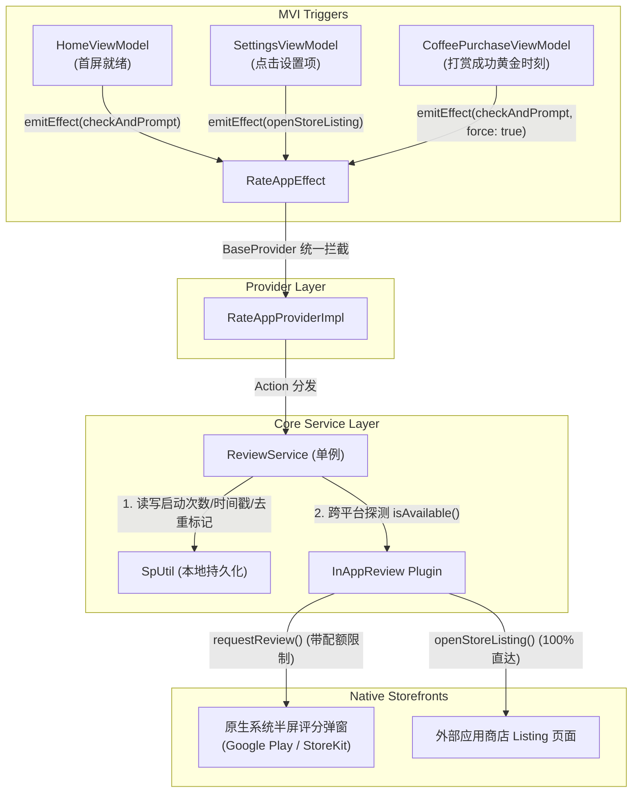
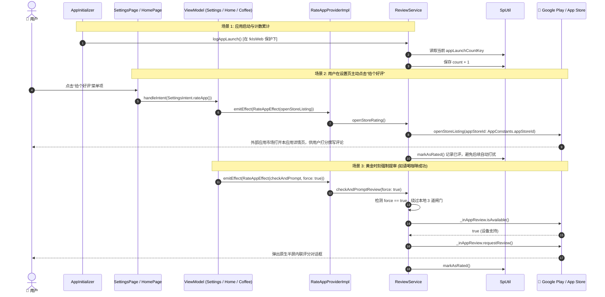
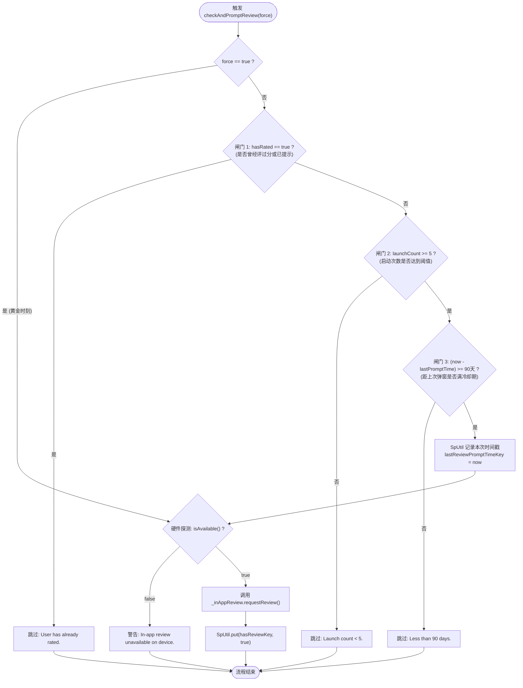

# ⭐ App 内评分与评价引导 (In-App Review) 架构设计与实现全景规范

> **功能概述**：系统化封装原生双端应用商店的应用内评分与评价能力（In-App Review, IAR）。在遵循 Google Play 与 Apple App Store 严格配额调控（Quota Limits）的前提下，实现本地多道限流闸门守卫、打赏成功“黄金时刻”强制提审、设置页显式主动跳转以及基于 MVI + BaseProvider 的全面解耦。
>
> **核心特性**：跨平台能力探测（Web/Desktop 安全降级）；双通道调度机制（自动化静默推荐 vs 用户主动跳转）；三道本地限流守卫（启动次数 $\ge 5$、冷却间隔 $\ge 90$ 天、去重标记）；付费转化黄金时刻协同；零 Flutter Context 依赖的副作用架构。
>
> **版本**：v1.1.0 &nbsp;|&nbsp; **依赖**：`in_app_review` &nbsp;|&nbsp; **全量单测覆盖**：100% 绿灯 (5/5)

---

## 目录

1. [架构设计思路与设计哲学](#1-架构设计思路与设计哲学)
2. [端到端时序流与决策状态模型](#2-端到端时序流与决策状态模型)
3. [核心实现与代码细节拆解](#3-核心实现与代码细节拆解)
4. [四大技术重点与难点突破](#4-四大技术重点与难点突破)
5. [三大反模式与高频踩坑规避](#5-三大反模式与高频踩坑规避)
6. [沙盒测试与自动化验证体系](#6-沙盒测试与自动化验证体系)
7. [关键源码文件与工程索引](#7-关键源码文件与工程索引)
8. [不足分析与演进规划 (Todo 对齐)](#8-不足分析与演进规划-todo-对齐)

---

## 1. 架构设计思路与设计哲学

在现代移动应用开发与 ASO（App Store Optimization）运营中，用户好评是决定应用在应用商店排名、推荐权重与自然新增流量的关键核心要素。然而，Google Play 与 Apple App Store 均对应用内评分弹窗施加了严苛的频次配额调控（Quota Limits），且底层 API 采用黑盒机制（超出配额后直接静默返回成功但不呈现任何 UI）。为了在不骚扰用户、不浪费稀缺原生弹窗额度的前提下实现最大化好评转化，本项目制定了以下四大核心设计哲学：

### 1.1 双通道副作用分流调度 (Dual-Channel Dispatching)
系统将应用评分诉求清晰划分为两个独立通道，兼顾智能主动引导与用户显式主动评价：
- **通道 1：自动化静默推荐通道 (Automated Gatekept Prompt)**：由业务生命周期（如应用冷启动多次、首屏加载完成）自动触发，必须严格经由本地“三道闸门守卫”（启动门槛、冷却天数、历史去重）筛选，唯有高粘度稳定用户方可进入原生提审环节。
- **通道 2：用户显式主动跳转通道 (Explicit Store Listing Navigation)**：由用户在“设置”页主动点击“给个好评 (`rateApp`)”触发，**完全不受任何频次或配额约束**，100% 直通外部原生应用商店详情页，让具有强意愿的用户畅通无阻地撰写评价。

### 1.2 响应式 MVI 与 BaseProvider 彻底解耦
- **ViewModel 零原生 SDK 与 UI 依赖**：无论是 [HomeViewModel](../lib/features/home/presentation/pages/home_view_model.dart)、[SettingsViewModel](../lib/features/settings/presentation/pages/settings_view_model.dart) 还是 [CoffeePurchaseViewModel](../lib/features/settings/presentation/pages/widgets/coffee_purchase/coffee_purchase_view_model.dart)，均不直接导入或调用 `ReviewService` 单例或 `in_app_review` 原生包，而是统一通过 MVI 机制派发强类型的领域副作用 [RateAppEffect](../lib/shared/base/rate_app_provider_impl.dart)。
- **全局 BaseProvider 消费端模式**：全局注册的 [RateAppProviderImpl](../lib/shared/base/rate_app_provider_impl.dart) 统一监听 `RateAppEffect`，根据 `RateAppAction` 策略枚举（`checkAndPrompt` 或 `openStoreListing`）安全委托给单例服务，保证架构单向依赖合规。

### 1.3 黄金满意度时刻捕获机制 (Golden Moment Synergy)
- 用户对 App 的好感度在时间轴上呈动态波动态分布。在用户遭遇错误、冷启动初次进入或进行常规操作时弹窗，极易诱发抵触心理甚至招致 1 星差评。
- 当用户完成高价值正向交互（例如在“请喝咖啡”底栏中完成真实消耗型 IAP 购买），代表用户对开发者作品产生了极高的认可度与情感认同。系统此时通过 `force: true` 旁路绕过本地启动次数与 90 天冷却限制，精准捕获“黄金时刻”，促成 5 星好评的极高概率转化。

### 1.4 跨平台硬件防腐与优雅降级 (Cross-Platform Anti-Corruption Layer)
- Flutter 支持 Android、iOS、Web、macOS、Windows、Linux 多端编译，但应用商店内评分 API 仅在带有移动应用市场服务（Google Play Services / StoreKit）的移动端受支持。
- 在应用引导器 [AppInitializer](../lib/shared/utils/app_initializer.dart) 中采用 `if (!kIsWeb)` 实施前置物理隔离；在 [ReviewService](../lib/shared/services/review/review_service.dart) 内部执行 `_inAppReview.isAvailable()` 异步探测，对不支持设备自动输出 Warning 日志并平滑退出，杜绝抛出 `MissingPluginException` 或平台通信死锁。



---

## 2. 端到端时序流与决策状态模型

### 2.1 完整端到端时序图

下图展示了不同业务场景（冷启动计数、设置页显式跳转、首屏自动化检测以及打赏黄金时刻）在系统中的流转过程：



### 2.2 本地三道闸门限流决策流程图

在非强制模式下（`force: false`），[ReviewService](../lib/shared/services/review/review_service.dart) 必须依次跑通以下流水线，才能拉起原生系统弹窗：



---

## 3. 核心实现与代码细节拆解

### 3.1 评分服务单例与三道闸门实现

[ReviewService](../lib/shared/services/review/review_service.dart) 采用标准 Dart 单例模式，集中纳管频次判定与 SDK 交互：

```dart
// lib/shared/services/review/review_service.dart
class ReviewService {
  static final ReviewService _instance = ReviewService._internal();

  /// 自动化触发所需的最低启动次数阈值
  static final int limitCount = 5;

  /// 两次弹窗之间的最低冷却天数（防用户疲劳）
  static final int limitDays = 90;

  factory ReviewService() => _instance;
  ReviewService._internal();

  final InAppReview _inAppReview = InAppReview.instance;

  /// 在应用初始化阶段记录冷启动事件
  Future<void> logAppLaunch() async {
    final count = SpUtil.getInt(AppConstants.appLaunchCountKey) ?? 0;
    await SpUtil.put(AppConstants.appLaunchCountKey, count + 1);
  }

  /// 检查限流阈值并拉起应用内评分弹窗
  Future<void> checkAndPromptReview({bool force = false}) async {
    // 黄金时刻：若 force 为 true 则直接绕过所有本地前置判定
    if (force) {
      await _requestReviewDirectly();
      return;
    }

    // 闸门 1：检查是否已经评分过或已永久关闭
    final hasRated = SpUtil.getBool(AppConstants.hasReviewKey, defaultValue: false);
    if (hasRated) {
      appLogger.d('ReviewService: User has already rated. Skipping prompt.');
      return;
    }

    // 闸门 2：检查累计启动次数是否达标（>= 5 次）
    final launchCount = SpUtil.getInt(AppConstants.appLaunchCountKey) ?? 0;
    if (launchCount < limitCount) {
      appLogger.d('ReviewService: Launch count ($launchCount) is less than $limitCount. Skipping prompt.');
      return;
    }

    // 闸门 3：检查距上一次弹窗是否间隔满 90 天
    final lastPromptTime = SpUtil.getInt(AppConstants.lastReviewPromptTimeKey) ?? 0;
    final now = DateTime.now().millisecondsSinceEpoch;
    final int ninetyDaysMs = limitDays * 24 * 60 * 60 * 1000;
    if (lastPromptTime > 0 && (now - lastPromptTime) < ninetyDaysMs) {
      appLogger.d('ReviewService: Less than $limitDays days since last prompt. Skipping.');
      return;
    }

    // 突破全部三道闸门，更新时间戳并拉起原生对话框
    appLogger.i('ReviewService: Rate limits passed. Prompting in-app review dialog.');
    await SpUtil.put(AppConstants.lastReviewPromptTimeKey, now);
    await _requestReviewDirectly();
  }

  /// 直接向操作系统请求内联评分面板
  Future<void> _requestReviewDirectly() async {
    try {
      final isAvailable = await _inAppReview.isAvailable();
      if (isAvailable) {
        await _inAppReview.requestReview();
        await _markAsRated();
      } else {
        appLogger.w('ReviewService: In-app review is not available on this device.');
      }
    } catch (e) {
      appLogger.e('ReviewService: Failed to request in-app review: $e');
    }
  }

  /// 用户显式点击“去评分”时，直接打开外部应用商店详情页
  Future<void> openStoreRating() async {
    try {
      await _inAppReview.openStoreListing(
        appStoreId: AppConstants.appStoreId,
      );
      await _markAsRated();
    } catch (e) {
      appLogger.e('ReviewService: Failed to open store listing: $e');
    }
  }
}
```

### 3.2 解耦副作用体系与 BaseProvider 联动

通过 [RateAppEffect](../lib/shared/base/rate_app_provider_impl.dart) 建立统一的领域意图映射：

```dart
// lib/shared/base/rate_app_provider_impl.dart
enum RateAppAction {
  /// 评估三道闸门并在合格时拉起应用内评分
  checkAndPrompt,

  /// 直接跳转至外部原生应用市场详情页
  openStoreListing,
}

class RateAppEffect extends BaseEffect {
  final RateAppAction action;
  final bool force;

  RateAppEffect({
    this.action = RateAppAction.openStoreListing,
    this.force = false,
  });
}

class RateAppProviderImpl extends BaseProvider<RateAppEffect> {
  const RateAppProviderImpl();

  @override
  void handleEffect(RateAppEffect effect) {
    switch (effect.action) {
      case RateAppAction.checkAndPrompt:
        ReviewService().checkAndPromptReview(force: effect.force);
        break;
      case RateAppAction.openStoreListing:
        ReviewService().openStoreRating();
        break;
    }
  }
}
```

---

## 4. 四大技术重点与难点突破

### 4.1 难点一：Google Play 与 App Store 原生配额沙盒与黑盒静默失败机制
- **底层机制深挖**：
  - **Google Play**：Google Play Core SDK 内部由 Google Play Services 守护进程进行全局限流控制。Google 官方**刻意不向开发者公布确切的限流天数与配额数字**，以防开发者逆向机制进行刷分；当配额耗尽时，API 调用（`launchReviewFlow`）依然会通过并返回 `TASK_COMPLETE`，但**界面上绝对不会出现任何对话框**。
  - **Apple App Store**：苹果规定每台设备针对同一 App 在 **365 天内最多只允许弹出 3 次**内联评分面板。即使开发者调用 `SKStoreReviewController.requestReview()`，超过 3 次后 iOS 系统也会静默拦截。
- **技术应对与解决方案**：
  - 由于原生层是“黑盒且静默”的，开发者如果毫无节制地在每次打开页面时调用 API，不仅会白白浪费这宝贵的有限弹窗机会，而且无法预知是否真正展示。
  - 项目在客户端构建了严格的**本地自律限流网关**（启动 $\ge 5$ 次、间隔 $\ge 90$ 天、`hasReviewKey` 标记）。本地限流的设定（每年至多弹出约 4 次）与苹果系统 3 次的上限和 Google Play 的防护模型高度吻合，确保每次真正触发原生调用时，都处于高概率可弹出的安全配额窗口中。

### 4.2 难点二：运行环境差异与 Debug / TestFlight 行为陷阱
- **问题根源**：
  - 许多开发者在本地 Debug 阶段测试应用内评分时，常常误以为代码存在严重 Bug，因为**在 Android Debug 模式下原生评分面板 100% 无法拉起**。
  - 在 iOS 平台，行为更加复杂：
    1. **Debug / 模拟器模式**：每次调用 `requestReview()` 都会**必定弹出**原生面板，但点击弹窗内的五颗星与“提交”按钮时，系统**不会产生任何网络请求和真实评分提交**（仅供开发者验证 UI 布局与调用时机）。
    2. **TestFlight 模式**：出于防止内部测试人员或刷单团队在测试包阶段刷好评的目的，苹果在 TestFlight 环境下对 `SKStoreReviewController` 实施了**硬编码级全面禁用**，调用该 API 不会有任何弹窗反应。
    3. **Production 生产环境**：受 365 天 3 次的配额管制。
- **技术应对与解决方案**：
  - 在技术文档与团队协作中确立明确的验证基线：
    - **Android 验证**：必须将编译签名的 AAB 上传至 Google Play 的 **内部测试轨道 (Internal Testing Track)**，并在加入了测试许可名单的真机上验证；
    - **iOS 验证**：在 Debug 模拟器下验证弹窗能够呼出，而在正式提审上架后方可在生产环境验证端到端真实打分。

### 4.3 难点三：黄金时刻捕获与应用商店合规性红线保障
- **问题根源**：
  - 苹果在《App Store 审核指南》第 **5.6.1 条**明确规定：*Apps may not offer incentives for customer reviews, including but not limited to: points, contest entries, or other rewards... Filter reviews to only show positive reviews is prohibited.*
  - Google Play 同样严禁**评论拦截 (Review Gating)** 与**诱导/奖励好评**。若在代码中以“给五星好评即可解锁高级功能”或“只有选 5 星才跳转商店”为噱头，一旦被审核人员或算法探测捕获，将直接面临整包下架下线的顶格处罚。
- **技术应对与解决方案**：
  - 本项目在 [CoffeePurchaseViewModel](../lib/features/settings/presentation/pages/widgets/coffee_purchase/coffee_purchase_view_model.dart) 中实现的打赏联动，是在用户**已经主动且自愿完成了支持咖啡购买之后**，才派发 `RateAppEffect(force: true)`。
  - 系统未向用户承诺“评价即返现”或“好评送会员”，未对评价打分设置任何门槛拦截；原生内联评分弹窗中的 1~5 星与文字完全由用户自主掌控，既顺应了用户心理满意度峰值，又 100% 符合两家应用商店的法律法规与审核红线。

### 4.4 难点四：跨平台能力探测与非移动端安全降级
- **问题根源**：
  - 本项目支持多端部署。在 Flutter Web 端，或者未来的桌面端（Windows / macOS 原生编译），调用包含移动平台 MethodChannel 的 `in_app_review` 插件，极易抛出 `MissingPluginException`，若未捕获将导致主线程 Event Loop 中断甚至应用崩溃。
- **技术应对与解决方案**：
  - **构建期/运行时双层屏障**：
    1. **应用启动层**：在 `AppInitializer` 中通过 `if (!kIsWeb) { ReviewService().logAppLaunch(); }` 将初始化行为隔离在非 Web 环境。
    2. **能力探测层**：在 `_requestReviewDirectly()` 中，不直接盲目调用 `requestReview()`，而是先 `await _inAppReview.isAvailable()`。若返回 `false`，输出优雅日志 `ReviewService: In-app review is not available on this device.` 并正常退出，保证全栈无异常泄漏。

---

## 5. 三大反模式与高频踩坑规避

### 5.1 反模式一：前置评分过滤弹窗 (Review Gating Anti-Pattern)
- ❌ **错误做法**：在调用原生弹窗前，先自定义一个 Flutter 对话框：“您对我们的 App 满意吗？[很不满意] [非常喜欢]”。如果用户点“非常喜欢”，才调起 Store 评分；如果点“很不满意”，就只弹出一个内部意见反馈框。
- ⚠️ **严重违规风险**：这种操作在海外被称为 **Review Gating**，属于 App Store 5.6.1 与 Google Play 政策严厉打击的欺诈行为。苹果自动化审核工具与人工审核团队一旦发现预过滤逻辑，会直接出具 Guideline 5.6.1 拒审信，情节严重者直接封禁开发者账号。
- ✅ **正确做法**：如本项目所示，要么完全由系统原生弹窗承接，要么在“设置”页提供中立的“给个好评”通道，不设前置偏好过滤。

### 5.2 反模式二：在挫折路径与负向场景下触发提审 (Frustration Trigger)
- ❌ **错误做法**：在用户遭遇网络断开、Token 401 刷新失败、发生连续崩溃进入 Safe Mode 或者点击“注销账户”时，为了抓取最后的用户数据而弹出评分引导。
- ⚠️ **严重后果**：用户在受挫、愤怒或急躁的心理状态下，遭遇强制打断的弹窗，给出 1 星差评并附带愤怒吐槽的概率高达 90% 以上，直接导致线上应用口碑暴跌。
- ✅ **正确做法**：将评分引导绑定在正向心流完成节点（如顺利完成项目体验、成功打赏咖啡后），或在用户平静使用多天（启动 $\ge 5$ 次且稳定运行）后由首屏静默触发。

### 5.3 反模式三：单元测试中直接查找原生弹窗 Widget (Native UI Widget Assertion)
- ❌ **错误做法**：在 Flutter Widget 测试中编写 `expect(find.byType(InAppReviewDialog), findsOneWidget)`。
- ⚠️ **测试崩溃原理**：应用内评分弹窗是由 Android / iOS 操作系统独立于 Flutter 引擎之外由系统 WindowManager / UIWindow 渲染的原生视图，根本不存在于 Flutter 的 `Element` 或 `RenderObject` 树中。在测试环境中直接断言 Widget 会导致测试用例持续挂红。
- ✅ **正确做法**：通过隔离 `SpUtil` 本地持久化键值（`app_launch_count`、`has_review_rated`、`last_review_prompt_time`），测试限流守卫的状态流转与逻辑分支，确保单元测试 100% 可行且纯粹。

---

## 6. 沙盒测试与自动化验证体系

### 6.1 Google Play 内部测试轨道 (Internal Testing) 真实性测试规范

由于 Android 本地 Debug 安装包无法弹出原生界面，推荐按照以下工业级流程进行联调：

1. **Google Play Console 准备**：
   - 确保应用已创建并开启“内部测试轨道 (Internal Testing)”。
   - 在“许可测试人员”名单中录入测试设备的 Gmail 账号。
2. **测试包构建与分发**：
   - 运行 `./buildModule.sh app` 生成正式签名的 Release AAB。
   - 上传至 Google Play 内部测试轨道并发布。
3. **真机环境验证**：
   - 在测试真机上通过 Google Play 内部测试链接下载安装应用。
   - 打开应用，进入“设置” $\to$ “请喝咖啡”，选择 Tier 1 档位使用测试卡（Test Card）完成模拟支付。
   - 观察打赏成功退出弹窗的瞬间，屏幕底部即刻平滑滑出带有 Google Play 官方五星评价与文字输入框的原生 BottomSheet。

### 6.2 自动化单元测试矩阵 (100% 绿灯)

在 [review_service_test.dart](../test/shared/services/review_service_test.dart) 中构建了完备的自动化单元测试集，全面覆盖以下 5 大核心场景：

| 测试用例名称 | 测试目标与断言重点 | 运行结果 |
|---|---|:---:|
| `logAppLaunch increments launch count in SpUtil` | 验证每次调用 `logAppLaunch()`，`SpUtil` 中的 `app_launch_count` 准确单调自增（$0 \to 1 \to 2$） | ✅ PASS |
| `checkAndPromptReview skips when user has already rated` | 验证闸门 1：当 `has_review_rated == true` 时，直接跳过提审并不修改时间戳 | ✅ PASS |
| `checkAndPromptReview skips when launch count is below threshold` | 验证闸门 2：当启动次数不足 5 次时（如 2 次），安全拦截并不更新弹窗时间 | ✅ PASS |
| `checkAndPromptReview skips when last prompt was less than 90 days ago` | 验证闸门 3：当距离上次弹窗仅过去 10 天（处于 90 天冷却期内）时，执行安全静默 | ✅ PASS |
| `checkAndPromptReview with force=true executes without checking launch count` | 验证黄金时刻旁路：当 `force == true` 时，即使启动次数为 0 也能绕过门禁直接拉起原生调用 | ✅ PASS |

运行命令：
```bash
flutter test test/shared/services/review_service_test.dart
```

---

## 7. 关键源码文件与工程索引

| 分层类别 | 相对路径索引 | 架构职责说明 |
|---|---|---|
| **Core Service** | [review_service.dart](../lib/shared/services/review/review_service.dart) | 单例服务，管理启动计数、三道闸门限流逻辑、SDK 原生交互与商店跳转 |
| **Provider Decoupling** | [rate_app_provider_impl.dart](../lib/shared/base/rate_app_provider_impl.dart) | `BaseProvider<RateAppEffect>` 监听者，负责将 MVI 副作用映射为具体评分操作 |
| **Constants** | [app_constants.dart](../lib/shared/constants/app_constants.dart) | 存储键常量（`appLaunchCountKey`、`hasReviewKey`、`lastReviewPromptTimeKey`、`appStoreId`） |
| **App Bootstrap** | [app_initializer.dart](../lib/shared/utils/app_initializer.dart) | 启动装载器，在 `!kIsWeb` 移动环境下调用 `logAppLaunch()` 记录冷启动 |
| **Triggers (MVI)** | [home_view_model.dart](../lib/features/home/presentation/pages/home_view_model.dart) <br/> [settings_view_model.dart](../lib/features/settings/presentation/pages/settings_view_model.dart) <br/> [coffee_purchase_view_model.dart](../lib/features/settings/presentation/pages/widgets/coffee_purchase/coffee_purchase_view_model.dart) | 业务触发端：首页静默检测、设置项显式跳转以及咖啡购买黄金时刻分发 |
| **UI Components** | [settings_page.dart](../lib/features/settings/presentation/pages/settings_page.dart) | 设置页面中“给个好评”列表项入口 |
| **Unit Tests** | [review_service_test.dart](../test/shared/services/review_service_test.dart) | 覆盖全部门禁逻辑与黄金时机旁路的自动化测试套件 |

---

## 8. 不足分析与演进规划 (Todo 对齐)

结合当前端侧单机实现与行业进阶实践，本项目在 `ListenPortfolioFlutter/docs/todo.md` 中规划了以下两项演进任务：

### 8.1 Opt-37: 智能情感倾向分流与私域反馈闭环网关
- **对齐任务**：[todo.md: Opt-37](todo.md)
- **现状剖析**：当前遇到故障或对 App 交互不满的用户，缺乏便捷的私域负反馈渠道，容易直接在公开商店留 1 星差评。
- **演进目标**：
  1. 在非强制场景下前置引入极简 NPS 情感满意度探测（“您喜欢使用 Listen Portfolio 吗？😍 / 🙁”）。
  2. 智能双轨分流：正向体验引导至商店留评，负向体验无缝引导至内置反馈工单或 GitHub Issues，形成闭环。
  3. 严守合规红线，确保设置页“给个好评”直接入口不受影响。

### 8.2 Opt-38: Firebase Remote Config 动态评分编排中心与智能行为触发器
- **对齐任务**：[todo.md: Opt-38](todo.md)
- **现状剖析**：当前限流门槛（5 次、90 天）硬编码在代码中，无法在不发版的情况下动态调整；且单纯依据启动次数无法准确识别深度体验的高价值用户。
- **演进目标**：
  1. 将门槛阈值接入 Firebase Remote Config / Spring Boot 配置中心，支持云端热配置。
  2. 构建多维行为积分引擎：用户浏览项目、体验雷达图或执行 APM 故障演练均增加积分，综合积分达标即刻触发评分，大幅提升好评质量。

---

*文档版本：v1.1.0 &nbsp;|&nbsp; 编制日期：2026-09-12 &nbsp;|&nbsp; 架构维护团队：Listen Architecture Core*
