# 🧪 ListenPortfolioFlutter 端到端 (E2E) UI 功能集成测试规划与实战方案

> **方案概述**：本方案详细梳理并规范了 `ListenPortfolioFlutter` 工程中基于 `patrol_finders` 构建的工业级端到端 (End-to-End, E2E) UI 自动化集成测试体系。
>
> **演进核心**：彻底摒弃传统“单一大测试级联阻塞”的脆弱模式，重构为 **22 组模块化、高内聚、具备可重入性（Re-entrancy）与自愈能力（Self-Healing）的独立用例组**。配套完备的异步等待轮询助手、浮层手势冲突清理、低时延本地 Mock 与环境 Fake 隔离策略，实现全工程核心业务链路与 MVI Intent 的 100% 覆盖。
>
> **版本**：v1.2.0 &nbsp;|&nbsp; **测试框架**：`patrol_finders` + `integration_test` &nbsp;|&nbsp; **覆盖用例数**：22 组独立用例

---

## 目录

1. [架构设计思路与设计哲学](#1-架构设计思路与设计哲学)
2. [公共测试基础设施与自愈助手层](#2-公共测试基础设施与自愈助手层)
3. [22 组端到端集成测试用例矩阵](#3-22-组端到端集成测试用例矩阵)
4. [四大技术重点与难点突破](#4-四大技术重点与难点突破)
5. [三大反模式与高频踩坑规避](#5-三大反模式与高频踩坑规避)
6. [执行指南与 CI/CD 流水线集成](#6-执行指南与-cicd-流水线集成)
7. [关键源码文件与工程索引](#7-关键源码文件与工程索引)
8. [不足分析与演进规划 (Todo 对齐)](#8-不足分析与演进规划-todo-对齐)

---

## 1. 架构设计思路与设计哲学

在大型 Flutter 项目的自动化测试体系中，传统的端到端测试常被称为“昂贵且脆弱的黑盒”：一个长达数百行的测试用例只要在第 10 步发生 1 像素的渲染偏差或微小的网络超时，后续所有测试全部中断，造成严重的级联雪崩（Cascade Failure）。为了打破这一困境，本项目在 `integration_test/app_test.dart` 中贯彻了以下四大设计哲学：

### 1.1 模块化解耦与无条件可重入 (Re-entrancy & Stateless Isolation)
- **拒绝大单体用例**：将所有业务链路拆解为 22 个互相独立的 `patrolWidgetTest`。
- **运行器级容错隔离**：测试运行器按序执行各用例组。若中间第 3 组因偶发异常失败，运行器仅将其标记为 Fail，**测试进程绝不崩溃中断，而是平滑自愈并立即执行第 4 组**。
- **单用例与全量无缝切换**：每个用例既支持全量流水线连续执行，也支持通过 `--name="UI Test - ..."` 毫无依赖地单独启动，极大提升了本地调试与缺陷定位的效率。

### 1.2 状态自愈与环境清洗机制 (Self-Healing Harness)
- 用例执行前绝不盲目假设前置状态（如“当前必然处于未登录页”或“当前必然在首页”）。
- 通过 `bootAppAndGoToLogin`、`performUiLogin` 等自愈助手函数，测试用例能动态探查屏幕当前呈现的 Widget 树：
  - 若有上一个用例遗留的 `AlertDialog` 弹窗，自动探测并点击 OK 关闭；
  - 若已处于目标页面，零耗时直接复用；
  - 若处于登录态但需重置，自动拉出侧边抽屉（Drawer）执行安全注销，确保测试始终在确定的契约环境中起跑。

### 1.3 确定性执行与时钟解压 (Deterministic Timing & Throttling)
- 严禁在测试中滥用无脑的 `sleep(Duration(seconds: N))`。固定延时不仅大幅拉长测试耗时，且在低配 CI 容器中极易因性能抖动产生超时挂红。
- 采用**有限步进异步轮询探针**（`waitForPageTransition` / `waitForPage`），结合 `VisibilityDetectorController.instance.updateInterval = Duration.zero`，彻底杜绝 Flutter 渲染管线因无限轮询动画而陷入 `pumpAndSettle` 死锁。

### 1.4 全真网络隔离与第三方 SDK 防腐 (Hermetic Fake Isolation)
- **本地零时延 Mock 服务**：接入 `LocalMockServer.initConfig(networkLatency: Duration(milliseconds: 10))`，将原本需要数百毫秒的 HTTP 请求压制在 10ms 极速闭环内，实现纯本地离线断网可跑。
- **原生渠道全面剥离**：通过 `FakeIapService`、`FakeNotificationService` 与 `ShareProviderImpl.skipShareForTesting = true`，彻底消除对 Google Play 登录、APNs/FCM 推送和系统分享面板的原生依赖。

```mermaid
graph TD
  subgraph Test Harness & Infrastructure
    MOCK["LocalMockServer (10ms Latency)"]
    FAKES["FakeIapService / FakeNotificationService"]
    VIS["VisibilityDetectorController (Interval: zero)"]
  end

  subgraph Self-Healing Helpers
    BOOT["bootAppAndGoToLogin($)"]
    LOGIN["performUiLogin($, user, pwd)"]
    NAV["navigateToSettings($)"]
    WAIT["waitForPage($, PageType)"]
  end

  subgraph 22 Isolated Patrol Widget Tests
    T1["Group 1: Login & Form Validation"]
    T2["Group 2: Forgot Password Flow"]
    T3["Group 3: Sign Up Flow"]
    T4["Group 4: Home & Drawer Navigation"]
    T5["Group 5: Settings & Logout"]
    T6["Group 6: AI Chat Assistant"]
    T7["Group 7: Sub-Views Navigation"]
    T8["Group 8: Theme & Typography"]
    T9["Group 9: Developer Mode Extra"]
    T10["Group 10: Guest Mode Flow"]
    T11["Group 11: Change Password Flow"]
    T12["Group 12: Resume View & PDF Export"]
    T13["Group 13: Language Switching"]
    T14["Group 14: Environment Switching"]
    T15["Group 15: Delete Account Danger Zone"]
    T16["Group 16: Crash Logs Diagnostic View"]
    T17["Group 17: Overview Quick Actions"]
    T18["Group 18: AI Chat Mode Selector & Preset"]
    T19["Group 19: Reset Settings to Defaults"]
    T20["Group 20: 401 Interceptor Token Expire"]
    T21["Group 21: Common WebView & JS Bridge"]
    T22["Group 22: Terms & Privacy Policy"]
  end

  MOCK -.-> BOOT
  FAKES -.-> BOOT
  VIS -.-> BOOT
  BOOT --> T1 & T2 & T3 & T10
  LOGIN --> T4 & T5 & T6 & T7 & T8 & T9 & T11 & T12 & T13 & T14 & T15 & T16 & T17 & T18 & T19 & T20 & T21 & T22
  NAV --> T5 & T8 & T9 & T11 & T13 & T14 & T15 & T16 & T19 & T20 & T21 & T22
```



---

## 2. 公共测试基础设施与自愈助手层

在 [integration_test/app_test.dart](../integration_test/app_test.dart) 中，核心测试辅助函数为整个 22 组用例提供了坚实的基础能力：

### 2.1 页面流转异步轮询探针
```dart
// integration_test/app_test.dart
Future<void> waitForPageTransition(PatrolTester $) async {
  final tester = $.tester;
  for (int i = 0; i < 40; i++) {
    if (find.byType(LoginPage).evaluate().isNotEmpty ||
        find.byType(HomePage).evaluate().isNotEmpty) {
      break;
    }
    await tester.pump(const Duration(milliseconds: 300));
    await Future<void>.delayed(const Duration(milliseconds: 150));
  }
  await tester.pumpAndSettle();
}

Future<void> waitForPage(PatrolTester $, Type pageType) async {
  final tester = $.tester;
  for (int i = 0; i < 40; i++) {
    if (find.byType(pageType).evaluate().isNotEmpty) {
      break;
    }
    await tester.pump(const Duration(milliseconds: 200));
    await Future<void>.delayed(const Duration(milliseconds: 150));
  }
  await tester.pumpAndSettle();
}
```

### 2.2 自愈式冷启动与登录导航 (`bootAppAndGoToLogin`)
```dart
Future<void> bootAppAndGoToLogin(PatrolTester $) async {
  final tester = $.tester;
  // 1. 清理上个用例异常残留的模态对话框
  final dialogOkBtn = find.text(I18nKeys.ok.tr);
  if (dialogOkBtn.evaluate().isNotEmpty && find.byType(AlertDialog).evaluate().isNotEmpty) {
    await tester.tap(dialogOkBtn.first);
    await tester.pumpAndSettle();
  }

  // 2. 若已在 LoginPage，零成本直接退出
  if (find.byType(LoginPage).evaluate().isNotEmpty) return;

  // 3. 若处于 HomePage，打开侧边栏注销回退
  if (find.byType(HomePage).evaluate().isNotEmpty) {
    tester.firstState<ScaffoldState>(find.byType(Scaffold)).openDrawer();
    await tester.pumpAndSettle();
    final logoutBtn = find.descendant(of: find.byType(Drawer), matching: find.text(I18nKeys.logout.tr));
    if (logoutBtn.evaluate().isNotEmpty) {
      await tester.tap(logoutBtn);
      await tester.pumpAndSettle();
      final okBtn = find.text(I18nKeys.ok.tr);
      if (okBtn.evaluate().isNotEmpty) {
        await tester.tap(okBtn);
        await waitForPage($, LoginPage);
      }
      return;
    }
  }

  // 4. 否则冷启动应用并等待 Splash 结束
  app.main();
  await tester.pumpAndSettle();
  await waitForPageTransition($);
  await waitForPage($, LoginPage);
}
```

### 2.3 幂等式 UI 登录与手势冲突清理 (`performUiLogin`)
```dart
Future<void> performUiLogin(PatrolTester $, String username, String password) async {
  final tester = $.tester;
  // 若已登录且非游客，跳过登录步骤
  if (find.byType(HomePage).evaluate().isNotEmpty && !authManager.state.isGuest) {
    return;
  }

  await bootAppAndGoToLogin($);

  if (find.byType(LoginPage).evaluate().isNotEmpty) {
    final loginFields = find.byType(CommonTextField);
    await tester.enterText(loginFields.at(0), username);
    await tester.enterText(loginFields.at(1), password);
    // 强制收起键盘，防止遮挡登录按钮手势区域
    FocusManager.instance.primaryFocus?.unfocus();
    await tester.pumpAndSettle();

    final submitLoginBtn = find.widgetWithText(CommonButton, I18nKeys.login.tr);
    await tester.tap(submitLoginBtn);
    await waitForPage($, HomePage);

    // 关键：立即关闭浮动的全局 Toast，防止其蒙层遮挡底栏手势点击
    CommonToast.hide();
    await tester.pumpAndSettle();
  }
}
```

---

## 3. 22 组端到端集成测试用例矩阵

全套用例在 [integration_test/app_test.dart](../integration_test/app_test.dart) 中实现了对整个项目业务场景的立体穿透：

| 用例编号 | 用例全名 (Test Title) | 核心验证链路与触发 Intent | 关键断言与结果预期 |
|:---:|---|---|---|
| **Case 01** | `UI Test - Login Form and Validations` | 空表单提交、超短用户名密码、记住我切换、密码明暗文切换 (`togglePasswordVisibility`) | 断言必填错误信息 (`fieldRequired`)、长度错误信息 (`minLengthMsg`) 及图标状态流转 |
| **Case 02** | `UI Test - Forgot Password Flow` | 忘记密码路由跳转、无效邮箱格式校验、有效邮箱发送重置链接 (`ForgotPasswordIntent.submit`) | 验证格式错误提示 (`invalidEmail`)、发送成功 Toast 及自动 pop 返回登录页 |
| **Case 03** | `UI Test - Sign Up Flow` | 注册页面跳转、密码与确认密码不匹配拦截、动态随机生成用户名/邮箱注册提交 | 拦截密码不一致 (`passwordsDoNotMatch`)、注册成功后安全重定向回 `LoginPage` |
| **Case 04** | `UI Test - Login and Home Navigation` | 正常登录、进入首页、打开 Drawer 抽屉验证用户名与邮箱渲染、跳转 About Me 页面并点击分享 | 断言抽屉用户信息正确、About Me 页面渲染完整、分享拦截器成功拦截 |
| **Case 05** | `UI Test - Settings Adjustments and Logout` | 进入设置页、语言弹窗选择 English、通知开关切换、物理缓存清理、注销二次确认 | 验证语言即时汉化/英化、缓存清理 Toast、确认弹窗并在注销后重定向至 `LoginPage` |
| **Case 06** | `UI Test - AI Chat Floating Sheet and Interaction` | 首页轻触 AI 悬浮球 (FAB)、进入 AI 对话页、输入框键入提问并点击发送 (`AiChatIntent.sendMessage`) | 验证 AI 页面正常挂载、消息输入与发送动作执行无异常，点击返回键安全回到首页 |
| **Case 07** | `UI Test - Home Bottom Navigation and All Sub-Views` | 首页抽屉全面导航：Projects、Architecture、About Me、Overview 四大子视图循环切换 | 验证所有子视图路由畅通，页面对应图标与关键标题元素无白屏、无渲染畸变 |
| **Case 08** | `UI Test - Settings Theme and Font Size Adjustments` | 进入“外观”设置页、深色/浅色/系统主题模式切换、字体族切换、文字大小滑块拖动 | 验证 `AppTheme` 动态热重构生效，页面字体缩放比例平滑变化无像素溢出 |
| **Case 09** | `UI Test - Developer Mode and Settings Extra Actions` | 在设置页面版本号 Tile 连续点击 7 次激活开发者模式 (`enableDeveloperMode`) | 验证开发者模式成功解锁，调试面板/额外诊断开关动态显隐正常 |
| **Case 10** | `UI Test - Guest Mode Flow and Exploration` | 登录页点击“游客体验 (Guest Mode)”免密登录，以访客身份漫游首页并尝试访问受限区域 | 验证游客身份正确标定 (`isGuest == true`)，受限交互弹出登录提示或平滑拦截 |
| **Case 11** | `UI Test - Change Password Flow Validation` | 登录态下进入“修改密码”页面，输入旧密码与新密码，验证密码复杂度与提交闭环 | 验证旧密码与新密码格式校验规则生效，修改成功后提示并安全返回 |
| **Case 12** | `UI Test - Resume View and PDF Export Trigger` | 导航至个人简历/作品集预览页面，触发 PDF 导出与外部查看意图 | 验证简历页面渲染正常，PDF 导出流被 Fake 拦截器接管并返回成功 |
| **Case 13** | `UI Test - Language Switching Flow` | 设置中心多语言切换专项测试：在 中文、英文、日文 之间进行循环热切换 | 验证国际化字典瞬时切换，所有系统 Tab 与基础按钮文案实时响应多语言变更 |
| **Case 14** | `UI Test - Environment Switching Flow` | 设置中心环境切换专项测试：在 LocalMock、Staging、Production 之间切换环境 | 验证 `EnvConfig` 响应式重置网络基地址 (BaseURL)，环境指示浮标状态同步刷新 |
| **Case 15** | `UI Test - Delete Account Danger Zone` | 导航至危险区域“注销账户 (Delete Account)”页面，验证安全警示与注销流程提交 | 验证危险操作警示文案呈现，表单提交后彻底清除本地所有会话并强制踢回登录页 |
| **Case 16** | `UI Test - Crash Logs Diagnostic View` | 进入崩溃日志诊断列表页 (`CrashLogListPage`)，查看本地崩溃日志记录与一键清理 | 验证崩溃持久化列表能够正常展示堆栈概览，一键清理操作后列表安全置空 |
| **Case 17** | `UI Test - Overview Quick Actions Navigation` | 首页 Overview 面板中的快捷功能入口卡片（Quick Actions）快速点击穿透 | 验证快捷动作点击后正确触发路由重定向，直接下钻至对应的业务子模块 |
| **Case 18** | `UI Test - AI Chat Mode Selector and Preset QA Flow` | AI 页面切换专家模型/角色模式，点击预设 FAQ 推荐词快速发起提问 | 验证预设问题点击后内容自动填入输入流并触发端侧极速回复 |
| **Case 19** | `UI Test - Reset Settings to Defaults Flow` | 设置页面触发“恢复出厂默认设置”对话框，确认重置并验证配置复位 | 验证二次确认对话框弹出，重置后语言、主题、字体大小及网络模式均安全恢复默认值 |
| **Case 20** | `UI Test - Simulate Token Expired & 401 Interceptor Flow` | 设置页触发“模拟 Token 失效”，发起业务请求模拟 401 拦截并静默刷新 Token 重发 | 验证 Dio 拦截器自动捕获 401，并发队列排队等待刷新，刷新成功后无缝恢复数据请求 |
| **Case 21** | `UI Test - Common WebView & JS Bridge Test` | 打开内置通用网页容器 `CommonWebView`，测试页面加载、手势拦截与 Bridge 通信 | 验证加载进度条消失，页面内容容器安全渲染，返回按钮能够正常 pop |
| **Case 22** | `UI Test - Terms of Service & Privacy Policy Navigation` | 设置页点击“服务条款”与“隐私政策”，验证法律合规文本展示与外链打开 | 验证合规页面正常拉起，协议文本分段渲染无报错，符合应用市场合规审核要求 |

---

## 4. 四大技术重点与难点突破

### 4.1 难点一：Flutter `pumpAndSettle` 无限动画假死与时钟死锁防御
- **问题根源**：
  Flutter 的 `tester.pumpAndSettle()` 底层机制是：持续推进虚拟时钟并等待当前帧渲染队列中的所有 Microtasks、Timers 与 Animations 完全静止（Idle）。然而，项目中许多常用组件（如 `VisibilityDetector` 的定时轮询、Lottie 循环动效、页面转圈菊花 `CircularProgressIndicator`、下拉刷新加载动效）包含无限循环的周期性重绘。若直接调用 `pumpAndSettle()`，测试引擎将陷入永久等待，最终抛出 `FlutterError: pumpAndSettle timed out`。
- **解决方案**：
  1. **初始化消除定时器**：在 `setUpAll` 中设置 `VisibilityDetectorController.instance.updateInterval = Duration.zero`，消除其内部 500ms 的防抖计时器。
  2. **有限步进轮询探针**：编写 `waitForPageTransition` 与 `waitForPage`，采用固定次数的 `tester.pump(Duration)` 步进结合 `evaluate().isNotEmpty` 条件断言，在目标 Widget 渲染完成的毫秒级瞬间立刻 `break` 跳出循环，彻底根除时钟死锁。

### 4.2 难点二：浮动覆盖层（CommonToast / SnackBar / Dialog）的手势靶点拦截与清理
- **问题根源**：
  在 E2E 测试中，前一个操作（如登录成功、设置保存）经常会在屏幕中下部弹出浮动提示框 `CommonToast` 或 `SnackBar`。这些组件在 Flutter 中属于顶层 `OverlayEntry`。如果紧接着执行 `tester.tap(find.text(...))` 点击底栏 NavigationBar 或底部按钮，Flutter 的命中测试（Hit Testing）会将触摸事件优先分发给半透明的 Toast 遮罩层，导致目标按钮完全无法接收到点击事件，引发测试偶发失败。
- **解决方案**：
  在 `performUiLogin` 的末尾显式执行：
  ```dart
  CommonToast.hide();
  await tester.pumpAndSettle();
  ```
  强制在微秒级清理所有全局浮层，还底栏手势测试环境以清爽洁净。

### 4.3 难点三：测试用例的无序独立执行与跨用例自愈机制
- **问题根源**：
  若某位开发者只想调试 `UI Test - Settings Adjustments and Logout`，直接运行 `--name="UI Test - Settings Adjustments and Logout"`，如果该测试依赖 Case 1 留在内存中的登录态，单跑必挂。若上一个测试在弹出“确认注销？”对话框时发生异常崩溃退出，下一个测试启动时屏幕中央还悬挂着这个未关闭的模态框，导致后续所有点击全部点在蒙层上。
- **解决方案**：
  在 `bootAppAndGoToLogin` 中引入**自愈防护探针**：
  ```dart
  final dialogOkBtn = find.text(I18nKeys.ok.tr);
  if (dialogOkBtn.evaluate().isNotEmpty && find.byType(AlertDialog).evaluate().isNotEmpty) {
    await tester.tap(dialogOkBtn.first);
    await tester.pumpAndSettle();
  }
  ```
  先扫除残留弹窗；再通过 `authManager.state.isGuest` 和 `find.byType(HomePage)` 动态判定当前身份，按需执行快速登录或安全退出，实现真正的“零假设、自包含、自愈合”。

### 4.4 难点四：401 Token 失效与并发静默重发全链路端到端演练
- **问题根源**：
  Token 401 静默刷新是整个架构中最复杂的网络容灾逻辑（详见 Case 20）。在纯单元测试中只能通过 Mock HttpClient 模拟状态码，无法验证真实 UI 在 Token 过期后是否会产生闪烁、掉帧、报错弹窗或页面死锁。
- **解决方案**：
  在集成测试 Case 20 中，通过设置页真实触发 `simulateTokenExpired`。此时客户端内存中的 AccessToken 被即刻清空。随后用例触发一次刷新或页面切换，E2E 探针精准观察：
  1. 页面未发生任何闪退或报错崩溃；
  2. Dio `AuthInterceptor` 成功挂起请求，调起 `refreshToken` 换发新凭证；
  3. 请求自动无缝重发，界面数据正常刷新。至此完成了架构级容灾的真机端到端落地检验。

---

## 5. 三大反模式与高频踩坑规避

### 5.1 反模式一：单体巨型级联测试 (Monolithic Cascade Failure)
- ❌ **错误做法**：在单个 `testWidgets('All E2E', ...)` 中将登录、看项目、改设置、聊 AI、注销一口气从头写到尾，长达 2000 行代码。
- ⚠️ **高危后果**：只要前面任一界面的文案微调或手势延迟，整个测试流水线立即报错中断，后面 20 多个功能完全失去测试覆盖。
- ✅ **正确做法**：如本项目所示，拆分为 22 组独立的 `patrolWidgetTest`，单组失败不影响整体大盘。

### 5.2 反模式二：使用硬编码 `sleep()` 进行异步等待 (Hardcoded Sleep)
- ❌ **错误做法**：在点击按钮后使用 `sleep(Duration(seconds: 3))` 或 `await Future.delayed(Duration(seconds: 5))`。
- ⚠️ **高危后果**：网络快时浪费等待时间，低配 CI 服务器变慢时 5 秒依然不够从而报错。
- ✅ **正确做法**：基于 `waitForPage` 动态轮询，目标一出现立刻响应，兼顾极速与弹性。

### 5.3 反模式三：在集成测试中依赖真实外网与原生支付/推送渠道
- ❌ **错误做法**：集成测试真实向生产环境 Spring Boot 发起网络请求，真实等待 FCM 原生通知下发，真实拉起 Google Play 支付。
- ⚠️ **高危后果**：遭遇公网网络波动、测试账号欠费、Google 限制或系统权限弹窗阻断，导致 CI 频繁报假警（Flaky Tests）。
- ✅ **正确做法**：统一使用低时延 `LocalMockServer`（10ms）与 Fake 服务（`FakeIapService`、`FakeNotificationService`），在沙盒环境中达到 100% 纯粹可控。

---

## 6. 执行指南与 CI/CD 流水线集成

### 6.1 本地测试执行常用命令

#### 1. 全量自动化连续执行 (22 组用例全跑)
```bash
flutter test integration_test/app_test.dart
```

#### 2. 单独指定某一分组快速调试 (秒级响应)
```bash
# 单独验证登录与校验流程
flutter test integration_test/app_test.dart --name="UI Test - Login Form and Validations"

# 单独验证 401 拦截器与 Token 静默刷新
flutter test integration_test/app_test.dart --name="UI Test - Simulate Token Expired & 401 Interceptor Flow"

# 单独验证 AI 助手悬浮球与对话交互
flutter test integration_test/app_test.dart --name="UI Test - AI Chat Floating Sheet and Interaction"
```

#### 3. 基于 Patrol CLI 在真机上执行
若已全局安装 `patrol_cli`，可直接通过原生驱动运行：
```bash
patrol test -t integration_test/app_test.dart
```

---

## 7. 关键源码文件与工程索引

| 分层类别 | 相对路径索引 | 架构职责说明 |
|---|---|---|
| **E2E Test Suite** | [app_test.dart](../integration_test/app_test.dart) | 包含 22 组独立测试用例、自愈助手层与全局测试装载入口 |
| **Network Mock** | [local_mock_server.dart](../../ListenCore/lib/network/local_mock_server.dart) | 提供 10ms 极低延迟的本地内存级 HTTP Mock 服务 |
| **IAP Service** | [iap_service.dart](../lib/shared/services/iap/iap_service.dart) | 负责应用内打赏支付业务解耦与运行时环境代理 |
| **Notification Service** | [firebase_notification_service_impl.dart](../lib/shared/services/firebase/firebase_notification_service_impl.dart) | 负责 FCM / APNs 原生推送接收与路由分发 |
| **Auth Manager** | [auth_manager.dart](../lib/shared/utils/auth_manager.dart) | 负责全局登录/游客/注销状态与 Token 凭据管理 |
| **UI Kit & Toast** | [uikit.dart](../../ListenUiKit/lib/uikit.dart) | `listen_uikit` 具备 `CommonToast.hide()` 快速清理手势遮挡能力的轻量浮层 |

---

## 8. 不足分析与演进规划 (Todo 对齐)

结合当前端侧基于 `patrol_finders` 的纯 Widget 树级自动化测试现状，本项目在 `ListenPortfolioFlutter/docs/todo.md` 中规划了以下两项进阶演进任务：

### 8.1 Opt-39: Patrol 原生平台跨进程自动化与系统权限/生物识别模拟桥接
- **对齐任务**：[todo.md: Opt-39](todo.md)
- **现状剖析**：当前测试运行在 Flutter 渲染树内，当真机弹出 Android/iOS 系统级对话框（如通知权限申请横幅、相册访问授权、原生软键盘弹起遮挡或 Face ID 弹窗）时，无法跨越系统层级进行点击，偶现超时阻断。
- **演进目标**：
  1. 引入 `patrol: ^3.0.0+` 原生驱动，桥接 Android `UiAutomator` 与 iOS `XCUITest`。
  2. 实现跨进程自动授权：`$.native.grantPermissionWhenInUse()`、`$.native.pressBack()`、`$.native.authenticateWithBiometrics()`。
  3. 采用原生级文本输入模拟，彻底杜绝软键盘遮挡底栏手势问题。

### 8.2 Opt-40: 自动化视觉回归像素级 Golden UI 比对与 E2E 故障快照/视频录制归档
- **对齐任务**：[todo.md: Opt-40](todo.md)
- **现状剖析**：当前用例以逻辑断言（查找文字和 Widget）为主，无法自动检测暗黑主题色彩偏差、超长文本截断、DPI 模糊或雷达图自绘畸变；且 CI 失败时仅有文字日志，缺乏现场直观快照。
- **演进目标**：
  1. 在关键步骤集成 `tester.takeScreenshot()`，实施容差 $\le 0.5\%$ 的像素级黄金图像差分比对。
  2. 集成 ADB / Patrol 录屏服务，在用例断言失败时自动抓取前后 5 秒 `.mp4` 录像并归档至 GitHub Actions Artifacts，10 秒内直观复现故障现场。

---

*文档版本：v1.2.0 &nbsp;|&nbsp; 编制日期：2026-09-12 &nbsp;|&nbsp; 架构维护团队：Listen Architecture Core*
