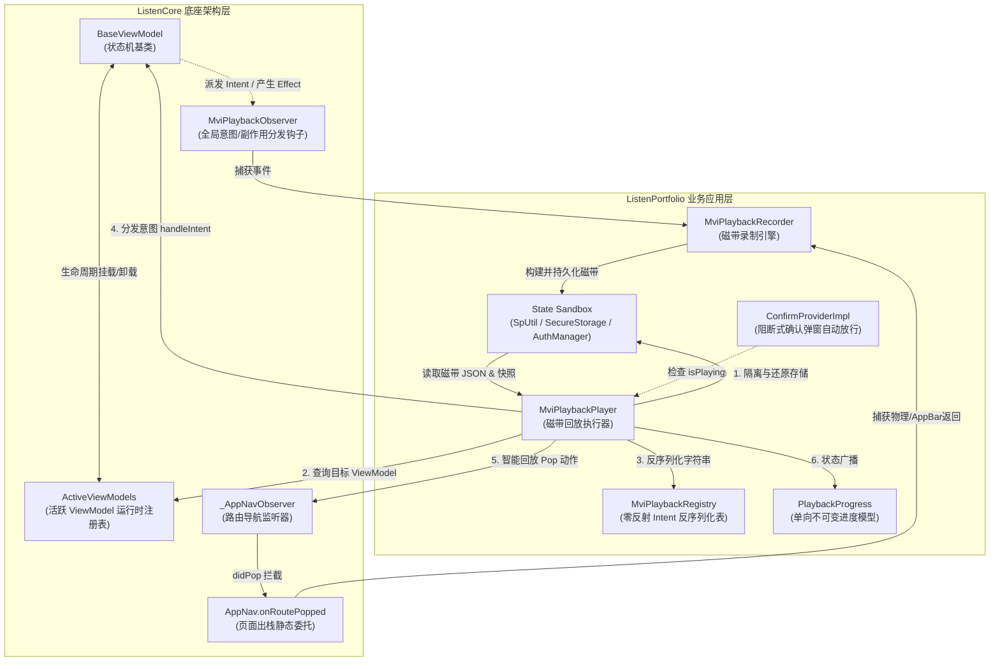
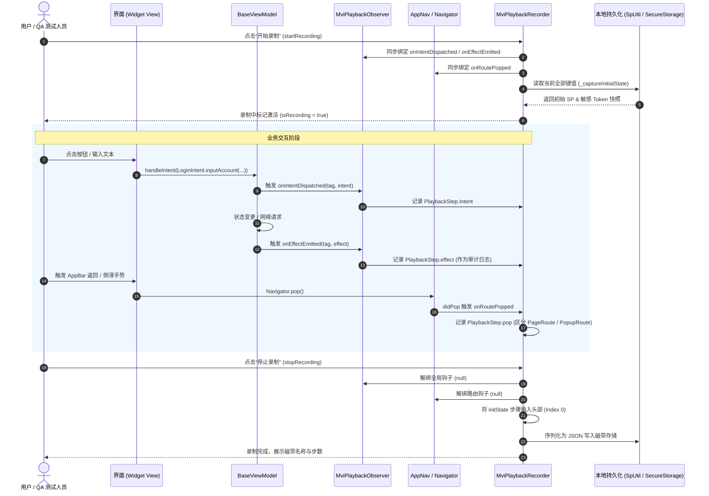
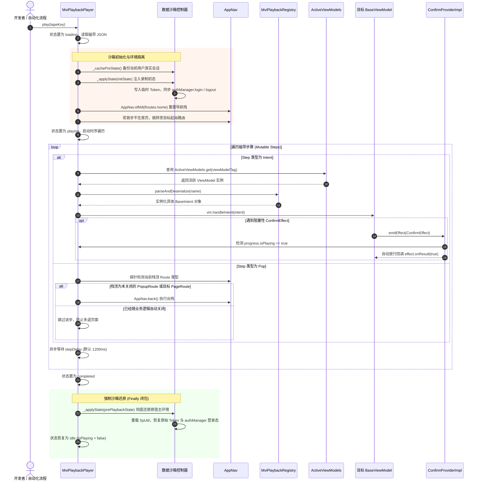
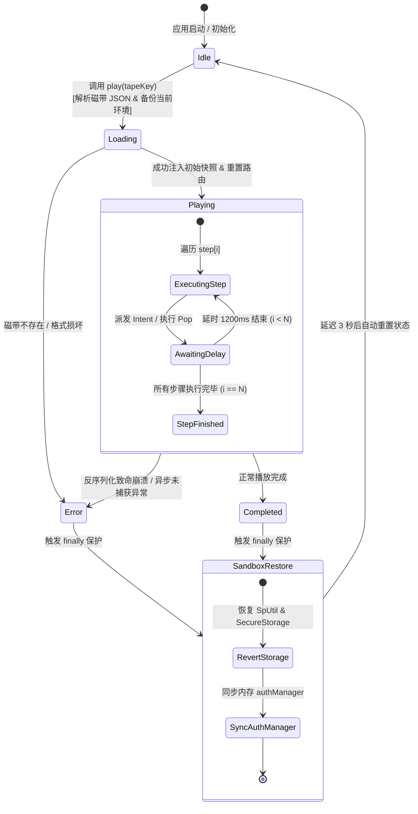

# Intent & Effect 录制与回放系统 - 架构设计与工程实现指南

本文档全面阐述了 **ListenPortfolio** 中自研的 **MVI Intent & Effect 本地录制与高保真回放系统**（MVI Playback Engine）的架构哲学、数据契约、核心技术实现细节、沙箱隔离模型、非侵入式路由拦截策略以及前瞻演进方向。

---

## 1. 系统设计哲学与核心架构 (Design Philosophy & Architecture)

### 1.1 为什么自研端侧 MVI 录制与回放系统？

在现代跨平台应用开发与质量保障体系中，传统的端到端测试（如 Appium、Flutter Driver、Patrol）通常面临以下痛点：
1. **外部基础设施沉重**：依赖跨进程调试通道、ADB/WebDriver 驱动协议、真机农场与云端测试脚本，环境搭建耗时且维护成本高；
2. **物理环境差异与偶发故障难复现**：生产用户、QA 或产品经理报告的“偶发/特定路径 Bug”，由于网络波动、本地缓存数据状态不一致、不同机型坐标偏位等因素，研发往往因“在我机器上复现不了 (Works on My Machine)”而耗费大量沟通与调试成本；
3. **测试数据污染生产持久层**：执行自动化或手动排查时，测试数据往往污染本地 SharedPreferences、Keychain 或远程数据库，测试后难以实现 100% 干净的环境回滚。

**本系统的破局思路**：
基于 Clean Architecture + MVI (Model-View-Intent) 架构天然具备的**单向数据流 (Unidirectional Data Flow)** 与**状态确定性 (State Determinism)**，将录制与回放能力直接下沉至 Flutter 引擎之上的架构拦截层：
* **零外部测试基建依赖**：100% 纯 Dart 内部运转，不需要任何外部测试框架、Socket 代理或特殊编译环境；
* **业务无侵入 (Zero-Boilerplate)**：不在任何具体 UI 按钮或手势探测器上手动埋点，直接在 `BaseViewModel` 边界挂载全局监听器，任何遵循 MVI 的业务逻辑自动具备录制能力；
* **磁带即用例 (Tape as Reproducible Asset)**：录制产物（“磁带 Tape”）仅为一个轻量 JSON 文本，包含录制开始时刻的底层环境快照（SP & 密钥）与时序步骤（Intent / Pop）。QA 只需导出该 JSON，研发在本地设备导入即可秒级复现完全相同的操作流；
* **密封状态沙箱 (Hermetic State Sandbox)**：回放启动前自动备份开发者当前设备的所有持久化数据，回放期间注入磁带快照并在内存中模拟登录态；回放结束后利用 `try ... finally` 闭环无条件 100% 还原现场，杜绝数据污染。

---

### 1.2 核心组件全景拓扑

整个录制回放引擎由 `ListenCore` 底座与 `ListenPortfolioFlutter` 业务层紧密协同构成：



---

### 1.3 核心组件职责矩阵

| 模块 | 文件路径 | 核心类 / 接口 | 核心架构职责 |
| :--- | :--- | :--- | :--- |
| **ListenCore** | [base_view_model.dart](../../ListenCore/lib/base/base_view_model.dart) | `MviPlaybackObserver` | 全局静态事件分发总线，在 `BaseViewModel` 接收 `handleIntent` 和发射 `emitEffect` 时触发同步钩子。 |
| **ListenCore** | [base_view_model.dart](../../ListenCore/lib/base/base_view_model.dart) | `ActiveViewModels` | 运行时存活 ViewModel 容器，记录当前栈中各 Tag 对应的实例与所在页面路由。 |
| **ListenCore** | [app_nav.dart](../../ListenCore/lib/route/app_nav.dart) | `_AppNavObserver` & `AppNav.onRoutePopped` | 挂载于全局 Navigator 的观察者，专门捕获绕过 ViewModel 的原生返回动作（Swipe Back、物理 Back、AppBar Back）。 |
| **ListenPortfolio** | [playback_recorder.dart](../lib/shared/utils/playback/playback_recorder.dart) | `MviPlaybackRecorder` | 录制控制器：捕获底层 SP 与 SecureStorage 初始快照，收集时序 Intent/Effect/Pop 步骤并持久化为磁带。 |
| **ListenPortfolio** | [playback_player.dart](../lib/shared/utils/playback/playback_player.dart) | `MviPlaybackPlayer` | 回放执行器：管理回放进度状态机，构建临时数据沙箱，驱动 ViewModel 调度，重现返回动画与事后强制恢复。 |
| **ListenPortfolio** | [playback_progress.dart](../lib/shared/utils/playback/playback_progress.dart) | `PlaybackProgress` & `PlaybackStatus` | 不可变进度模型，承载 `isPlaying`、`status`、`currentStepIndex`、`totalSteps` 并提供 `copyWith` 流转。 |
| **ListenPortfolio** | [playback_registry_init.dart](../lib/shared/utils/playback_registry_init.dart) | `MviPlaybackRegistry` | 零反射反序列化中枢，基于正则解析类名与参数，委托给各业务 Feature 静态注册的工厂函数。 |
| **ListenPortfolio** | [confirm_provider_impl.dart](../lib/shared/base/confirm_provider_impl.dart) | `ConfirmProviderImpl` | UI 对话框提供者，在检测到处于回放中时，自动旁路放行确认操作 (`effect.onResult(true)`)，防止 UI 卡死。 |
| **ListenPortfolio** | [playback_step.dart](../lib/features/settings/data/models/playback_step.dart) | `PlaybackStep` | Freezed 强类型数据模型，定义单个时序回放步骤（initState / intent / effect / pop）。 |

---

## 2. 交互时序与状态机模型 (Interaction Sequences & State Machine)

### 2.1 录制阶段时序图 (Recording Phase)



---

### 2.2 回放阶段时序图 (Playback Phase)



---

### 2.3 回放状态机模型 (Playback State Machine)

回放器内部通过 [PlaybackProgress](../lib/shared/utils/playback/playback_progress.dart) 严格维护了一个确定性有限状态机（Finite State Machine）：



---

## 3. 磁带数据契约与规范 (Tape Data Contract & Schema)

### 3.1 步骤类型与定义 (`PlaybackStep`)

单个录制磁带由一串时序步骤（`List<PlaybackStep>`）构成。各步骤类型如下：

* **`initState`**：环境初始快照。固定存放于磁带数组的第一项（Index 0）。包含录制启动时系统所有的无敏感键值与关键授权 Token。
* **`intent`**：用户交互产生的主动意图。携带目标 `viewModelTag`、参数序列化字面量 `name`、产生该意图时所在的页面 `route` 以及精确毫秒级时间戳。
* **`effect`**：ViewModel 处理业务后产生的单向 UI 副作用（如弹出 Toast、加载中提示等）。在回放时不主动重放（因为回放 Intent 会重新自然触发 Effect），主要作为审计、日志对齐与故障定位的对照线索。
* **`pop`**：页面或弹窗出栈。由于物理返回键、AppBar 返回与侧滑直接绕过 ViewModel，必须由路由监听器独立作为步骤捕获。

### 3.2 JSON 磁带实例与字段解析

```json
[
  {
    "type": "initState",
    "viewModelTag": "system",
    "name": "{\"sp\":{\"user_data\":\"{\\\"id\\\":101,\\\"username\\\":\\\"tester\\\"}\",\"current_language\":\"zh\"},\"secure\":{\"auth_token\":\"bearer_jwt_token_sample\",\"refresh_token\":\"refresh_sample\"}}",
    "timestamp": 1726100000000
  },
  {
    "type": "intent",
    "viewModelTag": "SettingsViewModel",
    "name": "SettingsIntent.switchThemeMode(isDark: true)",
    "route": "/settings",
    "timestamp": 1726100002000
  },
  {
    "type": "intent",
    "viewModelTag": "DeleteAccountViewModel",
    "name": "DeleteAccountIntent.submitDelete()",
    "route": "/delete_account",
    "timestamp": 1726100005000
  },
  {
    "type": "pop",
    "viewModelTag": "system",
    "name": "POP:DialogRoute",
    "timestamp": 1726100006200
  },
  {
    "type": "pop",
    "viewModelTag": "system",
    "name": "/delete_account",
    "timestamp": 1726100008000
  }
]
```

### 3.3 磁带存储键策略与防递归污染

为了防止磁带在保存时“磁带包含磁带”而导致数据呈指数级膨胀，在 `playback_recorder.dart` 的 `_captureInitialState` 与 `playback_player.dart` 的 `_cachePreState` 中实施了严格的前缀白名单过滤机制：

```dart
final keys = SpUtil.getKeys();
for (final key in keys) {
  // 必须显式剔除磁带自身和磁带列表索引键，防止递归快照
  if (key.contains(AppConstants.playbackTapeKey) || 
      key.contains(AppConstants.playbackTapesListKey)) {
    continue;
  }
  spSnapshot[key] = SpUtil.get(key);
}
```

---

## 4. 关键技术难点与核心实现 (Technical Challenges & Core Implementations)

### 4.1 难点 1：Flutter AOT 零反射环境下的意图序列化与反序列化

#### 痛点剖析
在标准的 Dart VM 服务端或命令行环境中，可以通过 `dart:mirrors` 动态根据类名反射调用构造器。然而在 Flutter 中，为了实现高效的 AOT 机器码编译并支持剧烈的摇树优化（Tree-Shaking）以减小包体积，**`dart:mirrors` 被完全禁用**。若直接读取录制下来的 JSON 字符串（例如 `"LoginIntent.inputAccount(account: test@example.com)"`），在运行时根本无法像 Java/JavaScript 那样通过字符串反射还原出对应的 Dart 强类型对象。

#### 解决方案：两级分发注册表与正则语义切割
系统在 [playback_registry_init.dart](../lib/shared/utils/playback_registry_init.dart) 中实现了 `MviPlaybackRegistry` 混入类，并规定：
1. 每个 Feature 的 Intent 必须实现 `registerPlayback()` 静态方法，向全局注册表中注入其各个具名工厂的构造闭包；
2. 在应用启动时调用 `initMviPlaybackRegistry()` 集中触发各 Feature 的注册；
3. 解析时采用正则表达式 `^([a-zA-Z0-9_]+)\.([a-zA-Z0-9_]+)\((.*)\)$` 精确分离出：
   * **Group 1**：类名（`className`，如 `LoginIntent`）；
   * **Group 2**：工厂/构造函数名（`constructorName`，如 `inputAccount`）；
   * **Group 3**：参数体（`body`，如 `account: test@example.com`）。
4. 参数体按 `, ` 切分为入参键值对 `Map<String, String>`，最后路由至注册闭包执行强类型实例化。

```dart
// lib/shared/utils/playback_registry_init.dart 核心解析实现
static BaseIntent? parseAndDeserialize(String intentStr) {
  final regex = RegExp(r'^([a-zA-Z0-9_]+)\.([a-zA-Z0-9_]+)\((.*)\)$');
  final match = regex.firstMatch(intentStr.trim());
  if (match == null) return null;

  final className = match.group(1)!;
  final constructorName = match.group(2)!;
  final body = match.group(3)!;

  final args = <String, String>{};
  if (body.isNotEmpty) {
    final pairs = body.split(', ');
    for (var pair in pairs) {
      final parts = pair.split(': ');
      if (parts.length >= 2) {
        args[parts[0].trim()] = parts.sublist(1).join(': ').trim();
      }
    }
  }
  return deserialize(className, constructorName, args);
}
```

```dart
// 业务 Feature 端解耦注册样例 (lib/features/auth/presentation/pages/login/login_intent.dart)
static void registerPlayback() {
  MviPlaybackRegistry.register('LoginIntent', 'inputAccount', (args) {
    return LoginIntent.inputAccount(args['account'] ?? '');
  });
  MviPlaybackRegistry.register('LoginIntent', 'inputPassword', (args) {
    return LoginIntent.inputPassword(args['password'] ?? '');
  });
  MviPlaybackRegistry.register('LoginIntent', 'submit', (_) => const LoginIntent.submit());
}
```

---

### 4.2 难点 2：高密封环境状态沙箱隔离与强力回滚机制 (State Sandboxing)

#### 痛点剖析
回放过程不是简单的重演动作。如果磁带录制的是“已登录用户在设置页修改个人资料”，而回放时当前设备处于“未登录态”，路由跳转到 `/settings` 时会立即被路由守卫强制重定向回 `/login`，导致回放完全脱轨崩溃；反之，若磁带测试了“修改密码”或“清空缓存”，回放完毕后当前开发者的本地配置将被彻底破坏。

#### 解决方案：四阶沙箱生命周期与 AuthManager 内存同步
系统在 [playback_player.dart](../lib/shared/utils/playback/playback_player.dart) 中构建了一套严密的持久化 + 内存双轨沙箱隔离体系：

1. **原态深缓存 (`_cachePreState`)**：回放启动瞬间，读取当前所有的 SharedPreferences 配置项与 Keychain/KeyStore 凭证（`auth_token`、`refresh_token`、`login_password`），保存在内存 `prePlaybackState` 局部变量中。
2. **基线初态注入 (`_applyState`)**：从磁带头部提取 `initState` 快照，先使用 `SpUtil.remove` 刷洗当前非磁带键，再将录制时的键值全量刷入并调用 `SpUtil.reload()`。
3. **内存登录态强制对齐 (`AuthManager`)**：
   > [!IMPORTANT]
   > 很多开发者在做状态还原时只更新了持久化文件，却忽视了内存状态。在我们的项目中，路由守卫依赖内存中的全局单例 `authManager.isLoggedIn`。如果只把 Token 写进磁盘而不同步调用 `authManager.login(user)`，内存单例依然处于注销态，回放初期的路由跳转会被守卫全盘拦截！
   >
   > 因此，`_applySecureAndAuthState` 实现了智能嗅探：当检测到有效 Token 与 User 信息时，主动触发 `authManager.login(user)`；若快照中未登录，则主动执行 `authManager.logout()`。
4. **幂等回滚保障 (`finally`)**：整个回放链路包裹在 `try ... finally` 块中。无论回放正常结束、出现意图解析失败、网络报错抑或是用户中途退出，`finally` 块必定被执行，将第一步缓存的真实凭据和会话全量写回，实现“来无影去无踪”的绝对环境隔离。

```dart
// lib/shared/utils/playback/playback_player.dart
final Map<String, Map<String, dynamic>> prePlaybackState = await _cachePreState();
try {
  // ... 执行初始状态加载、路由对齐与步骤遍历 ...
} finally {
  appLogger.i('[$tag] Restoring pre-playback user state sandbox...');
  await _applyState(prePlaybackState);
  _updateProgress(isPlaying: false);
}
```

---

### 4.3 难点 3：非 ViewModel 驱动的路由返回拦截与智能防重弹窗消除

#### 痛点剖析
常规的业务页面跳转均由 ViewModel 发射 `NavigationEffect` 并通过 UI 层执行 `AppNav.to(...)`，因此能被 `MviPlaybackObserver` 自然拦截。然而：
* **用户点击 Android 系统物理返回键**；
* **用户在 iOS 屏幕左侧边缘进行交互式右滑返回（Interactive Pop Gesture）**；
* **用户点击 AppBar 默认的返回箭头或点击弹窗外部半透明蒙层**。

这些行为**直接作用于 Flutter 官方的 `Navigator` 引擎层**，完全绕过了 ViewModel 的 `Intent` 体系！如果无法捕获并重现这些返回动作，包含“打开子页面 -> 返回上一页 -> 打开另一页面”的操作流在回放时将无法正常闭环。

#### 解决方案：Navigator 探针监听与回放智能防重机制
1. **录制端捕获**：在 ListenCore 的 `_AppNavObserver` 中重写 `didPop` 方法，挂接静态钩子 `AppNav.onRoutePopped`。在 [playback_recorder.dart](../lib/shared/utils/playback/playback_recorder.dart) 中将出栈操作统一记录为 `PlaybackStep.pop`。
   * 若路由为 `PageRoute`，记录其具体路由路径（如 `/settings`）；
   * 若路由为 `PopupRoute`（如 Dialog、BottomSheet、PopupMenu），记录其类型标识（如 `POP:DialogRoute`）。
2. **回放端防重探针**：回放时直接调用 `AppNav.back()` 存在巨大隐患——如果某个弹窗在回放步骤中已经被业务逻辑（如点击“确定”后 ViewModel 内部的 `pop` 副作用）正常关闭，回放器若盲目再次调用 `AppNav.back()`，将会导致正常的主页面被错误关闭（Double-Pop 导致黑屏或闪退）。
   因此，回放器在执行 Pop 步骤前，利用 `navigatorKey.currentState.popUntil` 进行**无损栈顶探针检测**：

```dart
// lib/shared/utils/playback/playback_player.dart 核心防重实现
} else if (type == PlaybackStep.pop) {
  final isRecordedPopup = name.startsWith('${PlaybackStep.pop}:');
  Route<dynamic>? currentTopRoute;
  AppNavConfig.navigatorKey.currentState?.popUntil((r) {
    currentTopRoute = r;
    return true; // 不做实际 pop，仅探取当前最顶层 Route
  });

  if (isRecordedPopup) {
    // 检测当前栈顶是否确实是尚未关闭的弹窗类路由 (非 PageRoute)
    final isCurrentRoutePopup = currentTopRoute != null && currentTopRoute is! PageRoute;
    if (isCurrentRoutePopup) {
      appLogger.i('[$tag] Replaying popup dismissal (pop) for: $name');
      AppNav.back();
    } else {
      appLogger.i('[$tag] Skipping popup dismissal (pop) for: $name (already dismissed)');
    }
  } else {
    // 对于普通页面，校验栈顶路由名称是否吻合，吻合才退栈
    if (currentTopRoute?.settings.name == name) {
      appLogger.i('[$tag] Replaying page transition back navigation (pop) from: $name');
      AppNav.back();
    } else {
      appLogger.i('[$tag] Skipping page transition back navigation (pop) from: $name');
    }
  }
}
```

---

### 4.4 难点 4：模态阻塞式确认对话框的自动旁路放行 (ConfirmEffect Bypass)

#### 痛点剖析
在诸如“注销账户”、“清空缓存”、“退出登录”等高危场景中，ViewModel 会触发一个 `ConfirmEffect`。该 Effect 在 UI 端由 [ConfirmProviderImpl](../lib/shared/base/confirm_provider_impl.dart) 弹出模态系统对话框，并等待用户手动点击“确定/取消”以执行异步回调 `effect.onResult(bool)`。在无人值守的自动化回放流中，回放器无法直接点击虚拟对话框上的物理 Widget，回放线程将被永久阻塞，导致测试死锁。

#### 解决方案：在 Provider 边界识别回放态并自动放行
得益于 Clean Architecture 将 UI 呈现（Provider）与领域意图（ViewModel）解耦的设计，我们在 `ConfirmProviderImpl` 中进行了轻量无侵入的运行态探测：

```dart
// lib/shared/base/confirm_provider_impl.dart
class ConfirmProviderImpl extends BaseProvider<ConfirmEffect> {
  @override
  void handleEffect(ConfirmEffect effect) {
    // 关键优化：若当前处于自动化回放模式，直接自动模拟点击“确认”，不再展示 UI 阻塞进程
    if (MviPlaybackPlayer.instance.progress.isPlaying) {
      effect.onResult(true);
      return;
    }

    // 正常生产流程：调起 CommonDialog 模态对话框...
    CommonDialog.showConfirm(
      title: effect.title,
      content: effect.message,
      onConfirm: () => effect.onResult(true),
      onCancel: () => effect.onResult(false),
    );
  }
}
```
这种设计不仅消除了复杂的 UI 坐标模拟，而且保证了领域状态机的完整流转与自动化快进。

---

### 4.5 难点 5：单向不可变状态机流转 (`PlaybackProgress.copyWith`)

为确保回放进度监听器的线程安全与单向数据流纯度，系统废弃了传统通过可变变量（Mutable Variables）在类内部随意修改状态的松散模式，采用**不可变模型 + copyWith 原子流转**设计：

```dart
// lib/shared/utils/playback/playback_progress.dart
class PlaybackProgress {
  final bool isPlaying;
  final PlaybackStatus status;
  final int currentStepIndex;
  final int totalSteps;
  final String currentStepName;

  const PlaybackProgress({
    required this.isPlaying,
    required this.status,
    required this.currentStepIndex,
    required this.totalSteps,
    required this.currentStepName,
  });

  PlaybackProgress copyWith({
    bool? isPlaying,
    PlaybackStatus? status,
    int? currentStepIndex,
    int? totalSteps,
    String? currentStepName,
  }) {
    return PlaybackProgress(
      isPlaying: isPlaying ?? this.isPlaying,
      status: status ?? this.status,
      currentStepIndex: currentStepIndex ?? this.currentStepIndex,
      totalSteps: totalSteps ?? this.totalSteps,
      currentStepName: currentStepName ?? this.currentStepName,
    );
  }
}
```
在 `MviPlaybackPlayer` 内部，统一通过受保护的 `_updateProgress` 方法发射新状态，并通过 `onProgressChanged` 回调实时通知 UI 胶囊或 APM 监控浮窗，彻底杜绝状态脏读与并发撕裂。

---

## 5. 架构反模式与避坑指南 (Anti-Patterns & Pitfalls)

在开发与演进 MVI 录制与回放系统时，需高度警惕以下典型反模式：

### 🚫 反模式 1：无节制的硬编码延迟与无感知休眠 (Hardcoded Sleep vs Paced Delay)
* **错误做法**：在回放意图时，直接写入随机的 `await Future.delayed(Duration(seconds: 3))`，或者为了等待 ViewModel 初始化而使用 `while (ActiveViewModels.get(tag) == null) { await sleep(100); }` 进行无限死循环轮询。
* **潜在灾难**：如果某个页面因网络错误导致 ViewModel 未能成功挂载，死循环将彻底卡死整个 Flutter 主线程事件循环，导致 App 无响应（ANR）。
* **正确做法**：采用固定的节奏式步伐步进（`stepDelay = const Duration(milliseconds: 1200)`），兼顾页面过渡动画渲染完成。若步骤超时未就绪，记录 Warning 日志并安全跳过（Fault-tolerant skip），继续回放后续步骤，保障全流程的容错性。

### 🚫 反模式 2：缺少 `finally` 保护导致生产持久层被污染 (Storage Pollution)
* **错误做法**：在回放开始时调用 `_applyState`，仅在回放正常结束的代码最后调用恢复方法。
* **潜在灾难**：一旦某个 Intent 反序列化失败抛出异常，或者回放中途用户强行杀掉应用，执行流中断将导致恢复逻辑被跳过，设备永远停留在录制磁带的“幽灵用户”状态下。
* **正确做法**：必须且只能在语言级的 `try { ... } finally { await _applyState(prePlaybackState); }` 结构中执行沙箱重置，确保无论以何种形式退出均能触发 100% 还原。

### 🚫 反模式 3：盲目调用 `Navigator.pop` 破坏页面导航栈 (Unchecked Route Popping)
* **错误做法**：只要磁带记录了 `pop` 步骤，回放器不加检测地直接调用 `AppNav.back()`。
* **潜在灾难**：许多业务逻辑（如提交表单成功后）在处理 Intent 时内部自带 `AppNav.back()` 副作用。如果磁带记录了由于该副作用引发的 Pop 事件，回放时先由 Intent 关闭了一次页面，紧接着 Pop 步骤又无脑执行一次 `AppNav.back()`，导致原本的主页面被连带弹出，破坏路由导航栈。
* **正确做法**：利用 `navigatorKey.currentState.popUntil` 作为只读探针提取当前最顶层 Route，动态核验当前顶层是该弹窗还是该页面，仅在尚未关闭时才执行 Pop，已关闭则自动忽略跳过。

---

## 6. 不足与演进路线 (Shortcomings & Future Roadmap)

当前系统已在本地录制、沙箱还原与意图重放中表现优异，但在复杂性日益增长的生产实践中，已规划了两项核心工程演进点（已记录于 [todo.md](todo.md)）：

### 6.1 Opt-41：MviPlaybackRegistry 宏 / 编译期代码生成自动化与类型安全 AST 校验
* **现状痛点**：目前每个 Feature 需人工手写维护 `registerPlayback()` 委托，并依赖正则表达式进行入参切割解析。若业务新增 Intent 构造器而遗漏注册，编译期无法给出预警，直到回放执行时才暴露运行时错误；同时正则切分难以优雅解析包含逗号的复杂文本、嵌套 JSON 对象或 List 集合参数。
* **演进方案**：
  1. 引入基于 `source_gen` / `build_runner` 或 Dart 3.x Macro 宏体系；
  2. 使用 `@MviPlaybackIntent()` 注解自动扫描所有继承自 `BaseIntent` 的 Sealed Class；
  3. 编译期自动生成强类型的双向序列化/反序列化代码（`*.playback.g.dart`），并在 CI 静态分析阶段设立 100% 注册校验门禁。

### 6.2 Opt-42：跨设备高保真手势坐标注入与多分辨率响应式回放适配
* **现状痛点**：当前系统锚定在业务逻辑领域的 `BaseIntent` 层，优势是规避了物理坐标误差与组件重构耦合。但它无法重现非 ViewModel 驱动的纯 Canvas 自绘手势交互（如 [SkillsRadarChart](../lib/features/home/presentation/pages/about_me/widgets/skills_radar_chart.dart) 六维多边形顶点的实时拖拽形变/旋转，以及项目图片双指缩放 Pinch-to-Zoom）；同时若直接记录绝对物理坐标，跨不同屏幕比例与分辨率设备回放时会出现靶点偏移。
* **演进方案**：
  1. 引入双轨混合录制架构（MVI Intent 逻辑轨 + Gesture Stream 手势轨）；
  2. 针对复杂自绘组件，在捕获 `PointerEvent` 时基于当前组件 `RenderBox` 计算归一化相对坐标 $(\frac{x}{W}, \frac{y}{H}) \in [0.0, 1.0]$；
  3. 在回放端根据目标设备的实际渲染尺寸进行动态反向投影，利用 `GestureBinding.instance.handlePointerEvent()` 注入虚拟指针流，达成兼具“业务逻辑高保真”与“图形交互连续性”的工业级跨端回放体验。

---

## 7. 自动化测试与验证策略 (Testing & Verification Matrix)

系统在 [playback_test.dart](../test/shared/utils/playback_test.dart) 中构建了完整的轻量单元测试套件，执行命令：

```bash
flutter test test/shared/utils/playback_test.dart
```

### 7.1 测试矩阵概览

| 测试用例分组 | 验证的核心技术点 | 期望断言标准 |
| :--- | :--- | :--- |
| **基础录制与分发** | `MviPlaybackRecorder.startRecording` & `_onIntent` | 触发 Intent 后，`recordedSteps` 中包含完整的意图名称、ViewModelTag 与时间戳。 |
| **反序列化解析** | `MviPlaybackRegistry.parseAndDeserialize` | 针对无参构造、单参构造、多参字符串能够精确恢复为对应的强类型 Intent 对象。 |
| **沙箱隔离与恢复** | `_cachePreState` 与 `_applyState` 协同 | 在测试前 Mock 持久化配置，回放中成功应用磁带初态，回放结束后本地 SP 100% 恢复为初值。 |
| **返回动作拦截 (Pop)** | `_onRoutePopped` 针对 PageRoute 与 PopupRoute | 能够精准捕获 `PageRoute` 路由名与 `POP:DialogRoute` 标识，并在回放时安全识别。 |
| **阻断式确认放行** | `ConfirmProviderImpl.handleEffect` | 处于回放态（`isPlaying == true`）时，无需 UI 操作即可同步回调 `onResult(true)`。 |
| **契约完整性校验** | `initMviPlaybackRegistry` 全量注册检查 | 遍历工程内所有核心 Intent，断言它们均已在注册表中登记工厂闭包。 |

---

## 8. 全量源码索引 (Source Code Directory)

本系统涉及的核心源码均位于以下相对路径，可供对照学习与审查：

* **录制器与播放器核心引擎**：
  * 录制器实现：[playback_recorder.dart](../lib/shared/utils/playback/playback_recorder.dart)
  * 回放器实现：[playback_player.dart](../lib/shared/utils/playback/playback_player.dart)
  * 不可变进度模型：[playback_progress.dart](../lib/shared/utils/playback/playback_progress.dart)
  * 全局统一导出：[playback_manager.dart](../lib/shared/utils/playback_manager.dart)
* **反序列化注册中心**：
  * 反序列化表：[playback_registry_init.dart](../lib/shared/utils/playback_registry_init.dart)
* **架构底座挂钩与监听器**：
  * MVI 事件钩子：[base_view_model.dart](../../ListenCore/lib/base/base_view_model.dart)
  * 路由返回钩子：[app_nav.dart](../../ListenCore/lib/route/app_nav.dart)
* **数据模型与确认适配**：
  * 步骤模型：[playback_step.dart](../lib/features/settings/data/models/playback_step.dart)
  * 元数据模型：[playback_tape_metadata.dart](../lib/features/settings/data/models/playback_tape_metadata.dart)
  * 确认弹窗放行：[confirm_provider_impl.dart](../lib/shared/base/confirm_provider_impl.dart)
* **单元测试套件**：
  * 自动化单测：[playback_test.dart](../test/shared/utils/playback_test.dart)
* **优化演进规划**：
  * 待办路线图：[todo.md](todo.md)

