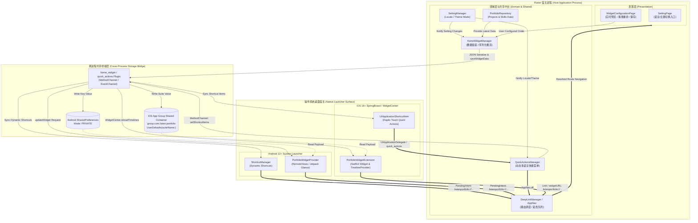
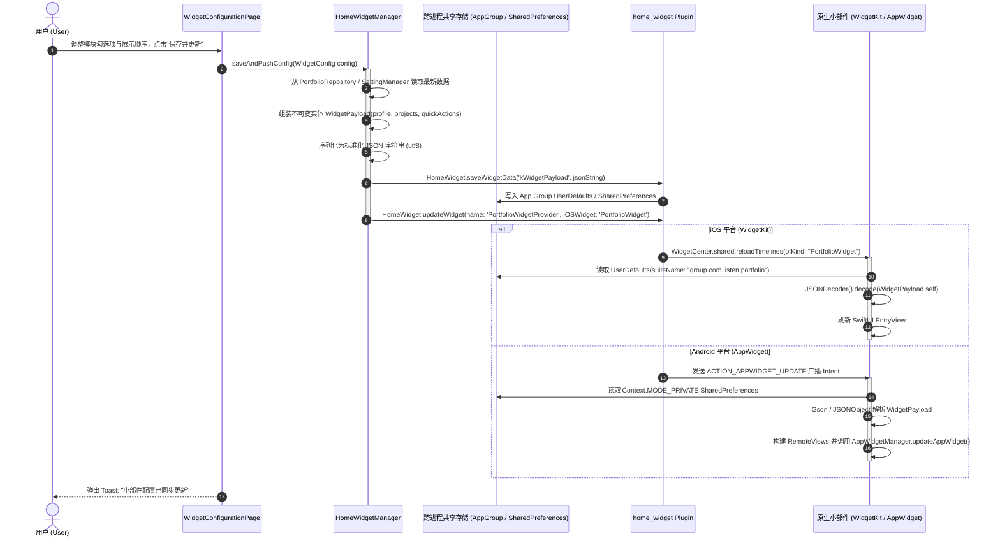
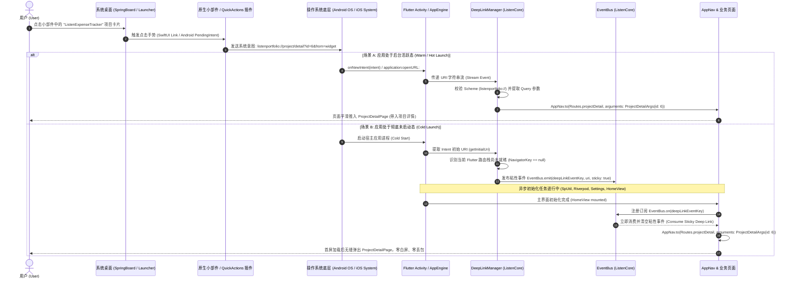

# 移动端桌面小部件与快捷方式全景架构设计 (Mobile Home Screen Widgets & Launcher Quick Actions Architecture Specification)

## 1. 业务背景与架构哲学 (Business Background & Architecture Philosophy)

在移动操作系统（Android / iOS）的交互生态中，用户与应用的接触面已远不止于“点击桌面图标冷启动打开应用”。现代操作系统的系统桌面（Launcher / SpringBoard）提供了两大关键的外部交互入口：

```
                              ┌─────────────────────────────────────────────────────────┐
                              │            移动操作系统桌面生态 (Mobile Home Screen)     │
                              └───────────────────────────┬─────────────────────────────┘
                                                          │
                        ┌─────────────────────────────────┴─────────────────────────────────┐
                        ▼                                                                   ▼
       ┌──────────────────────────────────┐                               ┌──────────────────────────────────┐
       │             Tier 1               │                               │             Tier 2               │
       │    长按桌面快捷菜单 (Quick Actions)│                               │      独立桌面小部件 (App Widgets)  │
       ├──────────────────────────────────┤                               ├──────────────────────────────────┤
       │ • 承载媒介: 桌面图标长按气泡弹窗   │                               │ • 承载媒介: 桌面任意排版网格部件   │
       │ • 技术底层: ShortcutManager /    │                               │ • 技术底层: AppWidgetProvider /  │
       │   UIApplicationShortcutItem      │                               │   WidgetKit (SwiftUI)            │
       │ • 交互模式: 即点即跳，秒级功能直达 │                               │ • 交互模式: 免打开即时速览，按需深链│
       │ • 当前状态: ✅ 已全量落地投产     │                               │ • 当前状态: 📋 架构就绪 / 规划中   │
       │   ([QuickActionsManager]         │                               │   (详见 [Opt-44](todo.md))        │
       │   (lib/shared/utils/             │                               │                                  │
       │   quick_actions_manager.dart))   │                               │                                  │
       └──────────────────────────────────┘                               └──────────────────────────────────┘
```

### 1.1 双层桌面生态体系 (Dual-Tier Launcher Surface Ecosystem)

1. **Tier 1: 桌面长按快捷菜单 (Launcher Quick Actions / App Shortcuts)**
   - **定位**：高频核心功能的高速路入口。当用户长按桌面应用图标时，系统弹出快捷菜单气泡。
   - **现有实现**：在 `ListenPortfolioFlutter` 中已通过 [QuickActionsManager](../lib/shared/utils/quick_actions_manager.dart) 落地投产。支持“设置 (Settings)”直达以及“联系作者 (Contact Me)”一键唤起系统邮件客户端。
   - **动态响应能力**：订阅全局状态机 `settingManager.addListener(updateShortcuts)`，在用户切换中/英/日多语言时，快捷菜单无缝热重构并下发给操作系统，无需重启 App。

2. **Tier 2: 独立桌面小部件 (Home Screen AppWidgets & WidgetKit)**
   - **定位**：个人作品集与技能资产的“常驻微表面 (Glanceable Surface)”。用户无需打开应用，在手机主屏幕上即可即时查看作者头像、核心技术栈、最新独立产品进展（如 `ListenExpenseTracker`）及一键快捷打赏通道。
   - **实现架构**：基于 `home_widget` 跨进程存储管道桥接 Flutter 宿主与 Android / iOS 双端原生声明式渲染引擎（Android Jetpack Glance / `RemoteViews` + iOS WidgetKit SwiftUI）。

### 1.2 核心设计哲学 (Core Design Principles)

- **微表面轻量化原则 (Micro-Surface Minimal Overhead)**：
  桌面小部件与快捷方式必须遵循操作系统的沙箱与内存限制（iOS WidgetExtension 严格限制物理内存 $< 30\text{ MB}$，超出即被系统 Watchdog 强杀；Android `RemoteViews` 跨进程 Binder 传输载荷限制 $< 1\text{ MB}$）。因此，桌面组件**严禁内嵌或唤起重量级的 Flutter 引擎实例**，必须采用双端原生声明式轻量组件渲染，数据由 Flutter 端预处理后单向推送到共享沙箱。
- **零轮询与事件驱动原则 (Zero-Polling & Event-Driven Invalidation)**：
  坚决摒弃传统 Android 桌面微件每 30 分钟后台定时轮询（`updatePeriodMillis="1800000"`）的电量黑洞反模式。将周期刷新强制设为 `0`，小部件在本地渲染纯静态 Timeline 快照；只有当用户在 Flutter 宿主内发生核心数据变更（如编辑个人履历、调整展示排序、切换深浅主题或语言）时，由 Flutter 主动触发定向事件失效（`HomeWidget.updateWidget`），达成 **0 额外后台电量损耗**。
- **跨进程沙箱隔离与数据防腐 (Sandboxed Cross-Process Security)**：
  iOS 宿主 App 与 WidgetExtension 处于完全隔离的沙箱目录（无法直接共享 `Documents/` 或标准 `UserDefaults.standard`）。架构基于 App Group Entitlements (`group.com.listen.portfolio`) 建立安全的跨进程文件与偏好共享管道；Android 侧则基于私有 `SharedPreferences`。所有数据载荷统一抽象为带有 Schema 版本控制的不可变 JSON 实体，严格校验防止脏数据导致原生崩溃。
- **原生自适应与主题无感漫游 (Native Theme Adaptation & Zero-Latency Sync)**：
  桌面组件完全融入系统级原生设计规范。iOS 侧小部件通过 SwiftUI `@Environment(\.colorScheme)` 监听系统级暗黑/浅色模式切换，Android 侧通过 Resource Configuration Qualifier (`values-night`) 实现资源分流，做到在 Flutter 进程完全休眠的情况下，小部件视觉自适应依然毫秒级响应。
- **冷热启动防竞态深链接穿透 (Race-Condition-Free Deep Link Relay)**：
  从小部件或快捷菜单点击触发的系统意图（Android `PendingIntent` / iOS `widgetURL`）到达 Flutter 端时，必须平滑接入既有的强类型路由治理中台（[DeepLinkManager](deep_link_routing_design.md) 与 [AppNav](../../ListenCore/lib/route/app_nav.dart)）。通过粘性事件队列（Sticky Event Queue）化解冷启动阶段由于引擎与路由栈尚未挂载导致的时钟竞争问题。

---

## 2. 系统全景架构与数据拓扑 (Architecture Topology & Data Pipeline)

下图展示了整个桌面生态从 Flutter 业务层、跨进程共享中介层到操作系统桌面宿主层的完整数据拓扑：



### 2.1 进程与特权边界分析 (Process & Privilege Boundaries)

| 维度 | Flutter 宿主进程 | Android AppWidget 宿主进程 | iOS WidgetExtension 扩展进程 |
| :--- | :--- | :--- | :--- |
| **执行上下文** | 主应用进程 (`com.listen.portfolio`) | 操作系统桌面应用进程 (`com.android.launcher3` 等) | 独立系统进程 (`com.listen.portfolio.WidgetExtension`) |
| **渲染技术** | Flutter Engine (Skia / Impeller 渲染树) | 原生 `RemoteViews` 跨进程 Binder 描述符 / Glance | 原生 SwiftUI 声明式视图树 |
| **内存配额** | 正常应用内存空间 ($100\text{ MB} \sim 512\text{ MB}$) | 遵循 Binder 传输大小限制 ($< 1\text{ MB}$) | 严格受限：$< 30\text{ MB}$（超限立即 SIGKILL） |
| **存储访问权限** | 应用标准私有沙箱 (`/data/user/0/...` 或 App Sandbox) | 通过 IPC 获取 RemoteViews，无直接文件沙箱访问 | 仅允许访问指定的 **App Group 共享容器** |
| **网络请求权限** | 完整网络权限（支持长连接、WebSocket、HTTP/2） | 严禁耗时网络 I/O，依赖后台拉取完毕的本地缓存 | 虽具备网络权限但执行时限 $< 5\text{s}$，建议离线首发 |
| **生命周期** | Activity / FlutterViewController 活跃周期 | 广播接收器 `AppWidgetProvider.onUpdate` 瞬时执行 | `TimelineProvider` 计算时钟周期，完成后挂起 |

---

## 3. 双向交互时序图解 (Sequence Diagrams)

### 3.1 数据写入与定向推送时序 (Data Serialization & Invalidation Pipeline)

当用户在 App 内更新个人资料、调整项目收藏状态、切换系统语言或在“桌面小部件配置页”中保存自定义排版时，触发以下事件驱动推流时序：



### 3.2 桌面小部件/快捷菜单点击直达深链接时序 (Deep Link Relay Pipeline)

桌面小部件或快捷菜单支持多区域独立靶点点击。用户点击某个项目卡片或快捷入口时，原生系统负责分发意图，Flutter 宿主负责安全消费：



---

## 4. 三大桌面微件族与配置交互设计 (Widget Family & Configuration UX)

为了兼顾 Android（网格尺寸灵活）与 iOS（严格遵循小/中/大规格）的双端设计哲学，方案定义了 **3 大微件族**：

```
+-----------------------------------------------------------------------------------------------+
|                                  三大桌面微件族规格一览                                         |
+--------------------------+----------------------------+---------------------------------------+
| 微件名称                  | 支持物理尺寸 (Android/iOS)   | 核心承载数据与交互动作                |
+--------------------------+----------------------------+---------------------------------------+
| 1. 个人简介卡             | Android: 1x1, 2x2          | • 开发者高清微型头像与在线状态徽标      |
|    (Profile Card)        | iOS: systemSmall           | • 核心定位 ("Senior Full-Stack Lead") |
|                          |                            | • 点击靶点直达 `/about` 或 `/profile` |
+--------------------------+----------------------------+---------------------------------------+
| 2. 精选项目列表卡         | Android: 4x2               | • 3 条核心商业开源项目摘要与技术标签   |
|    (Project List Preview)| iOS: systemMedium, Large   | • 独立条目点击直达 `/project/:id`     |
+--------------------------+----------------------------+---------------------------------------+
| 3. 快速入口面板           | Android: 2x2, 4x1          | • 4 个高频快捷按钮 (作品集/技能/联系/设置)|
|    (Quick Launch Bar)    | iOS: systemMedium          | • 点击分别唤起对应 Tab 或系统邮件客户端 |
+--------------------------+----------------------------+---------------------------------------+
```

### 4.1 个人简介卡 (Profile Card)
- **视觉排版**：圆形头像挂载于左侧/顶部，右侧为开发者多语言姓名与职能宣言（中：*全栈跨平台资深架构师* / 英：*Senior Full-Stack & Flutter Lead* / 日：*シニアフルスタック・Flutterリード*），右下角带有实时微型的 GitHub / 状态指示微胶囊。
- **目标路由**：点击整个卡片区域穿透触发 `listenportfolio://profile`，由 `AppNav` 调度至个人经历长文介绍页。

### 4.2 精选项目列表卡 (Project List Preview)
- **视觉排版**：采用三行垂直紧凑列表（Compact Rows），每行左侧为项目高保真微缩图或技术栈图标，中间为项目名称与两行标签（如 `Kotlin 2.x` / `Compose` / `MVI`），右侧为箭头或状态指示。
- **多项目独立穿透路由**：每个 Item 绑定独立的子深链接：
  - 项目 1: `listenportfolio://project/detail?id=6` (`ListenExpenseTracker`)
  - 项目 2: `listenportfolio://project/detail?id=1` (`ListenPortfolioFlutter`)
  - 项目 3: `listenportfolio://project/detail?id=2` (`ListenCore`)

### 4.3 快速入口面板 (Quick Launch Bar)
- **视觉排版**：四宫格或单行水平排列的 4 个半透明磨砂质感圆形图标卡片（Blur Container）：
  1. 📂 **作品集** (`/projects`)：直达项目列表 Tab；
  2. 📊 **技能雷达** (`/skills`)：直达 6 维技术能力多边形页面；
  3. ✉️ **联系作者** (`mailto:listen2code@gmail.com`)：直接呼出系统底层邮件编辑框；
  4. ⚙️ **应用设置** (`/settings`)：进入语言、主题、缓存管理页面。

### 4.4 App 内可视化配置页设计 (`WidgetConfigurationPage`)

用户在应用内依次点击 `设置 (Settings) -> 桌面小部件配置 (Widget Configuration)` 进入管理页：

```
+-------------------------------------------------------------+
|  <-  桌面小部件配置 (Widget Configuration)           [保存并同步] |
+-------------------------------------------------------------+
|  [ 📱 桌面小部件实时预览 (Live Interactive Preview) ]         |
|  +-------------------------------------------------------+  |
|  |  [ 浅色模式预览 ]  |  [ 暗黑模式预览 (选中) ]           |  |
|  +-------------------------------------------------------+  |
|  |  +-------------------------------------------------+  |  |
|  |  | 👨‍💻 Listen | Senior Flutter & Full-Stack Lead     |  |  |
|  |  | 🚀 ListenExpenseTracker (Compose + Room MVI)   |  |  |
|  |  | 🚀 ListenCore (Clean Architecture Foundation)    |  |  |
|  |  | [作品集]  [技能雷达]  [联系作者]  [应用设置]       |  |  |
|  |  +-------------------------------------------------+  |  |
|  +-------------------------------------------------------+  |
|                                                             |
|  ⚙️ 模块排序与显示开关 (Drag to Reorder & Toggle)            |
|  ---------------------------------------------------------  |
|  [:::] [x] 1. 个人资料摘要卡 (Profile Card)                  |
|  [:::] [x] 2. 精选项目推荐 (Featured Projects)               |
|  [:::] [x] 3. 快捷直达入口 (Quick Launch Bar)                |
|  ---------------------------------------------------------  |
|                                                             |
|  💡 提示：点击右上角“保存并同步”后，桌面小部件将在 1 秒内无感刷新。|
+-------------------------------------------------------------+
```

- **实时渲染预览引擎**：利用 Flutter 原生 Widget 树按照原生小部件的尺寸比例（`AspectRatio: 16 / 9` 或 `1 / 1`）高保真重绘预览，支持点击顶部 SegmentedButton 在“浅色模式”与“暗黑模式”之间切换，实时查看颜色对比度与排版效果。
- **拖拽重排交互**：基于 `ReorderableListView` 实现流畅的上下拖拽交互，用户可自由选择将“快捷入口”置顶或隐藏“精选项目”。

---

## 5. 跨进程通信契约与 JSON Payload 规范 (Data Contracts & Schemas)

为了确保跨平台、跨语言、跨进程反序列化的绝对安全与向前兼容性，Flutter 端写入的数据遵循严格的 Schema 定义。

### 5.1 JSON 载荷完整规范 (JSON Payload Schema)

```json
{
  "schemaVersion": 1,
  "updatedAt": 1726123456789,
  "locale": "zh",
  "themeMode": "dark",
  "profile": {
    "name": "Listen",
    "title": "全栈跨平台资深架构师",
    "avatarLocalPath": "/data/user/0/.../cache/widget_avatar.png",
    "onlineStatus": "available",
    "targetRoute": "listenportfolio://about"
  },
  "projects": [
    {
      "id": 6,
      "title": "ListenExpenseTracker",
      "subtitle": "Kotlin 2.x + Compose + Room MVI 离线优先记账应用",
      "category": "Android Native",
      "targetRoute": "listenportfolio://project/detail?id=6"
    },
    {
      "id": 1,
      "title": "ListenPortfolioFlutter",
      "subtitle": "工业级 Clean Architecture + MVI 响应式个人作品集",
      "category": "Flutter Multi-Platform",
      "targetRoute": "listenportfolio://project/detail?id=1"
    }
  ],
  "quickActions": [
    { "id": "projects", "label": "作品集", "iconName": "ic_projects", "targetRoute": "listenportfolio://projects" },
    { "id": "skills", "label": "技能雷达", "iconName": "ic_skills", "targetRoute": "listenportfolio://skills" },
    { "id": "contact", "label": "联系我", "iconName": "ic_contact", "targetRoute": "mailto:listen2code@gmail.com" },
    { "id": "settings", "label": "设置", "iconName": "ic_setting", "targetRoute": "listenportfolio://settings" }
  ]
}
```

### 5.2 跨语言强类型模型对齐 (Dart / Swift / Kotlin)

#### Dart 领域模型 (Flutter 端)

```dart
class WidgetPayload {
  final int schemaVersion;
  final int updatedAt;
  final String locale;
  final String themeMode;
  final ProfileWidgetData profile;
  final List<ProjectWidgetData> projects;
  final List<QuickActionWidgetData> quickActions;

  const WidgetPayload({
    required this.schemaVersion,
    required this.updatedAt,
    required this.locale,
    required this.themeMode,
    required this.profile,
    required this.projects,
    required this.quickActions,
  });

  Map<String, dynamic> toJson() => {
    'schemaVersion': schemaVersion,
    'updatedAt': updatedAt,
    'locale': locale,
    'themeMode': themeMode,
    'profile': profile.toJson(),
    'projects': projects.map((e) => e.toJson()).toList(),
    'quickActions': quickActions.map((e) => e.toJson()).toList(),
  };

  factory WidgetPayload.fromJson(Map<String, dynamic> json) {
    return WidgetPayload(
      schemaVersion: json['schemaVersion'] as int? ?? 1,
      updatedAt: json['updatedAt'] as int? ?? 0,
      locale: json['locale'] as String? ?? 'en',
      themeMode: json['themeMode'] as String? ?? 'system',
      profile: ProfileWidgetData.fromJson(json['profile'] as Map<String, dynamic>? ?? {}),
      projects: (json['projects'] as List<dynamic>? ?? [])
          .map((e) => ProjectWidgetData.fromJson(e as Map<String, dynamic>))
          .toList(),
      quickActions: (json['quickActions'] as List<dynamic>? ?? [])
          .map((e) => QuickActionWidgetData.fromJson(e as Map<String, dynamic>))
          .toList(),
    );
  }
}
```

#### Swift `Codable` 模型 (iOS WidgetExtension 端)

```swift
import Foundation

struct WidgetPayload: Codable {
    let schemaVersion: Int
    let updatedAt: Int64
    let locale: String
    let themeMode: String
    let profile: ProfileWidgetData
    let projects: [ProjectWidgetData]
    let quickActions: [QuickActionWidgetData]
    
    static let fallback = WidgetPayload(
        schemaVersion: 1,
        updatedAt: 0,
        locale: "en",
        themeMode: "system",
        profile: .fallback,
        projects: [],
        quickActions: []
    )
}

struct ProfileWidgetData: Codable {
    let name: String
    let title: String
    let avatarLocalPath: String?
    let targetRoute: String
    
    static let fallback = ProfileWidgetData(
        name: "Listen",
        title: "Full-Stack Software Lead",
        avatarLocalPath: nil,
        targetRoute: "listenportfolio://about"
    )
}
```

#### Kotlin `data class` 模型 (Android 端)

```kotlin
package com.listen.portfolio.widget

import com.google.gson.annotations.SerializedName

data class WidgetPayload(
    @SerializedName("schemaVersion") val schemaVersion: Int = 1,
    @SerializedName("updatedAt") val updatedAt: Long = 0L,
    @SerializedName("locale") val locale: String = "en",
    @SerializedName("themeMode") val themeMode: String = "system",
    @SerializedName("profile") val profile: ProfileWidgetData = ProfileWidgetData(),
    @SerializedName("projects") val projects: List<ProjectWidgetData> = emptyList(),
    @SerializedName("quickActions") val quickActions: List<QuickActionWidgetData> = emptyList()
)
```

---

## 6. 核心技术难点与硬核实现细节 (Technical Difficulties & Deep Implementations)

### 难点 1：跨进程数据管道与 iOS App Group 沙箱隔离 (Cross-Process Pipeline & App Group Isolation)

- **物理痛点**：
  在 iOS 平台上，主应用沙箱目录与 WidgetExtension 扩展沙箱目录彼此独立且受系统内核级别隔离。主应用写入 `NSHomeDirectory()/Documents` 的文件或通过默认 `UserDefaults.standard` 持久化的数据，在 WidgetExtension 进程中读取全部返回 `nil`。
- **硬核攻坚方案**：
  1. **App Group 授权配置**：在 Apple Developer Portal 与 Xcode 中为宿主 App (`com.listen.portfolio`) 和扩展 (`com.listen.portfolio.WidgetExtension`) 同时勾选 `App Groups` 特性，并配置统一共享标识符 `group.com.listen.portfolio`。
  2. **共享偏好读写**：Flutter 端通过 `home_widget` 底层调用 `UserDefaults(suiteName: "group.com.listen.portfolio")` 进行键值存取；
  3. **大图物理落盘共享**：小部件中展示的个人头像图片**严禁**直接将 Base64 字符串塞入 `UserDefaults`（会导致内存与 IO 暴增）。Flutter 端使用 `path_provider` 获取 App Group 共享目录路径（`getContainerDirectory`），将头像解码保存为 `shared_avatar.png`，在 JSON Payload 中仅传递该文件在共享容器中的相对文件名。Swift 端通过 `FileManager.default.containerURL(forSecurityApplicationGroupIdentifier:)` 构建绝对路径读取图片，做到零内存冗余。

### 难点 2：响应式多语言热重构与系统级外观自适应 (Reactive Dynamic Localization & Theme Sync)

- **物理痛点**：
  桌面小部件与快捷菜单由操作系统 Launcher 显示。若用户在 App 内将语言由“简体中文”切换至“日本語”，应用外部的快捷菜单项如何保证实时变更？当手机由白天切换至深夜模式时，处于休眠状态的 App 如何让小部件背景自动切换为纯黑深色？
- **硬核攻坚方案**：
  1. **快捷菜单的响应式监听**：
     在 [QuickActionsManager](../lib/shared/utils/quick_actions_manager.dart) 中，初始化阶段执行 `settingManager.addListener(updateShortcuts)`。一旦 SettingManager 状态机发布 Locale 变更事件，回调立即获取最新的 `I18nKeys.settings.tr` 与 `I18nKeys.contactMe.tr`，调用 `_quickActions.setShortcutItems(...)` 重新向系统平台通道注册，毫秒级完成桌面快捷菜单文案热更新。
  2. **SwiftUI 声明式环境属性**：
     在 iOS 小部件的 SwiftUI 视图层，引入 `@Environment(\.colorScheme) var colorScheme`。小部件的容器背景颜色绑定至动态语义色：
     ```swift
     struct WidgetEntryView: View {
         @Environment(\.colorScheme) var colorScheme
         let entry: SimpleEntry

         var body: some View {
             ZStack {
                 // Dynamic background matching system dark/light mode
                 colorScheme == .dark ? Color(red: 0.1, green: 0.1, blue: 0.12) : Color.white
                 // ... Widget content ...
             }
         }
     }
     ```
     这样即使 Flutter 宿主进程被系统回收休眠，当 iOS 系统在黄昏触发系统全局暗黑模式时，小部件依然能够由 iOS 渲染内核在下一帧自动完成主题切换。

### 难点 3：原生意图穿透与冷热启动防竞态深链接派发 (Native Intent Relay & Race Condition Buffer)

- **物理痛点**：
  用户在桌面上点击小部件项目跳转。如果此时 App 处于未启动状态（Cold Launch），操作系统直接创建新进程并拉起 `MainActivity`。在 Flutter 引擎装载、`runApp()` 执行、依赖注入完成及首屏 NavigatorKey 初始化之前，原生深链接若过早分发，将导致 `NullPointerException` 或路由丢弃。
- **硬核攻坚方案**：
  1. **原生 PendingIntent 规范装配**：
     在 Android 侧，针对每个小部件按钮装配带特定 Flag 的 Intent：
     ```kotlin
     val intent = Intent(context, MainActivity::class.java).apply {
         action = Intent.ACTION_VIEW
         data = Uri.parse("listenportfolio://project/detail?id=6&from=widget")
         flags = Intent.FLAG_ACTIVITY_NEW_TASK or Intent.FLAG_ACTIVITY_CLEAR_TOP
     }
     val pendingIntent = PendingIntent.getActivity(
         context, requestCode, intent,
         PendingIntent.FLAG_UPDATE_CURRENT or PendingIntent.FLAG_IMMUTABLE
     )
     views.setOnClickPendingIntent(R.id.item_container, pendingIntent)
     ```
  2. **粘性事件队列时钟对齐**：
     在 Flutter 宿主启动流程 [AppInitializer](../lib/shared/utils/app_initializer.dart) 中，先等待 `SpUtil.init()`、`settingManager.loadSettings()` 完成后才挂载路由中台。冷启动阶段若捕获到 `initialUri`，将其封包为 `deepLinkEventKey` 并配置 **`sticky: true, autoClear: true`** 存入 `EventBus`。待首屏页面完成渲染挂载（`onNavReady`）后，自动消费该粘性事件，精准调用 `AppNav.to(...)`。

### 难点 4：零轮询节能调度与事件驱动失效机制 (Zero-Polling & Event-Driven Invalidation)

- **物理痛点**：
  Google Play 与 iOS App Store 对后台唤醒和电池功耗审查极其严格。传统 Android 小部件在 XML 中配置 `updatePeriodMillis="1800000"`，会导致系统 AlarmManager 每 30 分钟强行唤醒一次设备 CPU，产生不必要的无线电耗电并增加被系统杀掉的概率。
- **硬核攻坚方案**：
  1. **彻底关闭系统定时唤醒**：
     在 Android `portfolio_widget_info.xml` 中将 `android:updatePeriodMillis` 明确设为 **`0`**：
     ```xml
     <appwidget-provider xmlns:android="http://schemas.android.com/apk/res/android"
         android:minWidth="250dp"
         android:minHeight="110dp"
         android:updatePeriodMillis="0"
         android:initialLayout="@layout/widget_profile_card"
         android:widgetCategory="home_screen" />
     ```
  2. **iOS Timeline 静态保鲜**：
     在 WidgetKit 的 `TimelineProvider` 中，设置刷新策略为 `.never`：
     ```swift
     func getTimeline(in context: Context, completion: @escaping (Timeline<SimpleEntry>) -> ()) {
         let entry = SimpleEntry(date: Date(), payload: loadPayloadFromAppGroup())
         // Policy .never instructs iOS not to schedule periodic wakeups
         let timeline = Timeline(entries: [entry], policy: .never)
         completion(timeline)
     }
     ```
  3. **Flutter 状态突变时的事件驱动推流**：
     小部件刷新的唯一动力源是 **用户在宿主应用内产生的主动交互**。每当用户保存资料、打赏项目、修改语言或编辑小部件排版时，Flutter 端统一调用 `HomeWidget.updateWidget()`。这种设计使得整套小部件体系在桌面静止状态下的 **CPU 占用率和耗电量完全为 0**。

---

## 7. 反模式与高危陷阱避坑指南 (Anti-Patterns & Pitfalls)

```
                       ┌──────────────────────────────────────────────────┐
                       │       桌面小部件与快捷方式四大高危反模式规避指南     │
                       └────────────────────────┬─────────────────────────┘
                                                │
         ┌──────────────────┬───────────────────┴───────────────────┬──────────────────┐
         ▼                  ▼                                       ▼                  ▼
┌──────────────────┐ ┌──────────────────┐                    ┌──────────────────┐ ┌──────────────────┐
│   Anti-Pattern 1 │ │   Anti-Pattern 2 │                    │   Anti-Pattern 3 │ │   Anti-Pattern 4 │
│ 小部件内发起网络IO│ │ 高频后台轮询保活   │                    │ 跨进程大图内存溢出│ │ 深链接参数无校验 │
├──────────────────┤ ├──────────────────┤                    ├──────────────────┤ ├──────────────────┤
│ ❌ 弱网导致小部件 │ │ ❌ 30分钟Alarm唤醒 │                    │ ❌ Base64超Binder │ │ ❌ 越权路由与类型│
│    卡死并被强杀   │ │    耗电遭审计下架 │                    │    物理超限抛异常 │ │    转换错误致崩溃 │
│ ✅ 离线本地数据推│ │ ✅ updatePeriod=0 │                    │ ✅ 共享磁盘相对路径│ │ ✅ 白名单反序列化│
│    流，宿主代更新 │ │    事件驱动单向推流│                    │    零内存跨进程共享│ │    强类型参数转换 │
└──────────────────┘ └──────────────────┘                    └──────────────────┘ └──────────────────┘
```

### 反模式 1：在桌面小部件原生进程内直接发起重网络 I/O (In-Widget Heavy Network I/O)
- **现象与恶果**：
  在 Android `AppWidgetProvider.onUpdate()` 或 iOS `TimelineProvider.getTimeline()` 中直接使用 OkHttp / URLSession 发起网络 HTTP 请求拉取最新作品集。若处于弱网或断网环境，请求超时超过 5 秒，iOS 系统 Watchdog 会直接判断扩展进程卡死并抛出 `Crash EXC_RESOURCE_WAKEUPS` 强行终止扩展，导致桌面微件大面积变黑或显示“无法加载”。
- **合规正解**：
  严格遵循 **“离线优先与数据推流 (Offline-First Push Pipeline)”** 架构。小部件进程只读本地共享存储中的静态 JSON 缓存。所有网络同步、接口重试均由 Flutter 宿主网络层执行完毕后，再将结构化结果写入 App Group 并触发小部件重绘。

### 反模式 2：依赖短周期后台轮询保持数据“即时” (Aggressive Periodic Polling)
- **现象与恶果**：
  配置 `updatePeriodMillis="900000"` (15分钟) 或在 iOS 端配置 `Timeline(policy: .after(Date().addingTimeInterval(300)))`。频繁的唤醒不仅会触发 Android 12+ 的后台广播限制与电量优化限制（Doze Mode），还会导致应用在 Google Play Console 的“过度被动唤醒”指标超标，影响应用商店曝光权重。
- **合规正解**：
  静态内容微件无需短周期轮询。将周期刷新完全设为 `0` / `.never`，仅在特定宿主业务生命周期触发事件定向失效。

### 反模式 3：跨进程传输超大位图导致 Binder 事务溢出 (TransactionTooLargeException)
- **现象与恶果**：
  在 Android 平台，Flutter 端将 Base64 图片塞入 JSON 或通过 Intent Extra 传递给 `RemoteViews`，当位图尺寸超过 $1\text{ MB}$ 时，Android 底层 Binder 缓冲区直接爆满，抛出臭名昭著的 `android.os.TransactionTooLargeException`，导致整个应用崩溃。
- **合规正解**：
  位图数据严禁走 IPC 通信管道。所有图片必须统一保存至文件系统磁盘（App Group 共享目录或外部私有缓存），进程间只传递本地文件路径（URI）。原生层使用带采样率控制的解码器按需下采样后加载至 `ImageView`。

### 反模式 4：深链接参数未经验证直接透传导致路由穿透与崩溃 (Unsanitized Deep Link Injection)
- **现象与恶果**：
  原生层传递的 URI 参数直接以纯字符串拼接入跳转路由，当参数包含特殊转义字符或恶意格式时，直接诱发 `type 'String' is not a subtype of type 'int'` 导致页面构建红屏崩溃；或被外部恶意程序构造恶意 Scheme 越权访问私密管理页面。
- **合规正解**：
  所有深链接一律经由 [DeepLinkManager](deep_link_routing_design.md) 与路由转换器委托（`Converter Delegate`）机制进行校验。严格限制目标路由在全局路由表 `Routes.routes` 白名单内，且所有 Query 参数均通过 `fromMap()` 强类型反序列化与安全默认值兜底。

---

## 8. Clean 架构集成与工程目录规范 (Clean Architecture Integration & Project Layout)

整个桌面生态体系在现有工程中严格遵循 **Clean Architecture** 分层规范与单向依赖治理规则（零架构规则违规）：

```
ListenPortfolioFlutter/
├── lib/
│   ├── features/
│   │   ├── setting/
│   │   │   └── presentation/
│   │   │       └── setting_page.dart                     # 设置页：挂载桌面小部件配置入口 ListTile
│   │   └── widget/                                       # [NEW/PLANNED] 桌面小部件特性模块 (Opt-44)
│   │       ├── data/
│   │       │   ├── models/
│   │       │   │   └── widget_payload_model.dart         # WidgetPayload 强类型序列化模型
│   │       │   └── repositories/
│   │       │       └── widget_repository_impl.dart       # 跨进程存储落地实现 (home_widget 封装)
│   │       ├── domain/
│   │       │   └── repositories/
│   │       │       └── widget_repository.dart            # 抽象业务契约接口
│   │       └── presentation/
│   │           ├── pages/
│   │           │   └── widget_configuration_page.dart    # 小部件管理排版与实时双主题预览页
│   │           └── view_models/
│   │               └── widget_configuration_view_model.dart # MVI 状态机与推流调度
│   └── shared/
│       ├── manager/
│       │   └── setting_manager.dart                      # 全局语言/主题管理器 (提供变更广播)
│       ├── router/
│       │   └── app_nav.dart                              # 统一路由跳转与路由去重中台
│       └── utils/
│           ├── app_initializer.dart                     # 启动编排：!kIsWeb 守卫下的桌面生态初始化
│           ├── deep_link_manager.dart                    # 粘性深链接意图分发中台
│           └── quick_actions_manager.dart                # [PROD] 桌面长按快捷菜单全局中台
├── test/
│   └── shared/
│       └── utils/
│           └── quick_actions_manager_test.dart           # 快捷菜单动态本地化与平台通道单元测试套件
└── docs/
    ├── deep_link_routing_design.md                       # 强类型路由与 Deep Link 架构设计底座
    ├── launcher_widgets.md                               # 本设计规范文档
    └── todo.md                                           # 演进规划池 (记录 Opt-44 与 Opt-45)
```

---

## 9. 质量保障与测试验收矩阵 (Testing & Quality Assurance Matrix)

为了保证桌面生态跨 Android / iOS 双端的绝对可靠性，我们建立了涵盖单元测试、方法通道模拟、跨进程一致性验证与真机功耗审计的完整质量保障矩阵：

| 测试层级 | 测试范围 | 验证方法与断言标准 | 执行命令 / 自动化工具 |
| :--- | :--- | :--- | :--- |
| **单元测试 (Unit Tests)** | `QuickActionsManager` 注册与动态本地化 | 验证 `init()` 正确向 `plugins.flutter.io/quick_actions` 发送 `setShortcutItems`；验证 `settingManager.setLanguage()` 能够即时触发新的多语言标题推流（2/2 测试全绿通过）。 | `flutter test test/shared/utils/quick_actions_manager_test.dart` |
| **单元测试 (Unit Tests)** | `WidgetPayload` JSON 编解码互逆性 | 验证 `toJson()` 与 `fromJson()` 字段无缝对齐，支持容错默认值（`schemaVersion` 缺失自动回退为 1）。 | `flutter test test/features/widget/widget_payload_test.dart` |
| **集成测试 (Integration)** | 桌面深链接意图冷启动/热启动分发 | 模拟外部 URI `listenportfolio://project/detail?id=6` 注入，验证 `DeepLinkManager` 粘性事件平滑分发至目标页面。 | `flutter test test/features/home/home_view_model_deferred_deeplink_test.dart` |
| **架构合规审计** | 架构单向依赖边界检查 | 检查 `lib/` 源码各层级依赖流向，确保零循环依赖与零表现层下沉违规。 | `dart run tools/dependency_rules.dart` |
| **真机功耗审计 (APM)** | 0 轮询后台电量与唤醒审计 | 在真机上添加小部件后锁屏静置 4 小时，使用 Battery Historian / Instruments 审计，验证被动唤醒次数必须为 **0 次**。 | Google Battery Historian / Instruments Energy Log |
| **真机兼容性验证** | Android 12~14+ & iOS 16~17+ 桌面渲染 | 验证小部件在不同桌面网格下的边距自适应，点击各个靶点能否秒级唤醒应用并正确高亮对应项目详情。 | Android Studio Layout Inspector / Xcode View Hierarchy |

---

## 10. 源码与资源索引 (Source Code & Documentation References)

本规范所涉及的核心源码与技术文档均采用**严格相对路径**进行关联引用：

- **桌面快捷菜单中台源码**：[lib/shared/utils/quick_actions_manager.dart](../lib/shared/utils/quick_actions_manager.dart)
- **桌面快捷菜单自动化单测**：[test/shared/utils/quick_actions_manager_test.dart](../test/shared/utils/quick_actions_manager_test.dart)
- **应用启动初始化调度器**：[lib/shared/utils/app_initializer.dart](../lib/shared/utils/app_initializer.dart)
- **强类型路由与 Deep Link 架构设计规范**：[deep_link_routing_design.md](deep_link_routing_design.md)
- **延迟深度链接规范与实装**：[deferred_deep_link_specification.md](deferred_deep_link_specification.md)
- **工程长期演进规划与技术优化池**：[todo.md](todo.md) (参见 `Opt-44` 与 `Opt-45`)
