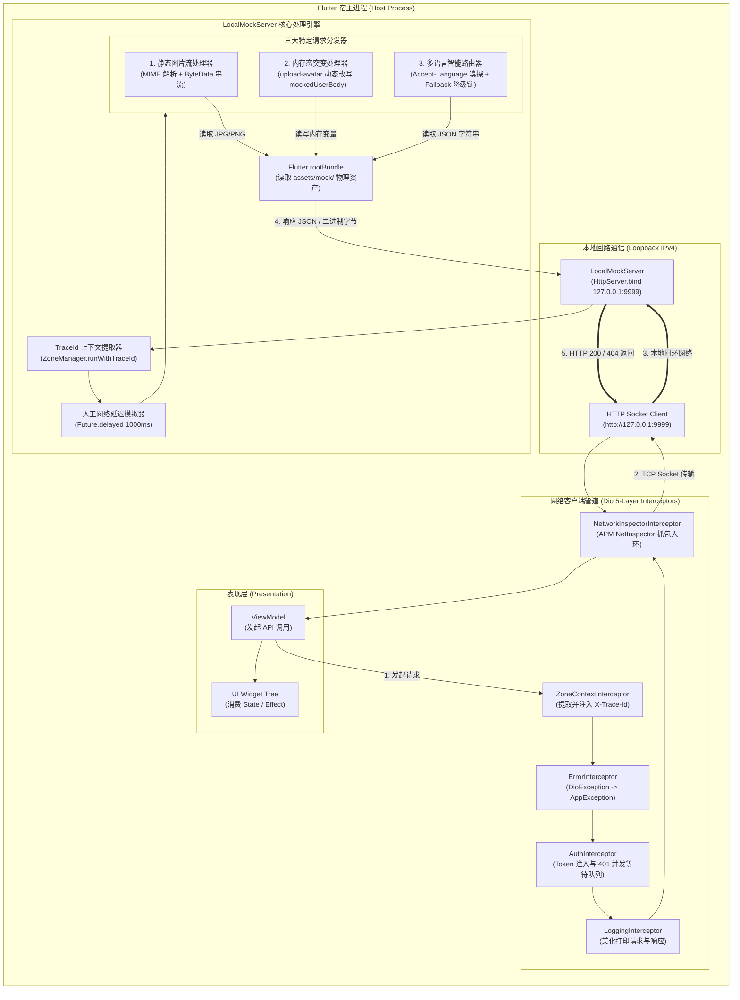

# 工业级 Mock 数据工程规范与 LocalMockServer 运行原理解析 (Enterprise Mock Data Specification & In-Process Mock Server Architecture)

## 1. 业务背景与设计哲学 (Business Background & Design Philosophy)

在移动客户端敏捷研发体系中，“前后端并行开发”与“弱网/离线环境健壮性测试”是衡量工程成熟度的两大核心指标。传统开发模式通常面临两大极端困境：
1. **内存伪造数据层 (Fake Repository / Memory Mocks)**：在 Dart 内存中直接编写 Mock Repository。这种做法**完全绕过了网络通信栈**，导致 Dio 5 重拦截链、HTTP 状态码解析、JSON 序列化/反序列化、401 Token 静默刷新队列、APM 网络抓包（Net Inspector）以及分布式 Trace ID 调用链等关键基础设施无法得到任何真实检验。
2. **外部托管 Mock 服务 (External Mock Services)**：依赖 Postman Mock、Mockoon 或云端 Mock 服务器。这种做法**引入了强网络依赖**，在弱网、断网、地铁或飞机等脱机场景下无法工作；且多位开发者并行修改接口时极易产生云端数据冲突，无法与 Git 仓库的代码分支实现原子化版本对齐。

```
                       ┌─────────────────────────────────────────────────────────┐
                       │          三大 Mock 方案对比与 LocalMockServer 优势      │
                       └───────────────────────────┬─────────────────────────────┘
                                                   │
         ┌─────────────────────────────────────────┼─────────────────────────────────────────┐
         ▼                                         ▼                                         ▼
┌─────────────────────────┐               ┌─────────────────────────┐               ┌─────────────────────────┐
│     Fake Repository     │               │   External Mock Server  │               │     LocalMockServer     │
│       (内存假仓储)       │               │       (外部云端服务)     │               │    (ListenCore 内嵌)    │
├─────────────────────────┤               ├─────────────────────────┤               ├─────────────────────────┤
│ ❌ 绕过真实网络堆栈     │               │ ❌ 强依赖外网连接       │               │ ✅ 真实 RFC HTTP 堆栈   │
│ ❌ 无法测试拦截器/APM   │               │ ❌ 无法与 Git 分支绑定  │               │ ✅ 纯本地离线 0 外部依赖│
│ ❌ 无 HTTP 状态码与超时 │               │ ❌ 团队数据易冲突覆盖   │               │ ✅ 5重拦截器与APM全覆盖 │
│ ❌ 无法演练序列化异常   │               │ ❌ 无法关联客户端TraceId│               │ ✅ TraceId 上下文染色   │
│ ❌ 多语言需 View 层判断 │               │ ❌ 部署与鉴权成本高     │               │ ✅ Accept-Language自动选│
└─────────────────────────┘               └─────────────────────────┘               └─────────────────────────┘
```

为了从根本上消除上述痛点，`ListenCore` 与 `ListenPortfolioFlutter` 共同构建了一套基于 **“进程内内嵌轻量 HTTP 服务器 (In-Process Embedded HTTP Server) + 静态资产即 API (Assets as APIs) + 动态内存态突变 (In-Memory State Mutation) + 全链路 TraceId 上下文染色 (Zone Tracing)”** 的工业级 Mock 体系。

---

## 2. 系统全景架构与请求流转时序 (System Topology & Request Lifecycle)

### 2.1 全景架构拓扑 (Architecture Topology)



### 2.2 请求处理时序图 (End-to-End Sequence Diagram)

```mermaid
sequenceDiagram
    autonumber
    actor VM as 业务 ViewModel
    participant Dio as ApiClient (Dio)
    participant Socket as 127.0.0.1:9999
    participant Server as LocalMockServer
    participant Zone as ZoneManager
    participant Bundle as rootBundle (Assets)

    VM->>Dio: GET /v1/projects (带 Accept-Language: zh-CN,zh;q=0.9)
    activate Dio
    Dio->>Dio: ZoneContextInterceptor 提取当前 Zone traceId: "trace-98765"
    Dio->>Dio: 注入 Header: X-Trace-Id = "trace-98765"
    Dio->>Socket: 发送 HTTP Socket 请求至 localhost:9999
    deactivate Dio

    activate Socket
    Socket->>Server: 触发 _server.listen((HttpRequest request) ...)
    activate Server
    Server->>Server: 提取 Header X-Trace-Id = "trace-98765"
    Server->>Zone: ZoneManager.run(..., traceId: "trace-98765")
    activate Zone
    Note over Server,Zone: 服务端日志染色：与客户端完全共享相同的 TraceId 与控制台高亮

    Server->>Server: 模拟网络延时: await Future.delayed(1000ms)
    Server->>Server: 解析 Accept-Language: 匹配到语言后缀 "zh"
    Server->>Server: 构造优先级候选路径: [assets/mock/v1/get/projects_zh.json, assets/mock/v1/get/projects.json]

    Server->>Bundle: 尝试读取 assets/mock/v1/get/projects_zh.json
    Bundle-->>Server: 成功返回 JSON 字符串
    Server->>Socket: 返回 HTTP 200 OK + Content-Type: application/json
    deactivate Zone
    deactivate Server
    deactivate Socket

    activate Dio
    Dio->>Dio: LoggingInterceptor 记录响应体
    Dio->>Dio: NetworkInspectorInterceptor 将抓包录入 RingBuffer
    Dio-->>VM: 返回 BaseResponseModel<List<Project>>(result: "0", body: [...])
    deactivate Dio
    VM->>VM: 更新 UI 状态，页面平滑呈现中文项目列表
```

---

## 3. 物理目录结构与资产映射规范 (Directory Structure & Asset Layout)

### 3.1 完整物理文件清单 (Repository File Tree)

项目根目录下的 `assets/mock/` 目录严格遵循 **RESTful 方法分层** 与 **语义化资源命名**：

```
assets/mock/
├── images/                               # 🖼️ 静态图片资产 (LocalMockServer 直接字节流代理)
│   ├── project1.jpg                      # Project 1: ListenPortfolioFlutter 封面图
│   ├── project2.jpg                      # Project 2: ListenCore 架构底座封面图
│   ├── project3.jpg                      # Project 3: ListenPortfolioBackend 微服务封面图
│   ├── project4.jpg                      # Project 4: ListenUiKit 组件库封面图
│   ├── project5.jpg                      # Project 5: AI 咨询助理封面图
│   ├── project6.jpg                      # Project 6: ListenExpenseTracker (Compose 记账应用)
│   ├── project7.jpg ~ project10.jpg      # 预留独立产品封面图
│
└── v1/                                   # 🌐 API 版本命名空间 (对齐后端 API 前缀 /v1)
    ├── delete/                           # 🗑️ DELETE 方法响应
    │   └── user/
    │       └── delete-account.json       # 注销账户接口响应
    │
    ├── get/                              # 📥 GET 方法响应 (支持多语言自动路由)
    │   ├── aboutMe.json                  # 关于我履历详情 (英文基准默认)
    │   ├── aboutMe_zh.json               # 关于我履历详情 (中文版)
    │   ├── aboutMe_ja.json               # 关于我履历详情 (日文版)
    │   ├── preset-qa.json                # AI 对话助手预设 FAQ 列表 (中文基准)
    │   ├── preset-qa_en.json             # AI 对话助手预设 FAQ 列表 (英文版)
    │   ├── preset-qa_ja.json             # AI 对话助手预设 FAQ 列表 (日文版)
    │   ├── projects.json                 # 核心项目列表 (英文基准默认，含 Project 1~6)
    │   ├── projects_zh.json              # 核心项目列表 (中文版)
    │   ├── projects_ja.json              # 核心项目列表 (日文版)
    │   └── user.json                     # 当前登录用户信息 (头像、邮箱、基础昵称)
    │
    └── post/                             # 📤 POST 方法响应 (支持业务与状态突变)
        ├── auth/                         # 鉴权与会话模块
        │   ├── forgot-password.json      # 找回密码重置邮件响应
        │   ├── login.json                # 密码登录成功响应 (下发 Token 对)
        │   ├── refresh.json              # 刷新令牌成功响应 (下发新 Token 对)
        │   └── signUp.json               # 账号注册成功响应
        └── user/                         # 用户资料模块
            ├── change-password.json      # 修改密码成功响应
            ├── logout.json               # 安全登出会话注销响应
            └── upload-avatar.json        # 头像上传动态突变响应
```

### 3.2 `pubspec.yaml` 资产注册清单

所有 Mock 数据与图片必须显式在 `pubspec.yaml` 中注册目录，否则 Flutter 的 `rootBundle` 在打包或热重载时将无法识别文件，导致 LocalMockServer 返回 404：

```yaml
flutter:
  assets:
    - assets/mock/images/
    - assets/mock/v1/delete/user/
    - assets/mock/v1/get/
    - assets/mock/v1/post/auth/
    - assets/mock/v1/post/user/
```

---

## 4. 统一数据契约规范 (Data Contracts & Envelope Schema)

所有 Mock JSON 数据必须严格对齐 `ListenCore` 的领域模型基类 `BaseResponseModel`，确保在脱机环境与真实云端 Spring Boot 生产环境之间的零代码切换。

### 4.1 标准响应信封结构 (Standard Response Envelope)

```json
{
  "result": "0",
  "messageId": "",
  "message": "success",
  "body": {
    // 具体的领域模型字段 (Map 或 List)
  }
}
```

| 字段名称 | 类型 | 约束 | 语义与作用说明 |
| :--- | :--- | :--- | :--- |
| `result` | `String` | 必填 | 业务状态码。`"0"` 严格代表业务成功；非 `"0"` 代表业务异常。 |
| `messageId` | `String` | 可选 | 国际化错误码 Key（如 `"USER_NOT_FOUND"`、`"TOKEN_EXPIRED"`）。客户端通过 `messageId.tr` 自动映射为用户界面的本地语言提示，**严禁在服务端或 Mock 中写死面向用户的多语言硬编码**。 |
| `message` | `String` | 可选 | 描述性调试文本，供开发人员在网络日志与 APM 中排查问题。 |
| `body` | `dynamic` | 可选 | 业务载荷对象（DTO）。成功时为对应的 JSON Object 或 JSON Array；失败时为包含错误明细的嵌套结构或 `null`。 |

---

## 5. 四大核心技术难点与硬核实现深度剖析 (Technical Difficulties & Deep Implementations)

### 难点 1：请求头多语言智能嗅探与无损降级链 (Accept-Language Dynamic Routing & Fallback Chain)

- **技术痛点**：
  在国际化大型应用中，若 Mock 服务器仅返回固定语言，前端工程师往往不得不在 Dart 视图层针对每个模型字段手写 `.tr` 转换（例如 `project.title.tr`），导致架构反模式——因为真实的生产后端本身就会根据客户端的 `Accept-Language` 请求头下发对应的目标语言文本，视图层应纯粹地执行“直出渲染”。
- **硬核攻坚方案**：
  在 [LocalMockServer](../../ListenCore/lib/network/local_mock_server.dart) 中实现了高效的**请求头嗅探与候选路径降级查找算法**：
  1. **解析入站标头**：提取客户端发出的 `accept-language` 头（例如 `zh-CN,zh;q=0.9,en;q=0.8`），通过逗号切割提取主语言标号，识别出 `zh` 或 `ja` 语言后缀；
  2. **生成候选路径优先栈 (Candidate Path Stack)**：
     对于请求 `GET /v1/projects`，引擎自动派生按匹配精度递减的候选清单：
     - 优先级 1: `assets/mock/v1/get/projects_zh.json` (精准匹配当前语言)
     - 优先级 2: `assets/mock/v1/get/projects.json` (无后缀的基准兜底文件)
  3. **无损顺序加载 (Sequential Probe)**：
     利用 `try ... await rootBundle.loadString(path)` 顺序探测。一旦找到首个有效文件即刻跳出循环，若全量探测均未命中才返回标准化 404 响应。这使得业务端仅需在需要多语言时增补 `_zh.json` 或 `_ja.json`，未翻译接口则全量平滑回退，**架构优雅度极高**。

### 难点 2：内存态有状态更新与 CRUD 回显闭环 (Dynamic In-Memory Mutation & Volatile CRUD Loop)

- **技术痛点**：
  纯静态 Mock 文件的一大硬伤是“无状态”。例如用户在“关于我”页面点击头像拍照上传了一张全新的自定义头像（Base64 字符串），如果 Mock 服务器仅返回写死的数据，那么用户返回页面或重新拉取个人资料时，头像依然是旧的默认图。这种割裂感会导致 UI 回显逻辑和图片缓存策略在脱机模式下无法进行真实闭环验证。
- **硬核攻坚方案**：
  在 `LocalMockServer` 中设计了**内存态突变闭环引擎 (In-Memory Volatile State Cache)**：
  1. **拦截上传突变意图**：当检测到 `POST /v1/user/upload-avatar` 时，解析客户端上报的 JSON Body 并提取其中的 `avatar` Base64 编码字符串；
  2. **动态修补基线资产**：从静态资产加载基础 `assets/mock/v1/get/user.json`，就地将 `body.avatarUrl` 动态改写为最新的 Base64 字符串；
  3. **内存热缓存挂载**：将更新后的整个用户对象保存在服务器单例的静态变量 `_mockedUserBody` 中；
  4. **GET 回显路由拦截**：后续任何组件发起 `GET /v1/user` 时，`LocalMockServer` 优先判断 `_mockedUserBody != null`，若存在则直接返回该动态内存结构。用户退出重新打开或触发刷新均能即时看到新头像，而在应用杀进程重启后自动重置为纯净基准，兼具**交互保真性**与**测试幂等性**。

### 难点 3：跨 Zone 上下文穿透与端到端 TraceId 缝合 (Cross-Zone Trace Context Synchronization)

- **技术痛点**：
  `LocalMockServer` 运行于独立的事件监听回调（`_server.listen`）中，属于完全脱离当前 UI 点击事件的另一个异步微任务上下文。如果在 Mock 服务端处理请求时直接打印普通日志，控制台与 APM `LogOverlay` 将无法把“客户端发起的请求”与“服务端处理并返回的日志”串联起来，导致在调试面板中 Trace ID 呈现断裂或变为 `[no-trace-id]`。
- **硬核攻坚方案**：
  `LocalMockServer` 与 `ListenCore` 的 [ZoneManager](../../ListenCore/lib/utils/zone_manager.dart) 实现了深度的上下文缝合：
  1. **请求头隐式传递**：客户端发起请求时，Dio 层的 `ZoneContextInterceptor` 自动从当前活跃 Zone 提取唯一的 `X-Trace-Id` 并注入 HTTP 请求头；
  2. **服务端 Zone 作用域重构**：`LocalMockServer` 收到请求的第一时间读取 `request.headers.value('X-Trace-Id')`，并调用：
     ```dart
     ZoneManager.run(
       () => _handleRequest(request),
       traceId: traceId,
       silent: true,
     );
     ```
  3. **日志全链路染色**：由于整个 `_handleRequest` 均在被显式注入了该 `traceId` 的 Zone 内执行，服务端打印的 `MockServer: >>> [GET] /v1/projects` 与 `Matched Asset: ...` 等所有日志，自动染上了与客户端完全相同的唯一 Trace ID 和颜色高亮，开发者在 APM 看板中可一键下钻查看完整的双向调用全貌。

### 难点 4：高性能二进制静态图片字节流代理与 MIME 安全自愈 (Binary Asset Streaming & MIME Resolution)

- **技术痛点**：
  作品集列表展示了多项精美商业开源项目的缩略图（如 `ListenExpenseTracker` 的记账界面）。在脱机环境下，如果图片只能依赖外网 CDN（如 Unsplash），断网时页面将充满碎图；若直接把超大图片转为 Base64 写入 JSON，会导致单次网络传输反序列化极其缓慢，甚至引发 Flutter 进程主线程卡顿。
- **硬核攻坚方案**：
  `LocalMockServer` 内置了纯原生的**静态二进制资源流式转发器**：
  1. **路径剥离与规范化**：当捕获包含 `/images/` 的请求（如 `http://localhost:9999/v1/images/project1.jpg`）时，自动通过正则表达式剥离 `/v1` 等版本前缀，映射为物理资产路径 `assets/mock/images/project1.jpg`；
  2. **扩展名与 MIME 类型安全协商**：内置 MIME 字典（支持 `.jpg`, `.jpeg`, `.png`, `.gif`, `.webp`, `.svg`），自动将 Content-Type 设置为 `image/jpeg` 或 `image/png`；
  3. **零解码直接字节流串流**：通过 `rootBundle.load(assetPath)` 提取原生的 `ByteData`，直接写入底层 HTTP Socket 的二进制管道 `request.response.add(data.buffer.asUint8List())`，无需经过任何 JSON 字符串编解码开销，图片加载速度与真实 CDN 表现无异。

---

## 6. 反模式与高危陷阱避坑指南 (Anti-Patterns & Pitfalls)

```
                       ┌──────────────────────────────────────────────────┐
                       │       Mock 数据维护四大高危反模式与规避指南         │
                       └────────────────────────┬─────────────────────────┘
                                                │
         ┌──────────────────┬───────────────────┴───────────────────┬──────────────────┐
         ▼                  ▼                                       ▼                  ▼
┌──────────────────┐ ┌──────────────────┐                    ┌──────────────────┐ ┌──────────────────┐
│   Anti-Pattern 1 │ │   Anti-Pattern 2 │                    │   Anti-Pattern 3 │ │   Anti-Pattern 4 │
│ View层硬编码多语言│ │ 遗漏 pubspec 声明│                    │ 单接口写死外网 CDN│ │ 超大未压缩位图塞入│
├──────────────────┤ ├──────────────────┤                    ├──────────────────┤ ├──────────────────┤
│ ❌ 在 Dart 代码中 │ │ ❌ 新建目录未在  │                    │ ❌ Mock 中写入外网│ │ ❌ 在 JSON 中塞入 │
│    写死 .tr 覆盖 │ │    pubspec.yaml  │                    │    图片 URL，断网 │ │    数 MB 的 Base64│
│    服务端直出内容 │ │    声明导致 404  │                    │    导致大面积碎图 │ │    导致解析掉帧卡死│
│ ✅ 依托请求头路由 │ │ ✅ 每次增补目录均│                    │ ✅ 统一走 localhost│ │ ✅ 放入 images/ 走│
│    维护 _zh / _ja│ │    执行声明与验证 │                    │    /images/ 本地流│ │    二进制流式加载  │
└──────────────────┘ └──────────────────┘                    └──────────────────┘ └──────────────────┘
```

### 反模式 1：在 Dart View 层硬编码 `.tr` 覆盖 Mock 直出数据
- **现象与恶果**：
  开发者在 `projects.json` 中定义了英文描述，却在 Widget 中写 `Text(project.desc.tr)`。这不仅违反了服务端驱动（Server-Driven Content）的架构原则，而且当真实后端下发已经翻译好的多语言内容时，前端又会由于找不到该长句子的翻译 Key 而报错或显示混乱。
- **合规正解**：
  保持服务端下发数据的纯粹性。对于需要多语言的接口，按规范建立 `projects_zh.json` 和 `projects_ja.json`，由 `LocalMockServer` 依据请求头动态下发。Dart View 层仅作为“直出渲染器”。

### 反模式 2：新建 Mock 子目录遗漏在 `pubspec.yaml` 中声明
- **现象与恶果**：
  新建了 `assets/mock/v1/put/user/` 目录并放入了 JSON 文件，但未在 `pubspec.yaml` 的 `assets:` 列表中添加对应路径。在本地测试时能够通过（如果是某些 IDE 缓存），但一旦打 Release 包或在 CI 中构建，`rootBundle.loadString` 直接抛出 `Unable to load asset`，LocalMockServer 报 404。
- **合规正解**：
  每次在 `assets/mock/` 下新增带有文件的**子目录**时，必须同步检查并更新 `pubspec.yaml`，并执行 `flutter pub get` 进行资源注册验证。

### 反模式 3：在 Mock 数据中大量使用外部不稳定图片 URL
- **现象与恶果**：
  在 `projects.json` 中配置了诸如 `https://via.placeholder.com/300` 或外部随机图床。在没有外网的闭合网络环境或弱网演练时，所有项目卡片全部变白或显示加载失败，严重影响交互演示与 E2E 自动化测试稳定性。
- **合规正解**：
  统一将图片资产保存至 `assets/mock/images/`，URL 统一配置为 `localhost/images/projectX.jpg`，交由 `LocalMockServer` 的内置字节流代理进行本地极速直出。

### 反模式 4：在静态 JSON 中内嵌超大无压缩 Base64 图片
- **现象与恶果**：
  直接在 `projects.json` 的字段里硬塞一张 5MB 的 Base64 字符串。当 `jsonDecode()` 在 Dart 主线程执行时，瞬时阻塞 Event Loop 数百毫秒，导致明显的页面启动掉帧（Jank），甚至触发内存溢出崩溃。
- **合规正解**：
  静态 JSON 仅用于传输元数据与轻量文本；位图资产一律走 `images/` 目录的二进制流。动态上传头像若需要传 Base64，需在客户端进行缩放与 WebP 压缩后再进行传输。

---

## 7. 新增接口 Mock 数据标准化实施流程 (Standard Workflow for New APIs)

当项目中新增业务接口时，严格遵循以下 **5 步标准化流水线** 落地：

```
+------------------+     +--------------------+     +---------------------+
| 1. 明确接口规范  | --> | 2. 建立目录与文件   | --> | 3. 编写标准信封 JSON |
| (Path / Method)  |     | (assets/mock/v1/..) |     | (result/message/body) |
+------------------+     +--------------------+     +---------------------+
                                                                │
                                                                ▼
+------------------+     +--------------------+     +---------------------+
| 5. 脱机运行验证  | <-- | 4. 注册 pubspec.yaml| <-- | (可选) 配齐 _zh/_ja |
| (断网环境全通)   |     | (避免 404 资源丢失) |     | (支持多语言自动路由) |
+------------------+     +--------------------+     +---------------------+
```

1. **确定契约**：明确 HTTP 方法（GET / POST / DELETE）与相对路径（如 `POST /v1/user/feedback`）；
2. **定位目录**：定位至 `assets/mock/v1/post/user/feedback.json`；
3. **编写数据**：按标准信封编写包含 `"result": "0"`, `"message": "success"` 以及真实业务 DTO 的数据体；
4. **多语言扩展 (按需)**：若包含多语言文案，同级创建 `feedback_zh.json` 与 `feedback_ja.json`；
5. **资产注册与脱机测试**：检查 `pubspec.yaml` 是否涵盖该目录，切换环境变量 `APP_ENV=mock`，启动应用验证网络通信与 APM 抓包。

---

## 8. 现有不足与演进路线图 (Limitations & Future Roadmap)

针对当前 Mock 体系在“异常演练”与“多语言合规门禁”方面的持续进阶，我们在 [todo.md](todo.md) 中规划了以下两项架构任务：

```
                      ┌────────────────────────────────────────────────────────┐
                      │             Mock 体系中远期演进优化规划路线             │
                      └───────────────────────────┬────────────────────────────┘
                                                  │
                    ┌─────────────────────────────┴─────────────────────────────┐
                    ▼                                                           ▼
       ┌──────────────────────────┐                                ┌──────────────────────────┐
       │          Opt-48          │                                │          Opt-49          │
       │ LocalMockServer 故障注入 │                                │ Mock JSON Schema 自动校验│
       │ 联动与动态网络异常模拟   │                                │ 与 CI 多语言 Key 对齐门禁│
       ├──────────────────────────┤                                ├──────────────────────────┤
       │• 支持请求头动态注入 500/ │                                │• 基于 JSON Schema 校验   │
       │  401/413 等物理错误码    │                                │  Mock 结构完整性         │
       │• 动态配置抖动延迟 (Jitter│                                │• 自动化比对 _zh / _ja 键 │
       │  Latency: 0~5000ms)      │                                │  值是否缺失，杜绝漏译    │
       │• 联动故障注入演练场      │                                │• 纳入 CI/CD 门禁检查     │
       └──────────────────────────┘                                └──────────────────────────┘
```

### 8.1 `Opt-48: LocalMockServer 故障注入联动与可控网络异常模拟引擎`
- **现状分析**：当前 `LocalMockServer` 固定返回 HTTP 200（延时固定为 1 秒），对于网络异常（如 HTTP 500 契约报错、401 Token 过期、413 文件过大、Socket 超时抖动）缺乏动态干预能力。当前故障演练主要依赖前端拦截器制造异常。
- **优化方案**：在 `LocalMockServer` 中支持特殊调试请求头（如 `X-Mock-Fault: 500` 或 `X-Mock-Latency: 5000`）。当接收到这些请求头时，Mock 服务器直接在物理 Socket 层返回对应的 HTTP 错误码与畸形 Payload，实现“真实物理网络异常”的零侵入演练。

### 8.2 `Opt-49: Mock JSON 模式校验 (JSON Schema Validation) 与 CI 自动化合规门禁`
- **现状分析**：目前 Mock JSON 文件由人工手动编写维护。当开发者修改了主文件（如 `projects.json` 新增字段 `techStack`）时，若遗漏更新 `projects_zh.json` 或 `projects_ja.json`，在编译期无法察觉，直到用户切换语言后才引发反序列化空指针或 UI 缺失。
- **优化方案**：引入基于 JSON Schema 的自动化校验脚本（`tools/lint_mock_schemas.dart`），在 GitHub Actions CI 流水线中自动扫描所有 `_zh.json` 与 `_ja.json`，比对键值对的一致性与数据类型，确保 100% 对齐。

---

## 9. 源码与资源关联索引 (Source Code & References)

本规范所涉及的核心源码与技术文档均采用**严格相对路径**进行关联引用：

- **内嵌 Mock HTTP 服务器实现**：[ListenCore/lib/network/local_mock_server.dart](../../ListenCore/lib/network/local_mock_server.dart)
- **多环境配置与切换中台**：[ListenCore/lib/env/app_env.dart](../../ListenCore/lib/env/app_env.dart)
- **网络客户端与 5 重拦截器编排**：[ListenCore/lib/network/api_client.dart](../../ListenCore/lib/network/api_client.dart)
- **分布式追踪与 Zone 调度器**：[ListenCore/lib/utils/zone_manager.dart](../../ListenCore/lib/utils/zone_manager.dart)
- **APM 性能监控与抓包审计**：[ListenCore/lib/apm/network_inspector_store.dart](../../ListenCore/lib/apm/network_inspector_store.dart)
- **故障注入演练场规范**：[fault_injection_playground_spec.md](fault_injection_playground_spec.md)
- **技术债务与前瞻演进规划池**：[todo.md](todo.md) (参见 `Opt-48` 与 `Opt-49`)
