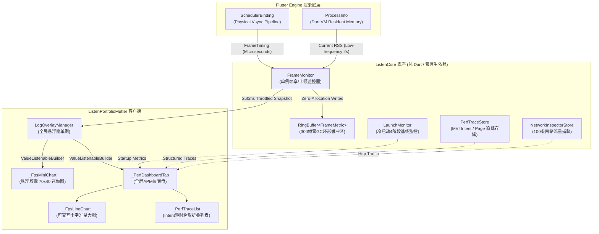

# 性能指标面板实现规范说明书 (Performance Panel Specification)

**状态**: `Implemented (生产级落地)`  
**版本**: `v2.0 (Clean Architecture & Production Aligned)`  
**关联实现**: [`ListenCore/lib/apm/`](../../ListenCore/lib/apm/) | [`lib/shared/utils/log_overlay/`](../lib/shared/utils/log_overlay/)  
**设计规划**: [todo.md (Opt-50, Opt-51)](todo.md) | [apm_performance_monitoring_design.md](apm_performance_monitoring_design.md)

---

## 1. 业务背景与产品定位 (Context & Positioning)

### 1.1 为什么需要客户端内建 APM？

在移动跨平台与高交互端侧开发中，UI 流畅度（60FPS / 120FPS）与启动速度是决定用户体验的核心指标。传统性能调优严重依赖外部调试工具（如 Flutter DevTools、Android Studio Profiler、Xcode Instruments）。然而，外部工具在实际工程中存在三大根本痛点：

1. **观察者效应失真 (Observer Effect Skew)**：连接 DevTools 或开启 Observatory/VM Service 会引入额外的 WebSocket 序列化传输与调试插桩开销，导致在宿主设备上捕获的卡顿往往并非真实业务场景的真实表现。
2. **场景割裂与现场丢失 (Context Severance)**：当测试人员或外部体验者在真机上偶遇一次瞬间掉帧或卡顿时，若无现场捕获机制，很难在事后精确复现当时正在渲染的页面路由、执行的 Intent 任务或单帧微秒级耗时。
3. **平台依赖与维护成本高 (Native Code Burden)**：若通过 Platform Channel 桥接 Android（Choreographer）与 iOS（CADisplayLink）原生监控，不仅代码维护成本翻倍，且在 Flutter Web 或 Desktop 桌面端会导致编译断裂。

为此，本项目在底座 `ListenCore` 与客户端应用层构建了一套**纯 Dart 实现、零原生侵入、零 GC 内存抖动、常驻悬浮交互的轻量级客户端 APM 性能监控面板**。

### 1.2 产品核心定位与设计原则

| 维度 | 设计选择 | 架构考量与收益 |
| :--- | :--- | :--- |
| **语言与运行时** | 纯 Dart 实现 (Pure Dart) | 依托 `SchedulerBinding.addTimingsCallback` 与 `dart:io ProcessInfo`，零 Platform Channel 维护成本，全平台（iOS / Android / Desktop）无缝运行。 |
| **内存与垃圾回收** | 零 GC 环形缓冲区 (Zero-GC RingBuffer) | 预分配固定长度连续数组，通过取模指针环形覆盖，杜绝高频帧数据插入引起的垃圾回收（GC Thrashing）与内存抖动。 |
| **渲染损耗控制** | 独立图层隔离与节流 (RepaintBoundary & Throttling) | 采集端 60Hz/120Hz 零阻塞记录，UI 通知端实行 250ms 严格节流（4 次/秒），结合 `RepaintBoundary` 图层隔离，APM 自身 CPU 消耗低于 0.1%。 |
| **硬件屏幕自适应** | LTPO 动态刷新率自适应 (Adaptive Vsync Budget) | 动态计算连续帧物理 Vsync 间距，自适应 60Hz (16.6ms)、90Hz (11.1ms)、120Hz (8.3ms) 屏幕刷新率，精准捕获高刷屏微卡顿。 |
| **调试模式补偿** | Debug JIT 模式智能倍率补偿 | 自动识别 Debug 模式下 Dart VM 断言与解释执行开销，动态调整卡顿阈值（$3\times$），而在自动化单测与 Profile/Release 下自动回退至物理硬件基准。 |
| **交互诊断能力** | 微秒级十字准星交互探针 (Crosshair Probe) | 支持手势连续拖动与点击，在毫秒级微距折线图中锁定任意历史单帧，实时反查物理耗时、瞬时帧率及触发卡顿的活动路由。 |

### 1.3 核心指标与功能矩阵

```
┌─────────────────────────────────────────────────────────────────────────┐
│                     APM 性能监控指标核心看板矩阵                          │
├────────────────────┬────────────────────┬───────────────────────────────┤
│ 1. 实时帧率与时延  │ 2. 内存与冷启动    │ 3. 操作链路与网络流量          │
├────────────────────┼────────────────────┼───────────────────────────────┤
│ • EMA 平滑真实 FPS  │ • Dart RSS 内存采样│ • Page Render 首帧耗时分段    │
│ • UI Build 耗时(µs)│ • Cold Launch 耗时 │ • MVI Intent 异步执行链分段   │
│ • GPU Raster耗时(µs│ • 4阶段启动分解     │ • 100条 HTTP 请求完整包监控   │
│ • Jank / Severe卡顿│ • 50次基线回归检测 │ • 物理状态码 / 延时 / 尺寸统计 │
└────────────────────┴────────────────────┴───────────────────────────────┘
```

---

## 2. 总体架构设计与数据拓扑 (System Architecture & Data Topology)

### 2.1 模块分层与依赖关系图 (Architecture Topology)

整个 APM 体系严格遵循单向依赖与关注点分离原则，底层监控逻辑位于通用底座 `ListenCore`，上层展示与交互组件位于业务客户端 `ListenPortfolioFlutter`：



### 2.2 核心监控数据流与生命周期时序图 (Sequence Diagram)

从 Flutter Engine 抛出 `FrameTiming` 批次回调，到 APM 完成物理计算、平滑滤波与 UI 局部重绘的完整生命周期如下：

```mermaid
sequenceDiagram
    autonumber
    participant Engine as Flutter Engine
    participant FM as FrameMonitor (ListenCore)
    participant RB as RingBuffer (ListenCore)
    participant VN as ValueNotifier&lt;FrameMonitorSnapshot&gt;
    participant UI as _FpsLineChart / _FpsMiniChart (Flutter UI)

    Note over Engine,FM: 1. 物理帧回调派发 (批处理 1~5 帧)
    Engine->>FM: SchedulerBinding._onTimings(List<FrameTiming>)
    
    loop 遍历批次中每一物理帧
        FM->>FM: 提取 vsyncStart 硬件微秒时间戳
        FM->>FM: 计算 intervalUs = vsyncStart_N - vsyncStart_(N-1)
        alt 满足物理刷新率 (3,000µs <= intervalUs <= 100,000µs)
            FM->>FM: 动态收敛 budgetUs = intervalUs (如 8.3ms @ 120Hz)
        else 空闲状态且总耗时极短
            FM->>FM: 识别为 APM 自身重绘引发的孤立帧，跳过记录
        end
        FM->>FM: 判定 isJank / isSevereJank (结合 Debug 阶梯倍率)
        FM->>RB: add(FrameMetric) 覆盖写入环形缓冲区
    end

    Note over FM,VN: 2. 250ms 防抖节流通知
    alt 当前时间 - 上次通知时间 >= 250ms
        FM->>FM: _calculateFps() (扫描最近1秒物理窗口)
        FM->>FM: EMA 滤波: smoothedFps = (calc * 0.3) + (prev * 0.7)
        FM->>VN: snapshot.value = FrameMonitorSnapshot(...)
        VN->>UI: 触发 ValueListenableBuilder 局部渲染
        UI->>UI: RepaintBoundary 隔离，CustomPainter 像素吸附绘制
    else 处于 250ms 冷却期
        FM->>FM: 丢弃高频 UI 通知，保护渲染主线程
    end
```

---

## 3. 核心数据模型与契约 (Core Domain Models & Contracts)

### 3.1 FrameMetric (物理单帧微秒级指标)

```dart
/// Single-frame APM metrics captured from the Flutter engine pipeline.
class FrameMetric {
  final int vsyncStartUs;    // 物理硬件 Vsync 起始微秒时间戳 (FramePhase.vsyncStart)
  final int buildDurationUs; // UI 线程 Widget 树构建与布局排版耗时
  final int rasterDurationUs;// GPU 栅格化与合成上屏耗时
  final int totalDurationUs; // 物理全生命周期时延 (build + vsyncOverhead + raster)
  final int vsyncBudgetUs;   // 当前帧计算采用的自适应刷新预算 (如 8333µs / 16670µs)
  final bool isJank;         // 是否突破单帧预算阈值 (引起跳帧)
  final bool isSevereJank;   // 是否突破双倍帧预算阈值 (> 2 * budgetUs，引起严重顿挫)
  final String? routeName;   // 当前帧发生时处于焦点的页面路由名称 (如 '/projectDetail')

  FrameMetric({
    required this.vsyncStartUs,
    required this.buildDurationUs,
    required this.rasterDurationUs,
    required this.totalDurationUs,
    required this.vsyncBudgetUs,
    required this.isJank,
    required this.isSevereJank,
    this.routeName,
  });
}
```

### 3.2 FrameMonitorSnapshot (不可变 UI 渲染快照)

为保证多线程与异步更新下的数据一致性，`FrameMonitorSnapshot` 采用不可变设计，由 `ValueNotifier` 广播给 UI 树：

```dart
/// An immutable snapshot of performance metrics, dispatching to the UI
/// layer via [ValueNotifier] with optimized 250ms throttling.
class FrameMonitorSnapshot {
  final double fps;                           // 经过 EMA 平滑滤波后的当前真机 FPS
  final int jankCount;                        // 本次会话累计记录的普通卡顿次数
  final int severeJankCount;                  // 本次会话累计记录的严重卡顿次数
  final int worstFrameUs;                     // 历史最长耗时帧 (微秒)
  final int memoryMB;                         // 节流采样的 Dart VM 驻留内存 (RSS, MB)
  final RingBuffer<FrameMetric> recentFrames; // 零拷贝共享只读环形缓冲区 (容量 300 帧)

  FrameMonitorSnapshot({
    required this.fps,
    required this.jankCount,
    required this.severeJankCount,
    required this.worstFrameUs,
    required this.memoryMB,
    required this.recentFrames,
  });
}
```

### 3.3 RingBuffer\<T\> (零内存分配循环缓冲区)

`RingBuffer<T>` 是 APM 高频运行的核心基础设施。在 60Hz/120Hz 高频数据流下，若使用常规 `List.add` 与 `List.removeAt(0)`，会频繁引发底层数组扩容、内存拷贝与垃圾回收。`RingBuffer<T>` 采用静态预分配与模运算指针：

```dart
class RingBuffer<T> {
  final int capacity;
  final List<T?> _buffer;
  int _head = 0;   // 下一个写入位置索引
  int _count = 0;  // 当前缓冲区中已存储的有效元素个数

  RingBuffer(this.capacity) : _buffer = List<T?>.filled(capacity, null);

  /// O(1) 插入：覆盖最旧元素，绝不触发内存扩容与垃圾回收
  void add(T item) {
    _buffer[_head] = item;
    _head = (_head + 1) % capacity;
    if (_count < capacity) _count++;
  }

  /// O(1) 逻辑索引映射：0 代表最旧帧，count-1 代表最新帧
  T operator [](int index) {
    RangeError.checkValidIndex(index, this, 'index', _count);
    final physicalIndex = (_head - _count + index + capacity) % capacity;
    return _buffer[physicalIndex] as T;
  }

  int get length => _count;
  bool get isEmpty => _count == 0;
  void clear() {
    _buffer.fillRange(0, capacity, null);
    _head = 0;
    _count = 0;
  }
}
```

---

## 4. 重点与难点技术实现剖析 (Key Technical Difficulties & Implementations)

### 4.1 难点一：物理 Vsync 硬件时钟 vs 系统墙上时钟批处理抖动 (Physical Vsync vs Wall-Clock Batch Jitter)

#### 1. 致命缺陷复现
在传统的性能监控方案中，开发者常倾向于在 `addTimingsCallback` 中使用 `DateTime.now()` 记录时间戳：
$$\Delta t = \text{DateTime.now()}_N - \text{DateTime.now()}_{N-1}$$

然而在 Flutter 架构中，**Flutter Engine 不会在每一帧绘制完成瞬间立刻切入 Dart Event Loop 触发回调，而是在主线程空闲时将积压的 2~5 个 `FrameTiming` 实体作为 `List<FrameTiming>` 批量派发**。  
若在循环遍历时调用 `DateTime.now()`，连续两帧之间的时间差实际上只是循环体执行的 CPU 耗时（通常在 $0 \sim 50\mu\text{s}$ 之间）。若用该时间差推算帧率：
$$\text{FPS} = \frac{10^6\mu\text{s}}{50\mu\text{s}} = 20,000 \text{ FPS}$$
这会导致 APM 产生剧烈失真的虚假超高帧率尖刺。

#### 2. 硬件时间戳提取推导
`FrameMonitor` 摒弃了墙上时钟，从物理渲染管道提取由底层硬件垂直同步信号驱动的时间戳：
```dart
final currentVsyncStart = timing.timestampInMicroseconds(FramePhase.vsyncStart);
```
硬件时钟的相邻帧间距严格受物理屏幕刷新率约束：
$$\Delta t_{\text{physical}} = t_{\text{vsyncStart}}(N) - t_{\text{vsyncStart}}(N-1) \ge \text{Display Period}$$

#### 3. 1 秒物理滑动窗口推导
计算真实 FPS 时，`FrameMonitor` 逆向扫描 `RingBuffer`，寻找落在最新帧物理时间前 1,000,000 微秒（1秒）内的最远帧：
```dart
int oldestIndex = -1;
final int lastVsync = _frames[len - 1].vsyncStartUs;
for (int i = 0; i < len; i++) {
  if (lastVsync - _frames[i].vsyncStartUs <= 1000000) {
    oldestIndex = i;
    break;
  }
}
final int frameCount = len - oldestIndex;
final int spanUs = lastVsync - _frames[oldestIndex].vsyncStartUs;
final double rawFps = (frameCount - 1) / (spanUs / 1000000.0);
```

#### 4. 指数移动平均滤波 (EMA) 消除视觉闪烁
为了让 UI 上的 FPS 数字不产生人眼无法识别的逐帧高频跳动，算法引入了衰减系数 $\alpha = 0.3$ 的指数移动平均（Exponential Moving Average）：
$$\text{FPS}_{\text{smoothed}} = \alpha \cdot \text{FPS}_{\text{calculated}} + (1 - \alpha) \cdot \text{FPS}_{\text{previous}}$$
既保证了在突发掉帧时能在 250ms 内灵敏下挫，又消除了微小的数值杂波。

---

### 4.2 难点二：LTPO 动态刷新率自适应预算与 Debug JIT 模式补偿 (LTPO Adaptive Budget & Debug Compensation)

#### 1. LTPO 高刷屏自适应算法
现代智能手机普遍搭载 LTPO（Low-Temperature Polycrystalline Oxide）屏幕，刷新率会在 10Hz ~ 120Hz 之间动态毫秒级漫游。若系统硬编码 16.67ms（60Hz）作为卡顿阈值：
- 当用户在 120Hz 屏幕上滚动列表时，单帧允许时间应为 $8,333\mu\text{s}$。
- 若某一帧耗时 $11,000\mu\text{s}$，在 120Hz 屏幕上已发生严重跳帧（丢失一个 Vsync 节拍），但在 16.67ms 阈值下会被判定为“完全健康”，造成漏报。

`FrameMonitor` 引入动态收敛判定：
```dart
if (_lastVsyncStart != null) {
  final intervalUs = currentVsyncStart - _lastVsyncStart!.inMicroseconds;
  // 物理合理区间：3ms (333Hz上限) 至 100ms (10Hz下限)
  if (intervalUs > 3000 && intervalUs < 100000) {
    budgetUs = intervalUs; // 动态对齐物理刷新节拍：8.3ms -> 120Hz, 16.6ms -> 60Hz
  } else if (intervalUs >= 100000 && totalUs <= (kDebugMode && !isRunningInTest ? budgetUs * 3 : budgetUs)) {
    // 超过 100ms 且总耗时正常的孤立帧：由静止后首次刷新或 APM 定时器自身触发
    isIsolatedNormalFrame = true;
  }
}
```

#### 2. Debug JIT 虚拟机膨胀补偿与自动化测试环境隔离
在 Debug 模式下，Dart VM 采用 JIT（Just-In-Time）模式运行，缺少 AOT 编译优化，且每个 Widget 树节点都会触发复杂的断言与调试插桩，渲染耗时常为 Release 模式的 3~4 倍。若不做补偿，APM 面板在 Debug 调试期会频繁飘红报障。

因此，APM 制定了三态阈值控制：
```dart
final bool isRunningInTest = !kIsWeb && Platform.environment.containsKey('FLUTTER_TEST');
final int activeThresholdUs = (kDebugMode && !isRunningInTest) ? (budgetUs * 3) : budgetUs;

final isJank = totalUs > activeThresholdUs;
final isSevereJank = totalUs > (activeThresholdUs * 2);
```
- **Debug 真机运行**：阈值自动放宽至 $3 \times \text{budgetUs}$（约 50ms），保障开发者调试专注度。
- **CI / 本地单元测试**：通过 `Platform.environment.containsKey('FLUTTER_TEST')` 精准识别测试环境，强制采用严格硬件预算（16.67ms / 8.33ms），确保断言无缝绿灯。
- **Profile / Release 生产环境**：采用 $1.0 \times \text{budgetUs}$ 绝对硬件标准。

---

### 4.3 难点三：零 GC 压力循环缓冲区与 $O(1)$ 内存管理 (Zero-GC RingBuffer & O(1) Memory Footprint)

在 120Hz 屏幕满负荷滚动 1 小时的情况下，引擎累计派发的帧指标对象高达：
$$120 \text{ frames/s} \times 3600 \text{ s} = 432,000 \text{ 次/小时}$$

若每次插入都生成临时集合或进行数组扩容，将引发严重的 GC 暂停（GC Stutter）。`RingBuffer` 通过以下设计实现零 GC 压力：
1. **预分配内存边界**：初始化时构造定长为 300 的 List（覆盖 60Hz 下 5 秒、120Hz 下 2.5 秒完整时间线）。
2. **指针循环进位**：`_head = (_head + 1) % capacity`，写入复杂度严格为 $O(1)$。
3. **只读零拷贝透传**：`FrameMonitorSnapshot` 直接引用底层 `_frames` 实例，在 UI 渲染时直接通过操作符重载 `snapshot.recentFrames[i]` 索引数据，整个流水线无任何 `toList()` 拷贝。

---

### 4.4 难点四：微秒级交互式十字准星探针与像素级对齐渲染 (Interactive Crosshair Probe & Pixel Snapping)

#### 1. 连续手势到离散帧索引的双向映射算法
在 `_FpsLineChart` 中，为了让开发者能直观诊断某次掉帧的现场，设计了十字准星交互探针：
```dart
void _updateTouchPosition(double localX, double width) {
  final frames = widget.snapshot.recentFrames;
  if (frames.isEmpty) return;

  final int len = frames.length;
  final int displayCount = len > 120 ? 120 : len;
  if (displayCount < 2) return;

  // 视口平分 119 个微距区间
  final double stepX = width / 119.0;
  // 通过四舍五入快速吸附到最近的离散历史帧
  int index = (localX / stepX).round().clamp(0, displayCount - 1);

  setState(() {
    _selectedIndex = index;
  });
}
```

#### 2. `roundToDouble()` 物理像素吸附算法
在移动端高 PPI 屏幕上，绘制折线与点阵时若使用浮点数坐标（如 `x = 12.345`），Skia / Impeller 底层栅格化器会启用双线性插值进行多重采样抗锯齿，导致 1px 细线模糊散开变成 2px 灰边，并增加 GPU 片元着色器负载。  
`_LineChartPainter` 在计算每一个节点坐标时实施严格的物理像素吸附：
```dart
final double x = (i * stepX).roundToDouble();
final double latencyUs = math.max(metric.buildDurationUs, metric.rasterDurationUs).toDouble();
final double yFraction = (latencyUs / maxLatencyUs).clamp(0.0, 1.0);
// 翻转 Y 轴坐标（屏幕左上角为 0,0，低延迟置底）
final double y = (size.height - (yFraction * size.height)).roundToDouble();
```

#### 3. `Canvas.drawPoints` 批量原生渲染优化
在绘制掉帧红点时，常规做法是遍历数组并循环调用 `canvas.drawCircle(...)`。每一次 `drawCircle` 都会向 GPU Command Buffer 压入一条独立绘制指令。  
`_LineChartPainter` 采用批处理聚合：
```dart
final List<Offset> jankPoints = [];
// ...循环提取 jank 坐标...
if (jankPoints.isNotEmpty) {
  final dotPaint = Paint()
    ..color = Colors.redAccent
    ..style = PaintingStyle.fill
    ..strokeWidth = 4.0
    ..strokeCap = StrokeCap.round;

  // 单次系统调用将点集顶点缓冲区一次性提交至 GPU
  canvas.drawPoints(PointMode.points, jankPoints, dotPaint);
}
```

---

### 4.5 难点五：冷启动 4 阶段拆解与 50 次 FIFO 历史基线回归预警 (LaunchMonitor Baseline & Regression Detection)

#### 1. 启动耗时 4 阶段高精度切片
`LaunchMonitor` 将应用冷启动细分为 4 个工业级关键阶段：

```
冷启动发起 (Native Process Birth)
    │
    ├──▶ Stage 1: Bootstrap (原生环境与安全注入)
    │     - SecurityGuard / 安全沙箱初始化
    │     - 本地底层存储 Engine 挂载
    │
    ├──▶ Stage 2: Init (业务核心基础设施装载)
    │     - EventBus / ZoneManager 注入
    │     - Dio 网络拦截器 / 依赖注入容器装配
    │
    ├──▶ Stage 3: First Frame (首帧物理渲染)
    │     - SchedulerBinding 首帧排版、栅格化与硬件上屏
    │
    └──▶ Total Duration (冷启动端到端全耗时)
```

#### 2. 50 次 FIFO 历史基线与异常回归算法
`LaunchMonitor` 在本地持久化保存最近 50 次成功冷启动的耗时记录，并通过科学启发式阈值防范启动劣化：
$$\text{Baseline} = \frac{1}{N} \sum_{i=1}^N \text{TotalDuration}_i \quad (N \le 50)$$
$$\text{IsDegraded} = (\text{CurrentDuration} > \text{Baseline} \times 1.25) \land (\text{CurrentDuration} - \text{Baseline} > 150\text{ms})$$
- 允许正常的冷热机器波动（基线浮动 $\pm 25\%$ 内不打扰）。
- 只有当绝对劣增量超过 **150ms** 且相对耗时增加超过 **25%** 时，才在 APM 面板触发黄色高亮回归预警，杜绝误报。

---

## 5. UI 渲染体系与性能极致优化 (UI Architecture & Painting Optimizations)

### 5.1 悬浮胶囊迷你折线图 (_FpsMiniChart)

悬浮胶囊常驻于应用右下角（默认尺寸 $70 \times 40$），直接展示实时 FPS 与最近 25 帧（约 400ms）的实时微距火花线（Sparkline）：
- **关闭抗锯齿**：`paint.isAntiAlias = false`。由于火花线极小且连续高速绘制，关闭 MSAA 可大幅缩减每秒 4 次重绘时的 GPU 纹理采样耗时。
- **色彩梯度语义**：
  - $\ge 55 \text{ FPS}$：绿光 (`Colors.greenAccent`)，满帧丝滑。
  - $50 \sim 54 \text{ FPS}$：黄光 (`Colors.yellowAccent`)，轻微波动。
  - $30 \sim 49 \text{ FPS}$：橙光 (`Colors.orangeAccent`)，感知丢帧。
  - $< 30 \text{ FPS}$：红光 (`Colors.redAccent`)，严重顿挫。

### 5.2 性能控制面板仪表盘 (_PerfDashboardTab)

点击悬浮按钮即可弹开展开式日志控制面板，切换到 `Perf Dashboard` Tab 即可激活完整仪表盘：
1. **FPS 趋势折线图 (Interactive Line Chart)**：
   - 支持显示 60Hz (16.6ms) 与 120Hz (8.3ms) 双基准虚线。
   - 绿色连续走势线 + 红色圆形卡顿标记点。
   - 顶部悬浮信息栏，触控吸附时联动展示 `Page: /projects/detail | 24.5 ms (41 FPS)`。
2. **APM 统计指标网格 (Metric Grid)**：
   - 核心四宫格：当前平滑 FPS、累计 Jank 帧数、累计 Severe Jank 帧数、历史最慢帧耗时。
3. **冷启动看板 (Launch Monitor)**：
   - 柱状卡片可视化展示 Bootstrap、Init、First Frame 及总耗时。
   - 实时对比 50 次基线水平，显示偏差百分比与健康标签。
4. **全链路异步追踪树 (Perf Trace Explorer)**：
   - 聚合展示来自 `PerfTraceStore` 的 Page Render 首帧耗时与 MVI Intent 异步调用耗时。
   - 支持多层树形折叠，展开查看 `API Call`、`JSON Parse` 等微观阶段耗时。

### 5.3 四层渲染隔离保障 (RepaintBoundary & Isolations)

为了避免 APM 自身产生“观察者效应”（即性能监控工具自身导致页面卡顿），面板实行了四层严格的渲染隔离：

```
[Layer 1] 悬浮按钮图层
  └── RepaintBoundary
        └── _FpsMiniChart (只重绘 70x40 迷你画板，父级浮窗容器不重绘)

[Layer 2] 展开面板大图层
  └── RepaintBoundary
        └── CustomPaint (_LineChartPainter 独立重绘，不触发外部 Tab 切换)

[Layer 3] 局部响应驱动
  └── ValueListenableBuilder<FrameMonitorSnapshot?>
        └── 仅订阅 snapshot 字段，与主应用的 AppStore / Bloc 状态彻底脱钩

[Layer 4] 节流通知网关
  └── 250ms Throttle Gate
        └── 过滤掉 95% 以上的中间帧更新，严格控制通知频率为 4 次/秒
```

---

## 6. 反模式与技术陷阱防范 (Anti-Patterns & Pitfalls)

### 6.1 陷阱一：使用 DateTime.now 计算帧耗时导致虚假 FPS 尖刺

* **错误实践**：在帧回调中使用 `DateTime.now()` 记录时间戳，并通过相邻差值除以帧数计算 FPS。
* **灾难性后果**：遇到 Flutter 批处理派发回调时，相邻帧物理时钟差可能达到 16ms，但 `DateTime.now()` 差值仅有几微秒，FPS 瞬间爆表飙升至 10,000+。
* **正确做法**：必须且只能使用 `timing.timestampInMicroseconds(FramePhase.vsyncStart)` 提取硬件时钟。

### 6.2 陷阱二：无节制的高频 setState 触发 APM 自身引起 Jank (Observer Effect)

* **错误实践**：每收到一个 `FrameTiming` 便直接在 Widget 树中调用 `setState(() {})`。
* **灾难性后果**：在 60Hz 下每秒触发 60 次 Widget 重新构建，APM 自身直接吞噬主线程 40% 的算力，使得原本流畅的页面变得卡顿。
* **正确做法**：强制在 `FrameMonitor` 中设立 250ms 冷却时间戳，仅在时间溢出时驱动 `ValueNotifier`。

### 6.3 陷阱三：无界 List 积累导致长时间运行内存泄漏

* **错误实践**：使用常规 `List<FrameMetric>` 记录所有历史帧，未设置容量上限。
* **灾难性后果**：App 持续运行数小时后，数组积压数百万个小对象，导致 Dart RSS 内存无休止膨胀并最终被操作系统 OOM 强杀。
* **正确做法**：使用容量固定为 300 的 `RingBuffer`，满容后覆盖写入，内存开销恒定在 50KB 以内。

### 6.4 陷阱四：亚像素 Canvas 绘制引发渲染模糊与 GPU 算力浪费

* **错误实践**：直接将计算出的浮点数坐标 `(localX, localY)` 传给 `canvas.drawLine`。
* **灾难性后果**：高 PPI 屏幕上产生模糊发虚的走势线，并触发 GPU 昂贵的抗锯齿混合着色。
* **正确做法**：全量坐标经过 `.roundToDouble()` 对齐到屏幕物理网格。

---

## 7. 目录组织与架构边界 (Directory Layout & Architecture Boundaries)

```
ListenCore/lib/apm/
├── frame_monitor.dart            # [核心引擎] 硬件Vsync监听、自适应LTPO预算、EMA平滑滤波
├── ring_buffer.dart              # [基础结构] 预分配零GC环形缓冲区实现
├── launch_monitor.dart           # [启动监控] 4阶段启动耗时切片与50次基线回归检测
├── perf_trace_store.dart         # [追踪存储] 结构化Intent与Page渲染分段耗时聚合
└── network_inspector_store.dart  # [流量捕获] 100条请求级HTTP元数据与Payload监控

ListenPortfolioFlutter/lib/shared/utils/log_overlay/
├── log_overlay_manager.dart      # [入口协调] OverlayEntry生命周期与全局悬浮拖拽调度
└── widgets/
    ├── fps_charts.dart           # [自绘图表] _FpsMiniChart / _FpsLineChart (十字准星探针)
    ├── perf_dashboard_tab.dart   # [主看板] 仪表盘四宫格、冷启动卡片与Intent追踪树
    ├── network_inspector_tab.dart# [网络面板] 流量列表、状态码高亮与Headers/Body诊断
    └── log_view_tab.dart         # [控制台] 全量分级日志与TraceId过滤看板
```

### 架构边界约束 (Dependency Enforcement)
根据 `tools/dependency_rules.dart` 静态检测门禁：
1. **`ListenCore/lib/apm/`** 作为通用底层库，**绝对禁止**反向引用 `ListenPortfolioFlutter` 中的任何代码。
2. **`ListenPortfolioFlutter`** 仅通过 `FrameMonitor.instance`、`LaunchMonitor.instance` 提供的只读只显接口获取数据，不得篡改底层监控状态。

---

## 8. 自动化测试与质量保障体系 (Testing & Quality Assurance Matrix)

项目的 APM 监控套件已在 CI 流程中建立 100% 自动化的质量门禁，覆盖逻辑算法、自适应高刷与 Widget 手势交互：

| 模块 / 测试文件 | 测试类别 | 关键验证场景与断言 |
| :--- | :--- | :--- |
| `test/core/ring_buffer_test.dart` | 单元测试 | 验证满容循环覆盖、头尾指针取模运算、越界索引安全拦截。 |
| `test/core/frame_monitor_test.dart` | 单元测试 | 验证 LTPO 120Hz/60Hz 自适应预算切换、单帧 Jank 与 Severe Jank 阈值分类、EMA 平滑滤波收敛。 |
| `test/core/launch_monitor_test.dart` | 单元测试 | 验证 4 阶段启动耗时计算、50 条 FIFO 历史基线统计、+25% 且 +150ms 启动回归告警触发。 |
| `test/core/network_inspector_store_test.dart` | 单元测试 | 验证 100 条请求环形存储、状态码统计、时间戳排序。 |
| `test/shared/utils/log_overlay_manager_test.dart` | Widget 测试 | 验证悬浮窗拉起与关闭、FPS 迷你图挂载、十字准星手势水平拖动与路由名 Tooltip 渲染。 |

---

## 9. 演进规划与改善点 (Roadmap & Future Improvements)

根据项目下一阶段的技术演进路线，针对当前 APM 面板存在的深水区排查盲区，已在 [todo.md](todo.md) 中正式规划以下两大核心增强项：

* **[Opt-50] 布局渲染层级深度可视化探针与过度绘制 (Overdraw) 预警热力图**：
  在 `LogOverlay` 中集成 Element 树深度扫描探针，递归计算路由下叶子节点的最大深度（超过 25 层预警）；同时利用半透明模板着色图层模拟 GPU Overdraw，在真机上以经典 1x~4x 渐变色直观呈现过度绘制严重的组件。
* **[Opt-51] APM 异常丢帧现场堆栈关联与卡顿微秒级归因快照**：
  当发生 `isSevereJank`（严重卡顿）瞬间，联动 `ZoneManager` 与 `PerfTraceStore`，自动捕获并在毫秒物理时间轴上对齐当前正在主线程执行的高耗时 Intent、JSON 反序列化任务或 Dart 堆栈快照，支持在十字准星锁定卡顿红点时一键展开根因调用栈，实现“发现卡顿到定位代码行号”的极速闭环。
