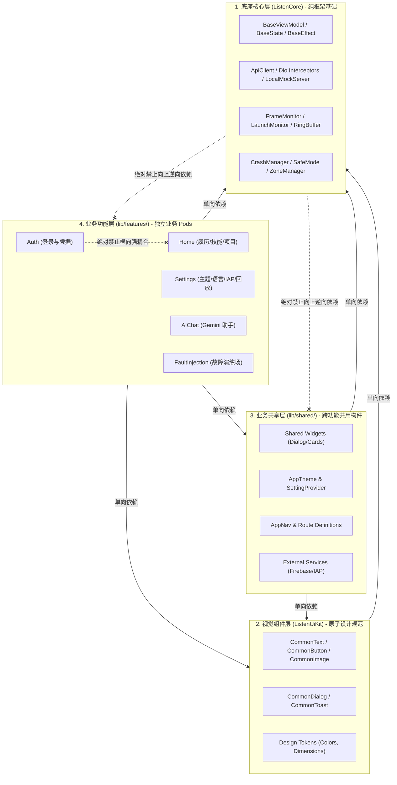
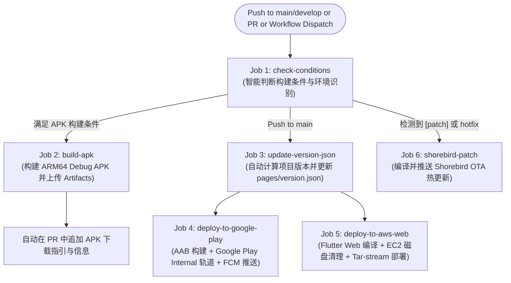

# Listen Portfolio Flutter 项目开发与架构治理指南 (Project Development & Engineering Guide)

**状态**: `Implemented (生产级治理与自动化交付)`  
**版本**: `v3.0 (Clean Architecture, CI/CD Pipeline & Custom Lint Aligned)`  
**关联工具与配置**:
- 架构治理脚本: [`tools/dependency_rules.dart`](../tools/dependency_rules.dart)
- 自定义 Lint 规则包: [`tools/lint_rules/lib/src/dependency_boundary_lint.dart`](../tools/lint_rules/lib/src/dependency_boundary_lint.dart)
- 静态分析配置: [`analysis_options.yaml`](../analysis_options.yaml)
- 统一自动化流水线: [`.github/workflows/ci.yml`](../.github/workflows/ci.yml)
- 多目标构建脚本: [`buildModule.sh`](../buildModule.sh)
- 待办规划: [todo.md (Opt-52, Opt-53)](todo.md)

---

## 1. 概述与核心工程愿景 (Overview & Engineering Vision)

### 1.1 项目定位与工程治理目标

`ListenPortfolioFlutter` 是一款定位商用交付水准的现代化跨平台个人作品集应用，底层依托通用底座 `ListenCore`（核心状态机、网络拦截、安全防护、崩溃自愈、全链路 Zone 追踪与轻量 APM）和 `ListenUiKit`（原子设计系统与视觉设计规范）。

在持续演进的软件工程中，随着业务模块增加与功能迭代，客户端项目极易遭遇四大结构性恶疾：
1. **依赖网状腐化 (Dependency Rot)**：Feature 模块间互相调用内部逻辑，导致牵一发而动全身，单元测试难以解耦隔离。
2. **抽象击穿与私有泄露 (Encapsulation Leakage)**：业务展现层或 ViewModel 直接实例化数据层的私有实现类（如 `_impl.dart`），使依赖倒置原则（IoC）形同虚设。
3. **平台与构建脆弱性 (Build Fragility)**：跨操作系统（Windows、macOS、Linux CI）环境下的斜杠路径差异、手动打包配置不一致、发版版本号冲突及磁盘空间耗尽。
4. **多语言与屏幕碎裂化 (Layout Overflow)**：在中/英/日多语言动态切换或小屏真机上，因缺乏防溢出防御设计而频繁暴发 `RenderFlex overflowed` 界面溃败。

为此，本项目构建了一套**结合 Clean Architecture、双层静态代码分析门禁（CLI + AST Custom Lint）、自动化多环境多目标交付流水线以及响应式防御布局**的工业级开发工程规范。

### 1.2 核心技术栈与工具链矩阵

| 领域 | 选型与工具 | 架构定位与核心职能 |
| :--- | :--- | :--- |
| **运行时框架** | Flutter 3.44.1 + Dart 3.x | 跨平台移动端（iOS / Android）与 Web 渲染运行时。 |
| **架构模式** | Clean Architecture + MVI | 基于 `BaseViewModel`、`BaseState`、`BaseEffect` 实现严格单向数据流。 |
| **CLI 依赖治理** | `tools/dependency_rules.dart` | 纯 Dart 独立 CLI，扫描模块依赖边界、检测循环依赖并生成 `dependency_graph.json`。 |
| **IDE 级 AST 分析** | `custom_lint` (15 项规则) | 依托 Dart Analyzer AST，实时拦截 ViewModel 持有 BuildContext、State 直接赋值及 UI 规范违规。 |
| **本地统一打包** | `buildModule.sh` (POSIX Bash) | 统一支持 `apk`、`bundle`、`patch` (Shorebird OTA)、`web` 4 种交付产物的编译。 |
| **云端持续集成** | GitHub Actions (`ci.yml`) | 自动化单测、代码分析、Google Play Internal 提审、AWS EC2 部署与热更新补丁分发。 |

---

## 2. 架构分层与依赖边界契约 (Architecture Layers & Dependency Contracts)

### 2.1 四层 Clean Architecture 依赖拓扑

整个客户端工程遵循单向依赖与层级隔离原则，层级自下而上严格约束如下：



### 2.2 绝对禁止的依赖反模式

#### 1. 禁止跨 Feature 模块横向强耦合
业务 Feature 模块（Pods）之间必须保持物理隔离。`features/auth` 绝不能直接 import `features/home` 的代码：
```dart
// ❌ 错误 - features/auth 直接耦合 features/home 内部模型
import 'package:listen_portfolio_flutter/features/home/data/models/user_profile_model.dart';

// ✅ 正确 - 将跨业务通用的模型沉淀至 shared 模块
import 'package:listen_portfolio_flutter/shared/models/user_profile_model.dart';
```

#### 2. 禁止底座核心层（ListenCore）向上逆向依赖
`ListenCore` 作为通用基础设施，被所有业务工程共享。Core 中绝不允许出现任何对 `features/` 或 `shared/` 的引用：
```dart
// ❌ 严重违规 - Core 绝不能依赖上层业务模型或常量
import 'package:listen_portfolio_flutter/features/auth/domain/models/auth_token.dart';
import 'package:listen_portfolio_flutter/shared/constants/app_constants.dart';
```

#### 3. 禁止绕过抽象接口直接导入私有实现类
表现层与 Domain 层必须依赖抽象契约（Repository 接口），杜绝直接引用包含 `_impl.dart`、`impl/`、`_mock.dart`、`_private.dart` 的内部实现文件：
```dart
// ❌ 错误 - ViewModel 直接导入并依赖 Repository 实现类
import 'package:listen_portfolio_flutter/features/auth/data/repositories/auth_repository_impl.dart';

// ✅ 正确 - 依赖 Domain 抽象契约
import 'package:listen_portfolio_flutter/features/auth/domain/repositories/auth_repository.dart';
```

#### 4. 禁止跨越 Feature 边界使用相对路径逃逸
在同一业务模块内，推荐使用清晰的相对路径（如 `../data/models/user_model.dart`）。但严禁利用 `../../../../features/` 越界逃逸到其他 Pod 中。

### 2.3 经架构裁决允许的合法例外

为了在严格的架构治理与工程开发效率之间取得平衡，系统经架构评审放行了以下两处合法例外：

1. **依赖注入组合根 (DI Provider Exceptions)**：
   负责对象装配的 Provider 文件（路径包含 `/provider/` 或 `/providers/`）承担控制反转（IoC）容器职责，必须实例化具体实现类（如 `AuthRepositoryImpl()`）并注入到接口变量中。因此，`dependency_rules.dart` 与 Lint 规则显式放行 Provider 对实现类的导入。
2. **同一 Feature 内部数据层协同**:
   位于 `features/<name>/data/` 目录下的数据源和仓储文件，允许相互引用同一 Feature 内部的内部类与 DTO。

---

## 3. 双层静态分析与架构治理体系 (Dual-Layer Static Analysis & Governance)

为了将架构违规阻断在提交远端之前，项目构建了“CI 独立门禁脚本”与“IDE 实时 AST 分析插件”双层防御纵深：

### 3.1 第一道防线：`tools/dependency_rules.dart` 独立 CLI 工具

`tools/dependency_rules.dart` 是一个轻量级、零第三方依赖的纯 Dart CLI 工具，用于快速扫描项目 `lib/` 目录下的所有 Dart 源码文件，验证架构依赖边界。

#### 核心命令矩阵
```bash
# 1. 运行全量依赖边界检查 (退出码 0 表示全部合规，1 表示存在违规)
dart run tools/dependency_rules.dart

# 2. 生成可视化依赖关系拓扑图谱 (输出 dependency_graph.json)
dart run tools/dependency_rules.dart --graph

# 3. 仅专项检查跨模块循环依赖 (Circular Dependencies)
dart run tools/dependency_rules.dart --check-circular

# 4. 仅专项检查层级逆向向上依赖 (Layer Violations)
dart run tools/dependency_rules.dart --check-layers

# 5. 查看帮助文档
dart run tools/dependency_rules.dart --help
```

#### 架构规则检测机制
```dart
static const List<DependencyRule> _rules = [
  // 1. 禁止跨 Features 横向依赖
  DependencyRule(
    pattern: r'import.*features/[^/]+/.*features/[^/]+/',
    description: 'Cross-feature module dependency not allowed',
    type: DependencyViolationType.crossFeature,
  ),
  // 2. 禁止 Core 依赖上层层级 (相对路径向上逃逸)
  DependencyRule(
    pattern: r'import.*\.\./.*features/|import.*\.\./.*shared/',
    description: 'core module should not depend on upper layer modules',
    type: DependencyViolationType.upwardDependency,
  ),
  // 3. 禁止直接导入私有实现类 (Provider 与同 Feature data 层除外)
  DependencyRule(
    pattern: r'import.*listen_portfolio_flutter/.*_(impl|mock|test|internal|private)\.dart',
    description: 'Direct import of private implementation files not allowed',
    type: DependencyViolationType.forbiddenPattern,
  ),
];
```

---

### 3.2 第二道防线：`custom_lint` IDE 实时 AST 分析与 Quick-Fix 自动修复

除了 CLI 脚本外，项目在 `pubspec.yaml` 中引入了 `custom_lint`，并在 `tools/lint_rules/` 中实现了基于 Dart Analyzer 抽象语法树（AST）的专属编译器插件。在 `analysis_options.yaml` 中深度启用了 **15 条核心检查规则**：

```yaml
# analysis_options.yaml
analyzer:
  plugins:
    - custom_lint

custom_lint:
  rules:
    # --- 1. UI 设计系统原子收敛 (带 Quick-Fix 一键替换) ---
    - use_common_image          # 拦截原生 Image.network / Image.asset，强制收敛为 CommonImage
    - use_common_clickable      # 拦截 GestureDetector / InkWell，强制收敛为 CommonClickable
    - use_common_text           # 拦截原生 Text，强制收敛为自适应缩放的 CommonText
    - use_common_button         # 拦截 ElevatedButton / TextButton，强制收敛为 CommonButton
    - use_common_icon_button    # 拦截 IconButton，强制收敛为 CommonIconButton
    - use_common_dialog         # 拦截 showDialog，强制收敛为符合设计系统的 CommonDialog
    - use_common_switch         # 拦截 Switch，强制收敛为 CommonSwitch
    - use_common_text_field     # 拦截 TextField，强制收敛为 CommonTextField
    - use_common_refresh_list   # 拦截 ListView，引导使用内置下拉刷新的 CommonRefreshList

    # --- 2. Clean Architecture & MVI 纯洁度 ---
    - view_model_context_isolation   # 严禁在 ViewModel / State 中注入 BuildContext，保障单测脱机运行
    - no_direct_state_assignment    # 严禁直接对 State 成员变量赋值，强制使用 updateState(...)
    - no_direct_app_nav_usage       # 严禁在 ViewModel 内部直接调用 AppNav 路由，必须派发 Effect 由 View 消费

    # --- 3. 依赖边界与代码安全性 ---
    - cross_feature_relative_import # 拦截通过相对路径跨越 Feature 边界的导入
    - no_hardcoded_strings          # 拦截硬编码英中文字符串，强制使用 I18nKeys.xxx.tr 国际化键
    - no_raw_color                  # 拦截裸硬编码 Color(0xFF...)，强制通过 AppTheme 获取主题色
```

---

## 4. CI/CD 自动化流水线与多目标交付矩阵 (CI/CD Pipeline & Delivery Matrix)

### 4.1 `.github/workflows/ci.yml` 全局作业编排拓扑

项目的 CI/CD 工作流采用全自动流水线，覆盖代码分析、架构校验、多端编译、Google Play 提审与 AWS 生产部署：



### 4.2 智能构建触发条件 (Smart Build Conditions)

为了避免每次轻微文档修改都触发长达 15 分钟的全量打包，`check-conditions` 设立了三重门禁：
1. **Commit Message 显式声明**：包含 `[build-apk]`、`[apk]` 或 `[deploy]` 时立即强制触发构建。
2. **时间间隔保护**：距离上次成功构建超过 **2 小时**，推送代码时自动构建。
3. **PR 自动化**：针对 `main` 或 `develop` 分支创建/更新 Pull Request 时自动构建测试包。
4. **Shorebird 补丁识别**：Commit 包含 `[patch]`、`[hotfix]` 或 `[shorebird-patch]` 时，自动分流至 `shorebird-patch` 作业。

---

### 4.3 统一多目标构建脚本 `buildModule.sh` 详解

项目根目录提供了跨平台自动化脚本 `buildModule.sh`，封装了环境配置注入、代码混淆、符号表拆分及产物归档：

```bash
# 指令语法: ./buildModule.sh [TARGET_TYPE] [ENVIRONMENT] [USE_SHOREBIRD]
# 示例 1: 本地构建 dev 环境 Debug APK
./buildModule.sh apk dev

# 示例 2: 构建 prod 生产环境 Release Android App Bundle (.aab)
./buildModule.sh bundle prod

# 示例 3: 编译并发布 prod 生产环境 Shorebird OTA 热修复补丁
./buildModule.sh patch prod

# 示例 4: 编译 prod 生产环境 Flutter Web 静态产物
./buildModule.sh web prod
```

#### 关键编译参数解析
* `--obfuscate`: 启用 Dart 代码混淆，将类名、函数名与字段名重命名为无意义符号，防止反编译逆向工程。
* `--split-debug-info=apkOutput`: 将调试符号从最终二进制中剥离并单独保存，显著缩减最终安装包体积达 30% 以上。
* `--extra-gen-snapshot-options=--save-obfuscation-map=apkOutput/mapping.json,--strip`: 导出混淆符号映射表 `mapping.json`，供崩溃监控平台（Sentry / Firebase Crashlytics）还原堆栈。
* `--dart-define=APP_ENV=$ENV`: 注入目标环境标识，驱动网络层在运行时解析对应的网关地址与 Mock 策略。

---

## 5. 重点与难点工程实现剖析 (Key Technical Difficulties & Implementations)

### 5.1 难点一：跨平台路径归一化与 Windows/Linux 正则匹配陷阱

#### 1. 致命缺陷背景
本地开发环境通常采用 Windows（PowerShell / CMD），文件系统使用反斜杠 `\` 作为路径分隔符（如 `lib\features\auth\presentation\login_page.dart`）；而 GitHub Actions CI Runner 运行于 Ubuntu Linux，路径采用正斜杠 `/`（如 `lib/features/auth/...`）。  
早期检测工具使用简单的 `filePath.contains('features/')`，导致在 Windows 本地执行时所有 Feature 规则被静默跳过（返回 `null`），造成“本地绿灯通过，推送到 CI 后全线飘红爆出 50+ 违规”的严重脱节。

#### 2. 跨平台路径归一化实现
`DependencyAnalyzer` 全面实施路径双斜杠兼容：
```dart
static String? _getFileModule(String filePath) {
  if (filePath.contains('features/') || filePath.contains(r'features\')) {
    return 'features';
  } else if (filePath.contains('shared/') || filePath.contains(r'shared\')) {
    return 'shared';
  } else if (filePath.contains('core/') || filePath.contains(r'core\')) {
    return 'core';
  }
  return null;
}

static String? _extractFeatureName(String path) {
  // 正则 [/\\] 优雅兼容 POSIX 与 Windows 目录分隔符
  final match = RegExp(r'features[/\\]([^/\\]+)[/\\]').firstMatch(path);
  return match?.group(1);
}
```

---

### 5.2 难点二：Clean Architecture 依赖倒置与 Provider 组合根特异性放行

#### 1. 痛点分析
Clean Architecture 严格规定：UI 展现层与 ViewModel **严禁直接 import 具体实现类**（如 `AuthRepositoryImpl`），必须通过抽象接口解耦。然而，在无依赖注入反射容器（如 Spring / Dagger）的纯 Flutter 场景下，**必须在某处物理代码中执行 `AuthRepositoryImpl()` 的实例化**。若规则一刀切禁止导入 `_impl.dart`，会导致正常的 Provider 代码无法编译。

#### 2. 组合根（Composition Root）特异性判定
`DependencyAnalyzer` 将 `/provider/` 与 `/providers/` 明确定义为项目的“依赖注入组合根”，赋予其唯一的实现类装配特权：
```dart
case DependencyViolationType.forbiddenPattern:
  // Exception A: Provider 组合根负责对象装配，允许导入具体实现类
  if (filePath.contains('/provider/') ||
      filePath.contains(r'\provider\') ||
      filePath.contains('/providers/') ||
      filePath.contains(r'\providers\')) {
    return false;
  }
  // Exception B: 同一 Feature 内部的 data 层允许引用自身内部实体
  if (fileModule == 'features' && (filePath.contains('/data/') || filePath.contains(r'\data\'))) {
    final currentFeature = _extractFeatureName(filePath);
    final importedFeature = _extractFeatureName(importLine);
    if (currentFeature != null && importedFeature != null && currentFeature == importedFeature) {
      return false;
    }
  }
  return true; // 其余任何层级直接导入私有实现均判定为违规
```

---

### 5.3 难点三：Google Play 自动化版本号运算与冲突自愈算法

在 CI 自动化发布 Google Play Internal 轨道时，Google Play 强制要求每次上传的 AAB 内部 `versionCode` 必须**严格单调递增**。若直接使用静态配置，频繁触发构建会导致 Google Play 抛出 `400 Version Code Already Exists` 错误中断流水线。

流水线引入了智能算法自愈：
1. **云端拉取**：调用 Node.js 脚本 `tools/get_play_version.js`，通过 Google Play Developer API 实时查询当前已发布的最高 Version Code。
2. **数学递增算法**：
   $$\text{NextVersionCode} = \text{LatestVersionCode} + 1$$
   $$\text{ProjectVersionCode} = 10000 \cdot \text{Major} + 100 \cdot \text{Minor} + \text{Patch}$$
3. **智能决策**：若计算出的项目版本号小于当前线上已有版本，则流水线自动感知并跳过提审，避免破坏性发布报错。

---

### 5.4 难点四：AWS EC2 磁盘真空化与 SSH Tar-Stream 原子级 Web 部署

#### 1. 痛点：微型云服务器的磁盘耗尽危机 (Disk Full Crisis)
生产部署采用 AWS EC2 微型实例（EBS 磁盘容量受限，如 20GB~30GB）。传统部署方式通常是：
1. 在 GitHub Actions 编译出 `build/web`；
2. 打包为 `web.tar.gz`；
3. 通过 SCP 上传到 EC2 磁盘临时目录；
4. SSH 连接解压并覆盖 `/var/www/`。

在多次构建后，临时包残留、Docker 孤儿构建缓存以及 Linux 系统日志（`journalctl`）会迅速塞满磁盘（使用率达 100%），导致 SSH 无法写入、Nginx 进程假死。

#### 2. 解决方案：磁盘真空化 + Tar-Stream 内存流式管道
工作流在部署前执行严格的宿主机系统真空化清理，并使用内存管道直传：
```bash
# 1. 宿主机磁盘空间三级真空化释放
sudo journalctl --vacuum-size=50M 2>/dev/null || true
sudo yum clean all 2>/dev/null || true
sudo docker system prune -af 2>/dev/null || true

# 2. Tar-Stream 内存流式管道部署 (完全不生成中间磁盘文件)
tar -czf - -C build/web . | ssh -i ~/.ssh/id_rsa ec2-user@$AWS_HOST "tar -xzf - -C /var/www/listen_portfolio_web"

# 3. Nginx 权限安全固化
ssh -i ~/.ssh/id_rsa ec2-user@$AWS_HOST "sudo chmod -R 755 /var/www/listen_portfolio_web"
```
* **零磁盘中间态**：本地通过 `tar -czf -` 打包直接输出到标准输出（stdout），通过 SSH 管道传输，远端通过 `tar -xzf -` 直接从标准输入（stdin）流式解压落地，全程不产生任何临时压缩包。
* **权限防 403**：原子化递归赋予 755 读执行权限，杜绝 Nginx Worker 进程报 HTTP 403 Forbidden 故障。

---

### 5.5 难点五：Shorebird OTA 补丁资产差异分析与符号图谱隔离

在向生产环境分发代码热更新时，Shorebird 会深度对比 Release 底包与本次 Patch 之间的 Dart 机器码差异：
- 必须开启 `--allow-asset-diffs`，以允许因本地化 JSON 字典或图片新增引起的资产差分打包；
- 必须开启 `--no-tree-shake-icons`，防止由于图标摇树裁剪导致的字体编码偏移引发渲染花屏；
- 在 Patch 生成阶段必须同步注入相同的 `--split-debug-info` 与混淆映射表，确保 Crash 上报平台能够精确反混淆热修复补丁中的错误堆栈。

---

## 6. 响应式布局与防溢出设计规范 (Responsive UI & Overflow Defense)

客户端不仅要在不同屏幕物理尺寸（折叠屏、平板、窄屏手机）下保持高水准呈现，更要适应多语言（如日文、德文相比中文通常字符膨胀 30%~50%）带来的排版挑战。所有 UI 研发必须遵守以下三大铁律：

### 6.1 铁律一：Row / Flex 容器内动态文本必须限宽与缩略
在 `Row` 或横向 `Flex` 容器中放置动态数据文本时，**严禁裸置**，必须使用 `Expanded` 或 `Flexible` 施加最大宽度约束，并开启 `TextOverflow.ellipsis`：
```dart
// ❌ 错误示例 - 文字超出时导致严重 RenderFlex overflowed 黄黑斑马线异常
Row(
  children: [
    const Icon(Icons.account_circle),
    const SizedBox(width: 8),
    CommonText(user.dynamicLongBio), // 动态超长文本直接撑爆屏幕边缘
  ],
)

// ✅ 正确示例 - 强力限宽与三点缩略防腐
Row(
  children: [
    const Icon(Icons.account_circle),
    const SizedBox(width: 8),
    Expanded(
      child: CommonText(
        user.dynamicLongBio,
        overflow: TextOverflow.ellipsis,
        maxLines: 1,
      ),
    ),
  ],
)
```

### 6.2 铁律二：多标签与滤镜芯片组强制采用 `Wrap` 自适应折行
对于横向排列的一组标签（Tag）、技能徽章（Badge）或筛选项，因其数量和字长动态不可控，**绝对严禁**使用 `Row` 进行横向堆叠，必须使用 `Wrap`：
```dart
// ✅ 正确示例 - 自动根据屏幕边界优雅折行换排
Wrap(
  spacing: 8.0,      // 标签横向间距
  runSpacing: 6.0,   // 换行纵向间距
  children: project.techStack.map((tech) => CommonBadge(label: tech)).toList(),
)
```

### 6.3 铁律三：多按钮工具栏与操作栏滚动防护
当底部操作栏或弹窗工具区包含 3 个及以上按钮时，在小屏设备或侧边栏狭窄模式下极易横向溢出。必须包裹 `SingleChildScrollView(scrollDirection: Axis.horizontal)` 提供水平滑动托底保护。

---

## 7. 反模式与技术陷阱防范 (Anti-Patterns & Pitfalls)

### 7.1 陷阱一：跨 Feature 模块直接 import 数据实体引发网状死锁
* **错误表现**：在 `features/home` 中直接引用 `features/auth/data/models/user_token.dart`。
* **危害**：当修改 Auth 模块的登录逻辑时，意外引发 Home 模块编译断裂，并在模块间形成隐式循环耦合，导致单测无法独立运行。
* **正确做法**：提取跨业务实体至 `shared/models/`，保持 Feature 之间完全不知晓彼此内部细节。

### 7.2 陷阱二：ViewModel 持有 BuildContext 导致内存泄漏与单元测试崩溃
* **错误表现**：为了调用 `Navigator.of(context)` 或 `MediaQuery.of(context)`，将 `BuildContext` 作为参数传入 ViewModel。
* **危害**：1) 页面销毁后 ViewModel 仍强引用 Context，造成整个 Widget 树无法被 GC 回收；2) 在脱机单元测试中无法构造真实的 Context，导致测试代码寸步难行。
* **正确做法**：ViewModel 仅负责业务逻辑与状态派发；路由跳转通过向 `effect` 流发送 `NavigationEffect`，由 View 层的 `SingleLiveEvent` 监听器执行页面切换。此模式已由自定义 Lint 规则 `view_model_context_isolation` 编译器级强制拦截。

### 7.3 陷阱三：直接对 State 属性赋值破坏 MVI 单向数据流与响应式刷新
* **错误表现**：在 ViewModel 中手写 `state.isLoading = true;`。
* **危害**：由于底层 `ValueNotifier` 或 State 监听器依赖引用不可变性（Immutability）进行差异比对，直接修改属性不会触发 UI 局部重绘，产生幽灵 Bug。
* **正确做法**：强制使用不可变对象与 `updateState((s) => s.copyWith(isLoading: true))`。此模式由自定义 Lint 规则 `no_direct_state_assignment` 强力防御。

### 7.4 陷阱四：在未限宽的 Row 中放置多语言文本导致多机型 RenderFlex 溢出
* **错误表现**：直接在 `Row` 内部放置动态翻译文案。在中文下测试正常，当用户切换为日文或英文时立即产生像素溢出（`RenderFlex overflowed by 24 pixels`）。
* **正确做法**：遵循第 6 章节规范，全量动态文本包裹 `Expanded` 并声明 `overflow: TextOverflow.ellipsis`。

---

## 8. 自动化测试与质量保障规范 (Testing & Quality Assurance Matrix)

项目的持续集成建立了严格的质量红线门禁，必须满足以下所有标准方可允许代码合并与发布：

| 校验门禁 | 自动化指令 / 触发点 | 达标红线要求 |
| :--- | :--- | :--- |
| **代码静态分析** | `flutter analyze` | 零警告（0 warnings），零错误（0 errors）。 |
| **自定义 AST 检查** | `dart run custom_lint` | 15 项 Clean Architecture 与 UI 规约 100% 合规。 |
| **架构依赖边界** | `dart run tools/dependency_rules.dart` | 零违规（0 dependency violations），DAG 拓扑无环。 |
| **全量单元测试** | `flutter test` | **589 项** 自动化测试用例 100% 绿灯全过。 |
| **代码覆盖率** | `dart run tools/calculate_coverage.dart` | 核心纯净代码行覆盖率严格保持在 **77.53%**（6,196 / 7,992 行）。 |
| **文档路径合规** | 自动化扫描门禁验证 | 零绝对路径，Markdown 文档全量遵循工程相对路径规范。 |

---

## 9. 演进规划与改善点 (Roadmap & Future Improvements)

结合当前架构治理与工具链在大型工程场景下的深水区表现，已在 [todo.md](todo.md) 中正式规划以下两项前瞻增强项：

* **[Opt-52] 基于 Dart Analyzer AST 的编译器级架构依赖图谱与导出穿透分析器**：
  将当前基于正则表达式文本匹配的 `tools/dependency_rules.dart` 升级为基于官方 `package:analyzer` 的深度 AST 访问器。精准拦截多行格式化导入、条件导入（`if (dart.library.io)`）以及公共接口文件通过 `export 'xxx_impl.dart'` 产生的私有实现导出穿透漏洞，并借助 Tarjan 强连通分量算法生成高保真 Mermaid 依赖拓扑图。
* **[Opt-53] Custom Lint 分析服务端增量缓存与按需降级调度引擎**：
  针对在 IDE 中日常编码时 `custom_lint` 守护进程遍历 15 条 AST 规则引发的内存开销与补全延迟，引入基于文件 SHA-256 内容哈希的增量 AST 语法树缓存；同时实行规则分级调度（键入时仅运行轻量规则，全量检查降级至保存文件或 Pre-commit 阶段），彻底消除 IDE 补全卡顿与内存膨胀。
