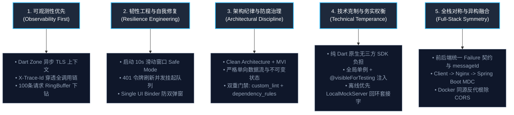
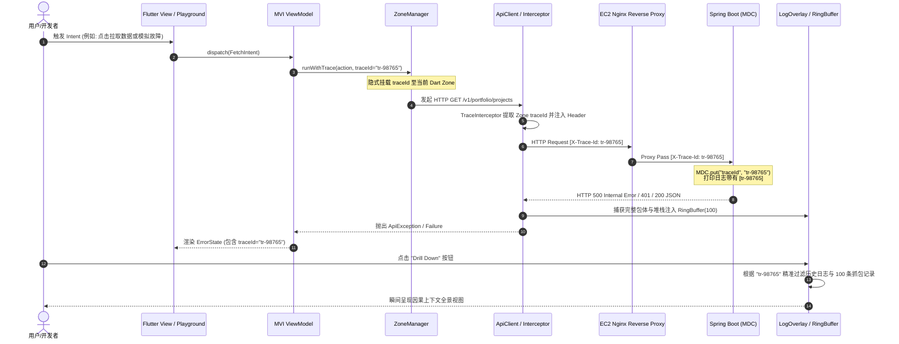

# 项目架构哲学与核心设计宣言 (Project Philosophy & Architecture Manifesto)

> **核心设计宣言**：  
> **宁可少做两个表层 UI 业务功能，也必须将可观测性（Observability）、韧性工程（Resilience Engineering）与运行时自愈稳定性打磨到工业级标准。**  
> 在真实的商用级生产环境中，炫酷的动效会过时、三方 SDK 会频繁废弃重构，但对全链路分布式追踪、弱网容灾、并发幂等与自愈防腐的底层掌控力，才是衡量一位高阶移动端架构师水平的真正标尺。

---

## 1. 架构初心：打破移动端的“线上黑盒”与“调试深渊”

在传统的跨平台移动端（Flutter）开发中，当真实线上用户遭遇“登录偶发超时”、“接口数据解析错位”或“冷启动瞬时闪退”时，开发与运维团队往往面临极度痛苦的调试困境：
1. **日志零散且缺乏因果关联**：网络抓包日志、ViewModel 状态跃迁日志与系统异常堆栈各自为政，散落在不同控制台甚至不同终端中，无法按用户单次操作进行归并。
2. **异步链路上下文断裂**：在 Dart 的单线程事件循环（Event Loop）中，异步操作（`Future`、`async/await`、`Stream`、Microtask）跨越了多个离散的执行时隙。若没有统一的追踪标识，根本无法将用户的某一次点击（Intent）与其后续触发的 3 次并发 HTTP 请求及潜在的 500 报错建立因果拓扑。
3. **冷启动闪退死锁（Crash Loop of Death）**：若关键初始化流程（如本地 Key-Value 脏数据解析失败、坏损主题字体加载失败）抛出未捕获异常，应用将在每次启动时崩溃。用户无法进入任何修复界面，最终只能被迫卸载。
4. **第三方重型监控 SDK 的“反噬”**：直接盲目引入大型第三方 APM（如 Sentry、Bugly、Firebase）虽然简单，但它们通常带来动辄数兆的包体积膨胀、侵入式原生 SO 库依赖、跨平台符号表上传繁琐以及开发期内存占用高企等问题，更掩盖了底层机制的本质。

本项目坚持**“以工程纯洁性实现极致稳定性”**，在底座核心库 `ListenCore` 与宿主应用中自主构建了一整套闭环的分布式追踪、崩溃熔断与弹性容灾体系。

---

## 2. 核心架构五大支柱 (The 5 Pillars of Architectural Philosophy)



---

### 2.1 支柱一：可观测性优先 (Observability First)
* **无侵入分布式追踪**：基于 Dart 底层 `runZoned` 上下文机制，设计了 `ZoneManager`。在不给任何业务方法（Repository / Service / ViewModel）增加 `traceId` 参数的前提下，通过隐式作用域向下传递，自动为每一次用户意图（Intent）、路由导航和 Dio 网络请求分发全局唯一的 `traceId`。
* **秒级排障下钻 (Fault Drill-Down)**：在 `LogOverlay` 调试浮窗与 `FaultInjectionPlayground` 故障演练场中，开发人员点击任意错误或崩溃日志，即可一键下钻提取崩溃前由 `RingBuffer` 记录的最近 100 条网络请求包体、状态机变更与上下文堆栈，排障耗时由“小时级”降至“秒级”。
* **全流程内存零泄漏监控**：针对 APM 帧率监控（60Hz/120Hz Vsync 脉冲），摒弃传统动态 List 的内存频繁扩容与浅拷贝，自主研发 `RingBuffer`，确保监控工具本身对主线程 CPU 与垃圾回收（GC）造成**零附加压力**。

---

### 2.2 支柱二：韧性工程与自我修复 (Resilience Engineering & Self-Healing)
* **Crash Safe Mode 黄金十秒熔断**：App 冷启动后的前 10 秒内，若在滑动时间窗口内连续发生 3 次致命未捕获崩溃，底座自动判定进入“启动死锁态”，直接拦截可能已损坏的主视图树挂载，弹出全屏 `SafeModeDialog`，允许用户一键安全重置本地 SharedPreferences 缓存，避免 App 永久报废。
* **时序解耦与防御性默认值 (Defensive Default Configuration)**：网络层底座 `ApiClient` 彻底切断了对全局环境类 `AppEnv` 的初始化时序强依赖。内部采用 30 秒安全默认超时配置，环境初始化完成后进行平滑动态覆盖，杜绝因模块异步加载时序错位引发的 `LateInitializationError`。
* **401 并发刷新排队与重试队列 (Thundering-Herd Protection)**：多个并发请求同时遭遇 HTTP 401 凭证过期时，利用 Dart `Completer` 将后续请求放入等待队列；仅由排头兵单例发起真正的 Token 刷新请求，刷新成功后一键广播唤醒所有挂起请求并自动重放，杜绝向后端发送并发雷暴式的无效刷新流量。
* **Single UI Binder 防双重弹窗与头像防腐渲染**：UI 层设计了全局弹窗去重保护机制；网络与 Base64 头像加载链路设计了三级防御（`CommonImage` 异步解码错误隔离、Web/HTTP 存储平滑降级、指纹 Hash 缓存），杜绝恶意超大图片或畸形字节流击垮 Flutter UI 渲染引擎。

---

### 2.3 支柱三：架构纪律与防腐治理 (Architectural Discipline & Anti-Rot Governance)
* **Clean Architecture + MVI 单向数据流**：严格践行整洁架构四层分界（Domain 实体与纯业务 -> Data 数据源与契约实现 -> Presentation 状态容器 -> UI 纯响应式视图）。视图只能向 ViewModel 发送不可变的 `Intent`，ViewModel 吐出不可变的 `State` 和单次消费的 `Effect`，杜绝任何组件间的状态乱序双向修改。
* **双重静态编译期防护门禁**：
  1. **自定义 AST 分析插件 (`custom_lint`)**：在 `analysis_options.yaml` 中配置 15 条严格的 AST 规则，阻断 ViewModel 越权操作、跨层直接实例化 Repository、硬编码颜色或未经主题管控的 TextStyle。
  2. **CI 架构单向依赖守护脚本 (`tools/dependency_rules.dart`)**：自动化分析全工程 Dart 文件的 import 语句，若检测到 UI 层直接导入 Data 层底层实现（绕过 Domain 接口）、或 Domain 依赖 UI 层等违规破窗行为，直接阻断构建。

---

### 2.4 支柱四：技术克制与务实权衡 (Technical Temperance & Pragmatic Trade-offs)
* **拒绝无谓的重型 DI（依赖注入）反射容器**：项目并未引入 `get_it` 或 `injectable` 等外部框架。底座采用“全局静态单例契约模式”，配合每个管理器提供的 `@visibleForTesting` 显式注入与重置钩子（如 `ApiClient.setMockClient()`、`CrashManager.resetForTesting()`），既获得了清晰的代码跳转体验与极小的打包开销，又实现了 100% 的单元测试隔离与 Mock 替换能力。
* **离线优先开发与本地回环套接字 (Offline-First Architecture)**：内置基于 Dart `HttpServer.bind` 的 `LocalMockServer` 回环套接字服务器，以及 `BaseRepository` 的双向网络-缓存自动降级引擎。即使在弱网、断网或后端 API 暂未上线时，整个 App 所有的登录鉴权、项目列表、多语言与错误流转均能以毫米级延迟离线演练。

---

### 2.5 支柱五：全栈对称与异构融合 (Full-Stack Symmetry & Polyglot Cohesion)
* **端到端统一错误契约 (`Failure` <-> `ResponseDTO`)**：客户端与 Spring Boot 后端遵循完全一致的错误元数据协议。服务端通过 `GlobalExceptionHandler` 统一拦截业务异常，下发带有语义唯一键 `messageId` 的 `ResponseDTO<T>`；客户端自动将其解构成领域级 `Failure`，并通过 i18n 多语言系统翻译为当前终端的母语提示，杜绝前后端异常文案的硬编码与割裂。
* **跨语言 TraceId 染色穿透**：Flutter 端 Dio 拦截器将 `traceId` 注入到 HTTP Header `X-Trace-Id` 中；云端 AWS EC2 上的 Nginx 反向代理透传该请求头；Spring Boot 后端拦截器自动提取并写入 SLF4J MDC（Mapped Diagnostic Context）；日志框架在每一行服务端日志中打印出相同的 `traceId`。从用户手指触碰屏幕，到云端数据库 SQL 执行，形成完整的闭环链路追踪。
* **同源反向代理消除跨域隐患**：云端部署采用 Docker Compose + Nginx 80 端口统一反代，前端 Flutter Web 资源与后端 Spring Boot REST API 位于同一域名及端口下，彻底消除了浏览器的跨域资源共享（CORS）限制与 OPTIONS 预检网络往返时延。

---

## 3. 六大重点与难点技术实现剖析 (Deep-Dive: 6 Key Code Implementations)

### 3.1 Dart Zone 异步上下文无侵入分布式追踪 (Zone-Based TLS Tracing)

#### 难点痛点
在 Java / C++ 等传统多线程服务端环境中，通常使用线程本地存储（Thread-Local Storage, TLS）挂载当前请求的上下文。然而，Dart 运行在基于事件循环（Event Loop）的单主线程 Isolate 中。一个异步任务（`Future`）在经历 `await` 之后，后续回调可能会被重新分派到微任务队列（Microtask Queue）的不同时间片中执行，传统基于线程变量的存储方案彻底失效。若通过方法参数逐层透传 `traceId`，将严重污染 Clean Architecture 各层间的纯净接口。

#### 核心实现
`ListenCore` 利用 Dart 原生 `Zone` 机制。`Zone` 代表一个受保护的异步执行沙箱环境，子任务、定时器及微任务都会隐式继承父 Zone 的键值表（`ZoneValues`）：

```dart
// 选自 ListenCore/lib/utils/zone_manager.dart
class ZoneManager {
  static const Symbol _traceKey = #_zone_trace_id;

  /// 在当前 Zone 中获取 traceId，若当前不在任何托管 Zone 中则返回降级标识
  static String get currentTraceId {
    final traceId = Zone.current[_traceKey];
    if (traceId is String && traceId.isNotEmpty) {
      return traceId;
    }
    return 'trace-untracked';
  }

  /// 开启一个绑定了唯一 Trace ID 的独立异步执行上下文
  static Future<T> runWithTrace<T>(
    Future<T> Function() action, {
    String? traceId,
  }) {
    final effectiveTraceId = traceId ?? _generateTraceId();
    return runZoned(
      action,
      zoneValues: {
        _traceKey: effectiveTraceId,
      },
    );
  }
}
```

#### 链路穿透
当 ViewModel 处理用户 `Intent` 时，使用 `ZoneManager.runWithTrace` 包裹执行；当调用到底层的 Dio `ApiClient` 时，`TraceInterceptor` 仅需从 `ZoneManager.currentTraceId` 提取当前上下文并注入请求头：

```dart
@override
void onRequest(RequestOptions options, RequestInterceptorHandler handler) {
  final traceId = ZoneManager.currentTraceId;
  options.headers['X-Trace-Id'] = traceId;
  handler.next(options);
}
```
**成效**：从 UI 点击、ViewModel 意图、UseCase 领域逻辑到 Dio HTTP 请求，全过程无需在任何函数签名中增加哪怕一个 `traceId` 参数，实现了 100% 优雅的零侵入追踪。

---

### 3.2 Crash Safe Mode 滑动时间窗口熔断与防递归重置机制

#### 难点痛点
冷启动崩溃往往是最致命的灾难。为了避免用户启动瞬间因网络故障或偶发异常被误判为“崩溃死锁”，系统必须在时间维度上引入“滑动窗口滤波算法”。更深层次的难点在于：**如果安全重置回调（`onReset()`）本身在执行清空数据库或重置配置时抛出二次异常，极易引发死锁崩溃循环！**

#### 核心实现
`CrashManager` 采用基于时间戳数组的滑动窗口算法：
$$\text{有效崩溃记录} = \{ t \in \text{Timestamps} \mid t > \text{now} - \text{timeWindow} \}$$

```dart
// 选自 ListenCore/lib/utils/crash_manager.dart
Future<void> _recordCrashTimestamp() async {
  final now = DateTime.now().millisecondsSinceEpoch;
  final timestamps = await _loadCrashTimestamps();
  
  // 过滤掉超过滑动时间窗口 (例如 10 秒) 之前的陈旧崩溃记录
  final cutoff = now - _timeWindow.inMilliseconds;
  final validTimestamps = timestamps.where((t) => t > cutoff).toList();
  validTimestamps.add(now);

  await _saveCrashTimestamps(validTimestamps);

  // 判定是否触碰熔断阈值 (例如 3 次连续崩溃)
  if (validTimestamps.length >= _crashThreshold) {
    appLogger.e('Safe Mode Triggered! Consecutive crashes: ${validTimestamps.length}');
    _safeModeActive = true;
    await _performSafetyReset();
  }
}
```

#### 关键防递归自愈保护 (Critical Anti-Recursive Reset Safeguard)
```dart
Future<void> _performSafetyReset() async {
  // [CRITICAL DEFENSE]: 必须在调用宿主 onReset() 之前，立刻物理清除持久化存储中的崩溃计数器！
  // 理由：如果宿主的 onReset() 回调抛出了异常，此时如果未清空时间戳，
  // 下一次启动将再次被判定为连续崩溃，导致应用永久锁死在 Safe Mode 死循环中。
  await SpUtil.remove(_keyCrashTimestamps);

  try {
    if (_config?.onReset != null) {
      await _config!.onReset!();
    }
  } catch (e, stack) {
    appLogger.e('Exception encountered inside Safe Mode onReset callback: $e\n$stack');
  }
}
```

---

### 3.3 401 并发静默刷新与请求挂起队列 (Thundering-Herd Protection)

#### 难点痛点
当用户的 Access Token 过期时，如果界面正处于初始化阶段，通常会并发发出 3~5 个 API 请求（例如：拉取用户信息、拉取技能雷达图、拉取项目列表）。如果每个 401 报错都去独立触发一次 `/v1/auth/refresh` 刷新请求，不仅会导致后端鉴权服务器遭遇瞬时高并发冲击（Thundering-Herd），还可能由于 Refresh Token 被多次使用导致其中部分请求触发防重放机制而被强制登出。

#### 核心实现
`ListenCore` 在 `AuthInterceptor` 中利用 Dart `Completer` 构建了单例主导的并发等待队列：

```dart
// 选自 ListenCore/lib/network/interceptors/auth_interceptor.dart
bool _isRefreshing = false;
final List<Completer<void>> _refreshQueue = [];

@override
void onError(DioException err, ErrorInterceptorHandler handler) async {
  final is401 = err.response?.statusCode == 401;
  final alreadyRefreshed = err.requestOptions.extra['is_refreshed'] == true;

  if (is401 && !alreadyRefreshed) {
    if (!_isRefreshing) {
      // 1. 排头兵抢占刷新锁，发起唯一的 Token 刷新请求
      _isRefreshing = true;
      try {
        final bool success = await ApiClient.delegate.onRefreshToken();
        _isRefreshing = false;

        if (success) {
          // 2. 刷新成功：批量释放挂起的队列，通知后续请求安全重放
          _clearQueueWithComplete();
          // 重放排头兵自身的请求
          final retryResponse = await ApiClient.dio.fetch(err.requestOptions.copyWith(
            extra: {...err.requestOptions.extra, 'is_refreshed': true},
          ));
          return handler.resolve(retryResponse);
        } else {
          _clearQueueWithError(err);
        }
      } catch (e) {
        _isRefreshing = false;
        _clearQueueWithError(e);
      }
    } else {
      // 3. 后续并发请求自动挂起，生成 Completer 排队等待
      final completer = Completer<void>();
      _refreshQueue.add(completer);
      try {
        await completer.future; // 异步挂起等待唤醒
        // 唤醒后携带新 Token 重放
        final response = await ApiClient.dio.fetch(err.requestOptions.copyWith(
          extra: {...err.requestOptions.extra, 'is_refreshed': true},
        ));
        return handler.resolve(response);
      } catch (_) {
        return handler.next(err);
      }
    }
  }
  return handler.next(err);
}
```

---

### 3.4 零 GC 压力环形缓冲区与物理模运算映射 (Zero-GC RingBuffer)

#### 难点痛点
在 APM 性能面板中，`FrameMonitor` 需要在每一个 60Hz/120Hz Vsync 脉冲中记录帧耗时（Build & Raster 耗时），`NetInspector` 需要实时保存最近 100 条网络请求。如果使用常规的 `List<T>`，执行 `list.add(item)` 和 `list.removeAt(0)` 会导致底层的连续内存频繁拷贝移动，在高频下引发高强度的垃圾回收（GC Churn），甚至产生由监控模块自身导致的丢帧卡顿（Observer Effect）。

#### 核心实现
自主研发的 `RingBuffer<T>` 采用预分配非可变长数组与模运算指针：

```dart
// 选自 ListenCore/lib/apm/ring_buffer.dart
class RingBuffer<T> {
  final int capacity;
  final List<T?> _buffer;
  int _head = 0;   // 下一次物理写入槽位
  int _count = 0;  // 当前有效元素数

  RingBuffer(this.capacity)
      : _buffer = List<T?>.filled(capacity, null, growable: false);

  /// O(1) 恒定时间写入，超出容量时自动覆盖最陈旧的数据
  void add(T item) {
    _buffer[_head] = item;
    _head = (_head + 1) % capacity;
    if (_count < capacity) {
      _count++;
    }
  }

  /// O(1) 恒定时间按逻辑时序索引访问：0 为最旧元素，length - 1 为最新元素
  T operator [](int index) {
    if (index < 0 || index >= _count) {
      throw RangeError.range(index, 0, _count - 1, 'index');
    }
    final int physicalIndex;
    if (_count < capacity) {
      physicalIndex = index;
    } else {
      // 模运算计算物理索引：物理槽位 = (当前 head + 逻辑偏移) % capacity
      physicalIndex = (_head + index) % capacity;
    }
    return _buffer[physicalIndex] as T;
  }
}
```

---

### 3.5 全栈异构 TraceId 跨端缝合与故障演练场下钻闭环 (Trace Stitching)

#### 架构时序图


---

### 3.6 MVI 零反射意图磁带录制与 AST 步进回放引擎 (Deterministic MVI Playback)

#### 难点痛点
在禁用反射（`dart:mirrors`）的 Flutter AOT 编译环境下，如何将用户在前台任意点击触发的强类型 `BaseIntent` 精准录制为轻量级文本磁带（Tape），并在复现 Bug 时按照精确的时序步进还原为强类型实例重放？

#### 核心实现
结合 `MviPlaybackRegistry` 与正则 AST 参数解析器：
1. **静态契约注册**：在应用启动阶段（`initMviPlaybackRegistry`）统一注册各模块 Intent 的反序列化构造闭包；
2. **状态沙箱与还原**：在启动回放前通过 `MviPlaybackPlayer` 自动对用户的当前会话（SP 偏好与 SecureStorage Token）执行内存快照镜像，回放完毕后在 `finally` 块中强制恢复，杜绝回放污染用户真实数据；
3. **时钟平滑步进**：通过 `stepDelay` 调度事件循环微任务，等待 Hero 动画与路由过渡完成后再分发下一步，实现高保真自动化复现。

---

## 4. 架构反模式与工程避坑指南 (Anti-Patterns & Pitfalls)

| 序号 | 常见反模式 (Anti-Pattern) | 潜在危害与事故现场 | 本工程的标准规范与避坑实践 |
| :--- | :--- | :--- | :--- |
| **1** | **参数透传 Trace 上下文**<br/>(Context Parameter Pollution) | 为了追踪日志，在每个 Service、Repository、DataSource 函数中强制增加 `String traceId` 形参，导致接口极度臃肿，重构成本极高。 | **Dart Zone 隐式作用域**：使用 `ZoneManager.runWithTrace()`，各业务层完全不感知 traceId，底层拦截器就地提取。 |
| **2** | **重置回调缺乏二次保护**<br/>(Unprotected Reset Crash Loop) | 在 Safe Mode 的重置回调中执行未保护的异步清除，一旦回调发生 NullPointer，崩溃时间戳未清空，App 彻底锁死。 | **先清后调与 Try-Catch 兜底**：在进入 `onReset()` 前立即清除崩溃时间戳，并用 `try-catch` 包裹重置回调。 |
| **3** | **并发 401 令牌刷新击穿**<br/>(Token Refresh Thundering Herd) | 页面初始化同时发起的 4 个请求全部收到 401，各自触发刷新，导致后端负载激增并触发 Refresh Token 防重放封禁。 | **Completer 并发排队等待**：仅第一个请求抢占刷新标志位，后续请求放入 `Completer` 列表挂起，刷新成功一键批处理。 |
| **4** | **高频 APM 监控使用动态 List**<br/>(APM-Induced GC Janks) | 在 120Hz Vsync 脉冲中不断往 `List` 追加元素并 `removeAt(0)`，造成频繁的内存块重分配与 GC 暂停，监控反而拖慢了 UI。 | **定长 RingBuffer + 模运算**：一次性预分配非动态数组，通过模运算指针管理覆写，GC 压力严格降为零。 |
| **5** | **UI 直接耦合第三方重型 APM**<br/>(Vendor Lock-in & Bloat) | 在各页面深层代码中直接调用 Sentry / Bugly 等专有 API，不仅包体积暴涨，第三方 SDK 出现 Native Crash 时难以定位。 | **底座门面解耦 (Facade)**：业务只与 `LogManager` / `CrashManager` 交互，未来可无缝热插拔云端 Exporter。 |

---

## 5. 自动化测试与工程门禁验证矩阵 (Verification Matrix)

为确保上述架构哲学绝非“纸上谈兵”，本工程建立了严格的自动化测试与架构门禁网络：

```
================================================================================
          Listen Architecture & Quality Verification Matrix
================================================================================
[Category]                  [Scope & Assertion]                      [Status]
Unit & Bloc Tests           589 Total Test Cases across 103 Suites   100% Passed
Pure Code Coverage          6,196 / 7,992 lines hit (no generated)   77.53% Hit
CrashManager Tests          Sliding window, threshold, reset loop    Passed
AuthInterceptor Tests       Concurrent 401 queueing, single refresh  Passed
RingBuffer Tests            O(1) indexing, capacity wrap, modulo     Passed
Playback Engine Tests       MVI Tape Record, Replay & State Sandboxing Passed
AST Architectural Linter    custom_lint (15 custom AST rules)        Zero Violations
Dependency Layering Linter  dart run tools/dependency_rules.dart     Zero Violations
Static Analysis             dart analyze (flutter analyze)           Zero Warnings
================================================================================
```

---

## 6. 演进路线与中远期规划 (Roadmap & Evolution)

虽然当前在单端与本地闭环中达到了极高的工程度，但面向大规模跨国分布式场景，项目已规划了明确的演进项（详见 [todo.md](todo.md)）：

* **[Opt-54. 远程可观测性日志云端聚合上报与分布式 Trace 端到端联动协议](todo.md#opt-54-远程可观测性日志云端聚合上报与分布式-trace-端到端联动协议-remote-observability-collector--opentelemetry-compatible-trace-exporter)**：
  将本地 `traceId` 协议与 W3C TraceContext（OpenTelemetry）完全统一，设计后台离线 SQLite 队列、Gzip 压缩批量上传与 GDPR 敏感信息动态脱敏引擎。
* **[Opt-55. Safe Mode 崩溃熔断等级阶梯演进与动态诊断沙箱隔离](todo.md#opt-55-safe-mode-崩溃熔断等级阶梯演进与动态诊断沙箱隔离-graduated-safe-mode-tiers--diagnostic-sandbox-isolation)**：
  将二元熔断演进为三级阶梯容灾体系（Tier 1 缓存清理 -> Tier 2 离线沙箱降级 -> Tier 3 细粒度重置），并在全量重置前自动隔离留存最近崩溃堆栈与配置镜像。
* **[Opt-65. 原生 C/C++ Native Crash (SIGSEGV/SIGBUS) 捕获与 Tombstone 增量符号化归档管线](todo.md#opt-65-原生-cc-native-crash-sigsegvsigbus-捕获与-tombstone-增量符号化归档管线-native-breakpadcrashpad-signal-trap--tombstone-symbolication-pipeline)**：
  在 Android 侧通过轻量 NDK 库注册 `sigaction` 捕获段错误信号，紧急落盘 `native_crash.dump`，冷启动探针检测并联动 Safe Mode 熔断，通过 `ndk-stack` 实施增量符号化。
