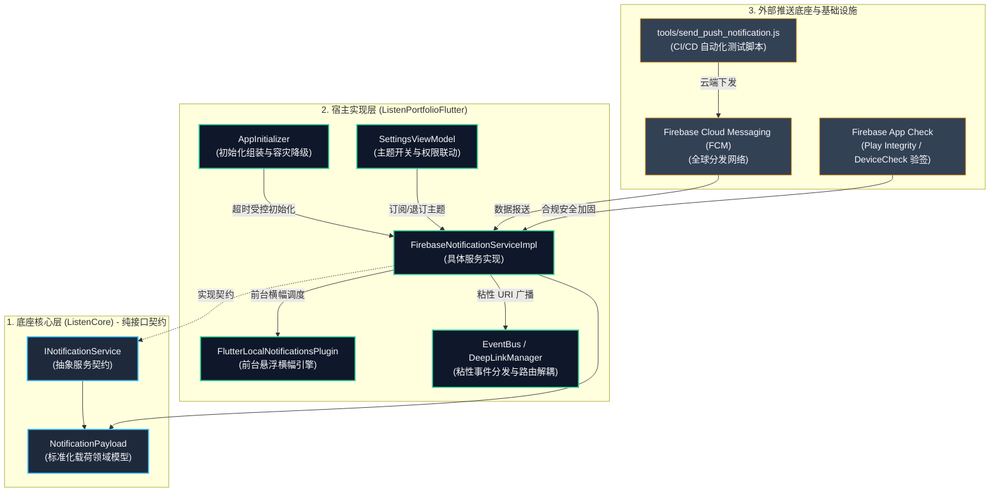
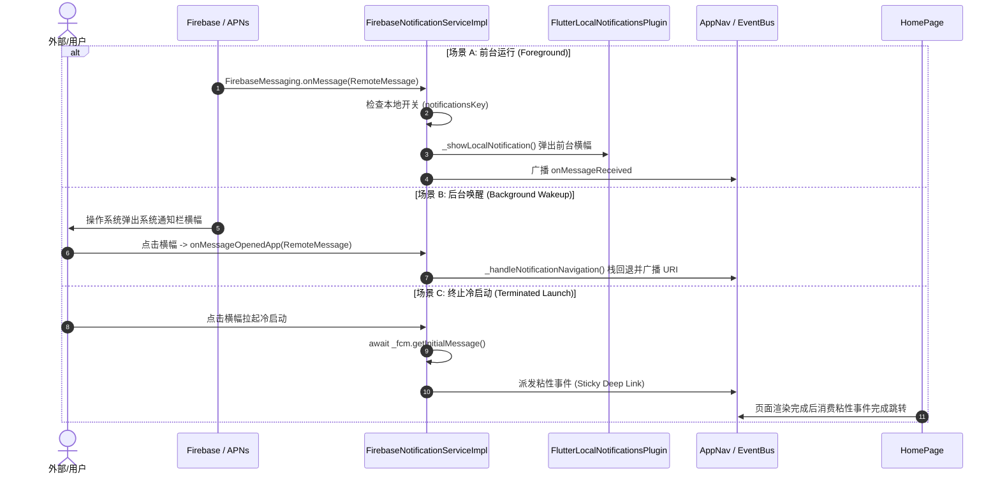

# 推送通知跨端集成与架构规范 (Push Notification Specification)

> **设计哲学**：  
> **基础底座零三方侵入，业务层面向契约编程，兼具网络弱网/离线容灾、冷启动粘性路由与开发者本地沙箱仿真。**  
> 推送通知不仅是一套简单的消息到达机制，更是串联“设备唤醒”、“冷启动生命周期”、“深度链接路由栈重塑”与“权限合规管控”的关键工程通道。

---

## 1. 核心架构与设计目标

为了在作品集 App 中实现商用级推送通知，同时保持基础库（`ListenCore`）与具体第三方云推送平台（`Firebase Cloud Messaging` / APNs / 极光推送）的绝对解耦，本项目遵循**依赖倒置原则（Dependency Inversion Principle, DIP）**与**整洁架构（Clean Architecture）**规范，构建了双层推送服务体系。

### 1.1 核心设计目标
1. **基础库纯洁性与平台无关（Vendor Decoupling）**：底座核心库 `ListenCore` 仅定义平台无关的数据载荷模型 `NotificationPayload` 与操作契约 `INotificationService`，绝不直接依赖 `firebase_messaging` 或原生插件。
2. **全生命周期精准感知（Three Lifecycle States）**：
   - **前台（Foreground）**：应用活跃运行时静默接收消息，结合 `flutter_local_notifications` 自动调度系统高优先级浮动横幅（Heads-up Banner），并向事件流广播。
   - **后台唤醒（Background Wakeup）**：用户从系统下拉通知栏点击消息，唤醒后台挂起或休眠的 App，安全拉回前台并调度路由。
   - **冷启动/终止态（Terminated Launch）**：应用未运行或被系统杀死时，用户点击通知触发冷启动，通过粘性事件（Sticky Event）完成页面重定向，彻底避免因页面未挂载完毕引发的路由丢失。
3. **网络弹性与防冻结超时熔断（Resilience & Timeout Safeguards）**：针对弱网、特定受限网络（如部分地区无法访问 Google Play 服务或 Firebase 端点）的环境，所有异步网络调用均配备硬超时防护（5s~10s），彻底规避冷启动挂死风险。
4. **统一深度链接与路由栈回退（Deep Link Unwinding）**：点击通知唤醒时，自动先将路由栈安全弹出回退至根页面（`Routes.home`），再通过事件总线派发深度链接 URI，防止页面栈无限堆叠导致内存泄露。
5. **本地沙箱仿真器（In-App Notification Simulator）**：在开发者设置中内建推送消息模拟器，支持在无真实 Firebase 后端或测试设备离线环境下，100% 高保真演练前台横幅与路由流转。

---

## 2. 系统架构与交互拓扑



---

## 3. 核心领域契约定义 (`ListenCore`)

在 `ListenCore/lib/services/notification_service.dart` 中，抽象出了平台无关的实体与服务契约：

### 3.1 标准化通知载荷实体 (`NotificationPayload`)
```dart
// 选自 ListenCore/lib/services/notification_service.dart
class NotificationPayload {
  /// 用户可见的消息标题
  final String title;

  /// 消息正文描述
  final String body;

  /// 随通知携带的业务自定义扩展键值对 (如 link, id, campaign_id 等)
  final Map<String, dynamic> data;

  const NotificationPayload({
    required this.title,
    required this.body,
    this.data = const {},
  });

  /// 鲁棒的安全反序列化构造器，对缺失或非法字段进行默认兜底
  factory NotificationPayload.fromJson(Map<String, dynamic> json) {
    return NotificationPayload(
      title: json['title'] as String? ?? '',
      body: json['body'] as String? ?? '',
      data: json['data'] as Map<String, dynamic>? ?? const {},
    );
  }
}
```

### 3.2 抽象服务接口 (`INotificationService`)
```dart
// 选自 ListenCore/lib/services/notification_service.dart
abstract class INotificationService {
  /// 初始化推送服务配置、渠道注册与生命周期监听器
  Future<void> initialize();

  /// 动态向操作系统申请推送通知权限 (Android 13+ POST_NOTIFICATIONS / iOS APNs)
  Future<bool> requestPermission();

  /// 获取设备当前唯一的远程推送注册 Token
  Future<String?> getToken();

  /// 设备 Token 刷新事件流 (用于 Token 轮转同步)
  Stream<String> get onTokenRefresh;

  /// 前台收到新消息时的事件流
  Stream<NotificationPayload> get onMessageReceived;

  /// 用户从系统通知栏点击消息唤醒应用时的事件流
  Stream<NotificationPayload> get onMessageOpenedApp;

  /// 订阅特定业务广播主题 (如 version_updates)
  Future<void> subscribeToTopic(String topic);

  /// 取消订阅特定业务广播主题
  Future<void> unsubscribeFromTopic(String topic);
}
```

---

## 4. 宿主服务核心实现 (`FirebaseNotificationServiceImpl`)

宿主应用落地文件位于：[`lib/shared/services/firebase/firebase_notification_service_impl.dart`](../lib/shared/services/firebase/firebase_notification_service_impl.dart)。该类承担了多维度的底层适配与容灾管理。

### 4.1 核心状态与安全超时机制
在初始化与网络请求中，若遇到网络不可达（如无梯环境下的 Google 服务阻塞），未设超时的 `await` 会直接造成应用在启动期永久卡死。因此，系统设立了严格的分级超时常数：

```dart
class FirebaseNotificationServiceImpl implements INotificationService {
  static const Duration _kInitTimeout = Duration(seconds: 10);     // Firebase 核心初始化超时
  static const Duration _kConfigTimeout = Duration(seconds: 5);    // 渠道与前台展示配置超时
  static const Duration _kNetworkTimeout = Duration(seconds: 10);  // FCM Token 与主题订阅网络超时
  static const Duration _kPermissionTimeout = Duration(seconds: 5);// 权限交互弹窗响应超时

  FirebaseMessaging get _fcm => FirebaseMessaging.instance;
  final FlutterLocalNotificationsPlugin _localNotifications = FlutterLocalNotificationsPlugin();

  final StreamController<NotificationPayload> _messageReceivedController =
      StreamController<NotificationPayload>.broadcast();
  final StreamController<NotificationPayload> _messageOpenedController =
      StreamController<NotificationPayload>.broadcast();

  bool _isFirebaseInitialized = false;
```

---

## 5. 六大重点与难点技术实现剖析 (Deep-Dive: 6 Key Code Implementations)

### 5.1 全生命周期（前台/后台/终止态）统一收敛处理

#### 难点痛点
Android 原生机制下，当 App 处于前台时，FCM 默认**不会**弹出系统通知栏悬浮横幅；而当 App 处于已终止（Terminated）状态时，用户点击通知会拉起全新的 Flutter Engine，此时监听器若绑定过晚，初次启动的消息 payload 将永久丢失。

#### 核心实现


在代码中，统一通过 `_handleNotificationNavigation` 统一路由入口：
```dart
// 1. 前台消息监听
FirebaseMessaging.onMessage.listen((RemoteMessage message) {
  if (!SpUtil.getBool(AppConstants.notificationsKey, defaultValue: true)) return;
  final payload = _convertMessage(message);
  _messageReceivedController.add(payload);
  if (message.notification != null) {
    _showLocalNotification(message, channel); // 触发前台 Heads-up Banner
  }
});

// 2. 后台点击唤醒监听
FirebaseMessaging.onMessageOpenedApp.listen((RemoteMessage message) {
  if (!SpUtil.getBool(AppConstants.notificationsKey, defaultValue: true)) return;
  final payload = _convertMessage(message);
  _messageOpenedController.add(payload);
  _handleNotificationNavigation(payload);
});

// 3. 终止态冷启动获取
final initialMessage = await _fcm.getInitialMessage().timeout(
  _kConfigTimeout,
  onTimeout: () => null,
);
if (initialMessage != null && SpUtil.getBool(AppConstants.notificationsKey, defaultValue: true)) {
  final payload = _convertMessage(initialMessage);
  _messageOpenedController.add(payload);
  _handleNotificationNavigation(payload);
}
```

---

### 5.2 路由栈回退防溢出与粘性深度链接（Deep Link Unwinding）

#### 难点痛点
当用户在浏览多层嵌套页面（例如“设置” -> “字体调整” -> “关于我” -> “更新说明”）时突然点击了一条推送通知，如果直接执行 `AppNav.to(targetRoute)`，会导致底层页面堆栈被无限叠加，用户按下物理返回键时需要连续返回十余次才能回到首页，极大损害体验，甚至引发内存泄漏。同时，在终止态冷启动时，目标页面还未初始化完成，普通的临时事件广播会被丢弃。

#### 核心实现
`FirebaseNotificationServiceImpl._handleNotificationNavigation` 采取了**“先解开栈、再发粘性事件”**的优雅解法：

```dart
void _handleNotificationNavigation(NotificationPayload payload) {
  appLogger.i('FirebaseNotificationService: _handleNotificationNavigation=$payload');
  final data = payload.data;

  // 1. 弹出所有子路由与模态弹窗，平滑重置至 HomePage 根路由
  AppNavConfig.navigatorKey.currentState?.popUntil((route) {
    return route.settings.name == Routes.home || route.isFirst;
  });

  // 2. 解析深度链接并派发粘性事件 (Sticky Event)
  if (data.containsKey(AppConstants.notificationParamLink)) {
    final linkStr = data[AppConstants.notificationParamLink] as String;
    final uri = Uri.tryParse(linkStr);
    if (uri != null) {
      eventBus.fire(
        CommonEvent<Uri>(
          DeepLinkManager.deepLinkEventKey,
          data: uri,
          sticky: true,   // 粘性：如果目标监听器尚未就绪，暂存此事件
          autoClear: true,// 消费后自动清除，杜绝重复触发
        ),
      );
      return;
    }
  }
}
```

---

### 5.3 Android 13+ (API 33) 权限合规与按需上下文式授权 (Contextual Permission)

#### 难点痛点
Google Play 与工信部合规政策严令禁止应用在冷启动第一帧未给用户任何解释就粗暴弹窗索取 `POST_NOTIFICATIONS` 权限。若用户在启动时被突兀弹窗吓退点击了拒绝，后续将很难引导用户去系统深层设置中重新开启。

#### 核心实现
本项目采用**“延迟与上下文感知授权（Contextual On-Demand Authorization）”**：
1. **冷启动静默**：`AppInitializer` 在应用启动时调用 `initialize()` 仅注册底层渠道与监听器，绝不调用 `requestPermission()`。
2. **设置页交互触发**：在用户进入“设置页面”（[`SettingsPage`](../lib/features/settings/presentation/pages/settings_page.dart)）或点击“通知开关”时，由 `SettingsViewModel` 显式调用：
   ```dart
   // 选自 SettingsViewModel
   Future<void> onNotificationToggled(bool enable) async {
     updateState(state.copyWith(notificationsEnabled: enable));
     await SpUtil.put(AppConstants.notificationsKey, enable);

     if (enable) {
       final granted = await notificationService.requestPermission();
       if (!granted) {
         // 用户拒绝系统授权，UI 开关自动回弹复原为关闭态，并弹出提示引导
         updateState(state.copyWith(notificationsEnabled: false));
         await SpUtil.put(AppConstants.notificationsKey, false);

         emitEffect(
           ConfirmEffect(
             title: I18nKeys.notificationPermissionTitle.tr,
             message: I18nKeys.notificationPermissionMessage.tr,
             okText: I18nKeys.openSettings.tr,
             onResult: (confirmed) {
               if (confirmed) {
                 handleIntent(const SettingsIntent.confirmOpenSettings());
               }
             },
           ),
         );
         return;
       }
       await notificationService.subscribeToTopic(AppConstants.versionUpdatesTopic);
     } else {
       await notificationService.unsubscribeFromTopic(AppConstants.versionUpdatesTopic);
     }
   }
   ```
3. **软硬状态自愈校准**：如果本地持久化配置显示为 `true`，但系统实际权限已被用户在系统设置中收回，下一次交互时能够平滑探测并自动将本地配置降级为 `false`，保持系统与应用状态的强一致性。

---

### 5.4 Firebase App Check 安全防护与平台凭证隔离

#### 难点痛点
移动端直接连接 Firebase 服务极易被逆向工程提取 `google-services.json` 中的公钥与 API Key，从而遭受伪造的垃圾流量或滥用配额。

#### 核心实现
服务在初始化阶段深度绑定了 `FirebaseAppCheck`，在调试期与生产期自动隔离 Provider：
```dart
try {
  await FirebaseAppCheck.instance.activate(
    // Android: 生产环境使用 Google Play Integrity 硬件级验签，Debug 使用测试令牌
    androidProvider: kDebugMode ? AndroidProvider.debug : AndroidProvider.playIntegrity,
    // iOS: 生产环境使用 Apple DeviceCheck 硬件级安全证书，Debug 使用测试令牌
    appleProvider: kDebugMode ? AppleProvider.debug : AppleProvider.deviceCheck,
  );
  appLogger.i('FirebaseNotificationService: FirebaseAppCheck activated successfully.');
} catch (appCheckError) {
  appLogger.w('FirebaseNotificationService: FirebaseAppCheck activation skipped/error: $appCheckError');
}
```

---

### 5.5 开发者设置推送仿真引擎 (`simulateMessageReceived`)

#### 难点痛点
在日常 UI 调试、集成测试或无外网开发场景下，开发者每次测试通知跳转都需要打开 Firebase Console 或运行 Node.js 脚本，操作繁琐且受网络与 Token 有效期制约。

#### 核心实现
`FirebaseNotificationServiceImpl` 提供了开箱即用的内存级仿真器：
```dart
void simulateMessageReceived(NotificationPayload payload) {
  // 检查当前应用开关是否允许展示通知
  if (!SpUtil.getBool(AppConstants.notificationsKey, defaultValue: true)) return;

  _messageReceivedController.add(payload);
  
  // 本地直接构造并激活 Android Heads-up 系统通知
  _localNotifications.show(
    id: payload.hashCode,
    title: payload.title,
    body: payload.body,
    notificationDetails: const NotificationDetails(
      android: AndroidNotificationDetails(
        AppConstants.notificationChannelId,
        AppConstants.notificationChannelName,
        channelDescription: AppConstants.notificationChannelDescription,
        icon: AppConstants.defaultNotificationIcon,
      ),
    ),
    payload: jsonEncode({'title': payload.title, 'body': payload.body, 'data': payload.data}),
  );
}
```
**成效**：在 `DeveloperSettingsPage` 中，开发者可一键触发“版本升级测试通知”或“特定 Tab 跳转通知”，直接在模拟器上验证横幅样式与点击后的粘性深度链接跳转，大幅缩短测试闭环。

---

### 5.6 统一异常捕获与弱网超时降级熔断

#### 难点痛点
当应用在地铁、电梯或海外特定受限网络环境中冷启动时，FCM 的 `subscribeToTopic` 或 `getToken` 可能会发生无限挂起或抛出 `FirebaseException`，从而引发主线程卡顿甚至未捕获异常崩溃。

#### 核心实现
所有网络操作均设置了 `_kNetworkTimeout`（10秒）超时包裹与静默降级捕获：
```dart
@override
Future<void> subscribeToTopic(String topic) async {
  if (!_isFirebaseInitialized) return;
  try {
    appLogger.i('FirebaseNotificationService: subscribeToTopic start for "$topic"...');
    await _fcm
        .subscribeToTopic(topic)
        .timeout(
          _kNetworkTimeout,
          onTimeout: () {
            appLogger.w('FirebaseNotificationService: subscribeToTopic("$topic") timed out after $_kNetworkTimeout');
          },
        );
    appLogger.i('FirebaseNotificationService: Subscribed to topic "$topic".');
  } catch (e) {
    appLogger.w('FirebaseNotificationService: Failed to subscribe to topic "$topic": $e');
  }
}
```

---

## 6. 自动化测试脚本与 CI/CD 联动 (`tools/send_push_notification.js`)

为了支撑服务端或 GitHub Actions CI/CD 流水线在发版后自动向所有用户下发升级广播，项目在 [`tools/send_push_notification.js`](../tools/send_push_notification.js) 中提供了高弹性的 Node.js 运维脚本。

### 6.1 典型推送命令

```bash
# 1. 向全局广播主题 (version_updates) 发送默认升级通知
node tools/send_push_notification.js

# 2. 发送特定项目详情页的跳转通知 (深度链接测试)
node tools/send_push_notification.js \
  --title "New Project Available!" \
  --body "Check out the ListenExpenseTracker architecture!" \
  --link "listen://app/project/detail?id=6"

# 3. 发送单设备调试推送 (避免打扰线上测试设备)
node tools/send_push_notification.js \
  --token "fcm_device_token_here..." \
  --title "Debug Push" \
  --body "Hello Developer"
```

---

## 7. 架构反模式与踩坑警示 (Anti-Patterns & Pitfalls)

| 序号 | 常见反模式 (Anti-Pattern) | 潜在危害与线上事故 | 本工程的规避与标准实践 |
| :--- | :--- | :--- | :--- |
| **1** | **未设超时的直接 Await 初始化**<br/>(Unbounded Firebase Init) | 在受限局域网或部分特殊网络下，`Firebase.initializeApp()` 或 `getToken()` 永不返回，导致启动图永久卡死。 | **全链路硬超时熔断**：为所有异步初始化配置 `timeout(_kInitTimeout)`，超时自动回退到离线禁用态。 |
| **2** | **启动首屏粗暴索权**<br/>(Aggressive Permission Prompt) | 首次打开 App 尚未进入主页就弹出系统通知权限，用户点击拒绝率高达 80%，并违反应用商店合规规范。 | **按需上下文式授权**：仅在用户进入设置页主动开启开关时才调用 `requestPermission()`，保证合规与高转化。 |
| **3** | **通知点击引发路由栈无限堆叠**<br/>(Route Stack Memory Explosion) | 连续点击多条通知时不断向当前栈执行 `to()`，导致返回时需要连退数十次，产生严重的内存泄露。 | **栈解包重置策略**：在路由跳转前统一执行 `popUntil(Routes.home)`，确保回退栈干净健康。 |
| **4** | **冷启动使用普通 EventBus 广播**<br/>(Transient Event Loss on Cold Boot) | 在终止态点击通知拉起 App 时，如果使用普通广播，目标页面的监听器尚未完成注册，导致深度链接直接丢失。 | **粘性事件 (Sticky Event)**：使用 `CommonEvent(sticky: true, autoClear: true)` 确保监听器挂载后立即补发消费。 |
| **5** | **忽视通知渠道分级与振动配置**<br/>(Channel Configuration Hazard) | 未为 Android 8.0+ 配置高优先级通知渠道，导致推送在前台或息屏时仅静默出现在通知栏，无浮动横幅。 | **显式声明 NotificationChannel**：配置 `importance: Importance.max` 与 `priority: Priority.high`，保障强提醒触达。 |

---

## 8. 演进路线与中远期规划 (Roadmap & Evolution)

当前推送系统在单端与全局广播层面已稳定落地，针对企业级场景的进一步演进规划如下（详见 [todo.md](todo.md)）：

* **[Opt-56. 动态通知频道分级治理与富媒体扩展呈现](todo.md#opt-56-动态通知频道分级治理与富媒体扩展呈现-dynamic-notification-channels--rich-media-push-presentation)**：
  增补 Android 渠道分级矩阵（更新/社交/营销三维频道隔离）、BigPicture 高清大图富文本展开与快捷操作 Action 按钮。
* **[Opt-57. 推送 Token 离线刷新容灾队列与服务端用户会话对齐](todo.md#opt-57-推送-token-离线刷新容灾队列与服务端用户会话对齐-fcm-token-refresh-offline-sync--server-session-binding-protocol)**：
  在 `ListenPortfolioBackend` 提供设备 Token 鉴权登记接口，实现客户端离线持久化队列、指数退避重试上报与坏死 Token 自动剔除。
* **[Opt-66. 基于后台静默推送 (Data Messages / Silent Push) 的本地离线缓存增量预同步引擎](todo.md#opt-66-基于后台静默推送-data-messages--silent-push-的本地离线缓存增量预同步引擎-background-silent-push--cache-warm-up-pipeline)**：
  通过 `FirebaseMessaging.onBackgroundMessage` 在后台静默接收无感知高优先级数据推送，提前唤醒并预热项目与简历本地缓存，实现用户点开 App 瞬间 0 毫秒即开即看。
