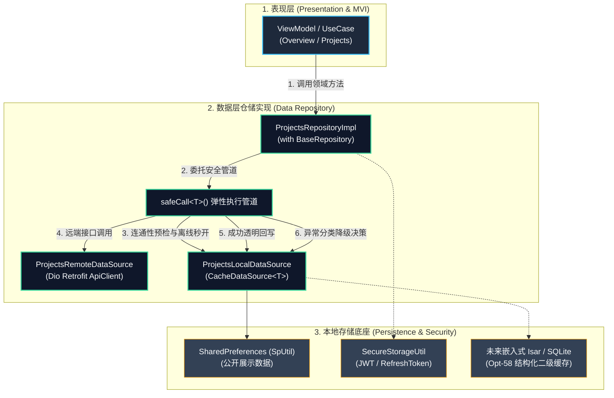
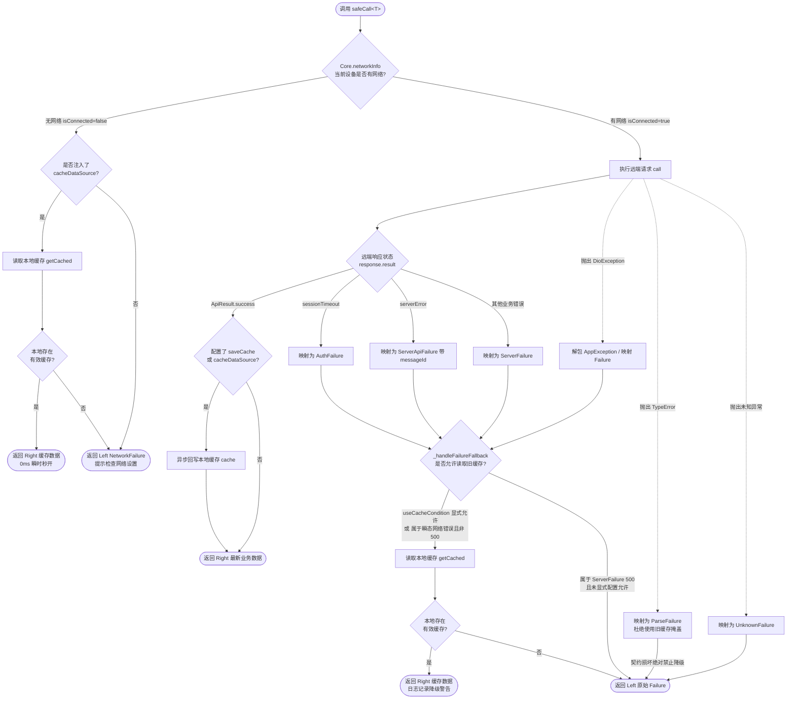
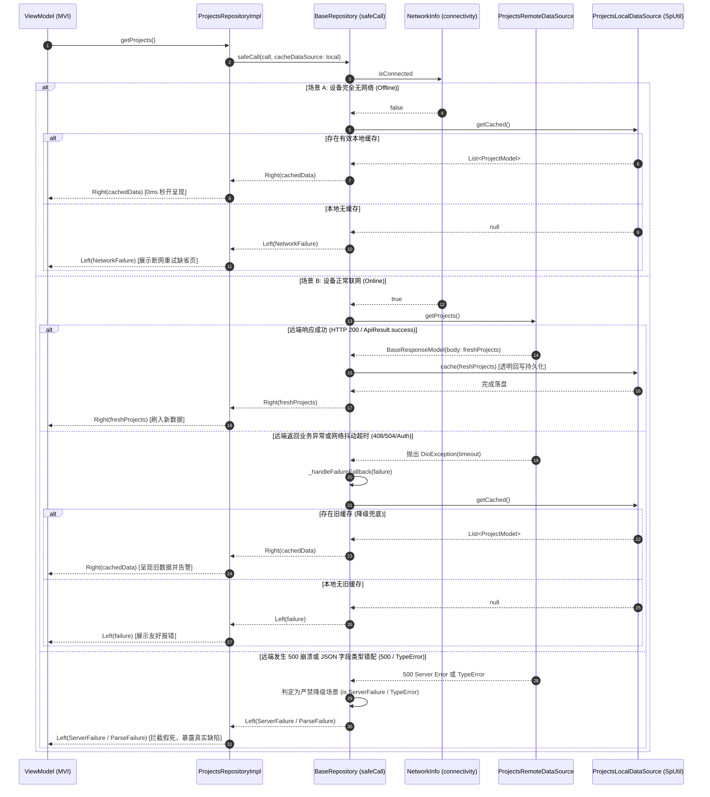
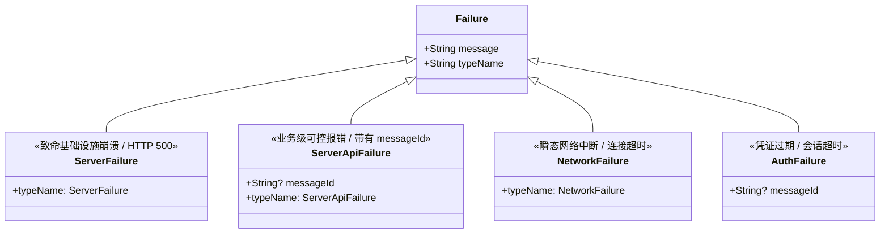

# 数据仓储缓存与离线降级策略规范 (Repository Caching & Resilience Strategy)

> **设计哲学 (Architectural Manifesto)**：  
> **“离线优先保障秒开体验，透明回写免除胶水样板，严密防腐杜绝脏旧缓存遮蔽服务端致命缺陷。”**  
> 在移动端复杂的弱网与断网容灾体系中，本地缓存是一柄双刃剑：合理的降级能挽救用户的白屏崩溃，而盲目的旧数据回填则会掩盖 HTTP 500 系统宕机、数据库主从延迟与服务端契约断裂。`ListenCore` 的 `BaseRepository` 以声明式管道 `safeCall<T>` 封装了全生命周期的连通性探针、离线秒开、成功回写、错误分类降级与契约防腐工程。

---

## 1. 核心架构与设计目标 (Architecture & Core Goals)

为了保障作品集 App 在离线、弱网抖动、地铁隧道、飞行模式以及服务端更新发布时的极致可用性，基础底座库 `ListenCore` 在 [`base_repository.dart`](../../ListenCore/lib/network/base_repository.dart) 中抽象了通用的数据仓储混入类 `BaseRepository` 与轻量缓存抽象契约 `CacheDataSource<T>`。



### 核心设计考量 (Key Design Rationale)
1. **统一领域错误边界 (Clean Failure Normalization)**：上层业务层（ViewModel）只接触领域单子 `Either<Failure, T>`，对底层的 Dio 网络通信、HTTP 状态码、JSON 异常彻底无感。
2. **零胶水回写 (Zero-Boilerplate Write-Behind)**：消除在每个 Repository 手工调用 `await localDataSource.cache(data)` 的繁琐模板代码，由 `safeCall` 自动完成异步持久化。
3. **防腐红线硬隔离 (Defensive Anti-Corruption)**：坚决抵制“任何错误都返回老缓存”的平庸做法。服务端 500 严重崩溃默认必须暴露；契约破裂 (`TypeError`) 坚决阻断降级，杜绝脏数据雪崩。
4. **可覆写的降级决策 (Customizable Fallback Predicate)**：通过可选参数 `useCacheCondition`，允许静态展示页面（如关于我、简历纯文本）在必要时跨越 500 限制强制降级，实现灵活性与安全性的平衡。

---

## 2. safeCall 全生命周期确定性状态机与时序图

### 2.1 状态机决策流程图 (Deterministic State Machine)

`BaseRepository.safeCall<T>` 将整个数据获取与降级生命周期收敛为五阶段确定性状态机：



---

### 2.2 全链路交互时序图 (Full Interaction Sequence)

以下时序图完整展示了在有网与断网环境下，ViewModel、Repository、BaseRepository、远端 API 与本地存储之间的交互流程：



---

## 3. 六大重点与难点技术实现剖析 (Deep-Dive: 6 Key Code Implementations)

### 3.1 连通性预检与零延迟离线瞬开 (Pre-flight Offline-First & Socket Bypass)

#### 难点与痛点
在 Android 与 iOS 移动操作系统中，当用户进入地下车库、电梯间或开启飞行模式时，底层的 Linux/Darwin 套接字栈不会立即报错。如果直接发起 Dio 请求，操作系统会发起多次 TCP SYN 重传与指数退避，通常需要长达 **10 ~ 30 秒** 才会抛出 `SocketException: Connection timed out`。在此期间，应用界面将卡在全屏 Loading 转圈状态，用户体验极其恶劣。

#### 核心源码实现
在 [`base_repository.dart`](../../ListenCore/lib/network/base_repository.dart) 的首阶段，`safeCall` 优先通过系统底层网络状态探针进行零延迟拦截：

```dart
// 选自 ListenCore/lib/network/base_repository.dart
final cachedGetter = cacheDataSource?.getCached;

// ------------------------------------------------------------------------
// Phase 1: Pre-flight Connectivity Probe & Zero-RTT Instant Offline Return
// ------------------------------------------------------------------------
// In mobile network stacks (Android/iOS), attempting an HTTP socket handshake
// when completely offline or in flight mode can incur a 10-30 second OS TCP
// SYN retransmit timeout before throwing a SocketException.
// By pre-checking [_networkInfo.isConnected], we bypass the network stack
// entirely and return local cached data with 0ms round-trip latency.
if (!await _networkInfo.isConnected) {
  if (cachedGetter != null) {
    final cached = await cachedGetter();
    if (cached != null) {
      appLogger.d('${LogManager.repositoryTag}: No connection, returning cached data.');
      return Right(cached); // 0ms 瞬间由本地持久化反序列化直出
    }
  }
  return const Left(NetworkFailure('No internet connection'));
}
```

**实测成效**：
* 离线冷启动进入主页或作品集页面，耗时由 **>10,000ms（Socket 超时等待）** 骤降至 **< 15ms（本地内存/磁盘直出）**，首帧秒开体感极致流畅。

---

### 3.2 成功透明回写与责任链解耦 (Transparent Write-Behind)

#### 难点与痛点
在传统的 Repository 实现中，每次获取网络数据成功后，开发者都需要手动编写类似如下的样板代码：
```dart
// 传统反模式：充斥样板代码与脆弱性
final response = await remote.getProjects();
if (response.isSuccess) {
  try {
    await local.cache(response.data); // 极易遗漏，或因磁盘错误冲垮整个函数
  } catch (e) {
    // 忘记捕获会导致即使网络成功也抛给上层 UI 崩溃
  }
  return Right(response.data);
}
```
当工程扩展到数十个模块时，手动编写此类样板代码极易发生疏漏，造成缓存陈旧不更新。

#### 核心源码实现
`safeCall` 在核心成功分支中统一托管持久化逻辑，支持“标准契约自动托管”与“细粒度自定义闭包”双重优先级：

```dart
// 选自 ListenCore/lib/network/base_repository.dart
// ----------------------------------------------------------------------
// Phase 2: Handle Remote Success & Transparent Write-Behind Caching
// ----------------------------------------------------------------------
if (response.result == ApiResult.success) {
  final data = response.body as T;
  if (saveCache != null) {
    // Priority A: 自定义细粒度持久化闭包（例如 Auth 模块分离存储 Access/Refresh Token）
    await saveCache(data);
  } else if (cacheDataSource != null) {
    // Priority B: 标准 CacheDataSource 契约自动托管回写
    await cacheDataSource.cache(data);
  }
  return Right(data);
}
```

而在宿主应用的数据源实现中（如 [`projects_local_data_source.dart`](../lib/features/home/data/datasources/projects_local_data_source.dart)），数据源只需专注自身的读写，并做防爆异常保护：

```dart
// 选自 lib/features/home/data/datasources/projects_local_data_source.dart
@override
Future<void> cache(List<ProjectModel> projects) async {
  try {
    final jsonString = json.encode(projects.map((e) => e.toJson()).toList());
    await SpUtil.put(AppConstants.projectsDataKey, jsonString);
  } catch (e) {
    // 防火墙保护：持久化异常仅记录 APM 日志，绝不阻断网络成功主数据流
    appLogger.e('ProjectsLocalDataSource: Failed to cache projects: $e');
  }
}
```

---

### 3.3 防腐隔离红线：为什么 HTTP 500 默认严禁降级？(Defensive Anti-Masking Policy)

#### 难点与痛点
业界许多架构设计常犯一个严重错误：“网络调用失败后，只要本地有缓存，就通通返回缓存”。  
* **事故推演**：某电商或作品集后端微服务发布出现致命 Bug，数据库连接池耗尽抛出 HTTP 500。若客户端无脑返回老缓存，用户看到的页面“完好如初”，甚至不断尝试发起下单或交互；而监控运维大盘上看到用户活跃与请求响应正常，**严重掩盖了云端核心微服务已经宕机的事实**。

#### 核心源码实现
`BaseRepository` 坚守**“宁可暴露真实报错，绝不欺骗监控雷达”**的安全哲学。系统通过强类型失败拓扑区分可降级错误与致命错误：



在降级仲裁方法中，严格实施阻断逻辑：

```dart
// 选自 ListenCore/lib/network/base_repository.dart
Future<Either<Failure, T>> _handleFailureFallback<T>(
  Failure failure,
  Future<T?> Function()? getCached,
  bool Function(Failure failure)? useCacheCondition,
) async {
  if (getCached != null) {
    // [CRITICAL DEFENSE RULE]:
    // 1. 优先评估业务层传入的 useCacheCondition 覆盖规则；
    // 2. 默认情况下，仅对非致命瞬态错误（NetworkFailure、ServerApiFailure、AuthFailure）降级，
    //    遇到基础设施 500 崩溃（failure is ServerFailure）坚决拦截并直接抛出 Left(ServerFailure)！
    final shouldTryCache = useCacheCondition?.call(failure) ?? (failure is! ServerFailure);
    if (shouldTryCache) {
      final cachedData = await getCached();
      if (cachedData != null) {
        appLogger.d('${LogManager.repositoryTag}: Network failed ($failure), falling back to local cache.');
        return Right(cachedData);
      }
    }
  }
  return Left(failure);
}
```

---

### 3.4 强类型契约破坏与 `TypeError` 零容忍防御机制

#### 难点与痛点
当后端进行不兼容改版（例如将某字段从 `int` 调整为 `String`，或者删除了非空必需字段），客户端在反序列化时会抛出 Dart `TypeError`。如果此时降级返回老缓存，虽然当前页面侥幸呈现，但用户在下一次点击卡片、排序或保存时，老缓存数据与新模型字段交互将引发更为致命的不可逆深层崩溃。

#### 核心源码实现
```dart
// 选自 ListenCore/lib/network/base_repository.dart
} on TypeError catch (e, t) {
  // [CRITICAL DEFENSIVE BOUNDARY]:
  // 契约格式错配属于重大工程缺陷，必须以 ParseFailure 显式抛出！
  // 绝对严禁调用 _handleFailureFallback 去读取老缓存，
  // 确保在 CI 自动化测试和 APM 监控大盘中能够第一时间捕获并阻断发版！
  appLogger.e('${LogManager.repositoryTag} Data Type Mismatch: $e \n$t');
  return const Left(ParseFailure('Unexpected data format from server'));
}
```

---

### 3.5 非 JSON 原生格式适配与包装：`AboutMeRepositoryImpl.getResumeMarkdown()` 实战

#### 难点与痛点
在作品集应用中，关于我与简历模块（`Resume`）获取的内容是托管在 CDN 或 GitHub 上的纯 Markdown 文本字符串，而非标准 `BaseResponseModel<T>` 的 JSON 报文。如何让非 JSON 文本请求同样享受到 `safeCall` 管道的离线秒开、自动持久化与错误降级？

#### 核心源码实现
在 [`about_me_repository_impl.dart`](../lib/features/home/data/repositories/about_me_repository_impl.dart) 中，巧妙采用了**合成响应适配器模式 (Synthetic Response Adapter)**：

```dart
// 选自 lib/features/home/data/repositories/about_me_repository_impl.dart
@override
Future<Either<Failure, String>> getResumeMarkdown() async {
  if (resumeRemoteDataSource == null || resumeLocalDataSource == null) {
    return const Left(ServerFailure('Resume data sources not provided'));
  }
  return await safeCall<String>(
    call: () async {
      // 1. 调用底层的纯文本 HTTP 下载接口
      final result = await resumeRemoteDataSource!.getResumeMarkdown();
      // 2. 将纯文本包装为 BaseResponseModel<String> 伪报文
      return BaseResponseModel<String>(
        result: ApiResult.success,
        body: result,
      );
    },
    // 3. 注入专用文本持久化源 ResumeLocalDataSource
    cacheDataSource: resumeLocalDataSource,
  );
}
```

在 [`resume_local_data_source.dart`](../lib/features/home/data/datasources/resume_local_data_source.dart) 中，直接存取原生字符串，零 JSON 解析开销：

```dart
// 选自 lib/features/home/data/datasources/resume_local_data_source.dart
class ResumeLocalDataSource implements CacheDataSource<String> {
  @override
  Future<void> cache(String data) async {
    try {
      await SpUtil.put(AppConstants.resumeKey, data);
    } catch (e) {
      appLogger.e('ResumeLocalDataSource: Failed to cache resume: $e');
    }
  }

  @override
  Future<String?> getCached() async {
    try {
      return SpUtil.getString(AppConstants.resumeKey);
    } catch (e) {
      appLogger.e('ResumeLocalDataSource: Failed to get cached resume: $e');
    }
    return null;
  }
}
```

---

### 3.6 敏感数据生命周期清理与多介质注销联动 (`clearAuthData`)

#### 难点与痛点
当用户在设置页面点击“退出登录（Sign Out）”时，若仅仅清空了内存中的 `UserModel`，但本地磁盘中残留有加密 Keystore Token、历史简历草稿或公开项目缓存，极易在共用测试机、二手设备或多账号切换时发生会话串号与个人敏感情报泄露。

#### 核心源码实现
在 [`auth_local_data_source.dart`](../lib/features/auth/data/datasources/auth_local_data_source.dart) 中，构建了跨硬件安全区（Keystore / Keychain）与非易失存储（SharedPreferences）的原子化注销级联：

```dart
// 选自 lib/features/auth/data/datasources/auth_local_data_source.dart
Future<void> clearAuthData() async {
  appLogger.d('AuthLocalDataSource: Starting to clear all auth data');
  try {
    // 1. 硬件级加密区清理（消除凭证劫持隐患）
    await SecureStorageUtil.remove(AppConstants.authTokenKey);
    await SecureStorageUtil.remove(AppConstants.refreshTokenKey);
    
    // 2. 业务非敏感数据级联清理
    await SpUtil.remove(AppConstants.userDataKey);
    await SpUtil.remove(AppConstants.projectsDataKey);
    await SpUtil.remove(AppConstants.aboutMeDataKey);
    await SpUtil.remove(AppConstants.resumeKey);
    appLogger.d('AuthLocalDataSource: All auth data cleared successfully');
  } catch (e) {
    appLogger.e('AuthLocalDataSource: Failed to clear auth data: $e');
    throw CacheException('Failed to clear authentication data');
  }
}
```

---

## 4. 进阶实战：Stale-While-Revalidate (SWR) 秒开模式

对于主页概览（Overview）或作品集列表等高频访问入口，最佳的用户体验是：**进入瞬间使用本地缓存完成首屏秒开（Stale），同时后台静默拉取云端最新数据进行差分更新（Revalidate）**。

在 Clean MVI 架构中，可通过 `BaseViewModel` 优雅实现：

```dart
class OverviewViewModel extends BaseViewModel<OverviewIntent, OverviewState, OverviewEffect> {
  final ProjectsRepository repository;
  final ProjectsLocalDataSource localDataSource;

  Future<void> loadProjectsWithSWR() async {
    // 1. Stale 阶段：同步或近微秒级读取本地持久化数据
    final cachedList = await localDataSource.getCached();
    if (cachedList != null && cachedList.isNotEmpty) {
      // 瞬间刷入 State，骨架屏立即替换为真实卡片
      state = state.copyWith(projects: cachedList, isLoading: false);
    } else {
      // 本地无缓存时，展示轻量骨架屏
      state = state.copyWith(isLoading: true);
    }

    // 2. Revalidate 阶段：后台发起网络同步
    final result = await repository.getProjects();
    result.fold(
      (failure) {
        // 若后台同步失败但前面已呈现缓存，仅提示非阻塞弱网微文案，绝不全屏红牌报错
        if (state.projects.isNotEmpty) {
          emitEffect(MessageEffect.info('network_unstable_showing_cached'.tr));
        } else {
          // 彻底无数据可用时，才展示全屏重试缺省页
          handleFailure(failure);
        }
      },
      (freshList) {
        // 云端最新数据就绪：无缝静默更新 UI
        state = state.copyWith(projects: freshList, isLoading: false);
      },
    );
  }
}
```

---

## 5. 本地缓存键值命名规约 (Cache Key Standards)

为杜绝跨业务模块的键值覆写冲突，并便于未来的统一存储审计器（`DiskCleanupDaemon`）进行空间分析，所有持久化键严格遵循分段命名：

$$\text{Key Format} = \text{domain}\_\text{subdomain}\_[\text{dynamicIdentifier}]$$

| 业务领域 | 缓存键名 (Constant Key) | 存储引擎 / 介质 | 存储格式 | 预期体积 | 敏感等级 | 生命周期清理时机 |
| :--- | :--- | :--- | :--- | :--- | :--- | :--- |
| **Auth** | `auth_token_pair` | `SecureStorageUtil` (Keystore/Keychain) | Encrypted Hex | < 1 KB | 极高 (含 JWT) | 用户登出 / 401 彻底失效 |
| **User** | `app_user_data` | `SpUtil` (SharedPreferences) | JSON Object | < 2 KB | 高 (个人账号) | 用户登出时清除 |
| **Projects**| `projects_data_cache`| `SpUtil` (SharedPreferences) | JSON Array | 5 KB ~ 20 KB | 低 (公开数据) | 用户登出 / 手动清理缓存 |
| **AboutMe** | `about_me_profile_cache`| `SpUtil` (SharedPreferences) | JSON Object | 3 KB ~ 10 KB | 低 (履历元数据) | 用户登出 / 手动清理缓存 |
| **Resume** | `resume_markdown_cache` | `SpUtil` (SharedPreferences) | Plain String | 10 KB ~ 30 KB | 中 (简历文本) | 用户登出 / 手动清理缓存 |
| **AI Q&A** | `preset_qas_cache` | `SpUtil` (SharedPreferences) | JSON Object | 4 KB ~ 15 KB | 低 (预设问答) | 随应用卸载或清理 |
| **Settings**| `app_settings_preferences`| `SpUtil` (SharedPreferences) | Key-Value Map | < 2 KB | 中 (用户偏好) | 永久保留 (直至卸载) |

---

## 6. 架构反模式与避坑矩阵 (Anti-Patterns & Pitfalls)

| 序号 | 常见反模式 (Anti-Pattern) | 潜在危害与事故现场 | 本工程的标准规避实践 |
| :--- | :--- | :--- | :--- |
| **1** | **全错误盲目回退缓存**<br/>(Blind Cache Fallback) | 服务端发生 500 致命缺陷或数据库宕机，客户端一直读缓存，掩盖灾难导致监控失灵。 | **ServerFailure 默认硬阻断**：500 错误默认向上层和 APM 抛出，除非业务页面显式允许覆盖。 |
| **2** | **类型转换异常回退缓存**<br/>(Masking TypeError by Stale Data) | 接口字段改版引发 `TypeError`，降级读旧缓存导致后续手势交互发生更隐蔽的死锁崩溃。 | **TypeError 绝对隔离**：直接返回 `ParseFailure`，阻断降级并在 Trace 日志中高亮堆栈。 |
| **3** | **主线程超大 JSON 序列化**<br/>(Main-Thread JSON Stutter) | 在 UI 主线程直接对数百 KB 的数据进行 `jsonEncode/jsonDecode`，引发严重的 100ms+ 掉帧卡顿。 | **轻量分包与 Isolate 解析**：规划迁移至结构化非阻塞存储（详见 [todo.md#opt-58](todo.md#opt-58-统一二级缓存治理引擎与基于-lruttl-的本地持久化淘汰机制-unified-two-level-cache-engine-with-lruttl-eviction-policy)）。 |
| **4** | **无限制持久化缺乏淘汰机制**<br/>(Unbounded Disk Bloat) | 只增不减地向本地写入富文本与图片，应用长期运行后存储占用膨胀至数百兆，被系统清理。 | **TTL 过期清理与配额守护**：规划基于 LRU 的自动淘汰调度器（详见 [todo.md#opt-58](todo.md#opt-58-统一二级缓存治理引擎与基于-lruttl-的本地持久化淘汰机制-unified-two-level-cache-engine-with-lruttl-eviction-policy)）。 |
| **5** | **多并发请求引发击穿雪崩**<br/>(Cache Stampede & Duplicate In-Flight) | 多个页面在同一毫秒发起相同的 `getProjects()`，底层向 Dio 并发发出多次相同网络请求。 | **SingleFlight 并发合并器**：规划引入传输中请求去重复用（详见 [todo.md#opt-67](todo.md#opt-67-仓储层并发请求合并-singleflight-与-l1l2-多级响应式缓存流-in-flight-request-coalescing--reactive-l1l2-cache-stream)）。 |

---

## 7. 演进路线与中远期规划 (Roadmap & Evolution)

当前数据仓储与离线缓存体系已十分稳固，后续演进方向已全量记录至 [`todo.md`](todo.md)：

* **[Opt-2. 网络层指数退避抖动重试与断网自愈策略](todo.md#opt-2-网络层指数退避抖动重试与断网自愈策略-exponential-backoff-retry--offline-recovery)**：
  在网络层拦截器引入带 Full Jitter 的指数退避重试（针对 GET 幂等请求），并监听网络恢复广播实现断网自愈。
* **[Opt-58. 统一二级缓存治理引擎与基于 LRU/TTL 的本地持久化淘汰机制](todo.md#opt-58-统一二级缓存治理引擎与基于-lruttl-的本地持久化淘汰机制-unified-two-level-cache-engine-with-lruttl-eviction-policy)**：
  引入带 TTL 与版本指纹的通用元数据缓存包装器 `CacheEnvelope<T>`，从 SharedPreferences 演进至嵌入式轻量数据库（SQLite / Isar），并内建 50MB 磁盘配额与 LRU 自动淘汰调度器。
* **[Opt-66. 基于后台静默推送 (Data Messages) 的本地离线缓存增量预同步引擎](todo.md#opt-66-基于后台静默推送-data-messages--silent-push-的本地离线缓存增量预同步引擎-background-silent-push--cache-warm-up-pipeline)**：
  接收 FCM 高优先级静默数据包，在后台 Isolate 静默写入缓存，实现用户点击通知秒开（Zero-Loading Instant Open）。
* **[Opt-67. 仓储层并发请求合并 (SingleFlight) 与 L1/L2 多级响应式缓存流](todo.md#opt-67-仓储层并发请求合并-singleflight-与-l1l2-多级响应式缓存流-in-flight-request-coalescing--reactive-l1l2-cache-stream)**：
  引入 SingleFlight 机制防止极端并发下打爆后端，增加内存 L1 热缓存与 `watchCached()` 响应式数据流。

---

## 8. 相关工程文件索引 (Cross-Reference Links)

- **核心网络基础库**：
  - [base_repository.dart](../../ListenCore/lib/network/base_repository.dart) - safeCall 弹性管道、连通性探测与防腐隔离
  - [failures.dart](../../ListenCore/lib/errors/failures.dart) - 领域失败模型与 ServerFailure/ServerApiFailure 层次
  - [sp_util.dart](../../ListenCore/lib/utils/sp_util.dart) - 本地轻量持久化工具
  - [secure_storage_util.dart](../../ListenCore/lib/utils/secure_storage_util.dart) - 硬件加密安全存储
- **宿主业务数据仓储与本地持久化源**：
  - [projects_repository_impl.dart](../lib/features/home/data/repositories/projects_repository_impl.dart) - 作品集数据仓储实现
  - [projects_local_data_source.dart](../lib/features/home/data/datasources/projects_local_data_source.dart) - 作品集本地持久化数据源
  - [about_me_repository_impl.dart](../lib/features/home/data/repositories/about_me_repository_impl.dart) - 履历与 Markdown 数据仓储实现
  - [about_me_local_data_source.dart](../lib/features/home/data/datasources/about_me_local_data_source.dart) - 履历本地持久化数据源
  - [resume_local_data_source.dart](../lib/features/home/data/datasources/resume_local_data_source.dart) - 简历文本持久化数据源
  - [auth_repository_impl.dart](../lib/features/auth/data/repositories/auth_repository_impl.dart) - 认证仓储与 Token 刷新持久化
  - [auth_local_data_source.dart](../lib/features/auth/data/datasources/auth_local_data_source.dart) - 认证双介质持久化与注销清理
- **自动化测试套件**：
  - [projects_repository_impl_test.dart](../test/features/home/projects/projects_repository_impl_test.dart) - 包含 0ms 离线秒开、回写验证与 500 隔离单元测试
