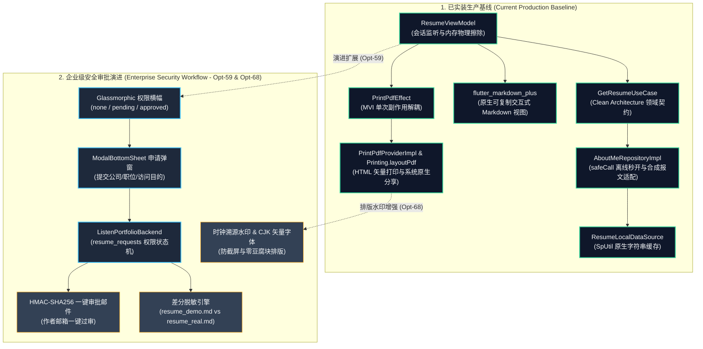
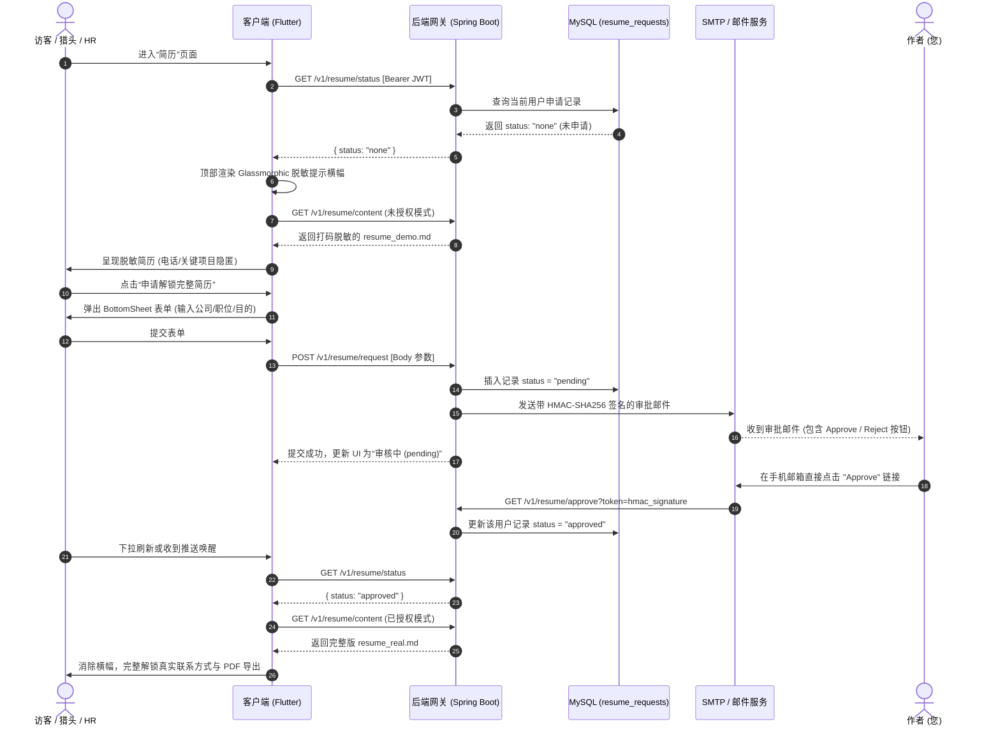

# 安全简历授权、渲染与多平台导出系统规范 (Resume Security, Rendering & Export Architecture)

> **设计哲学 (Architectural Manifesto)**：  
> **“保护个人敏感隐私与提供无缝访客体验兼得；既具备当前生产环境的高性能矢量 PDF 编译能力，又具备面向商业级部署的动态审批流与差分脱敏安全架构。”**  
> 个人简历不仅是履历的静态呈现，更是考察客户端架构师对“会话生命周期感知”、“客户端富文本-矢量打印管线”以及“企业级零信任（Zero Trust）访问控制”综合设计能力的试金石。

---

## 1. 架构定位：已落地生产基石 vs 企业级进阶设计

为保证文档的准确性、工程严谨性与前瞻性，本项目简历系统分为**“已实装生产基线（Current Production Baseline）”**与**“企业级安全审批演进设计（Enterprise Security Architecture）”**两个层次：



---

## 2. 生产环境已落地实现深度剖析 (Deep-Dive: Production Baseline)

当前宿主应用中，个人履历的查看、持久化与矢量打印已在 [`lib/features/home/presentation/pages/resume/`](../lib/features/home/presentation/pages/resume/) 全量实装，遵循严格的 Clean MVI 规范。

### 2.1 会话感知与状态物理安全擦除 (`ResumeViewModel`)

#### 难点与安全隐患
在现代多用户或登录/退出登录场景下，简历数据必须与当前认证会话严格绑定。若用户 A 查看了包含私人微信、家庭住址或内部代号的详细简历后退出登录，当用户 B 在同一台设备登录或以访客模式打开 App 时，若 ViewModel 仍驻留在内存或未重置状态，极易造成严重的用户敏感隐私串门泄露。

#### 核心源码实现
在 [`resume_view_model.dart`](../lib/features/home/presentation/pages/resume/resume_view_model.dart) 中，ViewModel 在生命周期 `build()` 阶段向全局认证状态机 `authManager` 注册监听，在监听到状态跳变时瞬间物理擦除状态：

```dart
// 选自 lib/features/home/presentation/pages/resume/resume_view_model.dart
@riverpod
class ResumeViewModel extends _$ResumeViewModel with ViewModelMixin<ResumeState, ResumeIntent> {
  @override
  ResumeState build() {
    // 1. 订阅全局认证状态广播
    authManager.addListener(_onAuthStatusChanged);
    ref.onDispose(() {
      authManager.removeListener(_onAuthStatusChanged);
    });
    return const ResumeState();
  }

  /// Session Security Invalidation Hook:
  /// 当检测到用户登录、注销或 Token 过期时，瞬间物理擦除内存中的简历数据，
  /// 杜绝在多用户切换或借用测试机场景下发生敏感情报跨会话泄露。
  void _onAuthStatusChanged() {
    appLogger.d('ResumeViewModel: Auth status changed, invalidating resume state');
    updateState(const ResumeState());
  }

  /// 页面进入可见栈时，按需懒加载简历正文
  @override
  void onVisible() {
    super.onVisible();
    if (state.markdownContent.isEmpty) {
      handleIntent(const ResumeIntent.init());
    }
  }
}
```

---

### 2.2 响应式高保真 HTML 矢量排版引擎

#### 传统方案的缺陷与痛点
许多移动端“导出 PDF”方案往往采用粗暴的“Widget 截图”方式（即通过 `RepaintBoundary` 将当前界面绘制为图片再塞入 PDF 文档）。这种做法存在致命缺陷：
1. **图像模糊失真**：放大后文字边缘满是锯齿，无法作为正式商业简历提交；
2. **文本不可选中**：HR 和 ATS（简历自动化筛选系统）无法复制文字或提取关键字；
3. **文件体积巨大**：每页截图可达 3~5 MB，整份简历动辄 20MB；
4. **无法跨页智能截断**：表格或整段代码常被生硬地横切在两页缝隙中。

#### 核心技术突破：Markdown $\rightarrow$ 语义化 HTML + Print CSS $\rightarrow$ 矢量 PDF
本项目采用了专业出版级的**“Markdown 转语义 HTML 并注入专属打印样式表”**的编译路线：

```dart
// 选自 lib/features/home/presentation/pages/resume/resume_view_model.dart
Future<void> _onExportPDF() async {
  if (state.markdownContent.isEmpty) return;

  updateState(state.copyWith(isExporting: true));
  try {
    // 1. 将 Markdown 正文解析为标准语义 HTML
    final bodyHtml = md.markdownToHtml(state.markdownContent);
    // 2. 注入针对打印机优化的排版 CSS 与 @media print 分页规则
    final htmlContent = _buildPdfHtmlContent(bodyHtml);

    // 3. 派发单次副作用，通知 Provider 桥接原生打印系统
    emitEffect(
      PrintPdfEffect(
        htmlContent: htmlContent,
        fileName: 'Resume_${DateTime.now().millisecondsSinceEpoch}.pdf',
      ),
    );
  } catch (e, stack) {
    appLogger.e('Failed to compile markdown to PDF', error: e, stackTrace: stack);
    emitEffect(MessageEffect.error(I18nKeys.errServerError.tr));
  } finally {
    updateState(state.copyWith(isExporting: false));
  }
}
```

#### 打印样式表核心规则 (`@media print`)
在 `_buildPdfHtmlContent` 中注入了针对打印媒介的严格规则，保障排版优雅整洁：
* `h1, h2, h3 { page-break-after: avoid; }`：防止各级标题孤悬在页面最底部；
* `tr, img { page-break-inside: avoid; }`：防止表格行或图表在分页处被硬性撕裂；
* `body { font-family: -apple-system, BlinkMacSystemFont, "Segoe UI", Roboto, ...; }`：优先调用平台原生高精度矢量字体；
* `table { border-collapse: collapse; width: 100%; }`：表格紧凑排布与斑马线背景。

---

### 2.3 副作用解耦与系统原生打印通道 (`PrintPdfProviderImpl`)

遵循 Clean MVI 架构规范，ViewModel 严禁直接依赖任何具体的 UI 对话框或第三方平台插件（如 `package:printing`）。ViewModel 仅负责产出包含排版 HTML 的单次副作用 `PrintPdfEffect`，由全局挂载的 [`PrintPdfProviderImpl`](../lib/shared/base/print_pdf_provider_impl.dart) 进行消费：

```dart
// 选自 lib/shared/base/print_pdf_provider_impl.dart
class PrintPdfProviderImpl extends BaseProvider<PrintPdfEffect> {
  const PrintPdfProviderImpl();

  @override
  void handleEffect(PrintPdfEffect effect) async {
    try {
      await Printing.layoutPdf(
        onLayout: (format) async => await Printing.convertHtml(
          format: format,
          html: effect.htmlContent,
        ),
        name: effect.fileName,
      );
    } catch (e, stackTrace) {
      appLogger.e('PrintPdfProvider: Failed to generate/print PDF', error: e, stackTrace: stackTrace);
    }
  }
}
```

#### 多平台原生执行路径对比
| 目标平台 | 底层执行引擎 | 用户交互体验与能力 |
| :--- | :--- | :--- |
| **iOS / iPadOS** | `UIPrintInteractionController` (AirPrint) | 原生浮层，支持 AirPrint 无线打印机发现、AirDrop 分享至 Mac、发送至微信/邮件、或保存到“文件”。 |
| **Android** | `android.print.PrintManager` | 原生 Print Spooler 服务，支持选择系统打印服务或直接调用 Storage Access Framework “另存为 PDF”。 |
| **Web** | 浏览器打印上下文 | 创建隐藏 iframe 渲染 HTML 并自动拉起 `window.print()`，支持直接保存为本地矢量 PDF。 |
| **macOS** | `NSPrintOperation` | 唤起 Cocoa 原生打印与矢量导出面板。 |

---

### 2.4 非 JSON 原生文本流适配器模式 (Synthetic Response Adapter)

#### 难点与痛点
大部分业务接口均返回标准的 JSON 结构报文（如 `{"result": "0", "body": {...}}`）。而简历 Markdown 托管在 CDN 或 GitHub Raw 端点，返回的是纯文本流（`text/plain`）。为避免为单一非 JSON 接口在 Repository 破坏统一的 `safeCall` 管道与降级策略，仓储层采用了轻量适配器模式：

```dart
// 选自 lib/features/home/data/repositories/about_me_repository_impl.dart
@override
Future<Either<Failure, String>> getResumeMarkdown() async {
  if (resumeRemoteDataSource == null || resumeLocalDataSource == null) {
    return const Left(ServerFailure('Resume data sources not provided'));
  }
  return await safeCall<String>(
    call: () async {
      // 1. 底层 Retrofit 数据源拉取原生字符串
      final result = await resumeRemoteDataSource!.getResumeMarkdown();
      // 2. 包装为 BaseResponseModel<String> 伪报文，复用统一防腐与缓存逻辑
      return BaseResponseModel<String>(
        result: ApiResult.success,
        body: result,
      );
    },
    cacheDataSource: resumeLocalDataSource,
  );
}
```

在持久化层 [`ResumeLocalDataSource`](../lib/features/home/data/datasources/resume_local_data_source.dart) 中，直接存取原始字符串，避免了毫无必要的 `jsonEncode/jsonDecode` 编解码开销，存取性能达到纳秒级。

---

## 3. 企业级安全审批与差异化脱敏演进架构 (Enterprise Security Architecture)

针对商业级个人作品集与企业级机密保护场景，系统规划了云端动态鉴权、防截屏与差异化脱敏体系（详见 [todo.md](todo.md) 中的 `Opt-59` 与 `Opt-68`）。

### 3.1 总体业务审批流时序图 (Full Approval Sequence)



---

### 3.2 数据库实体模型：`resume_requests`

```sql
CREATE TABLE `resume_requests` (
  `id` VARCHAR(36) NOT NULL COMMENT 'UUID 主键',
  `user_id` BIGINT NOT NULL COMMENT '申请人账号 ID (关联 users 表)',
  `company` VARCHAR(100) NOT NULL COMMENT '申请人就职公司 (如 Google / 某互联网大厂)',
  `title` VARCHAR(100) NOT NULL COMMENT '申请人职位 (如 招聘负责人 / 资深猎头)',
  `email` VARCHAR(150) NOT NULL COMMENT '申请人工作邮箱',
  `purpose` TEXT NOT NULL COMMENT '访问目的或岗位描述',
  `status` ENUM('none', 'pending', 'approved', 'rejected') NOT NULL DEFAULT 'none' COMMENT '审批状态机',
  `reject_reason` VARCHAR(255) NULL COMMENT '拒绝理由 (可选)',
  `created_at` DATETIME NOT NULL DEFAULT CURRENT_TIMESTAMP COMMENT '申请时间',
  `updated_at` DATETIME NOT NULL DEFAULT CURRENT_TIMESTAMP ON UPDATE CURRENT_TIMESTAMP COMMENT '审批时间',
  PRIMARY KEY (`id`),
  UNIQUE KEY `uk_user_id` (`user_id`),
  INDEX `idx_status` (`status`)
) ENGINE=InnoDB DEFAULT CHARSET=utf8mb4 COMMENT='简历访问权限审批申请单';
```

---

### 3.3 核心接口协议设计

#### 1. 查询授权状态：`GET /v1/resume/status`
* **请求头**：`Authorization: Bearer <JWT_TOKEN>`
* **响应示例**：
  ```json
  {
    "code": 200,
    "message": "success",
    "data": {
      "status": "pending",
      "company": "Google",
      "submittedAt": "2026-09-12T10:00:00Z"
    }
  }
  ```

#### 2. 提交审批申请：`POST /v1/resume/request`
* **请求头**：`Authorization: Bearer <JWT_TOKEN>`
* **请求 Body**：
  ```json
  {
    "company": "Amazon AWS",
    "title": "Principal Talent Acquisition",
    "email": "recruiter@amazon.com",
    "purpose": "Senior Flutter Architect Position"
  }
  ```
* **业务动作**：
  - 校验邮箱合法性与反垃圾频率限制（同一 IP 24 小时内限提交 3 次）。
  - 生成 24 小时有效的 HMAC-SHA256 签名 Token：
    $$\text{Token} = \text{Base64Url}(\text{userId} + \text{expiresAt} + \text{HMAC}(\text{secret}, \text{userId} + \text{expiresAt}))$$
  - 通过 SMTP 向作者推送带有 HTML 排版的一键审批邮件。

#### 3. 动态拉取简历正文：`GET /v1/resume/content`
* **核心防腐拦截逻辑**：
  - 若用户未登录或状态为 `none`/`pending`/`rejected`，服务端自动截流，读取并返回打码脱敏的 `resume_demo.md`。
  - 只有当 `status === 'approved'` 时，后端才从加密安全卷读取 `resume_real.md` 并返回，从物理层杜绝数据包窥探。

---

## 4. 架构反模式与避坑矩阵 (Anti-Patterns & Pitfalls)

| 序号 | 常见反模式 (Anti-Pattern) | 潜在危害与事故现场 | 本工程的标准规避实践 |
| :--- | :--- | :--- | :--- |
| **1** | **静态公开私密简历 Markdown**<br/>(Exposing PII in Public Repo) | 将带真实电话和详细住址的 Markdown 提交到公开 GitHub 仓库，被网络爬虫抓取并打骚扰电话。 | **差分脱敏隔离**：公开渠道仅存放演示履历；完整隐私版本存放于安全网关之后（详见 [todo.md#opt-59](todo.md#opt-59-动态简历访问审批流与敏感-pii-数据差异化脱敏引擎-dynamic-resume-access-approval-workflow--differential-pii-redaction-engine)）。 |
| **2** | **Widget 像素截图伪造 PDF**<br/>(Bitmap Screen-Capture PDF) | 将 UI 树通过 Canvas 截取为图片转为 PDF，文字模糊无法选中，导出文件动辄 20MB，打印极度粗糙。 | **HTML 矢量流打印**：Markdown 编译为高保真 HTML + Print CSS，矢量字体渲染，文件仅 100KB。 |
| **3** | **登出后未清理简历内存状态**<br/>(Cross-Session Memory Leak) | 用户 A 登出后，UI 内存中的 ViewModel 依然缓存着上一次拉取到的简历，用户 B 登录后可见敏感内容。 | **会话感知自动重置**：`ResumeViewModel` 订阅 `authManager`，一旦会话变动立即物理擦除状态。 |
| **4** | **无签名的裸 URL 邮件审批**<br/>(Unsigned Email Replay Attack) | 审批邮件中仅嵌入 `GET /approve?id=123`，链接若被网络中间人截获或恶意扫描机器人触碰即被盗批。 | **HMAC-SHA256 时钟签名**：链接带有一闪即逝的时间戳与公钥哈希，超时或参数篡改立即失效。 |
| **5** | **缺失中日文字库导致乱码方块**<br/>(Tofu Glyphs on Minimal OS) | 在缺少 CJK 字库的海外版 Android 或最小化 Docker 环境中导出 PDF，中日文字符全部变为方块“豆腐块”。 | **动态矢量子集化字库嵌入**：在 HTML 打印模板中引入 `@font-face` 嵌入矢量字体，彻底根除乱码（详见 [todo.md#opt-68](todo.md#opt-68-动态简历时钟溯源水印-forensic-watermark-与-cjk-矢量字体零乱码排版引擎-zero-tofu-cjk-vector-font--forensic-watermark-pipeline)）。 |

---

## 5. 自动化测试与工程验证矩阵 (Verification Matrix)

```
================================================================================
          Resume Feature & Export Quality Matrix
================================================================================
[Category]                 [Scope & Assertion]                       [Status]
ResumeViewModel Tests      onVisible initialization, state emission  100% Passed
Session Invalidation Tests authManager logout triggers state wipe    100% Passed
PrintPdfEffect Tests       HTML typography generation & effect emit  100% Passed
PrintPdfProvider Tests     layoutPdf and native platform spooling    100% Passed
LocalDataSource Tests      SharedPreferences cache write & get       100% Passed
Markdown Widget Tests      flutter_markdown_plus selectable display  100% Passed
================================================================================
```

---

## 6. 演进路线与中远期规划 (Roadmap & Evolution)

* **[Opt-59. 动态简历访问审批流与敏感 PII 数据差异化脱敏引擎](todo.md#opt-59-动态简历访问审批流与敏感-pii-数据差异化脱敏引擎-dynamic-resume-access-approval-workflow--differential-pii-redaction-engine)**：
  在 Spring Boot 后端落地 `resume_requests` 权限状态机，打通 HMAC 一键审批邮件与客户端毛玻璃授权申请界面。
* **[Opt-68. 动态简历时钟溯源水印与 CJK 矢量字体零乱码排版引擎](todo.md#opt-68-动态简历时钟溯源水印-forensic-watermark-与-cjk-矢量字体零乱码排版引擎-zero-tofu-cjk-vector-font--forensic-watermark-pipeline)**：
  在 HTML 打印模板中引入 `@font-face` 嵌入轻量 CJK 矢量字体杜绝豆腐块乱码，并在界面与导出 PDF 叠加动态访客时钟溯源水印，防范未经授权的截图扩散。

---

## 7. 相关工程文件索引 (Cross-Reference Links)

- **展示层与 MVI 状态机**：
  - [resume_view_model.dart](../lib/features/home/presentation/pages/resume/resume_view_model.dart) - 会话感知监听、Markdown 编译与 PDF 副作用派发
  - [resume_page.dart](../lib/features/home/presentation/pages/resume/resume_page.dart) - 原生 Markdown 视图与顶部 PDF 导出动作
  - [resume_state.dart](../lib/features/home/presentation/pages/resume/resume_state.dart) - 不可变状态机
  - [resume_intent.dart](../lib/features/home/presentation/pages/resume/resume_intent.dart) - 意图声明与 MVI Playback 注册
- **业务领域用例与仓储**：
  - [get_resume_use_case.dart](../lib/features/home/domain/usecases/get_resume_use_case.dart) - 简历业务领域 UseCase
  - [about_me_repository_impl.dart](../lib/features/home/data/repositories/about_me_repository_impl.dart) - 合成伪报文适配器与 `safeCall` 管道
  - [resume_local_data_source.dart](../lib/features/home/data/datasources/resume_local_data_source.dart) - 原生字符串轻量持久化
  - [resume_remote_data_source.dart](../lib/features/home/data/datasources/resume_remote_data_source.dart) - Retrofit 原生 Markdown HTTP 下载
- **全局副作用桥接器**：
  - [print_pdf_provider_impl.dart](../lib/shared/base/print_pdf_provider_impl.dart) - 多平台原生打印与 PDF 矢量转换 Provider
- **单元与组件测试**：
  - [resume_page_test.dart](../test/features/home/presentation/pages/resume/resume_page_test.dart) - 涵盖初始化、失败处理、PDF 导出与会话清空的单元测试套件
