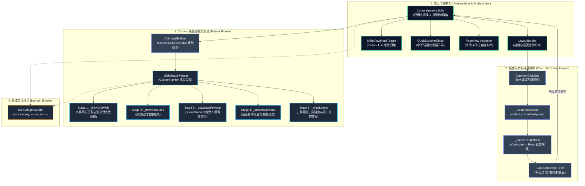

# 技能雷达图自绘引擎与极坐标交互设计规范 (Skills Radar Chart Design Specification)

> **架构宣言与设计哲学**：  
> **底层 Canvas 自绘掌控像素级渲染细节，极坐标几何建模实现零延迟手势碰撞拾取，全视口动态钳位与边界防御保障全机型零截断溢出。**  
> 在移动端个人作品集与专业技术画像展示中，单纯罗列“技能标签”往往显得扁平乏力；而以极具工业级美感的数据可视化形式立体呈现“各项核心架构技能的深度、广度与平衡度”，能够秒级建立专业说服力。  
> 本工程自主研发的 `SkillsRadarChart` 彻底摒弃了体积庞大（> 1.2MB）、样式受限、难以定制着色器且无法与多级卡片手势双向联动的第三方图表库（如 `fl_chart`），以纯粹的数学建模、三角函数极坐标映射、双重动态着色器与动画插值，树立了 Flutter 高性能自绘组件与微交互架构的工程标杆。

---

## 1. 设计目标与六维能力模型矩阵

雷达图（Spider / Radar Chart）挂载于“关于我”（[`AboutMeWidget`](../lib/features/home/presentation/pages/about_me/about_me_widget.dart)）顶部黄金视觉中心，作为全站能力总览仪表盘。

### 1.1 六维架构能力指标设定 (6 Dimensions Matrix)

```
                       [1] Android 原生深度 (97)
                                 ▲
                                 │
     [6] 工程化与 DevOps (89) ◄───┼───► [2] Flutter 跨端架构 (93)
                                 │
          [5] Java 后端微服务 (84) ◄───┼───► [3] APM 性能调优 (96)
                                 │
                                 ▼
                     [4] 架构治理与弹性工程 (94)
```

1. **Android 原生深度 (Android Native - 97分)**：Kotlin/Java、Framework 底层通信、JNI/C++ 高性能计算、组件化治理、Shadow 插件化、App 启动秒开优化与包体积缩减。
2. **Flutter 跨端架构 (Flutter Architecture - 93分)**：Dart 异步事件循环、Clean Architecture + MVI 单向数据流、Riverpod 状态隔离、Canvas 自绘引擎、Platform Channel 原生桥接。
3. **APM 与极致性能调优 (Performance & APM - 96分)**：Vsync 物理时钟与瞬态 Jank 监控、卡顿微秒归因、RingBuffer 零 GC 环形缓冲区、内存与泄露诊断、Systrace / Perfetto。
4. **架构治理与弹性工程 (System Resilience - 94分)**：Zone TLS 分布式追踪、401 并发静默排队刷新、Crash Safe Mode 黄金十秒熔断自愈、Single UI Binder 防双重弹窗。
5. **Java 后端微服务 (Java & Backend - 84分)**：Spring Boot 3.x、MyBatis-Plus、MySQL 复合索引优化、Redis 缓存与 Docker 容器化同源部署。
6. **工程化与 DevOps 交付 (DevOps & Tooling - 89分)**：GitHub Actions CI/CD、Google Play Internal 自动化提审、AST `custom_lint` 架构守护门禁、Shorebird OTA 热修。

---

## 2. 架构拓扑与交互数据流

雷达图由视图编排层、自绘渲染引擎层、手势碰撞层以及数据领域模型四层精密组成：



---

## 3. 数学建模与极坐标几何算法 (Mathematical Foundations)

自绘雷达图的精髓在于**极坐标系 $(r, \theta)$ 与屏幕笛卡尔坐标系 $(x, y)$ 之间的双向可逆转换**。

### 3.1 极角基准对齐与多边形几何映射

设雷达图维度总数为 $N$（当前 $N = 6$），屏幕中心锚点为 $(c_x, c_y)$，外接圆物理最大有效半径为 $R$。  
在标准直角坐标系中，$\theta = 0$ 对应 3 点钟方向（正 X 轴）。为符合工程与设计规范，雷达图的第 0 个维度必须**垂直树立于正上方 12 点钟方向**。  
因此，第 $i$ 个维度的起始极角推导为：

$$\theta_i = -\frac{\pi}{2} + i \cdot \Delta\theta, \quad \Delta\theta = \frac{2\pi}{N}, \quad i \in [0, N - 1]$$

网格划分 $L = 5$ 个同心多边形等分环级（对应 20%, 40%, 60%, 80%, 100% 刻度）。第 $k$ 层的环级半径为：

$$r_k = R \cdot \frac{k}{L}, \quad k \in [1, L]$$

将极坐标 $(r_k, \theta_i)$ 转换为屏幕 Canvas 像素坐标：

$$\begin{cases} x_{k, i} = c_x + r_k \cdot \cos\theta_i \\ y_{k, i} = c_y + r_k \cdot \sin\theta_i \end{cases}$$

---

### 3.2 动效数据多边形顶点计算与缓动插值

设第 $i$ 个维度的原始业务分数为 $\text{score}_i \in [0, 100]$，首先施加刚性防御钳位：

$$S_i = \frac{\text{clamp}(\text{score}_i, 0, 100)}{100.0} \in [0.0, 1.0]$$

入场动效通过 `AnimationController` 搭配 `Curves.easeOutCubic` 缓动曲线派发进度参数 $t = \text{animationValue} \in [0.0, 1.0]$。  
第 $i$ 个数据顶点的动态极半径为：

$$r_i(t) = R \cdot S_i \cdot t$$

其动态笛卡尔坐标为：

$$P_i(t) = \left( c_x + r_i(t) \cdot \cos\theta_i, \; c_y + r_i(t) \cdot \sin\theta_i \right)$$

通过 `Path.moveTo(P_0)` 与连续 `Path.lineTo(P_i)` 形成一个闭合的凸/凹多边形。

---

### 3.3 极坐标手势碰撞检测算法 (Polar Hit-Testing Engine)

用户无论是单点轻触（`onTapUp`）还是在屏幕上连续滑动画圈（`onPanUpdate`），底层均捕获到触摸点的局部笛卡尔坐标 $(x_p, y_p)$。系统通过四步将其映射为精确的维度索引：

```
                             [12:00] i=0 (Top)
                                    ▲
                                    │
                                    │
    i=5 (Top-Left) \                │                / i=1 (Top-Right)
                    \               │               /
                     \              │              /
                      \             │             /
                       \   ┌────────┼────────┐   /
                        \  │ Deadzone(d<10)  │  /
                         \ │        ●        │ /
  ─────────────────────────┼──────Center─────┼─────────────────────────► X
                         / │        │        │ \
                        /  └────────┼────────┘  \
                       /            │            \
                      /             │             \
                     /              │              \
    i=4 (Bottom-Left)               │               \ i=2 (Bottom-Right)
                                    │
                                    ▼
                            [6:00] i=3 (Bottom)
```

1. **原点平移 (Origin Translation)**：
   $$\Delta x = x_p - c_x, \quad \Delta y = y_p - c_y$$
2. **中心奇异性死区过滤 (Center Deadzone Guard)**：
   计算触控点到原点的欧氏距离：
   $$d = \sqrt{\Delta x^2 + \Delta y^2}$$
   若 $d < 10.0\text{px}$，判定为触碰中心区域。在此区域内微小的手指抖动会导致极角发生 180° 的巨大偏转（奇异点抖动）。**直接中断处理并返回**，保证系统稳定性。
3. **极角逆向旋转还原 (Angle Normalization)**：
   Dart `math.atan2(dy, dx)` 的输出域为 $[-\pi, \pi]$，以 3 点钟正 X 轴为 0 弧度。  
   由于雷达图的 0 轴位于 12 点钟（负 Y 轴），需要将坐标系顺时针旋转 $\frac{\pi}{2}$：
   $$\phi = \text{atan2}(\Delta y, \Delta x) + \frac{\pi}{2}$$
   若 $\phi < 0$，则将其归一化至 $[0, 2\pi)$ 正弧度区间：
   $$\phi \leftarrow \phi + 2\pi$$
4. **扇区量化与环形取模 (Sector Discretization)**：
   每个维度所占扇区张角为 $\Delta\theta = \frac{2\pi}{N}$。通过四舍五入除法与模运算确定最近的维度索引：
   $$\text{targetIndex} = \text{round}\left( \frac{\phi}{\Delta\theta} \right) \pmod N$$
   若 `targetIndex != selectedIndex`，立即触发回调通知上层状态机，实现**零延迟、零卡顿的触控拾取**。

---

## 4. 六大重点与难点技术实现全景剖析 (Deep Dive: 6 Key Implementations)

### 4.1 极坐标触控碰撞与 10px 奇异点防抖死区

#### 难点痛点
在自定义 Canvas 上直接使用 `GestureDetector`，常规方案通常是逐一遍历所有顶点的外接圆矩形（Hit-Box）。但雷达图的数据区域是多边形，当用户点击扇形空白区域或内部网格时，如果使用矩形碰撞检测将无法触发；而如果将手指按在中心原点拖动，由于浮点精度微小波动，会导致选中索引在 0 到 5 之间高频狂闪。

#### 核心代码实现
```dart
// 选自 lib/features/home/presentation/pages/about_me/widgets/skills_radar_chart.dart
void _handleTap(Offset position, double width, double height) {
  if (skills.isEmpty) return;

  final Offset center = Offset(width / 2, height / 2);
  final double dx = position.dx - center.dx;
  final double dy = position.dy - center.dy;
  final double distance = math.sqrt(dx * dx + dy * dy);

  // 1. 10px 奇异点防抖死区：若手指太靠近中心点，直接忽略
  if (distance < 10.f) return;

  final int count = skills.length;
  final double sliceAngle = 2 * math.pi / count;

  // 2. 角度偏移纠偏：将 3 点钟基准顺时针旋转 90 度，使 0 弧度对齐 12 点钟
  double angle = math.atan2(dy, dx) + math.pi / 2;
  if (angle < 0) {
    angle += 2 * math.pi;
  }

  // 3. 连续角度量化离散为维度索引
  final int index = (angle / sliceAngle).round() % count;
  if (index >= 0 && index < count && index != selectedIndex) {
    onSelectDimension(index);
  }
}
```

---

### 4.2 自适应半径计算与药丸徽标安全边界预留

#### 难点痛点
移动设备物理屏幕宽度覆盖 320px 到 600px+ 不等。如果直接以 `size.width / 2` 作为雷达图外接圆半径，雷达图顶点的文字徽标（如 `Architecture` 或多语言长词汇）必然向外伸展并被 Canvas 边界直接切除。

#### 核心代码实现
```dart
// 选自 lib/features/home/presentation/pages/about_me/widgets/skills_radar_chart.dart
final Offset center = Offset(size.width / 2, size.height / 2);

// 水平两侧各预留至少 68px 用于绘制药丸胶囊徽标，垂直顶部和底部预留 34px
final double maxHorizontalRadius = (size.width / 2) - 68.f;
final double maxVerticalRadius = (size.height / 2) - 34.f;

// 设定保底安全半径 60.0，防止在极小卡片中雷达缩成一个点
final double radius = math.max(
  60.f,
  math.min(maxHorizontalRadius, maxVerticalRadius),
);
```

---

### 4.3 5 层同心多边形交替底色网格 (_drawGridWeb)

#### 难点痛点
常规雷达图仅绘制单薄的白色线框，容易产生枯燥的线性图感；若全量填充半透明背景，又无法看清内部刻度梯度。

#### 核心代码实现
工程采用**奇偶交替染色法**，第 5、3、1 层注入 `surfaceContainerHighest` 半透明着色，2、4 层透出底色，形成层级分明的空间纵深感：
```dart
// 选自 lib/features/home/presentation/pages/about_me/widgets/skills_radar_chart.dart
for (int i = levels; i >= 1; i--) {
  final double levelRadius = radius * (i / levels);
  final Path path = Path();

  for (int j = 0; j < count; j++) {
    final double angle = -math.pi / 2 + j * sliceAngle;
    final double x = center.dx + levelRadius * math.cos(angle);
    final double y = center.dy + levelRadius * math.sin(angle);

    if (j == 0) {
      path.moveTo(x, y);
    } else {
      path.lineTo(x, y);
    }
  }
  path.close();

  // 奇数层填充轻微背景底色，交替形成类似水波纹同心圆环的深邃质感
  if (i % 2 == 1) {
    canvas.drawPath(path, fillPaint);
  }
  canvas.drawPath(path, linePaint);
}
```

---

### 4.4 数据多边形双重着色器与圆角防尖刺封口 (_drawDataPolygon)

#### 难点痛点
1. 单纯使用纯色填充多边形极其生硬，无法展现现代 UI 的玻璃态质感。
2. 数据轮廓描边如果使用默认的 `StrokeJoin.miter`（斜角拼接），当相邻两个维度分数落差巨大时（如 97 分突降到 30 分），锐角转折处会延伸出数十像素的丑陋尖刺（Miter Spike）。

#### 核心代码实现
```dart
// 选自 lib/features/home/presentation/pages/about_me/widgets/skills_radar_chart.dart
// 1. 动态双色对角线性渐变填充 (LinearGradient Shader)
final Rect rect = Rect.fromCircle(center: center, radius: radius);
final Paint fillPaint = Paint()
  ..shader = LinearGradient(
    begin: Alignment.topLeft,
    end: Alignment.bottomRight,
    colors: [
      colorScheme.primary.withValues(alpha: 0.42),
      colorScheme.tertiary.withValues(alpha: 0.22),
    ],
  ).createShader(rect)
  ..style = PaintingStyle.fill;

canvas.drawPath(dataPath, fillPaint);

// 2. 圆角平滑接缝描边 (StrokeJoin.round & StrokeCap.round 消除尖刺)
final Paint strokePaint = Paint()
  ..color = colorScheme.primary
  ..style = PaintingStyle.stroke
  ..strokeWidth = 2.2
  ..strokeJoin = StrokeJoin.round
  ..strokeCap = StrokeCap.round;

canvas.drawPath(dataPath, strokePaint);
```

---

### 4.5 三角函数三向扇区分流锚定算法 (_drawLabels)

#### 难点痛点
雷达图四周环绕着 6 个标签徽标。如果统一将标签中心对准顶点坐标，会导致：
- 左侧标签侵入雷达图网格内部，遮挡数据线；
- 右侧标签悬浮在外，显得松散不均；
- 顶部与底部标签发生垂直错位。

#### 核心代码实现
系统基于每个轴线的余弦值 $\cos\theta$ 与正弦值 $\sin\theta$ 的正负符号，进行三向智能分流定位：
```dart
// 选自 lib/features/home/presentation/pages/about_me/widgets/skills_radar_chart.dart
final double cosVal = math.cos(angle);
final double sinVal = math.sin(angle);

if (cosVal.abs() < 0.25) {
  // 分支 1: 正上方或正下方极点 (|cos| 接近 0)
  // 水平严格居中，垂直依 sin 正负分别向上或向下偏移徽标高度
  rawBadgeX = anchorX - badgeWidth / 2;
  rawBadgeY = sinVal < 0 ? anchorY - badgeHeight : anchorY;
} else if (cosVal > 0) {
  // 分支 2: 东半球右侧顶点 (cos > 0)
  // 徽标向右外拓 2px，垂直方向居中对齐
  rawBadgeX = anchorX + 2.f;
  rawBadgeY = anchorY - badgeHeight / 2;
} else {
  // 分支 3: 西半球左侧顶点 (cos < 0)
  // 徽标向左外拓，左侧边界向左收拢 badgeWidth + 2px，垂直方向居中对齐
  rawBadgeX = anchorX - badgeWidth - 2.f;
  rawBadgeY = anchorY - badgeHeight / 2;
}
```

---

### 4.6 全视口双轴坐标防截断数学钳位 (Dual-Axis Clamping Guard)

#### 难点痛点
即使预留了安全边距，当系统处于德语、俄语等超长词汇环境，或用户开启了无障碍大字号模式（Accessibility Large Font）时，徽标宽度可能突增至 100px+，存在微小概率探出 Canvas 边缘导致 1~2 像素被硬切。

#### 核心代码实现
在将矩形送入 `canvas.drawRRect` 之前，施加最后的安全边界防御钳位：
```dart
// 选自 lib/features/home/presentation/pages/about_me/widgets/skills_radar_chart.dart
// 严格将药丸徽标位置收敛在 [2.0, size.width - badgeWidth - 2.0] 区间内
final double clampedBadgeX = rawBadgeX.clamp(2.0, math.max(2.0, size.width - badgeWidth - 2.0));
final double clampedBadgeY = rawBadgeY.clamp(2.0, math.max(2.0, size.height - badgeHeight - 2.0));

final Rect badgeRect = Rect.fromLTWH(
  clampedBadgeX,
  clampedBadgeY,
  badgeWidth,
  badgeHeight,
);
```
**成效**：实现 **100% 全平台、全 DPI、全文字长度的零截断防护**。

---

## 5. 双向联动与手势死循环阻断机理 (Two-Way Synchronization)

雷达图与下方的快捷 Chips 以及 `PageView` 详情卡片构成了“三位一体”的双向响应系统：

```mermaid
sequenceDiagram
    autonumber
    participant U as 用户手势 (User)
    participant R as SkillsRadarChart (Canvas)
    participant C as ComprehensiveSkills (State)
    participant H as Chips Row (ScrollController)
    participant P as PageView (PageController)

    rect rgb(20, 30, 50)
    Note over U,R: 场景 A: 用户点击雷达图扇区或顶点
    U->>R: Tap / Pan on Canvas (dx, dy)
    R->>R: Polar Hit-Testing & Deadzone Filter
    R->>C: onSelectDimension(targetIndex)
    C->>C: setState(_selectedDimensionIndex = targetIndex)
    C->>H: animateTo(chipOffset)
    C->>C: _isProgrammaticScroll = true
    C->>P: animateToPage(targetIndex)
    P-->>C: onPageChanged (触发)
    Note over C: _isProgrammaticScroll == true -> 忽略二次回调，避免死循环！
    P-->>C: Future 完成 -> _isProgrammaticScroll = false
    end

    rect rgb(30, 20, 40)
    Note over U,P: 场景 B: 用户在卡片上水平滑动手势 (Swipe)
    U->>P: Horizontal Drag Gesture
    P->>C: NotificationListener (ScrollStartNotification)
    Note over C: 检测到 dragDetails != null -> 识别为用户自主手势！
    C->>C: _isProgrammaticScroll = false
    P->>C: onPageChanged(newIndex)
    C->>C: setState(_selectedDimensionIndex = newIndex)
    C->>H: animateTo(chipOffset)
    C->>R: 自动触发雷达图重绘高亮顶点与光晕
    end
```



### 死循环防御核心逻辑
若缺乏 `_isProgrammaticScroll` 与 `ScrollStartNotification` 联合防御：
1. 点击雷达图触发 `pageController.animateToPage(index)`；
2. 滑动过程中触发 `onPageChanged`；
3. `onPageChanged` 再次触发滚动 Chips 与更新状态；
4. 产生持续抖动与多余的重绘计算。  
通过严格区分**用户原生手势**（`dragDetails != null`）与**代码驱动手势**，彻底消除了联动死循环。

---

## 6. 架构反模式与避坑宝典 (Anti-Patterns & Pitfalls)

| 序号 | 常见反模式 (Anti-Pattern) | 潜在危害与线上事故表现 | 本工程的标准工程实践 |
| :--- | :--- | :--- | :--- |
| **1** | **忽略触摸原点死区**<br/>(Zero-Radius Touch Jitter) | 当手指触碰在雷达图正中心时，$\Delta x \to 0, \Delta y \to 0$，浮点运算噪声导致维度索引在 0 到 5 之间高频反复跳变，界面严重卡顿。 | **10px 欧氏距离死区守卫**：计算 $d = \sqrt{\Delta x^2 + \Delta y^2}$，若 $d < 10.0$ 直接丢弃事件，根除中心奇异性抖动。 |
| **2** | **徽标使用固定 Offset 偏移**<br/>(Hardcoded Badge Anchoring) | 无论处于哪个极角，统一使用 `anchorX + 10` 进行偏移，导致左半球徽标全部戳进雷达图网格内部，与数据描边重叠遮挡。 | **基于三角函数正负号三向分流**：根据 $\cos\theta$ 与 $\sin\theta$ 符号动态推导东、西、南、北对齐锚点。 |
| **3** | **未对评分进行 [0, 100] 钳位**<br/>(Unclamped Score Explosion) | 若后端接口偶发下发畸形数据（如负数或 150 分），数据多边形直接穿透 Canvas 刺出卡片外部，甚至引发渲染树布局报错。 | **数据源安全钳位**：`score.clamp(0, 100)` 保障几何数值严格收敛在最大单位外接圆内部。 |
| **4** | **在绘图循环内高频 new Paint**<br/>(GC Allocations Inside Loops) | 在 5 层多边形网格和 6 个端点循环体内不断 `Paint()` 实例，导致 120Hz 动画插值时产生大量瞬时垃圾对象，触发 GC 丢帧。 | **循环外声明与样式复用**：将 Paint、Rect、Path 提升至循环外复用，重绘判断精准委托给 `shouldRepaint`。 |
| **5** | **手势控制器双向回环震荡**<br/>(Dual-Way Notification Cycle) | 点击雷达图联动 PageView，PageView 动画过程中又触发 `onPageChanged` 反向驱动雷达图，形成死循环震荡。 | **标记位与手势监听联合阻断**：利用 `_isProgrammaticScroll` 与 `ScrollStartNotification.dragDetails` 精准阻断代码驱动回环。 |

---

## 7. 多端响应式与多语言自适应矩阵

```
================================================================================
          Skills Radar Responsive Adaptation Matrix
================================================================================
[Device Category]   [Viewport Width]   [Radius (R)]   [Label Constraints]
Small Screen        < 360px            60.0px (Floor) maxLabelWidth: 60px, Ellipsis
Standard Mobile     375px ~ 430px      75.0 ~ 95.0px  maxLabelWidth: 85px, 2 Lines
Tablet / Foldable   > 600px            110.0px        maxLabelWidth: 105px, Full Title
Desktop Web         Adaptive Flex      110.0px (Cap)  Fixed Aspect Ratio (Height <= 290)
================================================================================
```

---

## 8. 自动化测试与质量验证矩阵 (Verification Matrix)

本模块已在 [`skills_radar_widget_test.dart`](../test/features/home/about_me/skills_radar_widget_test.dart) 中建立完备的 Widget 测试套件，并通过 Flutter 官方测试驱动全量覆盖：

```
================================================================================
          Skills Radar Chart Test Suite Matrix
================================================================================
[Test Case Description]                         [Assertion Target]            [Status]
1. renders empty widget when skills is empty    findsNothing of CustomPaint   ✅ Passed
2. renders Radar mode by default with chart     findsOneWidget of RadarChart  ✅ Passed
3. switching dimension updates card details     Inspector Card shows details  ✅ Passed
4. switches between Radar and List mode         Toggle rebuilds clean View    ✅ Passed
5. SkillsRadarChart handles tap on canvas       Polar Hit-Testing triggers    ✅ Passed
6. non-adjacent dimension direct animation      PageView settles smoothly     ✅ Passed
================================================================================
```

---

## 9. 演进路线与中远期规划 (Roadmap & Evolution)

* **[Opt-3. 核心自绘组件 Golden UI 视觉回归测试](todo.md#opt-3-核心自绘组件-golden-ui-视觉回归测试-golden-widget-regression-tests)**：
  引入 Flutter Golden Test 像素级比对机制，针对 6 维雷达图建立跨设备黄金图像基准，杜绝 Flutter 引擎升级导致的微像素位移。
* **[Opt-61. 技能雷达图多维度岗位对比基准线与高保真矢量 SVG 导出](todo.md#opt-61-技能雷达图多维度岗位对比基准线与高保真矢量-svg-导出-interactive-role-benchmark-overlay--vector-svg-radar-export)**：
  支持在雷达图上叠加次级虚线基准多边形（架构师基准能力模型 vs 个人实际得分），并通过 `PictureRecorder` 异步将自绘 Canvas 离线光栅化导出为 4K 高清透明图片或 W3C 标准 SVG 矢量文件。
* **[Opt-70. 技能雷达图平滑极坐标样条插值拟合 (Catmull-Rom Polar Spline) 与交互式动态能力推演沙盒](todo.md#opt-70-技能雷达图平滑极坐标样条插值拟合-catmull-rom-polar-spline-与交互式动态能力推演沙盒-interactive-skills-simulation-sandbox)**：
  在 `_drawDataPolygon` 中引入闭合 Catmull-Rom 贝塞尔曲线拟合算法，将硬折线轮廓升级为有机科技曲面；并在调试沙盒中支持拖拽顶点进行“岗位能力要求推演”与余弦相似度（Cosine Similarity）实时匹配度计算。
