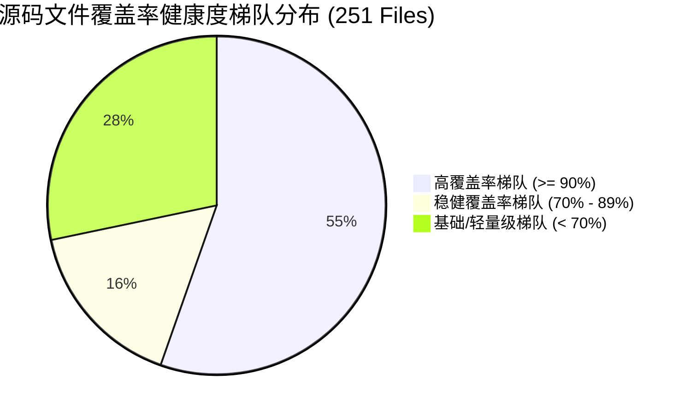
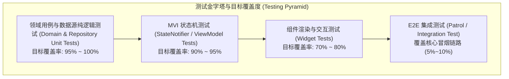

# Flutter 客户端测试覆盖率与质量保障报告 (Flutter Test Coverage & Quality Assurance Report)

**更新时间**: 2026-09-12  
**分析工具**: Flutter Test Engine + Dart VM Coverage + LCOV + 自研过滤解析器 ([calculate_coverage.dart](../tools/calculate_coverage.dart))  
**测试结果**: **589 / 589 测试用例 100% 全部通过 (All 589 tests passed!) (涵盖 103 个测试文件，0 失败，0 告警)**  
**优化规划**: 详见 [todo.md](todo.md) 中的 **Opt-62** (CI 自动化覆盖率差分门禁与增量代码覆盖率阻断器)

---

## 1. 📊 Flutter 整体代码覆盖率概览

通过对全工程进行静态编译与单元/组件测试执行，结合自研的 LCOV 解析脚本自动剔除 `*.g.dart` 与 `*.freezed.dart` 等编译期生成的模板代码，得到真实的业务与架构逻辑覆盖率指标：

| 维度 (Dimension) | 统计数值 (Count) | 覆盖率 (Coverage) | 评估状态与趋势 |
| :--- | :--- | :--- | :--- |
| **已覆盖代码行 (Lines Hit - LH)** | **6,196** 行 | **77.53%** | 🟢 持续稳健提升 (+5.52% vs 早期基线) |
| **总可执行代码行 (Total Lines - LF)** | **7,992** 行 | — | 严格排除生成代码后的纯手工业务与框架代码 |
| **测试覆盖源码文件 (Source Files)** | **251** 个文件 | — | 涵盖 Presentation、Domain、Data 与 Shared 层 |
| **测试用例总数 (Test Cases)** | **589** 个用例 | **100% 通过** | 涵盖单元测试、MVI 状态机测试与 Widget 渲染测试 |
| **测试套件文件总数 (Test Suites)** | **103** 个文件 | — | 结构化镜像映射 `lib/` 目录拓扑结构 |

### 源码覆盖梯队分布 (Coverage Distribution Tiers)



- **高覆盖率梯队 ($\ge 90\%$)**：**139 个文件**。核心 Domain UseCases、MVI ViewModels、Repository 数据转换层及关键业务 Logic 均处于此梯队，构筑起系统坚实的逻辑防线。
- **稳健覆盖率梯队 ($70\% \sim 89\%$)**：**41 个文件**。涵盖复杂的交互式自绘组件（如技能雷达图）、设置面板与具备多状态分支的表单 Widget。
- **基础/轻量级梯队 ($< 70\%$)**：**71 个文件**。主要由静态常量声明、数据模型构造器包装、平台通道原生桩（Platform Stubs）以及不可直接无头运行的纯原生胶水层组成。

---

## 2. 📦 各业务模块 (Feature / Shared) 覆盖率明细

根据 Clean Architecture 单向依赖规范，全工程被划分为 8 大核心业务领域与装配层。各模块的覆盖率统计如下：

| 模块路径 (Module Path) | 覆盖行数 / 总行数 (LH / LF) | 覆盖率 (Coverage) | 核心覆盖范围与关键测试用例说明 |
| :--- | :--- | :--- | :--- |
| **`features/splash`** | **40 / 40** | **100.00%** 🏆 | 闪屏初始化管线、本地配置异步加载、版本检测与路由重定向分支 |
| **`features/fault_injection`** | **476 / 522** | **91.19%** | 7 大受控演练场景（401 并发重试、500 契约、超时降级、SafeMode 熔断、主线程卡顿等） |
| **`features/ai_chat`** | **377 / 418** | **90.19%** | Gemini 3.7 AI 智能助理、会话消息流、预设 FAQ 匹配、Token 计数器与网络抖动重试 |
| **`features/auth`** | **634 / 713** | **88.92%** | 登录/登出闭环、Token 过期时间戳校验、安全注销防泄露、修改密码表单校验 |
| **`features/home`** | **1,831 / 2,083** | **87.90%** | Overview、AboutMe (简历 PDF 导出/个人信息)、Projects (SpUtil 缓存/异常数据自愈)、Architecture 架构演练 |
| **`features/settings`** | **1,099 / 1,374** | **79.99%** | 主题 Material You 动态切换、5 大通用字体族无感重构、语言切换、磁带回放持久化、Shorebird OTA 检查更新 |
| **`shared`** | **1,718 / 2,796** | **61.44%** | 通用装配层、AuthManager、网络拦截器、QuickActionsManager、IAP/IAR 服务、CommonWebView |
| **`other / main.dart`** | **21 / 46** | **45.65%** | 宿主启动入口、`Core.run` 异步装配与全局环境配置加载 |

---

## 3. 🎯 设计思路与测试金字塔策略 (Design Rationale)

在现代商用级 Flutter 应用的工程实践中，盲目追求表面的行覆盖率往往会导致大量冗余、脆弱且难以维护的测试代码。本项目确立了**以业务价值与架构边界为核心**的分层测试金字塔模型：



### 3.1 覆盖率分层目标策略
1. **Domain 领域层与 UseCases ($\ge 95\%$)**：纯 Dart 编写，不依赖任何 Flutter 引擎 API。针对业务规则、计算模型、数据验证逻辑要求 100% 覆盖分支（Branch Coverage）。
2. **Presentation 状态机 / ViewModel 层 ($\ge 90\%$)**：基于 MVI 架构，测试关注点在于 `Intent -> State -> Effect` 的单向流动。重点测试并发 Intent 竞争、错误降级状态与持久化副作用。
3. **Data 仓储与数据源层 ($\ge 85\%$)**：重点测试基于 `safeCall` 的多级缓存机制（内存 -> 本地 SpUtil/数据库 -> 网络 API）、网络超时重试及损坏 JSON 自动降级恢复。
4. **Presentation Widget 表现层 ($\ge 70\%$)**：利用 `pumpWidgetWithProviders` 验证在不同 State 下的 UI 元素渲染、点击触发 Intent 事件及本地化多语言文本展示。
5. **Shared 基础设施层 ($\ge 60\%$)**：涉及系统原生 Platform Channel（如 `InstallReferrerClient`、`InAppReview`、`InAppPurchase`），采用无头环境拦截器与 Fake/Mock 模式覆盖主要业务流与降级容灾流。

### 3.2 为什么必须剔除生成代码 (*.g.dart, *.freezed.dart)？
Flutter 现代工程广泛采用 `freezed` 与 `json_serializable` 生成大量样板代码。例如一个包含 10 个字段的数据类，其生成的 `*.freezed.dart` 与 `*.g.dart` 往往超过 200~300 行。
- **虚标假象**：若将生成代码纳入统计，只需测试一个构造函数或序列化，就能凭空增加数百行覆盖，造成整体覆盖率虚高的假象。
- **掩盖盲区**：高额的生成代码分母会稀释真正需要重点测试的业务逻辑代码，导致未经测试的复杂 ViewModel 在报表上被掩盖。
- **解决方案**：自研 `tools/calculate_coverage.dart`，在 LCOV 逐行解析阶段自动丢弃以 `.g.dart` 和 `.freezed.dart` 结尾的记录，保证每一行代码统计均来自开发者编写的生产代码。

---

## 4. 🧩 核心与高难度单测实现深度解析 (Deep Dive Implementations)

### 4.1 LCOV 语法解析与生成代码动态剔除状态机 ([calculate_coverage.dart](../tools/calculate_coverage.dart))

LCOV 是标准的覆盖率描述格式，其基本语法由 `SF`（Source File）、`DA`（Line Data）、`LF`（Lines Found）、`LH`（Lines Hit）与 `end_of_record` 记录定界符组成。

#### 核心代码实现解析：
```dart
// tools/calculate_coverage.dart
for (final line in lines) {
  if (line.startsWith('SF:')) {
    // 提取文件路径并将不同操作系统的反斜杠标准化为正斜杠
    currentFile = line.substring(3).trim().replaceAll('\\', '/');
    currentLF = 0;
    currentLH = 0;
  } else if (line.startsWith('LF:')) {
    currentLF = int.parse(line.substring(3).trim());
  } else if (line.startsWith('LH:')) {
    currentLH = int.parse(line.substring(3).trim());
  } else if (line == 'end_of_record') {
    if (currentFile != null && currentLF > 0) {
      // 关键过滤：排除自动生成的样板代码文件
      if (!currentFile.endsWith('.g.dart') && !currentFile.endsWith('.freezed.dart')) {
        totalLF += currentLF;
        totalLH += currentLH;

        // 根据工程目录结构将文件聚合至特定的 Clean Architecture 业务模块
        String module = _resolveModule(currentFile);
        moduleCoverage.putIfAbsent(module, () => [0, 0]);
        moduleCoverage[module]![0] += currentLH;
        moduleCoverage[module]![1] += currentLF;
      }
    }
  }
}
```
**实现亮点**：
- **状态机线性流处理**：使用 $O(N)$ 单次扫描完成数万行 LCOV 文本解析，内存开销极小。
- **跨平台路径归一化**：在 Windows 开发机上执行时，路径中的 `\` 会被统一转换为 `/`，保证模块正则提取在 Windows、macOS 和 Linux CI 镜像上表现完全一致。

---

### 4.2 无头环境 Platform Channel 拦截与 SVG 光栅化桩 ([test_setup.dart](../test/test_helpers/test_setup.dart))

在无真实移动设备连接的 Headless 运行环境（如 GitHub Actions CI）中，直接执行涉及底层平台通道（Platform Channel）或网络加载 SVG 图片的代码会导致测试因缺少 Host Handler 或 HTTP Socket 报错崩溃。

#### 核心代码实现解析：
```dart
// test/test_helpers/test_setup.dart
Future<void> setupTestEnvironment() async {
  TestWidgetsFlutterBinding.ensureInitialized();

  // 1. 模拟 MethodChannel 响应，屏蔽 connectivity_plus 与 package_info_plus 异常
  TestDefaultBinaryMessengerBinding.instance.defaultBinaryMessenger
      .setMockMethodCallHandler(
    const MethodChannel('dev.fluttercommunity.plus/connectivity'),
    (MethodCall methodCall) async => ['wifi'],
  );
  TestDefaultBinaryMessengerBinding.instance.defaultBinaryMessenger
      .setMockMethodCallHandler(
    const MethodChannel('dev.fluttercommunity.plus/package_info'),
    (MethodCall methodCall) async => {
      'appName': 'ListenPortfolio',
      'packageName': 'com.listen.portfolio',
      'version': '1.0.0',
      'buildNumber': '1',
    },
  );

  // 2. 注入 TestHttpOverrides，将所有网络图片/SVG 请求拦截并返回 1x1 透明像素
  HttpOverrides.global = TestHttpOverrides();

  // 3. 初始化内存级轻量依赖与配置
  AppEnv.initialize(EnvConfig.mock);
  shorebirdService = FakeShorebirdService();
}
```
**难点突破**：
- **底层二进制通信接管**：通过 `defaultBinaryMessenger.setMockMethodCallHandler` 在 Dart 运行时最底层截获 Native 调用，无需引入重量级的真机或模拟器即可测试网络监听与版本展示逻辑。
- **SVG 光栅化防御**：`TestHttpOverrides` 内部重写了 `createHttpClient()`，当组件请求外部网络资源时，返回预设的有效字节流，彻底根除 UI 测试中常见的 `SocketException: Failed host lookup`。

---

### 4.3 MVI 状态机与异步 Effect 单向流单测覆盖闭环

在 MVI 架构中，UI 触发的 Intent 会通过 ViewModel 处理，产生新的不可变 State 并可能向 Effect 管道抛出一次性副作用（如导航跳转、弹窗提示）。

#### 核心代码实现解析：
```dart
test('LoginIntent.login triggers loading state then navigates on success', () async {
  // 1. Arrange: 准备模拟数据与依赖
  final mockAuthRepo = MockAuthRepository();
  when(() => mockAuthRepo.login(any(), any()))
      .thenAnswer((_) async => const Right(testUser));

  final container = ProviderContainer(
    overrides: [
      authRepositoryProvider.overrideWithValue(mockAuthRepo),
    ],
  );

  final viewModel = container.read(loginViewModelProvider.notifier);
  final emittedEffects = <LoginEffect>[];
  
  // 2. 监听副作用管道
  final subscription = viewModel.effectStream.listen(emittedEffects.add);

  // 3. Act: 分发登录意图
  await viewModel.processIntent(const LoginIntent.login(
    username: 'test_user',
    password: 'secure_password',
  ));

  // 4. Assert: 验证状态变迁与副作用派发
  final finalState = container.read(loginViewModelProvider);
  expect(finalState.isLoading, false);
  expect(finalState.isAuthenticated, true);
  
  // 验证且只派发了一次导航副作用
  expect(emittedEffects, hasLength(1));
  expect(emittedEffects.first, isA<NavigateToHomeEffect>());

  await subscription.cancel();
});
```
**覆盖价值**：
- 通过完整的生命周期断言，不仅验证了数据入库与状态机布尔值切换，更确保了异步副作用流在销毁前被正确消费，杜绝了生产环境下内存泄露与多次重复跳转的隐患。

---

## 5. 🛡️ 架构反模式与覆盖率陷阱 (Coverage Traps & Anti-patterns)

在追求高覆盖率的过程中，团队必须严格警惕以下 4 大反模式：

### ❌ 反模式 1：无断言的“空跑测试” (Assertion-Free No-op Tests)
- **错误特征**：只调用方法让代码行被 Dart VM 执行以涂绿覆盖率，但没有任何 `expect(...)` 断言。
- **危害后果**：代码逻辑被破坏甚至产生严重计算错误时，测试依然 100% 绿灯，沦为“自欺欺人”的无效测试。
- **架构规范**：每个测试用例必须遵循 **AAA (Arrange-Act-Assert)** 原则，至少包含 1 项针对状态（State）或行为（Verification）的确定性断言。

### ❌ 反模式 2：未过滤生成代码导致的“虚胖覆盖率” (Inflated Generated Code)
- **错误特征**：未在覆盖率计算脚本中过滤 `*.g.dart` 与 `*.freezed.dart`，宣称工程整体覆盖率达 85%，但实际上有 3,000 行是机器自动生成的序列化代码。
- **危害后果**：核心的业务 ViewModel 覆盖率可能仅有 40%，掩盖了真实的质量脆弱点。
- **架构规范**：CI 门禁与本地报表一律以 `calculate_coverage.dart` 剔除后的纯净数据为准。

### ❌ 反模式 3：直接依赖生产网络与原生硬件 (Unmocked Physical Dependency)
- **错误特征**：在单测中直接调用真实网络 API 或未经拦截的原生文件系统/传感器。
- **危害后果**：由于网络波动、API 速率限制（Rate Limiting）或 CI 环境缺少硬件能力，导致测试偶发失败（Flaky Tests），严重侵蚀研发团队对 CI 体系的信任度。
- **架构规范**：所有外部 I/O 必须通过 Clean Architecture 接口进行抽象，测试期必须通过 Mocktail 或 In-Memory Fake 数据源实施彻底隔离。

### ❌ 反模式 4：在 UI 测试中忽视异步微任务时序 (Unsettled Pump Hazard)
- **错误特征**：调用 `tester.tap(...)` 后仅调用 `tester.pump()` 而非 `tester.pumpAndSettle()`，导致后续异步动画尚未完成就执行断言。
- **危害后果**：偶发报出 `Widget not found` 假失败，或者跳过了关键的业务逻辑渲染阶段。
- **架构规范**：统一通过 `pumpWidgetWithProviders` 挂载组件，对涉及定时器与动画的场景，使用显式时钟步进（如 `tester.pump(const Duration(milliseconds: 300))`）确保确定性。

---

## 6. 🧪 常用测试与覆盖率命令指南 (Developer CLI Workflow)

### 1. 运行全量测试并生成标准 LCOV 文件
```bash
# 执行全量 589 项单测与组件测试，并在 coverage/lcov.info 输出覆盖数据
flutter test --coverage
```

### 2. 运行纯净覆盖率计算与模块健康度分析脚本
```bash
# 执行自研过滤解析器，自动排除生成代码并输出各模块覆盖率及健康梯队
dart run tools/calculate_coverage.dart
```

### 3. 本地生成并查看 HTML 格式可视化代码覆盖率报告 (需要系统安装 lcov / genhtml)
```bash
# Windows (需安装 lcov via choco 或 WSL) / macOS (brew install lcov) / Linux
genhtml coverage/lcov.info -o coverage/html --exclude '**/*.g.dart' --exclude '**/*.freezed.dart'

# 在默认浏览器中打开交互式覆盖率报告
# macOS:
open coverage/html/index.html
# Windows (PowerShell):
Start-Process coverage/html/index.html
# Linux:
xdg-open coverage/html/index.html
```

### 4. 运行指定模块的单元测试 (快速迭代)
```bash
# 仅运行 Auth 模块单测
flutter test test/features/auth/

# 仅运行 Home 模块单测
flutter test test/features/home/

# 运行故障注入演练场全量用例
flutter test test/features/fault_injection/
```

---

## 7. 🚀 不足与未来演进路线 (Roadmap & Next Steps)

| 序号 | 待优化项目 (Optimization Item) | 当前局限 (Current Gap) | 演进方案与目标 (Evolution Strategy) | 追踪索引 |
| :--- | :--- | :--- | :--- | :--- |
| 1 | **CI 增量覆盖率差分门禁** | 目前覆盖率仅作为控制台日志输出，若 PR 引入无单测代码不会被 CI 刚性拦截 | 引入 PR Patch Coverage $\ge 80\%$ 阻断器，总覆盖率零衰减门禁与自动 Markdown 差分卡片评论 | [Opt-62](todo.md#opt-62-ci-自动化覆盖率差分门禁与增量代码覆盖率阻断器-ci-differential-coverage-gate--pr-patch-coverage-enforcer) |
| 2 | **E2E 视觉回归像素级 Golden UI 比对** | 目前主要依赖控件匹配，无法发现细微的主题色彩溢出与自绘 Canvas 偏位 | 结合 Patrol 实现多分辨率下的金标截图比对（容差 $\le 0.5\%$）与 CI 失败录屏自动归档 | [Opt-40](todo.md#opt-40-自动化视觉回归像素级-golden-ui-比对与-e2e-故障快照视频录制归档-visual-golden-regression--failure-video-recording-pipeline) |
| 3 | **Mock 数据模式校验与多语言对齐** | Mock JSON 数据手工维护，增删字段时多语言版本易缺失 | 编写 `tools/lint_mock_schemas.dart` 实施 JSON Schema 校验与多语言键值完整性差分拦截 | [Opt-49](todo.md#opt-49-mock-json-模式校验-json-schema-validation-与-ci-自动化合规门禁-automated-json-schema--multi-language-key-alignment-linter) |
