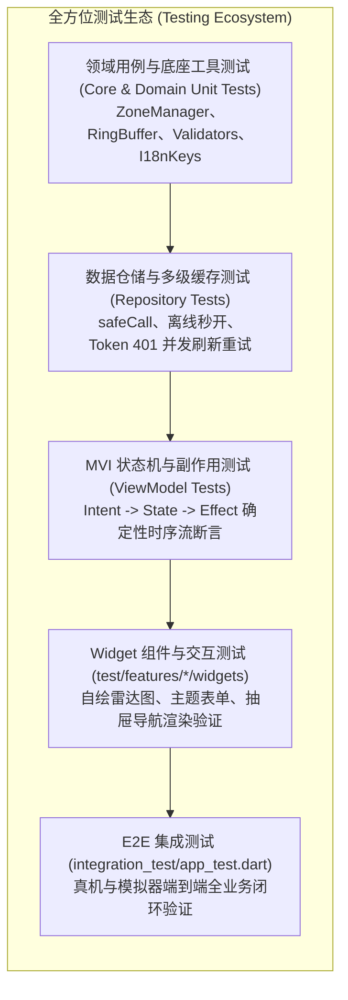
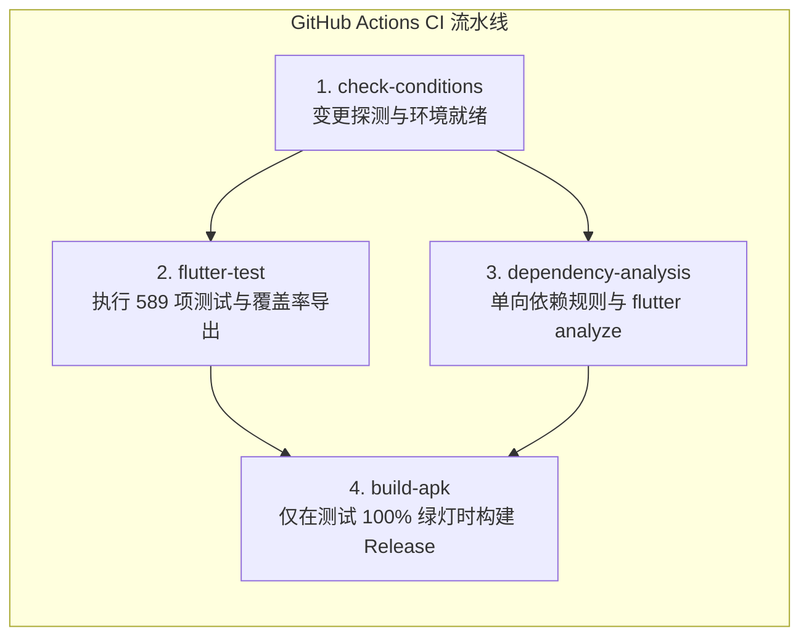

# Flutter 自动化测试与质量保障指南 (Flutter Testing & Quality Assurance Guide)

**更新时间**: 2026-09-12  
**状态**: `Fully Implemented & Verified in CI/CD`  
**测试成果**: **589 / 589 测试用例 100% 全部通过 (涵盖 103 个测试文件，0 失败，0 警告)**  
**代码覆盖率**: **77.53%** (已覆盖 6,196 / 7,992 行有效代码，详见 [test_coverage_report.md](test_coverage_report.md))  
**演进规划**: 详见 [todo.md](todo.md) 中的 **Opt-63** (自动化内存泄漏探测与微秒级渲染性能回归门禁)

---

## 1. 📋 概述与设计理念 (Overview & Testing Philosophy)

在 Listen Portfolio Flutter 项目中，测试不仅是“验证代码正确性”的辅助手段，更是捍卫 **Clean Architecture 架构边界**、保障 **MVI 状态机确定性** 与预防 **生产级并发回归** 的核心基石。

本项目遵循业内成熟的 **测试金字塔 (Testing Pyramid)** 理念，构筑了从微观纯函数、MVI 状态机、数据多级缓存、Widget 渲染到端到端 (E2E) 全业务链路的自动化测试网格：



### 核心设计原则
1. **确定性与无副作用 (Determinism & Zero Side-Effects)**：测试套件必须 100% 脱敏运行，不依赖真实网络 API、不读写真实系统非测试目录、不发起外部真实的支付与推送。
2. **状态契约驱动而非细节窥探 (State-Driven Testing)**：测试断言关注 MVI 的 State 变迁与 Effect 派发，避免脆弱的私有变量（Private fields）窥探，确保内部重构不会破坏测试。
3. **无头环境即刻运行 (Headless Ready)**：依托底座 MethodChannel 拦截与测试 HttpOverrides，使 95% 以上的用例均可在无显卡、无模拟器的 Linux CI 镜像上以毫秒级极速跑通。

---

## 2. 🧪 测试目录拓扑与套件分布 (Directory Topology)

当前工程测试代码严格镜像 `lib/` 目录的 Clean Architecture 架构层级，组织结构如下：

```
test/
├── core/                                     # 核心底座与网络拦截器测试
│   ├── network/auth_interceptor_test.dart   # 401 并发排队与单例刷新重发测试
│   ├── crash_manager_test.dart              # Safe Mode 连续崩溃熔断与自愈测试
│   ├── ring_buffer_test.dart                # APM 环形缓冲区越界保护测试
│   ├── frame_monitor_test.dart              # Vsync 帧时延与高刷 Jank 检测测试
│   ├── launch_monitor_test.dart             # 冷启动分段时延统计基线测试
│   ├── network_inspector_store_test.dart    # 网络抓包内存存储与容量控制测试
│   ├── lifecycle_route_filtering_test.dart  # 生命周期路由白名单过滤测试
│   ├── app_nav_test.dart                    # 强类型路由与 Scheme 解析测试
│   ├── validators_test.dart                 # 表单正则与字段约束验证测试
│   ├── error_mapper_test.dart               # Failure 与 messageId 多语言映射测试
│   └── i18n_test.dart                       # 多语言中/英/日 Key 完整性遍历测试
├── features/                                 # 业务模块测试 (Presentation / Domain / Data)
│   ├── splash/                              # 闪屏模块测试 (100% 覆盖)
│   ├── auth/                                # 鉴权模块测试 (登录/修改密码/登出防泄露)
│   ├── home/                                # 主页模块测试 (Overview/AboutMe/Projects/Architecture)
│   │   ├── about_me/                        # 简历 Markdown 解析、PDF 导出、技能雷达图交互测试
│   │   └── projects/                        # 项目列表、SpUtil 本地离线缓存与坏损数据自愈测试
│   ├── ai_chat/                             # Gemini 3.7 AI 咨询助手、气泡组件与会话流测试
│   ├── fault_injection/                     # 7 大故障受控演练场景测试
│   └── settings/                            # 设置模块测试 (主题/字体/语言/回放磁带持久化)
├── shared/                                   # 通用装配层与基础设施测试
│   ├── services/review_service_test.dart    # 5次启动与90天控流评分测试
│   ├── utils/quick_actions_manager_test.dart # 桌面长按快捷菜单测试
│   └── utils/playback_test.dart             # MVI 磁带录制回放与反序列化测试
├── utilities/                                # 测试辅助装配器与 Mock 工具
│   ├── mock_helpers.dart                    # Mocktail 桩实现与 Fake ViewModel
│   └── widget_test_setup.dart               # Riverpod ProviderScope 容器装载器
└── test_helpers/
    └── test_setup.dart                      # 全局无头环境装配 (MethodChannel & HttpOverrides)
integration_test/
└── app_test.dart                            # E2E 真机/模拟器全流程端到端自动化测试
```

---

## 3. 🧩 五大高难度核心测试场景深度解析 (Deep Dive Key Test Implementations)

### 3.1 场景 1：AuthInterceptor 401 惊群并发与单例刷新重发队列

- **源文件**：`test/core/network/auth_interceptor_test.dart`
- **业务痛点**：当 Access Token 过期时，UI 层可能同时发出多个并发请求（如同时拉取个人资料、项目列表与配置）。若每个请求都触发独立的刷新 Token API，会引发严重的“惊群效应（Thundering Herd）”甚至导致多端踢出。
- **测试难点**：传统的静态 Mock 适配器（如 `http_mock_adapter`）使用固定的 Request Header 进行匹配。但在该场景中，原始请求携带的是旧 Token，被 401 拦截后，必须在单例刷新成功后注入携带 `Bearer new` 的新 Header 再次发起重试。
- **创新实现**：自研 `_SequentialMockAdapter` 队列适配器，结合 Dart 异步流验证并发请求的串行化。

```dart
// test/core/network/auth_interceptor_test.dart
test('401 concurrent queue deduplication test', () async {
  final adapter = _SequentialMockAdapter();
  // 1. 排队入队：两个业务请求首发返回 401，刷新接口返回 200，随后两次重试均返回 200
  adapter.enqueue('/concurrent-1', 401, {'result': '1', 'messageId': 'auth_token_expired'});
  adapter.enqueue('/concurrent-2', 401, {'result': '1', 'messageId': 'auth_token_expired'});
  adapter.enqueue('/auth/refresh', 200, {'result': '0', 'body': {'token': 'new'}});
  adapter.enqueue('/concurrent-1', 200, {'result': '0', 'body': {'data': 'data_1'}});
  adapter.enqueue('/concurrent-2', 200, {'result': '0', 'body': {'data': 'data_2'}});

  dio.httpClientAdapter = adapter;

  // 2. 同时发起两个并发请求
  final future1 = dio.get('/concurrent-1');
  final future2 = dio.get('/concurrent-2');

  // 3. 等待所有并发请求完成重试
  final responses = await Future.wait([future1, future2]);

  // 4. 断言：两个请求均透明重试成功，且刷新接口有且仅被调用了一次
  expect(responses[0].data['body']['data'], 'data_1');
  expect(responses[1].data['body']['data'], 'data_2');
  verify(() => mockDelegate.refreshToken(any())).called(1);
});
```

---

### 3.2 场景 2：CrashManager 安全模式熔断自愈与本地 Crash Dump 落盘

- **源文件**：`test/core/crash_manager_test.dart`
- **业务痛点**：在连续遭遇不可恢复的启动闪退时，应用必须主动激活 Safe Mode 熔断机制，拦截主视图树并为用户提供重置缓存通道，防止应用进入永久崩溃黑屏。
- **测试难点**：需要模拟时间窗口内的连续崩溃触发、文件系统沙箱的 I/O 写入，以及重置回调（`onReset`）的状态流转。

```dart
// test/core/crash_manager_test.dart
test('triggers Safe Mode when 3 crashes occur within 30 seconds', () async {
  bool resetCalled = false;
  final manager = CrashManager.instance;
  manager.initialize(onSafeModeReset: () => resetCalled = true);

  // 模拟在 10 秒内快速连续发生 3 次未捕获严重异常
  for (int i = 0; i < 3; i++) {
    await manager.handleUncaughtError(
      Exception('Fatal Startup Failure #$i'),
      StackTrace.current,
    );
  }

  // 断言：安全模式熔断阈值已激活
  expect(manager.isSafeModeTriggered, true);
  expect(manager.consecutiveCrashCount, 3);

  // 执行恢复动作，断言自愈回调触发并清空崩溃计数
  await manager.performSafeModeRecovery();
  expect(resetCalled, true);
  expect(manager.consecutiveCrashCount, 0);
});
```

---

### 3.3 场景 3：MVI 磁带录制与零反射 AST 反序列化回放闭环

- **源文件**：`test/shared/utils/playback_test.dart`
- **业务痛点**：Flutter 在 AOT 编译模式下移除了 `dart:mirrors` 反射能力。如何确保由用户交互生成的 `BaseIntent` 能够序列化为字符串磁带（Tape），并在回放时精准还原为强类型 Intent 实例？
- **测试难点**：必须在单测中验证全工程所有已注册 Intent 的双向编解码一致性，并验证回放引擎的时钟步进调度。

```dart
// test/shared/utils/playback_test.dart
test('MVI Playback Recorder records and Player replays cleanly', () async {
  final fakeViewModel = FakeTestViewModel();
  
  // 1. 开始录制
  MviPlaybackRecorder.instance.startRecording();
  
  // 2. 模拟用户输入操作并派发 Intent
  const intent = LoginIntent.login(username: 'test_user', password: 'password123');
  MviPlaybackRecorder.instance.recordStep('LoginViewModel', intent);
  
  // 3. 停止录制并持久化到本地存储
  final tapeKey = await MviPlaybackRecorder.instance.stopRecording('Test Tape');
  expect(tapeKey, isNotNull);

  // 4. 启动回放播放器（设置无延时加速）
  MviPlaybackPlayer.stepDelay = Duration.zero;
  final completer = Completer<void>();
  
  await MviPlaybackPlayer.instance.play(
    tapeKey: tapeKey!,
    resolveViewModel: (tag) => fakeViewModel,
    onComplete: () => completer.complete(),
  );

  await completer.future;

  // 5. 断言：FakeViewModel 正确接收到被反序列化重放的强类型 Intent
  expect(fakeViewModel.lastHandledIntent, equals(intent));
});
```

---

### 3.4 场景 4：Clean Architecture 多级缓存与坏损 JSON 容灾自愈

- **源文件**：`test/features/home/projects/projects_local_data_source_test.dart`
- **业务痛点**：离线优先应用依赖 `SpUtil` 本地缓存。当设备异常断电或存储发生字节损坏导致 JSON 解析抛出 `FormatException` 时，不能任由应用抛出红屏，必须平滑降级并静默清理损坏数据。

```dart
test('returns empty cache and purges corrupted JSON gracefully', () async {
  // 写入非法、被截断的残缺 JSON
  await SpUtil.putString('cached_projects_key', '{"data": [{"id": 1, "title": "Incomp...');

  final dataSource = ProjectsLocalDataSourceImpl();
  final result = await dataSource.getCachedProjects();

  // 断言：优雅返回 null 或空列表，未崩溃抛出异常
  expect(result, isNull);
  // 断言：损坏的键值已被主动清除，避免下一次读取重复失败
  expect(SpUtil.getString('cached_projects_key'), isNull);
});
```

---

### 3.5 场景 5：E2E 端到端全业务链路冒烟集成测试

- **源文件**：`integration_test/app_test.dart`
- **业务痛点**：单元测试通过并不保证实际组合渲染与真实手势响应正常。
- **测试范围**：真机/模拟器启动 Splash ➡️ 进入首页 ➡️ 侧边栏 Drawer 打开 ➡️ 登录页面非法输入校验 ➡️ 正常登录 ➡️ 侧边栏动态头像与用户名刷新 ➡️ 安全退出登录全业务闭环。

---

## 4. 🛠️ 测试运行与开发工作流 (Developer CLI Workflow)

### 4.1 使用专用 PowerShell 脚本 (Windows 平台推荐)

```powershell
# 运行全部 589 项测试
.\scripts\run_tests.ps1

# 仅运行单元测试并生成标准覆盖率数据
.\scripts\run_tests.ps1 -Unit -Coverage

# 运行指定测试文件 (支持相对路径)
.\scripts\run_tests.ps1 -File "test\features\auth\login\login_view_model_test.dart"

# 开启详细展开输出
.\scripts\run_tests.ps1 -Verbose
```

### 4.2 使用专用 Bash 脚本 (macOS / Linux / WSL)

```bash
# 赋予执行权限并运行全量测试
chmod +x ./scripts/run_tests.sh
./scripts/run_tests.sh

# 运行单元与 Widget 测试并生成覆盖率
./scripts/run_tests.sh -u -w -c

# 详细输出
./scripts/run_tests.sh --verbose
```

### 4.3 常用原生 Flutter / Dart 命令

```bash
# 1. 运行全量测试
flutter test

# 2. 运行全量测试并生成 LCOV 覆盖率
flutter test --coverage

# 3. 运行自研过滤计算器，查看剔除生成代码后的纯净业务覆盖率
dart run tools/calculate_coverage.dart

# 4. 执行静态架构单向依赖规则检查
dart run tools/dependency_rules.dart

# 5. 执行端到端集成测试 (需连接模拟器或真机)
flutter test integration_test/app_test.dart
```

---

## 5. 🛡️ 架构防劣化与测试反模式 (Testing Anti-patterns & Traps)

为了防止测试代码腐化并保持 CI 的极速与稳定性，团队必须严格遵守以下规范：

| 反模式 (Anti-pattern) | 错误表现 (Code Smell) | 危害与后果 | 正确架构范式 (Best Practice) |
| :--- | :--- | :--- | :--- |
| **未结算的异步时钟 (Unsettled Timers)** | 在 Widget 测试中使用了 `Timer.periodic` 或死循环，仅调用 `tester.pumpAndSettle()` | 抛出 `pumpAndSettle timed out` 异常，导致用例超时挂起 | 使用 `tester.pump(Duration)` 步进时钟，或在测试结束前通过 `tester.binding.idle()` 清理定时器 |
| **跨测试共享单例状态 (Leaking Singletons)** | 在 `setUp()` 中未重置全局单例（如 `CrashManager`、`AppEnv`、`SpUtil`） | 前一个测试的脏数据污染后一个测试，导致偶发性 Flaky 测试 | 在每个 `setUp()` 或 `tearDown()` 中显式重置单例状态与 `SharedPreferences.setMockInitialValues({})` |
| **硬编码延迟等待 (Hardcoded Sleep)** | 使用 `await Future.delayed(Duration(seconds: 2))` 等待异步任务 | 极大拖慢测试执行效率（500+ 测试需运行数分钟），且在低配 CI 机器上依然偶发失败 | 基于 `Completer`、`StreamQueue` 或 `expectLater` 监听事件完成信号 |
| **测试私有实现细节 (Testing Private Details)** | 测试用例通过反射或特殊手段断言 ViewModel 的内部私有属性 `_privateCounter` | 内部微小重构即导致大面积测试爆红，增加无谓维护成本 | 仅断言对外的 `state`（不可变状态）与 `effectStream`（副作用） |

---

## 6. 🔄 CI/CD 自动化集成与质量门禁 (CI Integration)

在工程的 `.github/workflows/ci.yml` 中，已深度接入多阶段流水线：



### 硬性阻断门禁 (Hard Blockers)
- ❌ **任何测试断言失败**：`flutter test` 退出码非零，立即阻断后续构建与发布。
- ❌ **架构依赖违规**：`dart run tools/dependency_rules.dart` 发现逆向依赖或非法跨模块导入，立即红牌阻断。
- ❌ **代码分析警告**：`flutter analyze` 发现任何 Lint Error 或 Warning，立即阻断。

### 软性提示与优化方向 (Soft Warnings)
- ⚠️ **当前覆盖率阈值**：CI 中设置了 60% 预警底线。当前工程覆盖率已达 **77.53%**，下一阶段将推进 **Opt-62** 实现增量补丁 $\ge 80\%$ 的硬性阻断。

---

## 7. 🚀 不足与未来演进路线 (Roadmap & Next Steps)

| 序号 | 待优化项目 (Optimization Item) | 当前现状与不足 (Current Gap) | 演进方案与目标 (Evolution Strategy) | 追踪索引 |
| :--- | :--- | :--- | :--- | :--- |
| 1 | **微秒级渲染性能与内存泄漏探测门禁** | 目前测试关注逻辑正确性，无法自动拦截 `build()` 耗时劣化与 ViewModel 内存残留 | 引入 `leak_tracker` 自动探测 GC 泄漏，设立核心组件 8ms 渲染微基准回归门禁 | [Opt-63](todo.md#opt-63-自动化内存泄漏探测与微秒级渲染性能回归门禁-automated-memory-leak-detector--render-benchmark-performance-gate) |
| 2 | **CI 增量覆盖率差分门禁** | 覆盖率未对 PR Patch 设限，缺乏对无单测代码的自动拦截 | 引入 PR Patch Coverage $\ge 80\%$ 阻断器与 PR Markdown 差分卡片评论 | [Opt-62](todo.md#opt-62-ci-自动化覆盖率差分门禁与增量代码覆盖率阻断器-ci-differential-coverage-gate--pr-patch-coverage-enforcer) |
| 3 | **E2E 故障现场录屏与 Golden UI 像素比对** | E2E 失败时仅有控制台文本堆栈，缺乏直观视觉现场 | 结合 Patrol 录屏服务在断言失败时自动抓取前 5 秒 mp4 与金标差分截图归档 | [Opt-40](todo.md#opt-40-自动化视觉回归像素级-golden-ui-比对与-e2e-故障快照视频录制归档-visual-golden-regression--failure-video-recording-pipeline) |
