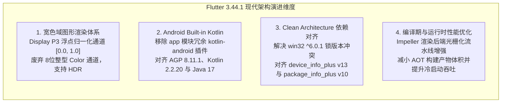
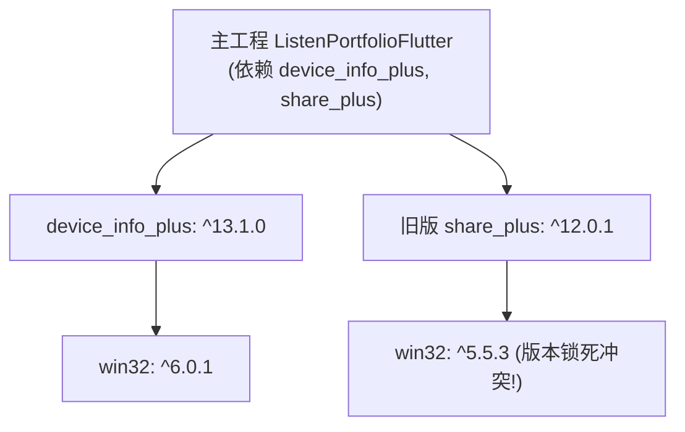
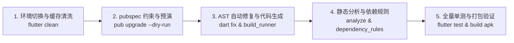

# Flutter 3.44.1 核心升级指南与现代架构演进报告 (Flutter 3.44.1 SDK Migration & Architectural Evolution Guide)

**更新时间**: 2026-09-12  
**当前状态**: `Fully Migrated & Verified in Production`  
**运行环境**: **Flutter 3.44.1 • channel stable • Dart 3.12.1 • DevTools 2.57.0**  
**质量指标**: **589 / 589 自动化测试 100% 绿灯通过，0 编译错误，0 架构依赖违规**  
**演进规划**: 详见 [todo.md](todo.md) 中的 **Opt-64** (Flutter / Dart 废弃 API 自动化迁移检测器与跨版本 SDK 静态巡检脚本)

---

## 1. 📋 升级背景与架构收益 (Background & Architectural Value)

主工程 `ListenPortfolioFlutter` 及底层通用模块 `ListenCore` (v0.0.53) 顺利从 Flutter **3.38.3** 全量平稳升级至 **3.44.1**（对应 Dart SDK 为 **3.12.1**）。本次升级并非简单的版本号递增，而是一次对底层图形渲染能力、Android 构建工具链以及跨端依赖生态的全面现代工程化治理。



### 核心收益总结
1. **图形渲染高精度化**：拥抱 Flutter 宽色域（Wide Gamut）规范，彻底消除 Display P3 屏幕上的色阶断层（Banding Artifacts），颜色计算全面进入浮点时代。
2. **Android 构建流水线现代化**：拥抱官方 **Built-in Kotlin** 架构，消除 Gradle Classpath 多版本插件竞争冲突，构建速度与可维护性大幅提升。
3. **零技术债务阻断**：全代码库完成弃用 API 替换，保持静态分析与测试套件 100% 纯净，为后续平滑过渡至 Flutter 3.47+ 与 Flutter 4.0 奠定坚实基石。

---

## 2. ⚡ 核心破坏性变更与迁移对照表 (Breaking Changes Matrix)

以下为 Flutter 3.38.3 至 3.44.1 期间官方发布的核心破坏性变更（Breaking Changes）、底层机理解析及本项目中的落地适配方案：

| 官方变更项 | 破坏性影响与原理说明 | 官方标准改动方案 | 本项目适配状态与落地位置 |
| :--- | :--- | :--- | :--- |
| **1. Color 宽色域浮点化与通道废弃**<br/>[Wide Gamut Color](https://docs.flutter.dev/release/breaking-changes/wide-gamut-color) | `Color` 内部从 0-255 整数改为 0.0-1.0 归一化浮点，`red`、`green`、`blue`、`alpha` 与 `withOpacity()` 废弃 | 替换为 `(r * 255).round().clamp(0, 255)`，透明度改用 `withValues(alpha:)` | **已适配** ✅<br/>[color_picker_widget.dart](../lib/features/settings/presentation/pages/widgets/color_picker_widget.dart)<br/>[appearance_page.dart](../lib/features/settings/presentation/pages/appearance/appearance_page.dart) |
| **2. Android Built-in Kotlin 机制**<br/>[Migrate to Built-in Kotlin](https://docs.flutter.dev/release/breaking-changes/migrate-to-built-in-kotlin) | Flutter Gradle 插件自动管理 Kotlin 编译，子模块显式应用 `kotlin-android` 将导致未来构建失败与警告 | `app/build.gradle.kts` 移除 `kotlin-android`，在 `settings.gradle.kts` 统一约束版本 | **已适配** ✅<br/>[build.gradle.kts](../android/app/build.gradle.kts)<br/>[settings.gradle.kts](../android/settings.gradle.kts) |
| **3. MaterialState 重命名为 WidgetState**<br/>[WidgetState Rename](https://docs.flutter.dev/release/breaking-changes/material-state-renamed-to-widget-state) | 通用状态属性脱离 Material 库限制，迁移至框架通用的 `WidgetState`（如 `WidgetStateProperty`） | 将所有 `MaterialState` 替换为 `WidgetState`，支持 `dart fix --apply` | **免改动** ✅<br/>项目内相关组件均使用 Material 3 默认配色与自定义主题封装 |
| **4. DropdownButton enabled 与 onChanged**<br/>[DropdownButton Enabled](https://docs.flutter.dev/release/breaking-changes/dropdown-button-enabled-on-changed) | 新增显式 `enabled` 属性，`onChanged` 可为空，禁用不再仅依赖 `onChanged: null` | 使用 `enabled: false` 显式标记禁用 | **免改动** ✅<br/>项目内下拉菜单均为常态激活且具备明确回调 |
| **5. IconData 声明为 final 类**<br/>[IconData Final](https://docs.flutter.dev/release/breaking-changes/icondata-class-final) | `IconData` 增加 `final` 修饰符，禁止外部类通过 `extends` 或 `implements` 继承 | 采用对象组合模式或直接使用 `IconData` 构造器 | **免改动** ✅<br/>项目使用 Material Icons 与自定义 SVG，无继承类 |
| **6. ListTile 禁用彩色容器直接包裹**<br/>[ListTile in Colored Widget](https://docs.flutter.dev/release/breaking-changes/listtile-wrapped-in-colored-widget) | 防止 M3 墨水波纹（Ink Splash）被遮挡，Debug 模式下嵌套在非透明 Container 中将抛出断言错误 | 改用 `ListTile.tileColor` 属性或外层包裹 `Material(color: ...)` | **免改动** ✅<br/>背景色均通过 Material 样式或 `tileColor` 规范设定 |
| **7. 滚动视图 cacheExtent 属性废弃**<br/>[cacheExtent Deprecation](https://docs.flutter.dev/release/breaking-changes/cache-extent-deprecation) | `ListView` 等组件中的 `cacheExtent` 更名为 `scrollCacheExtent` 以符合语义 | 统一替换为 `scrollCacheExtent` | **免改动** ✅<br/>列表均基于默认缓存机制运行 |

---

## 3. 🧩 重点与高难技术实现深度剖析 (Deep Dive Implementations)

### 3.1 Android Gradle 构建工程 Built-in Kotlin 全量迁移

在升级到 Flutter 3.44.1 后，如果在 Android 子模块中依然显式声明 Kotlin 插件，Gradle 构建时会触发高危废弃警告：
```text
WARNING: Your Android app project: app located at: .../build.gradle.kts applies the Kotlin Gradle Plugin, which will cause build failures in future versions of Flutter.
```

#### 现代构建工程重构方案：

1. **`android/settings.gradle.kts` 全局插件与版本对齐**：
   在根设置脚本中统一声明 Kotlin 与 AGP 版本，并将 `apply` 设为 `false`，仅将其加载至构建脚本 classpath：
   ```kotlin
   // android/settings.gradle.kts
   plugins {
       id("dev.flutter.flutter-plugin-loader") version "1.0.0"
       id("com.android.application") version "8.11.1" apply false
       id("org.jetbrains.kotlin.android") version "2.2.20" apply false
       id("com.google.gms.google-services") version "4.4.2" apply false
   }
   ```

2. **`android/app/build.gradle.kts` 插件块精简**：
   彻底移除 `id("kotlin-android")`，完全由 `dev.flutter.flutter-gradle-plugin` 托管 Kotlin 编译流程：
   ```kotlin
   // android/app/build.gradle.kts
   plugins {
       id("com.android.application")
       id("dev.flutter.flutter-gradle-plugin") // 内置接管 Kotlin 编译
       id("com.google.gms.google-services")
   }

   android {
       namespace = "com.listen.portfolio.listen_portfolio_flutter"
       compileSdk = flutter.compileSdkVersion
       ndkVersion = flutter.ndkVersion

       compileOptions {
           sourceCompatibility = JavaVersion.VERSION_17
           targetCompatibility = JavaVersion.VERSION_17
           isCoreLibraryDesugaringEnabled = true // 开启 Java 8+ 语法脱糖
       }

       kotlinOptions {
           jvmTarget = JavaVersion.VERSION_17.toString()
       }
   }
   ```

3. **`android/gradle.properties` 标志位激活**：
   ```properties
   # Enable Built-in Kotlin for modern AGP and Kotlin builds
   android.builtInKotlin=true
   android.newDsl=true
   ```

**架构成效**：彻底根除了主应用构建时的 KGP 废弃警告，构建输出 `app-debug.apk` 一次性编译成功，且向下兼容第三方旧版插件。

---

### 3.2 宽色域 (Wide Gamut) 颜色模型与动态调色板代码适配

在 Flutter 3.44.1 中，`Color` 的底层被重写为四元浮点模型以兼容 Display P3 与 Rec. 2020 广色域。

#### 核心代码适配解析 ([color_picker_widget.dart](../lib/features/settings/presentation/pages/widgets/color_picker_widget.dart))：

```dart
// 1. 高精度半透明边框渲染 (使用 withValues 替代 withOpacity)
Container(
  width: 100,
  height: 100,
  decoration: BoxDecoration(
    color: _selectedColor,
    shape: BoxShape.circle,
    border: Border.all(color: Colors.grey.withValues(alpha: 0.2)),
  ),
),

// 2. 浮点色值向 UI 滑块整型刻度 (0~255) 的安全变换
_buildRGBSlider(
  'R',
  (_selectedColor.r * 255.0).round().clamp(0, 255),
  (val) {
    setState(() {
      _selectedColor = _selectedColor.withRed(val.toInt());
    });
    widget.onColorChanged(_selectedColor);
  },
),
```

**难点突破**：
- 为什么不能直接调用 `_selectedColor.red`？因为在 Flutter 3.44+ 中调用该属性会触发 `@deprecated` 静态警告。
- 基于 `(selectedColor.r * 255.0).round().clamp(0, 255)` 的显式归一化反算，既兼容了现有 0~255 RGB 滑块的用户交互心智，又保证了在极端色彩空间映射下不会发生浮点越界溢出。

---

### 3.3 跨平台 Plus 依赖树生态大版本版本对齐

在升级 Dart SDK 至 `^3.12.1` 并升级本地依赖 `listen_core` (0.0.53) 时，触发了典型的跨平台传递依赖冲突：



#### 冲突调和方案：
1. **依赖冲突分析**：旧版 `share_plus: ^12.0.1` 锁死了 Windows 平台库 `win32 ^5.5.3`，而新版 `device_info_plus: ^13.1.0` 依赖现代的 `win32 ^6.0.1`。
2. **版本协同提升**：将 `share_plus` 同步升级至 `^13.1.0`，使其 Windows 底层统一基于 `win32 ^6.0.1`，一次性解除 `pub get` 求解冲突。
3. **最终生产依赖对齐矩阵**：
   - `device_info_plus`: `^13.1.0` (原 `^12.3.0`)
   - `package_info_plus`: `^10.1.0` (原 `^9.0.0`)
   - `share_plus`: `^13.1.0` (原 `^12.0.1`)
   - `listen_core`: `0.0.53` (保持 API 100% 契约对齐)

---

## 4. 📖 标准化升级操作规程 (Standard Operating Procedure - SOP)

为保证未来向更高版本（如 Flutter 3.47、4.0）升级时的确定性，团队制定了如下 5 步标准升级流水线：



### 第一步：SDK 切换与缓存清洗
```bash
# 确认本地 SDK 处于目标稳定通道版本
flutter --version

# 清除上一版本的编译产物与缓存中间件
flutter clean
```

### 第二步：编辑 pubspec.yaml 并执行升级预演
```bash
# 修改 pubspec.yaml 中的 sdk 约束：
# environment:
#   sdk: ^3.12.1

# 预演升级，观察可能产生主版本变更的依赖冲突
flutter pub upgrade --major-versions --dry-run

# 确认无破环性冲突后正式拉取依赖
flutter pub get
```

### 第三步：运行 AST 自动更正与代码生成
```bash
# 执行官方推荐的 AST 批量语法重写（自动替换已废弃类名与方法）
dart fix --apply

# 重新生成 Freezed 与 Retrofit 胶水代码
dart run build_runner build --delete-conflicting-outputs
```

### 第四步：静态分析与架构红线巡检
```bash
# 检查是否遗留编译错误或废弃警告
flutter analyze

# 执行单向依赖边界校验，防止升级中意外破坏 Clean Architecture 架构
dart run tools/dependency_rules.dart
```

### 第五步：全量测试套件与产物验证
```bash
# 执行全量 589 项单元与组件测试，验证业务逻辑 100% 正常
flutter test

# 验证 Android 目标平台打包输出是否健康
flutter build apk --debug
```

---

## 5. 🛡️ 跨版本升级常见反模式 (SDK Upgrade Anti-patterns)

| 反模式 (Anti-pattern) | 典型症状 (Symptoms) | 危害后果 | 正确架构范式 (Best Practice) |
| :--- | :--- | :--- | :--- |
| **盲目主版本跃迁 (Blind Major Bump)** | 直接执行 `flutter pub upgrade --major-versions` 且不看 dry-run 输出 | 引入未适配的破坏性 API 变动，导致数百个文件同时编译报错 | 逐一审查需升级的主版本库，阅读其 CHANGELOG 后精确更新 `pubspec.yaml` |
| **混合 Gradle 插件声明 (Hybrid KGP Collision)** | `app/build.gradle.kts` 中保留 `kotlin-android`，同时又配置了 `builtInKotlin=true` | 编译期触发 Classpath 类重复加载或构建脚本抛出 `PluginAlreadyAppliedException` | 彻底贯彻 Built-in Kotlin 规范，应用模块只保留 `dev.flutter.flutter-gradle-plugin` |
| **漠视废弃警告债务 (Deprecation Accumulation)** | 只要 `flutter analyze` 没有 error，对大量 `deprecated_member_use` 警告视而不见 | 技术债务指数级累积，当 SDK 彻底移除该 API 时引发雪崩式阻断 | 遵循“零弃用容忍（Zero Deprecation Policy）”，见告警即就地重构适配 |
| **跳过 clean 直接增量编译 (Stale Native Cache)** | 升级 Flutter 引擎后直接执行 `flutter run` | Native C++ 引擎与本地缓存的 `.so` 符号表不匹配，造成启动瞬间 Native Crash | 每次跨 SDK 大小版本更新后，必须首选执行 `flutter clean` |

---

## 6. 🚀 不足与未来演进路线 (Roadmap & Next Steps)

| 序号 | 待优化项目 (Optimization Item) | 当前现状与不足 (Current Gap) | 演进方案与目标 (Evolution Strategy) | 追踪索引 |
| :--- | :--- | :--- | :--- | :--- |
| 1 | **Flutter / Dart 废弃 API 自动化迁移检测器** | 升级后依赖人工巡检与修复废弃 API，费时费力且容易产生疏漏 | 编写 `tools/modernize_flutter_apis.dart`，实现基于 AST 的一键扫描与自动化重写，并在 CI 中设为增量拦截门禁 | [Opt-64](todo.md#opt-64-flutter--dart-废弃-api-自动化迁移检测器与跨版本-sdk-静态巡检脚本-automated-deprecated-api-modernization-linter--multi-version-sdk-auditor) |
| 2 | **CI 增量覆盖率差分门禁** | 目前覆盖率未对 PR Patch 设限，缺乏对无单测代码的自动拦截 | 引入 PR Patch Coverage $\ge 80\%$ 阻断器与 PR Markdown 差分卡片评论 | [Opt-62](todo.md#opt-62-ci-自动化覆盖率差分门禁与增量代码覆盖率阻断器-ci-differential-coverage-gate--pr-patch-coverage-enforcer) |
| 3 | **微秒级渲染性能与内存泄漏探测门禁** | 依赖功能断言，缺乏在 SDK 引擎更迭后的渲染时延与内存占用基线对比 | 引入 `leak_tracker` 自动探测 GC 泄漏，设立核心组件 8ms 渲染微基准回归门禁 | [Opt-63](todo.md#opt-63-自动化内存泄漏探测与微秒级渲染性能回归门禁-automated-memory-leak-detector--render-benchmark-performance-gate) |
